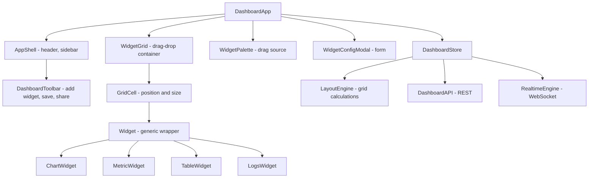

# Dashboard with Widgets

**Category:** Frontend System Design
**Difficulty:** 🟡 Medium
**Seniority:** Mid-level
**Companies:** Datadog, New Relic, Grafana, Tableau, Salesforce
**Tags:** modular, drag-drop, state, virtualization, real-time, responsive
**Time:** 45-60 min

---

## Problem Statement

Design a customizable dashboard with draggable widgets like Datadog, New Relic, or Grafana. Users can add, remove, resize, and rearrange widgets on a grid. Widgets display various data types (charts, metrics, logs, tables) and update in real-time. The dashboard layout persists per user.

Dashboards can have 20+ widgets with complex data visualizations. The interviewer cares about the grid layout system, drag-and-drop architecture, widget modularity, state management for layouts, and performance with many real-time updating widgets.

## Clarifying Questions

- What is the maximum number of widgets? *Up to 50 widgets per dashboard. Typical dashboards have 10-20.*
- What widget types? *Charts (line, bar, pie), metric cards (single values), logs, tables, and text widgets.*
- What grid system? *A responsive grid with fixed column count (e.g., 12 columns) and variable row heights.*
- Do widgets have different sizes? *Yes. Widgets can span multiple columns and rows (e.g., 2x2, 4x3).*
- Is real-time data required? *Yes. Some widgets update every few seconds (e.g., metrics).*
- Do we need dashboard templates? *Yes. Users can save dashboards as templates and share them.*
- Offline support? *Read-only offline with cached data. Mutations require a connection.*
- Mobile? *Yes, responsive design with a stacked layout on mobile.*

## Requirements

### Functional
- Display widgets on a responsive grid with drag-and-drop reordering.
- Add, remove, resize, and configure widgets.
- Persist dashboard layout per user.
- Support real-time data updates for widgets.
- Provide dashboard templates and sharing.

### Non-Functional
- Drag and resize at 60 fps with 20+ widgets.
- Dashboard renders in under 1 s for typical use cases.
- Real-time updates appear within 1-2 seconds.
- WCAG 2.1 AA accessible, including keyboard navigation.
- Responsive design for mobile and desktop.

### Out of Scope
- Advanced widget configuration (e.g., custom SQL queries), alerting rules, and user permissions.

## Component Architecture



- **WidgetGrid** is a drag-and-drop container that manages the grid layout. It handles widget positioning, collision detection, and auto-layout when widgets are moved or resized.
- **GridCell** represents a widget's position and size on the grid. It calculates the widget's CSS grid coordinates.
- **Widget** is a generic wrapper that handles common widget functionality (loading, error states, resize handles, menu).
- **Widget types** (ChartWidget, MetricWidget, etc.) are specific implementations that render their data visualizations.
- **WidgetPalette** is a sidebar with available widget types that can be dragged onto the grid.
- **LayoutEngine** calculates grid positions, handles collisions, and ensures widgets don't overlap.
- **DashboardStore** holds the dashboard layout, widget configurations, and data. It persists to the server and local storage.
- **RealtimeEngine** manages WebSocket connections for real-time widget data updates.

## Data Model & State

```text
DashboardState {
  dashboard: {
    id, title, description, ownerId,
    layout: Layout,
    widgets: Map<WidgetId, WidgetConfig>,
    isTemplate: Boolean,
    sharedWith: UserId[]
  }
  layout: {
    columns: 12,                              // grid column count
    rowHeight: 80,                            // pixels per row
    margin: [16, 16],                         // [x, y] gap between widgets
    widgets: Map<WidgetId, LayoutItem>
  }
  ui: {
    selectedWidgetId: WidgetId | null,
    dragging: WidgetId | null,
    resizing: WidgetId | null,
    paletteOpen: Boolean,
    configOpen: Boolean
  }
}

LayoutItem {
  x: Int,                                     // column position (0-11)
  y: Int,                                     // row position
  w: Int,                                     // width in columns
  h: Int,                                     // height in rows
  minW: Int, minH: Int,                       // minimum size
  maxW: Int, maxH: Int                        // maximum size
}

WidgetConfig {
  id, type, title,
  dataSource: { type, query, params },
  refreshInterval: Int,                       // seconds
  options: { ... }                            // widget-specific options
}
```

- **Layout.** The grid uses a 12-column system. Each widget has `x, y, w, h` coordinates. The `LayoutEngine` ensures widgets don't overlap and handles auto-layout.
- **Widget types.** Each widget type has a specific configuration schema. The `type` field determines which component to render.
- **Data sources.** Widgets fetch data from various sources (APIs, databases). The `dataSource` field specifies the query and parameters.
- **Persistence.** The dashboard layout and widget configurations are saved to the server and cached in local storage for instant load.

## API & Interfaces

```text
GET  /api/dashboards/{id}
     200 { dashboard, widgets, layout }

POST /api/dashboards
     { title, description, layout, widgets }
     201 Dashboard

PATCH /api/dashboards/{id}
     { layout?, widgets? }
     200 Dashboard

DELETE /api/dashboards/{id}
     204

GET  /api/widgets/{id}/data
     200 { data, timestamp }

WebSocket wss://dashboard.example.com/ws?dashboard={id}
server -> client
  { type: "widget.data", widgetId, data, timestamp }
client -> server
  { type: "subscribe", dashboardId }
```

- **Dashboard CRUD.** Create, read, update, and delete dashboards. The layout and widgets are part of the dashboard payload.
- **Widget data.** Each widget fetches its data from a specific endpoint. Real-time updates are pushed via WebSocket.
- **Templates.** Dashboards can be saved as templates. Templates are copied when users create a new dashboard.

## Rendering & Performance

**Rendering.** CSR with an app shell. The initial fetch loads the dashboard layout and widget configurations. Widget data is fetched after layout rendering.

**Grid layout system.**

```text
FUNCTION calculateLayout(layout, widgets)
  SET grid ← Array(rows).fill(Array(columns).fill(null))
  FOR EACH widgetId, item IN layout.widgets
    FOR row FROM item.y TO item.y + item.h - 1
      FOR col FROM item.x TO item.x + item.w - 1
        IF grid[row][col] != null
          THROW CollisionError
        grid[row][col] ← widgetId
  RETURN grid

FUNCTION findAvailablePosition(layout, w, h)
  FOR row FROM 0 TO maxRows
    FOR col FROM 0 TO columns - w
      IF canPlace(layout, col, row, w, h)
        RETURN { x: col, y: row }
  RETURN null

FUNCTION canPlace(layout, x, y, w, h)
  FOR row FROM y TO y + h - 1
    FOR col FROM x TO x + w - 1
      IF isOccupied(layout, col, row)
        RETURN false
  RETURN true
```

- **Collision detection.** The `LayoutEngine` checks for overlaps when moving or resizing widgets. If a collision is detected, it either blocks the move or shifts other widgets.
- **Auto-layout.** When a widget is added or removed, the `LayoutEngine` can reposition widgets to fill gaps (optional feature).

**Drag and drop.**
- Use pointer events for drag and drop. During drag, update the widget's visual position using CSS transforms without re-rendering.
- Show a ghost preview of the widget at the drop position. Highlight valid drop zones.
- On drop, calculate the new grid position and update the layout. Send a PATCH request to persist the change.

**Resize.**
- Add resize handles to widget corners. During resize, update the widget's dimensions using CSS transforms.
- Enforce minimum and maximum sizes. Prevent overlaps during resize.
- On release, update the layout and persist the change.

**Virtualization.**
- For dashboards with many widgets, virtualize the grid. Render only widgets visible in the viewport.
- Use intersection observers to lazy-load widget data when widgets come into view.

**Real-time updates.**

```text
FUNCTION handleWebSocketEvent(event)
  SWITCH event.type
    CASE "widget.data"
      SET widget ← widgets.get(event.widgetId)
      widget.data ← event.data
      widget.lastUpdate ← event.timestamp
      IF isViewing THEN refreshWidget(event.widgetId)
```

- Batch multiple events arriving in the same frame to avoid excessive re-renders.
- Use memoized widget components to re-render only changed widgets.
- Throttle real-time updates to avoid overwhelming the UI (e.g., max 1 update per second per widget).

**Performance optimizations.**
- Use CSS Grid for layout. It's performant and handles responsive design well.
- Debounce drag and resize events to reduce layout calculations.
- Cache widget data and refresh only when the refresh interval expires.
- Use Web Workers for heavy data processing (e.g., chart rendering).

## Accessibility & UX

- **Keyboard navigation.** Tab moves through widgets. Enter opens the widget menu. Arrow keys move the selected widget (if keyboard drag is enabled). Escape cancels drag/resize.
- **Screen readers.** Use `aria-label` on widgets with their title and type. Announce layout changes (e.g., "Widget moved to position 2, 3").
- **Focus management.** When opening the widget config modal, move focus to the first input. When closing, return focus to the widget.
- **Drag alternatives.** Provide a "Move to" menu in the widget menu for users who cannot drag.
- **Responsive design.** On mobile, stack widgets vertically. Disable drag and drop on small screens.
- **Loading states.** Show skeletons while widget data loads. Display error states with retry options.
- **Empty states.** Show a "Add your first widget" prompt for empty dashboards.
- **Visual feedback.** Highlight drop zones during drag. Show resize handles on hover.

## Edge Cases & Resilience

- **Widget collisions.** Prevent overlaps during drag and resize. If a collision is detected, block the move or shift other widgets.
- **Very large widgets.** Enforce maximum size limits (e.g., 12 columns x 10 rows) to prevent widgets from dominating the dashboard.
- **Real-time disconnect.** Use exponential backoff for reconnection. Buffer events during disconnect and apply on reconnect.
- **Concurrent edits.** If two users edit the same dashboard, use last-write-wins with versioning. Show a notification if the layout was modified by another user.
- **Widget data errors.** Display error states in widgets. Provide retry options. Fall back to cached data if available.
- **Slow widget data.** Show loading skeletons. Timeout after a reasonable duration (e.g., 10 s) and show an error.
- **Mobile drag.** Disable drag and drop on mobile or use a long-press to activate drag mode.
- **Offline.** Cache dashboard layout and widget data in local storage. Allow viewing cached data offline. Queue mutations and apply on reconnect.

## Trade-offs

| Decision | Option A | Option B | Choice & Why |
|---|---|---|---|
| Grid system | CSS Grid | Absolute positioning | CSS Grid. Native responsive support and better performance. |
| Drag implementation | Native HTML5 DnD | Pointer events | Pointer events. Better touch support and custom styling. |
| Real-time transport | Polling | WebSocket | WebSocket. Lower latency and better for frequent updates. |
| Virtualization | Always | Only for large dashboards | Only for large dashboards. Simpler for typical use cases. |
| Layout persistence | Save on every move | Debounced save | Debounced save. Reduces server load and network chatter. |

## Follow-up Questions

1. **How would you support dashboard templates?** Allow users to save a dashboard as a template. When creating a new dashboard from a template, copy the layout and widget configurations. Users can then customize the new dashboard.
2. **How do you handle widget data caching?** Cache widget data in memory with a TTL. Refresh data when the cache expires or the user manually refreshes. Use IndexedDB for offline caching.
3. **How would you add widget sharing?** Allow users to share individual widgets via embed codes. Render widgets in an iframe with a subset of the dashboard state.
4. **How do you support collaborative editing?** Use operational transformation or CRDTs for layout conflicts. Broadcast layout changes via WebSocket and apply them to all connected clients.
5. **How would you test drag-and-drop?** Unit-test the layout engine with scripted move/resize operations. Use E2E tests with Playwright to verify drag-and-drop behavior.

## Common Mistakes

- Using absolute positioning for the grid, making responsive design difficult.
- Not handling widget collisions, leading to overlapping widgets.
- Re-rendering the entire dashboard on every drag move instead of using transforms.
- Not debouncing layout saves, causing excessive server requests.
- Ignoring keyboard navigation and screen reader accessibility.
- Not caching widget data, causing redundant fetches.

## Key Takeaways

- Use CSS Grid for a responsive, performant layout system.
- Implement a layout engine to handle collisions and auto-layout.
- Use transforms for drag/resize performance and debounced saves for efficiency.
- Design for accessibility with keyboard navigation and proper ARIA semantics.
- Handle real-time updates with WebSocket and batch events to avoid excessive re-renders.
- Cache widget data and use virtualization for large dashboards.
