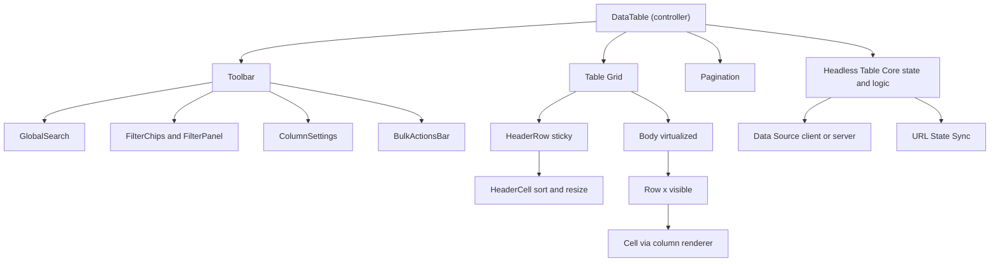

# Data Table

**Category:** Frontend System Design
**Difficulty:** 🟡 Medium
**Seniority:** mid
**Companies:** Google, Microsoft, Atlassian, Stripe, Datadog, Airtable, Salesforce
**Tags:** virtualization, server-side-pagination, sorting-filtering, url-state, grid-accessibility, component-api
**Time:** 45 min

---

## Problem Statement

Design a reusable data table component for an admin dashboard — think the Stripe payments list, Datadog logs view, or AG Grid / TanStack Table in a design system. It displays rows of records with sortable columns, filters, pagination, row selection with bulk actions, and column customization.

Datasets range from 50 rows (fully client-side) to millions of rows (server-driven). The table must stay responsive, keep its state shareable via URL, and be accessible to keyboard and screen-reader users.

## Clarifying Questions

- How many rows? *From tens to millions; > 10K always server-side.*
- Pagination style? *Page-based with page size selector; infinite scroll as an option for log-like views.*
- Which features? *Sort (single, multi optional), per-column filters, global search, row selection, column show/hide/resize.*
- Inline editing? *Out of scope for v1; discuss as follow-up.*
- Real-time updates? *Not required; manual refresh plus optional polling.*
- Mobile? *Must be usable; horizontal scroll with sticky first column is acceptable.*
- Shareable state? *Yes — filters/sort/page in the URL so links reproduce the view.*
- Export? *CSV export of current filter, done server-side for large sets.*

## Requirements

### Functional

- Render columns with custom cell renderers (text, number, date, status badge, actions).
- Sort by column (asc/desc/none), filter per column, global search.
- Pagination (page size 25/50/100) with total count.
- Row selection (single, multi, select-all-on-page, select-all-matching) and bulk actions.
- Column visibility, reorder, resize; persisted per user.
- Sticky header and first column.

### Non-Functional

- Interactions (sort, page change) respond < 100ms visually; server round-trip shown with non-blocking loading.
- Smooth scrolling for 1000+ rendered rows via virtualization.
- No layout shift during loading.
- WCAG 2.2 AA; correct table/grid semantics.
- Headless core reusable across React and Angular apps.

### Out of Scope

- Pivoting, grouping/aggregation, spreadsheet formulas.

## Component Architecture



- **Headless core** (like TanStack Table): pure logic for column defs, sort/filter state, selection, row models; framework-agnostic so React hooks and Angular services wrap it.
- **Data Source**: `ClientDataSource` sorts/filters in memory; `ServerDataSource` translates state into API queries. Same table UI for both.
- **HeaderCell**: sort toggle button, resize handle, column menu.
- **Body**: virtualized rows (TanStack Virtual / CDK virtual scroll) when page size or infinite mode yields many rows.
- **URL State Sync**: two-way binds sort/filter/page to query params.
- **BulkActionsBar**: appears when selection is non-empty; shows "12 selected — Select all 4,201 matching".

## Data Model & State

```text
column definition:
  { id, header, accessor: (row) => value, cell?: renderer, sortable, filterable,
    filterType: "text"|"select"|"dateRange"|"number", width, minWidth, pinned?: "left" }

table state (serializable, URL-synced):
  sorting: [{ columnId, direction: "asc"|"desc" }]
  filters: { [columnId]: value }
  globalSearch: string
  page: number
  pageSize: 25 | 50 | 100

user prefs (persisted server-side or localStorage):
  columnOrder: [columnId], columnVisibility: { [id]: bool }, columnWidths: { [id]: px }

selection state:
  mode: "explicit" | "allMatching"
  selectedIds: Set<rowId>          // explicit picks
  excludedIds: Set<rowId>          // when allMatching, rows unticked

server cache:
  key = hash(sorting, filters, globalSearch, page, pageSize)
  value = { rows, totalCount, fetchedAt }
```

- Separate **query state** (URL), **preferences** (persisted), **selection** (ephemeral), and **server data** (React Query / Angular `resource` / NgRx with cache keys).
- Rows indexed by stable `rowId` — never use array index as key (sorting would scramble selection/DOM reuse).
- Selection "all matching" is represented as a predicate (current filters) minus exclusions, not millions of ids.

## API & Interfaces

```text
GET /api/payments?sort=-createdAt,amount&status=succeeded&q=acme
                  &createdFrom=2024-01-01&page=3&pageSize=50
200 → { rows: [{ id, amount, currency, status, customer, createdAt }],
        totalCount: 4201, page: 3, pageSize: 50 }

// cursor variant for huge or log tables (no deep offsets):
GET /api/logs?filter=...&cursor=abc&limit=100 → { rows, nextCursor, prevCursor }

POST /api/payments/bulk
  body: { action: "refund", ids?: [...], filter?: {...}, excludeIds?: [...] }
  202 → { jobId }          // long-running; poll /api/jobs/{jobId}

POST /api/payments/export { filter, sort, columns } → 202 { jobId } → download URL
```

Component interface:

```text
<DataTable
  columns=[...]
  dataSource=serverSource("/api/payments")   // or rows=[...] for client mode
  getRowId=(row) => row.id
  selectionMode="multi"
  initialState={ sorting, pageSize }
  state? / onStateChange?                     // controlled mode
  onRowClick=(row) => ...
  bulkActions=[{ id: "refund", label: "Refund", confirm: true }]
  emptyState=node
/>
```

## Rendering & Performance

- **Server-side** sort/filter/paginate for large data; client-side for < ~5K rows already loaded (instant).
- **Keep previous data** while fetching the next page (`placeholderData: keepPreviousData` in React Query) with a subtle progress bar — no blanking, no CLS.
- **Debounce** text filters and global search (300ms); select/date filters apply immediately.
- **Cancel** in-flight requests when query state changes (AbortController / `switchMap`).
- **Prefetch** next page on idle or hover of the Next button.
- **Virtualization** for page sizes > 100 or infinite mode: fixed row height (e.g. 40px) makes it trivial; overscan ~10 rows. Header stays outside the scroll body or uses `position: sticky`.
- **Column virtualization** for 50+ columns (render visible columns only).
- **Memoization**: memoize column defs and cell renderers; rows re-render only when their data or selection changes.
- **Layout**: `table-layout: fixed` with explicit widths avoids expensive auto-layout; resize updates CSS variables rather than re-rendering every cell.
- **Client mode heavy ops**: sorting 50K rows can block the main thread — use a Web Worker or `startTransition`.

```text
FUNCTION onStateChange(newState)
  SET urlParams ← serialize(newState)          // replaceState for typing, pushState for page
  SET key ← hash(newState)
  IF cache.has(key) AND fresh(cache.get(key)) THEN render(cache.get(key)); RETURN
  SET loading ← true                            // keep rendering previous rows dimmed
  CALL abort previous request
  SET data ← await fetch(buildQuery(newState), signal)
  IF key = hash(currentState) THEN render(data); SET loading ← false
  IF newState.filters changed THEN clear explicit selection
```

## Accessibility & UX

- Use native `<table>`, `<thead>`, `<th scope="col">` for read-only tables — best screen-reader support. Upgrade to `role="grid"` only for interactive cell navigation (inline editing) with roving `tabindex` and arrow-key movement.
- Sortable headers: a `<button>` inside `<th>`; `aria-sort="ascending|descending|none"` on the `<th>`; announce "Sorted by amount, descending" via a polite live region.
- Row checkboxes: `aria-label="Select row Acme Corp"`; header checkbox supports `indeterminate` state (`aria-checked="mixed"`).
- With virtualization, set `aria-rowcount` (total) and `aria-rowindex` per row so AT knows position.
- Resize handles operable via keyboard (focus + arrow keys) and labeled.
- Caption or `aria-label` describes the table ("Payments, 4,201 results").
- States: skeleton rows matching row height on first load, dimmed rows + progress bar on refetch, empty state ("No payments match these filters" + Clear filters), error state with retry.
- Mobile: horizontal scroll container with sticky first column, or a card layout below a breakpoint; ensure touch targets ≥ 24px.
- i18n: numbers/currency/dates with `Intl` APIs; locale-aware string sort with `Intl.Collator`; RTL mirrors pinned column side via logical properties.

## Edge Cases & Resilience

- **Race conditions**: fast page clicks → abort + key check so page 3 data never renders under page 5 controls.
- **Page out of range** after filtering (page 40 of now 3 pages): clamp to last page.
- **Data changes between pages** with offset pagination (duplicates/skips): acceptable for admin views; use cursor pagination for append-heavy tables.
- **Select all matching + data changes**: server applies the action using the filter snapshot; confirm count before destructive action.
- **Bulk action partial failure**: job result reports per-row failures; table refreshes and highlights failures.
- **Invalid URL params**: validate and fall back to defaults (schema validation, e.g. zod).
- **Very wide content**: truncate with ellipsis + tooltip/title; never let one cell blow up row height in fixed-height virtualized mode.
- **Security**: render cell values as text; custom renderers must not use raw HTML; CSV export must escape formula-leading characters (`=`, `+`, `-`, `@`) to prevent CSV injection; authorize bulk actions server-side.

## Trade-offs

| Decision | Option A | Option B | Choice & Why |
|---|---|---|---|
| Processing location | Client-side sort/filter | Server-side | Server for large or paginated data; client when the full dataset is small and loaded |
| Pagination UI | Numbered pages | Infinite scroll | Pages for admin tasks (shareable, "go to page", footer reachable); infinite for logs/feeds |
| Semantics | Native `<table>` | ARIA `role="grid"` | Native table unless cell-level interaction is needed; grid requires full keyboard model |
| Architecture | Monolithic component | Headless core + UI layer | Headless — reusable across frameworks/designs, testable logic |
| State location | Internal state | URL query params | URL for query state (shareable, back button works); prefs in storage |
| Select all | Load all ids | Filter-based selection | Filter predicate + exclusions — scales to millions |

## Follow-up Questions

1. **How would you add inline editing?** Switch to `role="grid"` with roving focus; Enter edits a cell, Escape cancels; optimistic save per cell with validation and rollback.
2. **How would you support 1M rows client-side?** Don't; if forced, load columnar data in a Web Worker, sort/filter there, and virtualize both axes, sending only visible slices to the main thread.
3. **How do you keep column preferences across devices?** Persist to a user-settings API with debounce; localStorage as fast cache, reconciled with server on load.
4. **How do you add real-time updates?** Poll or subscribe for changed row ids; patch visible rows in place, and show "N new rows" instead of reshuffling the sorted view.
5. **How would you test it?** Unit test the headless core (sort/filter/selection), component tests with Testing Library by role, URL-sync tests, and performance tests with 10K rows.

## Common Mistakes

- Using array index as row key, breaking selection and DOM reuse after sorting.
- Clearing the table to a spinner on every page change, causing flicker and CLS.
- Not cancelling stale requests, rendering wrong page data.
- Storing selection of "all" as millions of ids.
- Using `div` soup without table semantics or `aria-sort`.
- Keeping filter state only in memory so refresh/back loses the user's view.

## Key Takeaways

- Separate headless table logic from rendering and from the data source.
- Treat sort/filter/page as serializable query state synced to the URL and used as the cache key.
- Keep previous data during fetches and cancel stale requests.
- Virtualize rows (and columns) only when needed; prefer native table semantics for accessibility.
