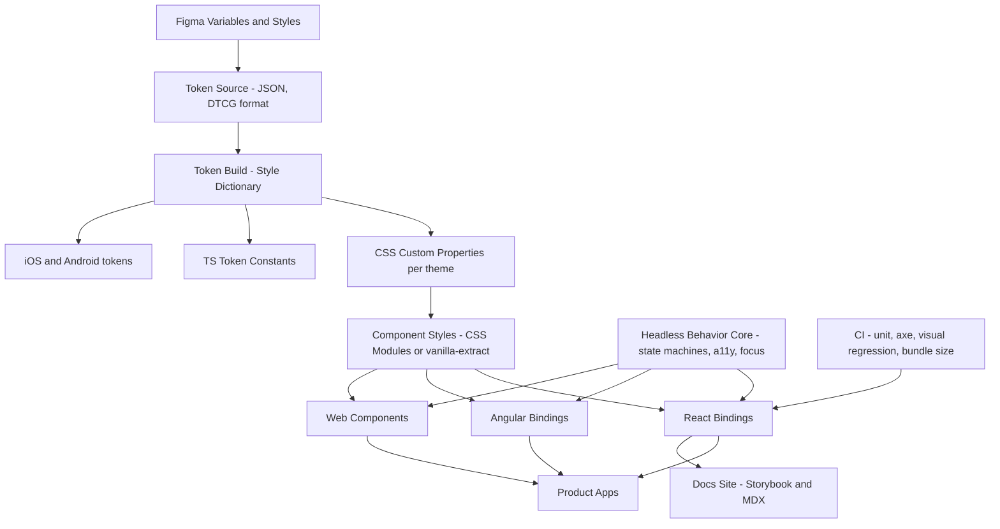

# Design System Component Library

**Category:** Frontend System Design
**Difficulty:** 🔴 Hard
**Seniority:** staff
**Companies:** Google, Airbnb, Shopify, Atlassian, Salesforce, Uber, Microsoft
**Tags:** design-tokens, theming, headless-components, api-design, versioning, accessibility, monorepo
**Time:** 60 min

---

## Problem Statement

Design a design system and component library that dozens of product teams will use across web apps, like Material, Shopify Polaris, Atlassian Design System or Salesforce Lightning. It includes design tokens (color, spacing, typography), theming (brands, dark mode, density), about 60 accessible components (Button, TextField, Select, Combobox, Modal, Tooltip, Table, DatePicker…), documentation, and a release process.

Teams use different frameworks (mostly React, some Angular, a few legacy server-rendered pages). The interviewer wants to see how you structure the layers (tokens, styles, behavior, framework bindings), how you design component APIs that scale, how you deliver accessibility once for everyone, and how you version, distribute, test and drive adoption without blocking teams.

## Clarifying Questions

- How many consumers and frameworks? *About 40 product teams, about 70% React, 20% Angular, 10% server-rendered or legacy jQuery pages.*
- How many brands and themes? *Three brands, plus light, dark and high-contrast modes, and comfortable or compact density.*
- Is SSR required? *Yes. Next.js and Angular Universal apps need no flash of unstyled content and no hydration mismatches.*
- Accessibility target? *WCAG 2.2 AA, and legal requirements in the EU (EAA) and US (ADA).*
- Do we own the design source? *Yes. Figma libraries must stay in sync with code through tokens.*
- How fast must teams adopt changes? *Teams upgrade on their own schedule. We support the N-1 major version for 12 months.*
- Bundle constraints? *Apps are performance-sensitive. Tree-shaking per component is required.*

## Requirements

### Functional
- Design tokens as a single source of truth, exported to CSS variables, JS/TS, iOS/Android, and Figma.
- Runtime theming: brand, color mode and density, scoped per subtree.
- Accessible components with keyboard, focus and ARIA behavior built in, plus composable primitives for custom needs.
- React and Angular bindings, plus Web Components for legacy pages.
- Documentation site with live examples, usage guidelines, an a11y notes and props table, and migration guides.

### Non-Functional
- Per-component tree-shakeable ESM. Button under 3 KB gzipped, plus a shared runtime under 10 KB.
- Zero-runtime or low-runtime CSS, SSR-safe, with no FOUC and no hydration mismatch.
- Semver discipline, automated codemods for breaking changes, and deprecation warnings one minor version ahead.
- Every component passes automated a11y checks (axe), keyboard tests and visual regression tests in all themes.

### Out of Scope
- Product-specific composite components (owned by teams), and the icon design process itself.

## Component Architecture



Layered architecture, where each layer is independently versioned in a monorepo (pnpm workspaces plus Turborepo or Nx, with Changesets for releases):

1. **Tokens.** Primitive tokens (`blue-600: #2563eb`) feed semantic tokens (`color.action.primary.bg → {blue-600}`), which feed component tokens (`button.primary.bg → {color.action.primary.bg}`). Products should only use semantic tokens. Themes remap semantic tokens to different primitives.
2. **Styles.** Component CSS that references CSS variables only, never raw values. It ships as static CSS (CSS Modules or vanilla-extract) with no runtime CSS-in-JS, which is SSR-safe, fast and works in every framework.
3. **Headless behavior core.** Framework-agnostic state machines and helpers for focus trap, roving tabindex, typeahead, dismiss-on-outside-click, positioning (Floating UI) and ARIA wiring. This is what React Aria, Zag.js and Radix primitives do. Accessibility is written once.
4. **Framework bindings.** Thin React components (hooks over the core) and Angular components and directives, which use signals and `ControlValueAccessor` so they work with Reactive Forms. Web Components (Lit) cover legacy pages.
5. **Docs and tooling.** Storybook as the workbench, a docs site, ESLint rules (no raw hex colors), codemods, and Figma Code Connect.

Components come in two tiers. **Primitives** (Box, Stack, Text, Pressable, Popover, Listbox) are composable. **Patterns** (Select, Combobox, DatePicker, Modal) are opinionated and assembled from the primitives. Teams use patterns by default and drop to primitives for custom needs, which reduces forks.

## Data Model & State

```text
Token (DTCG JSON)
{ "color": { "action": { "primary": { "bg": {
    "$type": "color", "$value": "{color.blue.600}",
    "$extensions": { "modes": { "dark": "{color.blue.400}", "hc": "{color.black}" } } } } } } }

Theme = { brand: acme | globex | initech, mode: light | dark | hc, density: comfortable | compact }
  -> resolved to CSS:  [data-brand="acme"][data-mode="dark"] { --color-action-primary-bg: #60a5fa; ... }

Component State (inside each component, headless core)
Select {
  isOpen: Boolean, highlightedKey: Key | null,
  selectedKeys: Set<Key>,                // controlled or uncontrolled
  inputValue (combobox), focusStrategy: first | last | selected,
  collection: List<Item | Section>       // built from children or items prop
}

Library Metadata (for docs and tooling)
ComponentManifest { name, status: alpha | beta | stable | deprecated,
                    props: [ { name, type, default, deprecated?, since } ],
                    a11yPattern: "WAI-ARIA Listbox", tokensUsed: [...], figmaNodeId }
```

- **Controlled vs uncontrolled.** Every stateful component supports both: `value` + `onChange`, or `defaultValue`. In React this is the `useControllableState` pattern. In Angular it maps to `ControlValueAccessor` plus `@Input`/`@Output` (or `model()` signals).
- **Theme state** lives in the DOM as `data-*` attributes on any container, read through CSS cascade. There is no JS theme context needed for styling, so nested themes work and SSR emits the right attributes. A JS context exists only for components that need token values in JS, such as charts.
- **No server cache.** The library is presentational. Data fetching belongs to apps. Async components (an async Combobox) accept `loadOptions` and loading state instead of fetching.

## API & Interfaces

Distribution contract:

```text
Packages (npm, ESM + types, "sideEffects": ["*.css"])
  @ds/tokens        -> tokens.css (all themes), tokens.ts, tokens.json
  @ds/core          -> headless machines (select, dialog, menu, tooltip...), no DOM framework
  @ds/react         -> import { Button } from "@ds/react/button"   // per-component entry points
  @ds/angular       -> DsButtonModule / standalone <ds-button>
  @ds/elements      -> <ds-button>, <ds-dialog> custom elements for legacy pages
  @ds/codemods      -> npx @ds/codemods v5-to-v6
  @ds/eslint-plugin -> rules: no-raw-colors, prefer-ds-components

CDN for legacy: https://cdn.ds.example.com/elements@6.2.0/ds.js (+ SRI hash)
```

Component API design principles, using Select as the example:

```text
Select (React)                          | ds-select (Angular)
  label: String (required for a11y)     |   [label]
  value / defaultValue / onChange       |   formControl / ngModel (ControlValueAccessor)
  items: Iterable<T> | children <Item>  |   <ds-option [value]>
  isDisabled, isInvalid, errorMessage   |   [disabled], [invalid], [errorMessage]
  size: "sm" | "md" | "lg"              |   [size]
  renderValue?(item)                    |   <ng-template dsSelectValue>
  slots: { trigger, popover, listbox }  |   content projection
  ...rest -> forwarded to root element  |   host attributes
  ref -> forwarded (focus())            |   @ViewChild exposes focus()
Events: onOpenChange(isOpen), onChange(key) | (openChange), (valueChange)
```

- Use variants as enums (`variant="primary" | "secondary" | "danger"`), not booleans (`primary`, `danger`), so impossible combinations cannot be expressed.
- Composition over configuration: provide slots, children, or the `asChild`/polymorphic `as` pattern instead of 40 props.
- Escape hatches are explicit and limited: `className`/`style` on the root, and `UNSAFE_` prefixes for deep overrides. Never expose internal DOM structure as API.
- Required a11y props are enforced in the types. For example, IconButton requires `aria-label`, and a dev-mode warning fires if `label` is missing.

## Rendering & Performance

- **Zero-runtime CSS.** Static CSS with CSS variables means no style injection during render, no SSR style extraction, and theme switching is a single attribute change with no re-render. Runtime CSS-in-JS (styled-components, Emotion) adds about 10–15 KB and serialization cost per render, and it clashes with React Server Components.
- **CSS delivery.** Per-component CSS files are imported by the component's entry, so bundlers include only what is used. An optional single `ds.css` is offered for simple setups. Use cascade layers (`@layer ds.reset, ds.components, ds.utilities`) so app overrides win predictably without specificity wars.
- **Tree-shaking.** ESM only, `"sideEffects"` declared, per-component `exports` map, and no barrel file that forces evaluating every module. Enforce size budgets in CI with size-limit: fail the PR if Button grows by more than 5%.
- **SSR safety.** No `window` or `document` access during render. Generate ids deterministically (React `useId`, Angular's id service with SSR-stable counters). Portals mount only after hydration. Positioning is computed on the client.
- **Heavy components.** Table and DatePicker live in separate packages or entry points. Locale data is loaded lazily, and the DatePicker uses `Intl` APIs instead of bundling Moment or date-fns locales.
- **Server Components.** Purely presentational components (Text, Stack, Badge) ship without `"use client"` so they render on the server with zero JS. Interactive ones are client components.
- **Icons.** Individual SVG components or an SVG sprite, never an icon font, which has bad a11y and is not tree-shakeable.

## Accessibility & UX

- **Patterns from the WAI-ARIA APG.** Dialog (focus trap, `aria-modal`, return focus, Esc), Menu (roving tabindex, typeahead), Combobox (`aria-activedescendant`, `aria-expanded`, `aria-controls`), Tabs, Listbox, Tooltip (on hover *and* focus, dismissable with Esc per WCAG 1.4.13), Switch and Slider.
- **Focus.** Visible `:focus-visible` rings come from tokens, with at least 3:1 contrast and 2 px width (WCAG 2.4.11/2.4.13). The focus-trap and restore logic lives in the core.
- **Contrast and tokens.** Validate contrast in CI for every semantic foreground/background pair in every theme. The high-contrast theme supports `forced-colors: active` with system colors.
- **Target size.** Interactive elements are at least 24 × 24 CSS px (WCAG 2.5.8), and 44 px touch targets in comfortable density.
- **Motion.** Motion tokens collapse to 0 ms under `prefers-reduced-motion`.
- **Interaction normalization.** Pointer, keyboard, touch and virtual-cursor (screen reader) clicks all go through a unified `usePress`/`dsPress` abstraction that handles the iOS, Android and Safari inconsistencies.
- **States everywhere.** Each component documents and implements loading (`aria-busy`), disabled (prefer `aria-disabled` so the element stays focusable and discoverable), invalid (`aria-invalid` plus `aria-describedby` linked to the error text), and empty states.
- **i18n/RTL.** Logical CSS properties only (`padding-inline-start`), so components mirror with `dir="rtl"`. Arrow-key direction flips for horizontal widgets. All built-in strings ("Close", "Next month") come from a localized message catalog that consumers can override.

## Edge Cases & Resilience

- **Multiple library versions on one page** (micro-frontends). Scope CSS variables and classes by major version (`--ds6-*`, `.ds6-button`) so v5 and v6 can coexist. For Web Components, register with a versioned tag (`ds6-button`) or guard `customElements.define`.
- **Breaking changes.** Deprecate first: a dev-only console warning plus a docs badge in minor N, removal in the next major. Ship jscodeshift or ts-morph codemods, and publish an adoption dashboard of versions in use, scanned from the monorepo or package lockfiles.
- **Theming conflicts.** Teams overriding internals break on upgrade. Offer supported customization through component tokens, and lint against targeting internal class names.
- **Portals and stacking.** Use a z-index token scale (`z.overlay`, `z.modal`, `z.toast`) and a single portal root. Nested modal and popover focus management uses a stack.
- **Hydration mismatch.** Avoid rendering differences between server and client (random ids, `Date.now()`, media queries in JS). Prefer CSS media queries for responsive behavior.
- **Forms integration.** Native form participation works: hidden `<input name>` for custom selects, and `ElementInternals` for Web Components, so `FormData` and native validation function.
- **Security.** Never use `dangerouslySetInnerHTML` or `innerHTML` in components. Rich content is passed as nodes. Link components add `rel="noopener noreferrer"` for `target="_blank"`. Publish packages with npm provenance and 2FA, and pin CI actions to guard the supply chain.

## Trade-offs

| Decision | Option A | Option B | Choice & Why |
|---|---|---|---|
| Multi-framework strategy | Web Components only | Headless core + thin native bindings (+ WC for legacy) | Core + bindings. Idiomatic APIs (forms, SSR, refs) per framework. WC alone has SSR, forms and React interop friction. |
| Styling | Runtime CSS-in-JS | Static CSS + CSS variables | Static CSS. Zero runtime, SSR/RSC safe, instant theme switching through attributes. |
| Component API | Many config props | Composition (slots, primitives) | Composition for complex widgets with sensible defaults. Fewer forks, smaller API surface. |
| Packaging | Single package | Per-component entry points in a few packages | Entry points. Tree-shaking and clear ownership without dependency hell. |
| Versioning | Independent per component | Lockstep library version | Lockstep majors. Simpler compatibility story for consumers. Changesets for granular changelogs. |

## Follow-up Questions

1. **How do you keep Figma and code in sync?** Tokens are the contract. Figma Variables export to DTCG JSON through a plugin into a PR, Style Dictionary builds them, and visual regression runs. Code Connect maps Figma components to code snippets.
2. **How do you measure adoption and success?** Static analysis across repositories (component usage counts, raw-color lint violations), the version distribution, a11y defect rates in products, and time-to-build surveys. Use these to prioritize the roadmap.
3. **A team needs a variant you don't support. What do you do?** Use a contribution model: they build it from primitives locally first. If two or more teams need it, it goes through an RFC and is promoted into the library with tests and docs. Avoid one-off props.
4. **How do you test the library?** Unit tests on core state machines, interaction tests (Testing Library or Storybook play functions), axe checks per story, visual regression (Chromatic or Playwright screenshots) across themes and RTL, bundle-size checks, and canary releases consumed by pilot apps.
5. **How would you roll out a token rename across 40 apps?** Alias the old token to the new one for one major version, emit lint warnings, ship a codemod, and track remaining usages on the adoption dashboard before removing it.

## Common Mistakes

- Building framework-specific components first and re-implementing behavior per framework, so accessibility drifts between them.
- Hardcoding hex values and pixel sizes in components instead of semantic tokens, which makes theming impossible.
- Boolean-prop explosions (`primary`, `large`, `outlined`) and leaking internal DOM structure as API.
- Runtime CSS-in-JS that breaks SSR or streaming and costs render time.
- Breaking changes without deprecation, codemods or migration guides, which leads teams to fork the library.
- Treating accessibility as docs guidance instead of behavior built into components and verified in CI.

## Key Takeaways

- Layer the system: tokens, static CSS on variables, a headless behavior core, then thin framework bindings.
- Get accessibility right once in the core by implementing the WAI-ARIA APG patterns, and enforce it with types, lint and CI.
- API design: semantic variants, controlled and uncontrolled support, composition with slots, and explicit escape hatches.
- Adoption depends on tree-shakeable packages, semver with codemods, coexisting versions, great docs and contribution paths.
