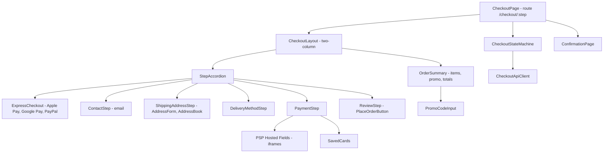

# E-commerce Checkout

**Category:** Frontend System Design
**Difficulty:** 🟡 Medium
**Seniority:** senior
**Companies:** Amazon, Shopify, Stripe, eBay, Walmart, Airbnb
**Tags:** form-validation, multi-step-flow, payments, idempotency, pci-compliance, conversion-optimization
**Time:** 45 min

---

## Problem Statement

Design the frontend for an e-commerce checkout: the flow from "Proceed to checkout" to the order confirmation page. It covers the cart review, shipping address, delivery options, payment, order review and placing the order. Guest checkout and signed-in users with saved addresses and cards must both work.

Every 100 ms of latency and every confusing error costs revenue, so the interviewer expects you to optimize for conversion, correctness and security. That means no double charges, totals that always match the server, PCI-compliant card handling, and clear recovery from declines and price or stock changes.

## Clarifying Questions

- Single-page or multi-step? *Multi-step on one route (an accordion or stepper), with each step addressable by URL.*
- Which payment methods? *Cards, Apple Pay/Google Pay through the Payment Request API, PayPal redirect, and saved cards.*
- Do we own card processing? *No. Use a PSP such as Stripe or Adyen with hosted fields so card data never touches our servers.*
- Do we need 3-D Secure (SCA)? *Yes. EU customers need 3DS2 challenges.*
- International? *Yes. Multi-currency, localized address formats, and taxes computed server-side.*
- What are the traffic peaks? *Black Friday reaches 50x normal. Inventory can run out mid-checkout.*
- Guest checkout? *Yes. An account is optional after the order.*

## Requirements

### Functional
- Steps: Cart review, then Shipping address, then Delivery method, then Payment, then Review & Place order, then Confirmation.
- Prefill for signed-in users (saved addresses and cards). Browser autofill for guests.
- Promo codes, a gift card, and live recalculation of tax, shipping and total from the server.
- Express checkout (Apple Pay/Google Pay/PayPal) that skips steps.
- Handle declines, 3DS challenges, out-of-stock items and price changes gracefully.

### Non-Functional
- No double orders or charges, even with double-clicks, retries or refreshes.
- The total shown always equals the amount charged. The server is authoritative.
- PCI DSS scope minimized (SAQ A): raw card data never touches our JS or servers.
- Fast: LCP < 2 s, and step transitions in under 100 ms. WCAG 2.1 AA accessible.

### Out of Scope
- Cart page browsing, order management after purchase, and fraud model internals.

## Component Architecture



- **CheckoutStateMachine** (XState-style, or a reducer with explicit states) is the single source of truth for which step is active, which steps are complete, and which transitions are allowed. Disallowed transitions, like placing an order before a valid address, simply cannot happen.
- **Step components** are self-contained forms. Each validates locally and then commits to the server (`PATCH /checkout`). The server response updates the totals.
- **OrderSummary** renders server-computed line items and totals only. It never computes tax or discounts itself. Updates are debounced and show a subtle loading state.
- **PSP Hosted Fields** are cross-origin iframes (Stripe Elements, Adyen, Braintree). Our page never sees the PAN. We get back a token or PaymentMethod id.
- **ExpressCheckout** uses the Payment Request API, or the PSP wrapper around it, to collect address and payment in one native sheet.
- **Framework notes.** React can use React Hook Form/Formik with schema validation (Zod/Yup). Angular can use Reactive Forms with `FormGroup` per step and custom validators. The state machine is framework-agnostic.

## Data Model & State

```text
CheckoutSession (server cache, keyed by checkoutId) {
  id, version: Int,                        // optimistic concurrency
  currency: "EUR",
  lineItems: [ { sku, title, qty, unitPrice, available: Boolean, priceChanged: Boolean } ],
  contact: { email },
  shippingAddress: Address | null,
  deliveryOptions: [ { id, label, price, eta } ], selectedDeliveryId,
  promoCodes: [ { code, discount } ],
  totals: { subtotal, discount, shipping, tax, total },   // minor units (cents), integers
  paymentIntent: { id, clientSecret, status } | null,
  status: open | processing | completed | expired
}

UI State {
  machine: { current: shipping | delivery | payment | review | placing | done,
             completed: Set<Step> }
  forms: Map<Step, { values, touched, errors, dirty }>
  placeOrder: { idempotencyKey: UUID, inFlight: Boolean, error: null | DeclineError }
  totalsPending: Boolean
}
```

- **Money.** Always integers in minor units with a currency code, formatted only at render time with `Intl.NumberFormat`. Never do floating-point math on prices.
- **Server-authoritative.** The client may predict a value, such as showing the shipping price of the selected option immediately, but the server response always wins.
- **Persistence.** `checkoutId` lives in the URL or a cookie, so a refresh restores the session from the server. Form drafts go in `sessionStorage`, excluding anything sensitive. Card data is never persisted, since it lives in the PSP iframe.
- **Versioning.** Every mutation sends `version`. A 409 means another tab changed the session, so refetch and reconcile.

## API & Interfaces

```text
POST  /api/checkout                       { cartId }
      201 CheckoutSession
GET   /api/checkout/{id}
      200 CheckoutSession
PATCH /api/checkout/{id}                  { version, shippingAddress? , selectedDeliveryId?, contact? }
      200 CheckoutSession                 // recomputed totals, delivery options
      409 { currentVersion }              // stale
      422 { fieldErrors: { postalCode: "INVALID_FOR_COUNTRY" } }
POST  /api/checkout/{id}/promo            { code }
      200 CheckoutSession | 422 { error: "EXPIRED" }
POST  /api/checkout/{id}/payment-intent   // creates PSP PaymentIntent server-side
      200 { clientSecret }
POST  /api/checkout/{id}/place-order
      Headers: Idempotency-Key: 7f3c...
      Body: { version, paymentMethodId, expectedTotal: 12999 }
      200 { orderId, status: "confirmed" }
      402 { code: "card_declined", declineCode }
      409 { code: "TOTAL_CHANGED", session }        // price/stock changed
      202 { status: "requires_action", clientSecret } // 3DS challenge
GET   /api/address/autocomplete?q=&country=           // proxied Places API
```

Component interfaces:

```text
AddressForm
  props:  country, initialValues, schema (from country format metadata), savedAddresses
  events: onSubmit(address), onCountryChange(country)

PlaceOrderButton
  props:  total, disabled, inFlight
  events: onPlaceOrder()
```

Sending `expectedTotal` lets the server reject the order if the price changed after the user last saw the total. The user is never charged an amount they did not see.

## Rendering & Performance

**Rendering.** SSR the shell, the order summary and the first step, because the page should be interactive almost immediately and a slow checkout hurts conversion. Hydrate the forms. Alternatively, use islands: SSR the static summary and hydrate only the interactive form steps.

**Critical path.**
- Load the PSP SDK with `<link rel="preconnect">` to the PSP origin, and load it early but async, since its hosted fields take 300–800 ms to initialize. Start loading it while the user fills in the address.
- Prefetch the next step's code chunk on idle (`requestIdleCallback`) or on focus of the current step.
- Keep third-party scripts (analytics, A/B tools, chat widgets) off the checkout page, or defer them. They hurt both INP and security.

**Totals recalculation.**

```text
FUNCTION onShippingChange(address)
  IF NOT validateLocally(address) THEN RETURN
  ABORT previousRequest
  SET totalsPending ← true                     // dim totals, disable Place Order
  SET res ← AWAIT PATCH /checkout { version, shippingAddress: address }
  IF res.status == 409 THEN session ← AWAIT GET /checkout; reconcile(); RETURN
  SET session ← res.body; SET totalsPending ← false
```

**Place order flow.**

```text
FUNCTION placeOrder()
  IF placeOrder.inFlight THEN RETURN                       // double-click guard
  SET placeOrder.inFlight ← true
  SET key ← placeOrder.idempotencyKey                      // generated once per attempt set
  SET pm ← AWAIT psp.createPaymentMethod(hostedFields)     // tokenized in iframe
  SET res ← AWAIT POST /place-order (Idempotency-Key: key) { pm.id, expectedTotal, version }
  IF res.status == 202 THEN
    SET r ← AWAIT psp.handleNextAction(res.clientSecret)   // 3DS modal
    SET res ← AWAIT POST /place-order (same key)           // server re-checks intent
  IF res.ok THEN navigate("/order/" + res.orderId, replace = true)
  ELSE IF res.code == "TOTAL_CHANGED" THEN showChangesDialog(res.session)
  ELSE showDecline(res.declineCode); SET idempotencyKey ← uuid()  // new attempt allowed
  SET placeOrder.inFlight ← false
```

**Bundle.** Code-split by step. Address autocomplete and the PayPal SDK load on demand. Load country address metadata (field order, postal regex) per country, not all 200 at once.

## Accessibility & UX

- **Forms.** Every input has a visible `<label>`. Use the correct `autocomplete` tokens (`shipping street-address`, `postal-code`, `email`, `cc-number` in hosted fields) and the right `inputmode`/`type` (`email`, `tel`, `inputmode="numeric"` for postal codes where appropriate).
- **Validation.** Validate on blur, then on change once a field has been touched. Never validate while the user types the first time. Link errors with `aria-describedby`, set `aria-invalid="true"`, and on submit move focus to the first invalid field. An error summary at the top with anchor links helps long forms.
- **Stepper.** Each step header is a button with `aria-expanded`, and the current step has `aria-current="step"`. Completed steps show a summary and an "Edit" button. Move focus to the new step's heading on transition.
- **Live regions.** Announce total changes ("Total updated to €129.99") through `aria-live="polite"`. Announce declines through `role="alert"`.
- **Placing order.** The button shows a spinner and the text "Placing order…", is disabled through `aria-disabled`, and the page warns before unload while the request is in flight.
- **i18n.** Address forms adapt to the country (no state field for many countries, postal code before city in DE/FR, and so on). Format currency with `Intl.NumberFormat(locale, { style: "currency", currency })`. Use logical CSS properties for RTL. Pass localized PSP error messages through.
- **Trust UX.** Show the total, the delivery ETA and the return policy near the Place Order button. Keep the header minimal, with no nav links that pull users out of checkout.

## Edge Cases & Resilience

- **Double submit.** Disable the button, add an in-flight guard, and use an idempotency key. The server returns the same order for a repeated key. A refresh during placement reloads the session, and if its status is `processing` or `completed`, the client polls for or shows the order.
- **Network timeout on place order.** Do not assume failure. Retry with the same idempotency key, or poll `GET /checkout/{id}` for its status. Never generate a new key for an outcome that is still unknown.
- **Price or stock change.** The server returns `TOTAL_CHANGED` with a diff. Show a dialog listing what changed ("Item X is now out of stock") and require explicit re-confirmation.
- **3DS.** The challenge happens in the PSP modal or a redirect. Handle the return URL to resume, and cover abandonment and timeout.
- **Session expiry.** Reservation holds expire after about 15 minutes. Show a countdown if inventory is held, and recreate the session gracefully.
- **Multiple tabs.** Version conflicts (409) trigger a refetch, and BroadcastChannel tells other tabs once the order is complete.
- **Security.**
  - Hosted fields keep card data out of our origin, so an XSS on our page cannot read the PAN.
  - A strict CSP (`script-src` nonce-based, `frame-src` restricted to the PSP) plus Subresource Integrity on third-party scripts guards against Magecart-style skimming.
  - CSRF tokens or SameSite=Lax/Strict cookies on mutations.
  - Never log form values containing PII. Mask the email in analytics.
  - Promo codes are validated server-side, and attempts are rate-limited.
- **Third-party outage.** If the PSP SDK fails to load, show the alternative methods (PayPal) and a clear error. Address autocomplete degrades to manual entry.

## Trade-offs

| Decision | Option A | Option B | Choice & Why |
|---|---|---|---|
| Flow layout | One long page | Multi-step accordion | Accordion on one route. Less cognitive load, progress is preserved, and there are no full page loads. |
| Card capture | Own inputs + server tokenization | PSP hosted fields (iframes) | Hosted fields. SAQ A PCI scope, and XSS cannot read card data. |
| Totals | Compute on client | Server recompute on each change | Server. Tax and promo rules are complex and must match the charge. The client only shows pending state. |
| Validation timing | On every keystroke | On blur, then on change | On blur first. Less noisy, and better for screen reader users. |
| Duplicate protection | Button disable only | Idempotency key + server dedupe | Both. Disabling only covers the UI, while the key covers retries, refreshes and network ambiguity. |

## Follow-up Questions

1. **How would you A/B test a one-page vs multi-step checkout?** Assign variants server-side to avoid flicker. Measure conversion, time to purchase and error rate per step through funnel events, and guard against sample ratio mismatch.
2. **How do you support "Buy Now" from the product page?** Create a checkout session for a single SKU with express payment. The Payment Request sheet supplies address and payment, so the only remaining step is review.
3. **How would you make the flow resilient on Black Friday?** Use a static SSR shell from the CDN, a queue or waiting room in front of place-order, graceful degradation of non-critical calls (recommendations), and client retries with jittered backoff.
4. **How do you handle an address the carrier cannot deliver to?** Call an address validation API server-side and suggest a corrected address ("Did you mean…?") that the user explicitly accepts.
5. **What analytics would you collect without leaking PII?** Step views, field-level error codes (not values), time per step, and payment method selected. Hash user ids and respect consent (CMP) before loading trackers.

## Common Mistakes

- Computing tax, discounts or totals on the client and trusting them.
- Using floats for money, or formatting currency by string concatenation.
- Building custom card inputs on your own origin, which expands PCI scope and XSS risk.
- Relying only on disabling the button to prevent double charges, with no idempotency key.
- Treating a place-order timeout as a failure and letting the user retry with a new key.
- Validating too aggressively, or showing errors with no programmatic association or focus management.

## Key Takeaways

- Model checkout as an explicit state machine. The server owns the truth (totals, stock, status) and the client is a fast, forgiving view of it.
- Idempotency keys plus an `expectedTotal` check mean exactly one charge, of the amount the user saw.
- PSP hosted fields, a strict CSP and minimal third-party scripts are the backbone of checkout security.
- Conversion comes from speed (SSR, preconnect, prefetch), autofill-friendly accessible forms, and clear recovery from declines and changes.
