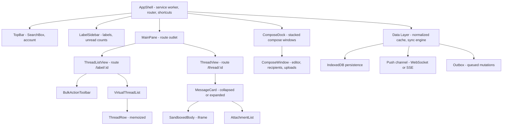

# Email Client

**Category:** Frontend System Design
**Difficulty:** 🟡 Medium
**Seniority:** senior
**Companies:** Google, Microsoft, Yahoo, Apple, Proton, Superhuman
**Tags:** virtualization, offline-first, indexeddb, autosave, client-side-search, normalization
**Time:** 45 min

---

## Problem Statement

Design the frontend of a web email client like Gmail or Outlook on the web. Users browse folders and labels, scroll a thread list that can hold tens of thousands of conversations, open a thread to read its messages, compose and reply with drafts that autosave, and search their mailbox. The app should keep working on flaky connections and show cached mail when offline.

The interviewer wants to hear about how the thread list stays fast (virtualization, pagination, caching), how client state is modelled (threads, messages, labels, normalized), how drafts are saved reliably, how offline caching and queued actions work, and how you render untrusted HTML email safely.

## Clarifying Questions

- How large is a typical mailbox? *Up to 100k threads per user. The inbox list shows about 50 rows per page, and power users scroll deep.*
- Folders or labels? *Gmail-style labels: a thread can have many labels. System labels are Inbox, Sent, Drafts, Spam and Trash.*
- Do we need offline support? *Yes. Read recent mail offline, compose offline, and queue actions such as archive, label and send until the connection returns.*
- Is search server-side or client-side? *The full mailbox is searched on the server. Cached mail can be searched locally for instant and offline results.*
- What about real-time updates? *New mail should appear within a few seconds through a push channel. No reload.*
- Rich-text compose? *Yes: basic formatting, inline images and attachments up to 25 MB, with larger files going through a link.*
- Which platforms? *Desktop browsers first, responsive down to tablet. Mobile has native apps.*
- Is a keyboard-first workflow required? *Yes. Gmail-style shortcuts (j/k, e, r, c, /).*

## Requirements

### Functional
- A sidebar with system and user labels and their unread counts.
- A thread list per label with sender, subject, snippet, date, unread and starred state, using infinite scroll.
- A thread view that shows the messages of a conversation, collapses the read ones, and renders HTML bodies safely.
- Bulk actions: select many threads, then archive, delete, mark read, label or move.
- Compose, reply and forward in a pop-out or inline editor, with drafts that autosave and attachments that upload.
- Search with operators (`from:`, `has:attachment`, `label:`) and as-you-type suggestions.
- Live arrival of new mail. Offline reading, plus queued actions and send.

### Non-Functional
- The first inbox paint takes under 1 s on a warm load, using the app shell plus cached data.
- Scrolling stays at 60 fps through 10k+ loaded rows. Opening a thread takes under 200 ms when its messages are cached.
- A draft is never lost. Autosave runs within 2 s of the user pausing and survives tab crashes.
- Rendering untrusted email content must not allow XSS.
- WCAG 2.1 AA: full keyboard operation and screen reader support.

### Out of Scope
- The mail transport (SMTP/IMAP), spam classification, and calendar or contacts apps.

## Component Architecture



Responsibilities:
1. **AppShell** is cached by a service worker so that it boots instantly. It owns routing and the global keyboard shortcut map. The shortcut map is scoped, so `j/k` act on the list when the list has focus.
2. **LabelSidebar** reads label entities and unread counts from the store, and updates them from push events.
3. **ThreadListView** owns the list query (`labelId` or a search string plus a cursor) and the selection set. **VirtualThreadList** renders only the visible rows. **ThreadRow** is memoized on `threadId` and the thread's version number.
4. **ThreadView** loads the messages of a thread. Each **MessageCard** renders its HTML body inside a sandboxed iframe.
5. **ComposeDock** holds several compose windows that are independent of the route, so a draft stays open while you navigate. Each window autosaves through the draft service.
6. **Data Layer** is a normalized entity cache, similar to TanStack Query or Apollo normalized caching, or NgRx Entity in Angular. It persists to IndexedDB, applies push events, and sends mutations through an outbox.

## Data Model & State

```text
EntityStore {
  threads:  Map<threadId, Thread>
  messages: Map<messageId, Message>
  labels:   Map<labelId, Label>
  drafts:   Map<draftId, Draft>
}

Thread   { id, subject, snippet, participants[], labelIds[], unreadCount,
           starred, lastMessageAt, messageIds[], version }
Message  { id, threadId, from, to[], cc[], date, snippet,
           bodyState: "none" | "loading" | "loaded", bodyRef, attachments[] }
Label    { id, name, type: "system" | "user", color, unreadCount, totalCount }
Draft    { id, threadId?, inReplyTo?, to[], subject, bodyHtml, attachments[],
           localVersion, serverVersion, status: "dirty" | "saving" | "saved" | "error" }

ListQueries: Map<queryKey, { threadIds[], nextCursor, historyId, stale }>
  // queryKey = "label:INBOX" or "search:from:alice has:attachment"

UIState {
  route, selection: Set<threadId>, focusedThreadId,
  openComposeIds[], searchDraft, density, readingPane: "right" | "below" | "off"
}

Outbox: [{ opId, type: "archive" | "label" | "send" | "markRead", payload, attempts }]
```

- **Server cache vs UI state.** Threads, messages, labels and list pages are server state. They are cached, persisted and invalidated. Selection, focus, open compose windows and layout preferences are UI state, kept in memory or in localStorage.
- **Normalization.** One thread appears in many lists (Inbox, Starred, a search result). Lists store only IDs, so marking a thread read updates every list at once.
- **Label-derived membership.** Archiving removes `INBOX` from `thread.labelIds`. Each list's selector filters out threads that no longer match, so the row disappears right away without a refetch.
- **Bodies are lazy.** The list needs only metadata. Message bodies are fetched when a thread opens, then cached in IndexedDB with an LRU cap of about 200 MB.

## API & Interfaces

```text
GET  /api/labels                                   -> [Label]
GET  /api/threads?label=INBOX&cursor=&limit=50     -> { threads: [ThreadSummary], nextCursor, historyId }
GET  /api/threads?q=from:alice+has:attachment&cursor=
GET  /api/threads/:id                              -> { thread, messages: [MessageMeta] }
GET  /api/messages/:id/body                        -> { html, text, inlineImages: [cid -> url] }
POST /api/threads/batchModify  { ids[], addLabels[], removeLabels[], opId }
POST /api/drafts               { to, subject, bodyHtml, inReplyTo }  -> { id, version }
PUT  /api/drafts/:id           { ..., baseVersion }  -> { version } | 409 { serverDraft }
POST /api/drafts/:id/send      { opId }              -> { messageId }
POST /api/attachments          (resumable upload)    -> { attachmentId }
GET  /api/history?since=historyId                    -> { changes[], newHistoryId }
WS   /api/push  -> { type: "historyChanged", historyId }
```

- **Incremental sync.** Push events only carry a `historyId` hint. The client then calls `/history?since=` to fetch the changes. This is idempotent, and it lets a client catch up after being offline. If the server's history window has expired, the client falls back to a full refetch.
- **Idempotency.** Every mutation carries a client-generated `opId`, so outbox retries can never double-send.

Component interfaces:

```text
ThreadList props:  { queryKey, rowHeight, onOpen(threadId), onSelectionChange(ids) }
ThreadList events: open, select, bulkAction(type, ids), loadMore
ComposeWindow:     { draftId?, mode: "new" | "reply" | "forward", sourceMessageId?,
                     onSent(messageId), onDiscard(), onMinimize() }
SearchBox:         { initialQuery, onSubmit(q), suggest(prefix) -> Suggestion[] }
```

## Rendering & Performance

- **Rendering strategy.** Use CSR with an app shell. Mail is private and highly interactive, so SSR adds little, but the shell (sidebar skeleton, header) is precached by the service worker. On boot, the first inbox page is painted from IndexedDB, then revalidated in the background (stale-while-revalidate).
- **Virtualization.** Thread rows have a fixed height for each density setting (compact 32 px, default 40 px), so a windowed list such as react-window, TanStack Virtual, or Angular CDK `cdk-virtual-scroll-viewport` positions rows with O(1) math. About 10 overscan rows keep scrolling smooth. Pagination by cursor starts when the user is within 2 screens of the end.
- **Thread view.** Message bodies are lazy-loaded per expanded message. When a thread has 50+ messages, the middle ones collapse into "N older messages", which is how Gmail does it.
- **Prefetch.** When a row is hovered or focused for more than 150 ms, or for the next thread after `j/k`, prefetch that thread's messages so opening it feels instant.
- **Search.** Debounce suggestions by 150 ms and cancel stale requests with AbortController. Local results come from a small index over cached threads (subject, sender, snippet), built in a Web Worker with MiniSearch or FlexSearch. They show first and are then merged with the server results.
- **Bundle.** Compose (the rich-text editor), settings and the attachment viewer are code-split and loaded on first use. The editor chunk is prefetched when the browser is idle after the inbox renders.
- **Re-render control.** Each row subscribes to its own thread entity through a selector, using React `memo` plus `useSyncExternalStore`, or Angular `OnPush` plus signals. An unread-count change re-renders one row and one sidebar item, not the whole list.
- **Core Web Vitals.** LCP is the first thread rows, served from cache. INP: bulk actions are optimistic, and heavy work such as sanitizing large HTML runs in a worker. CLS: rows and skeletons have fixed heights.

### Draft autosave

```text
FUNCTION onEditorChange(draft)
  SET draft.localVersion ← draft.localVersion + 1
  SET draft.status ← "dirty"
  WRITE draft TO IndexedDB              // synchronous-ish local durability first
  DEBOUNCE saveDraft(draft) BY 2000 ms, MAX WAIT 10000 ms

FUNCTION saveDraft(draft)
  IF a save is in flight FOR draft.id THEN mark pendingResave; RETURN
  SET versionSent ← draft.localVersion
  SET draft.status ← "saving"
  TRY
    SET res ← PUT /api/drafts/:id WITH body, baseVersion = draft.serverVersion
    SET draft.serverVersion ← res.version
    IF draft.localVersion = versionSent THEN SET draft.status ← "saved"
  CATCH 409 conflict
    // edited in another tab or device: keep local, offer "restore other version"
    SET draft.status ← "conflict"
  CATCH network error
    SET draft.status ← "error"; ENQUEUE draft in outbox
  IF pendingResave THEN saveDraft(draft)
```

- Drafts are also flushed on `visibilitychange` to hidden and on `pagehide`, using `fetch(..., { keepalive: true })`.
- The first save does a POST to obtain a server `draftId`. Edits made before that POST returns are coalesced into the next save.

## Accessibility & UX

- **Thread list.** Use `role="grid"`, or a listbox with rows, plus roving tabindex. Arrow keys or `j/k` move focus, `x` selects, `Enter` opens and `e` archives. Each row's accessible name reads "Unread, from Alice, subject..., 10:42 AM".
- **Shortcuts** can be turned off in settings to meet WCAG 2.1.4 (single-character shortcuts). They never fire while focus is in a text field.
- **Focus management.** Opening a thread moves focus to its heading. Going back returns focus to the row the user came from. A compose window traps focus only when it is maximized as a dialog. Docked windows are non-modal regions.
- **Live regions.** "Conversation archived. Undo" is announced through `aria-live="polite"`, and the toast has an Undo button that gets focus with a shortcut (`z`).
- **States.** Skeleton rows while loading. Friendly empty states ("Inbox zero"). An offline banner that shows the number of queued actions. Inline errors on a failed send, with Retry.
- **i18n and RTL.** Use logical CSS properties and `Intl.DateTimeFormat` for relative dates ("10:42 AM", "Mar 3"). Each email body gets its own `dir="auto"`.

## Edge Cases & Resilience

- **XSS from email HTML.** This is the biggest risk. Sanitize bodies with DOMPurify, either server-side or in a worker, then render them inside an `<iframe sandbox>` without `allow-scripts` and with a strict CSP. Rewrite links to open with `target="_blank" rel="noopener noreferrer"`. Proxy remote images to block tracking pixels and IP leaks, and only load them when the user clicks "show images" for untrusted senders.
- **CSRF.** Use SameSite cookies plus a CSRF token header on mutations. The API never accepts state-changing GET requests.
- **Offline.** The service worker serves the shell. IndexedDB serves cached threads and bodies. Mutations go to the outbox and replay in order when the browser fires `online` or the WebSocket reconnects. Sending while offline shows "Queued, will send when online".
- **Undo send.** Hold the send for 5-30 s on the client, or schedule it on the server with a cancel endpoint. The server approach survives the tab closing, so prefer it.
- **Race conditions.** If the user archives a thread while a list page refetch is in flight, the refetched page must not bring the thread back. Apply pending outbox ops on top of server responses (a rebase), or ignore responses whose `historyId` is older than the cache's.
- **Multiple tabs.** Use BroadcastChannel to share push events and to elect one tab as the sync leader through the Web Locks API, which avoids duplicate syncs and outbox replays.
- **Large attachments.** Resumable chunked uploads. The send button is disabled until uploads finish, or the send is queued until they do.
- **Storage pressure.** Request `navigator.storage.persist()`, evict old bodies with an LRU, and handle `QuotaExceededError` gracefully.

## Trade-offs

| Decision | Option A | Option B | Choice & Why |
|---|---|---|---|
| List pagination | Offset pages with page numbers | Cursor-based infinite scroll | **Cursor**: stable under inserts of new mail. Show "1-50 of many" only as a hint. |
| Email body rendering | Sanitized HTML inline in the DOM | Sanitized HTML in a sandboxed iframe | **Iframe**: isolates CSS and scripts so the email cannot restyle the app. Costs auto-height measuring. |
| Offline storage | localStorage / Cache API only | IndexedDB normalized entities | **IndexedDB**: large, async, queryable, and works in workers. |
| Real-time updates | Push full payloads over WebSocket | Push a `historyId` hint, then pull diffs | **Hint + pull**: idempotent, catches up after gaps, smaller push messages. |
| Search | Server-only | Local index + server | **Hybrid**: instant and offline results for recent mail, full coverage from the server. |
| Draft saves | Save on every keystroke | Debounce + local persistence | **Debounce 2 s + IndexedDB on each change**: durable without spamming the API. |

## Follow-up Questions

1. **How would you support 10 accounts in one client?** Namespace the stores and IndexedDB databases by account ID, open one push channel per account (or a multiplexed one), and lazy-load the non-active accounts.
2. **How do unread counts stay correct with optimistic updates?** Apply the deltas locally when the action happens, then reconcile with the server label counts from the history sync. The server value wins after the outbox drains.
3. **How would you implement "Select all 12,000 conversations"?** Don't load them all. Send a query-based bulk action (`{ query: "label:INBOX", exceptIds[] }`) and have the server process it asynchronously with progress.
4. **How do you keep the thread list fast with variable row heights, such as label chips that wrap?** Clamp rows to a fixed height with ellipsis. If they truly vary, use a measuring virtualizer that estimates heights and corrects scroll offset.
5. **How would you encrypt mail end to end, as Proton does?** Decrypt in a Web Worker with keys kept in memory. Search can then only be local, over decrypted cached content, and server-side snippets go away.

## Common Mistakes

- Rendering email HTML with `innerHTML` in the main document, which opens XSS and lets email CSS leak into the app.
- Storing threads separately per list, so read/unread state goes out of sync between Inbox and search results.
- Autosaving drafts only to the server, so a crash or offline period loses the user's text.
- Not virtualizing the list, so the DOM grows to thousands of rows and scrolling janks.
- Refetching whole lists on every push event instead of syncing incrementally.
- Ignoring keyboard power-user flows and focus restoration.

## Key Takeaways

- A normalized entity cache with ID-only lists makes multi-label views consistent and cheap to update.
- Offline-first means an IndexedDB cache, a service worker shell, and an idempotent outbox replayed in order.
- Drafts need two layers of durability: a local write on each change, plus debounced, versioned server saves.
- Treat email bodies as hostile: sanitize them, sandbox them in an iframe, and proxy remote images.
- Virtualize the list and prefetch on intent so the client feels instant at 100k-thread scale.
