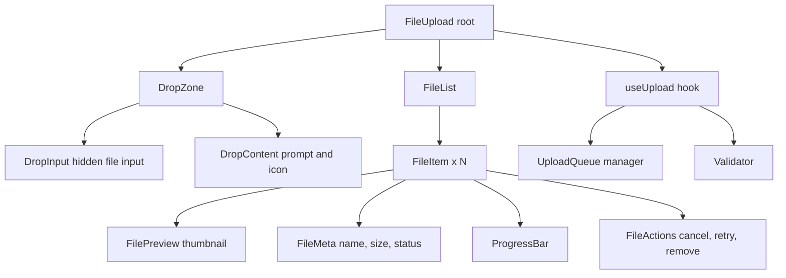

# File Upload Widget

**Category:** Frontend System Design
**Difficulty:** 🟢 Easy
**Seniority:** junior
**Companies:** Common UI component
**Tags:** drag-drop, progress, validation
**Time:** 30-45 min

---

## Problem Statement

Design a file upload widget like the ones in Google Drive, Dropbox, or web forms. Users can select files via a button or drag-and-drop them into a drop zone. The widget shows file previews (for images), validates files (type, size), displays upload progress, and handles errors.

The interviewer wants to see drag-and-drop handling, file validation, progress tracking, and a clean API for integrating with upload endpoints.

## Clarifying Questions

- Single file or multiple files? *Support both; configurable via `multiple` prop.*
- File types allowed? *Configurable via `accept` (MIME types or extensions).*
- Max file size? *Configurable; default 10MB per file, 50MB total.*
- Image preview? *Yes for images; show thumbnail before upload.*
- Upload immediately or on form submit? *Configurable: immediate (auto-upload) or manual (triggered by button).*
- Progress display? *Yes, per-file progress bar and overall progress.*
- Retry on failure? *Yes, allow retry for failed uploads.*

## Requirements

### Functional

- File selection via button and drag-and-drop.
- File validation: type, size, count.
- Image preview for supported formats.
- Upload progress (per-file and overall).
- Cancel and retry for individual files.
- Success/error states with messages.
- Auto-upload or manual upload mode.

### Non-Functional

- Accessible: keyboard operable, screen reader friendly.
- Performant: handle large files without blocking UI.
- Secure: client-side validation only; server must re-validate.
- Responsive: works on mobile and desktop.

### Out of Scope

- Chunked/resumable uploads, client-side encryption, advanced image editing.

## Component Architecture



- **FileUpload root**: manages file list, upload state, and configuration.
- **DropZone**: drag-and-drop area with visual feedback (highlight on drag over).
- **DropInput**: hidden `<input type="file">` triggered by button or drop zone click.
- **FileList**: renders selected/uploaded files.
- **FileItem**: per-file component with preview, metadata, progress, and actions.
- **useUpload hook**: handles file selection, validation, upload logic, and progress tracking.
- **UploadQueue**: manages concurrent uploads (max parallel uploads).
- **Validator**: checks file type, size, and count against constraints.

## State Management

```text
File {
  id: string                    // unique identifier
  file: File                    // native File object
  name: string
  size: number                  // bytes
  type: string                  // MIME type
  preview?: string              // data URL for images
  status: "pending" | "uploading" | "success" | "error"
  progress: number              // 0-100
  error?: string
  response?: any                // server response
}

UploadState {
  files: File[]
  maxFiles: number
  maxSize: number               // bytes per file
  maxTotalSize: number          // bytes total
  accept: string                // MIME types/extensions
  autoUpload: boolean
  maxParallel: number           // concurrent uploads, default 3
}

FUNCTION validateFiles(newFiles)
  FOR each file IN newFiles
    IF file.size > maxSize THEN RETURN error "File too large"
    IF NOT accept.includes(file.type) THEN RETURN error "Invalid file type"
  IF files.length + newFiles.length > maxFiles THEN RETURN error "Too many files"
  IF totalSize + sum(newFiles.size) > maxTotalSize THEN RETURN error "Total size exceeded"
  RETURN valid

FUNCTION uploadFile(file)
  SET file.status ← "uploading"
  TRY
    SET res ← uploadToServer(file, onProgress)
    SET file.status ← "success"
    SET file.response ← res
  CATCH err
    SET file.status ← "error"
    SET file.error ← err.message
```

- File IDs are generated client-side (e.g., `crypto.randomUUID()` or timestamp-based).
- Preview is generated via `FileReader` for images (`readAsDataURL`).
- Progress is derived from `XMLHttpRequest.upload.onprogress` or Fetch with streams.

## API Integration

```text
// Component API
<FileUpload
  accept="image/*,.pdf"
  maxSize={10 * 1024 * 1024}  // 10MB
  maxFiles={5}
  autoUpload={true}
  onUpload={(files) => console.log("Uploaded", files)}
  onError={(err) => console.error(err)}
/>

// Hook API
const { files, upload, cancel, retry, remove } = useUpload({
  accept: "image/*",
  maxSize: 10 * 1024 * 1024,
  maxFiles: 5,
  autoUpload: true,
  uploadFn: async (file, onProgress) => { ... }
})

// Upload function (customizable)
async function uploadToServer(file, onProgress) {
  const formData = new FormData()
  formData.append("file", file)

  const xhr = new XMLHttpRequest()
  xhr.upload.onprogress = (e) => {
    onProgress(e.loaded / e.total * 100)
  }

  return new Promise((resolve, reject) => {
    xhr.onload = () => resolve(JSON.parse(xhr.response))
    xhr.onerror = () => reject(new Error("Upload failed"))
    xhr.open("POST", "/api/upload")
    xhr.send(formData)
  })
}
```

Server API (example):

```text
POST /api/upload
  Content-Type: multipart/form-data
  body: file
  → 201 { id, url, size, type }
  → 413 { error: "File too large" }
  → 415 { error: "Invalid file type" }
```

## Rendering & Performance

- **Drop zone**: use `dragover`, `dragleave`, `drop` events; prevent default to allow drop. Highlight with CSS class.
- **Preview**: generate thumbnails asynchronously; use `FileReader` in a web worker to avoid blocking UI for large images.
- **Progress**: update progress bar via CSS variable or inline style; use `requestAnimationFrame` for smooth updates.
- **Concurrent uploads**: limit parallel uploads (default 3) to avoid browser/network congestion; queue extras.
- **Large files**: use streams (Fetch API) or `XMLHttpRequest` for progress; avoid loading entire file into memory.
- **Virtual scrolling**: not needed for typical uploads (< 100 files); if many, consider virtualization for the file list.

```text
FUNCTION handleDrop(e)
  e.preventDefault()
  SET droppedFiles ← Array.from(e.dataTransfer.files)
  SET validated ← validateFiles(droppedFiles)
  IF valid THEN
    ADD files with previews
    IF autoUpload THEN uploadAll()
```

## Accessibility & UX

- **Keyboard**: tab to drop zone, Enter/Space to trigger file input; tab to file items, Enter to cancel/retry.
- **Screen reader**: announce file added, upload progress, success/error via `aria-live`.
- **Focus**: maintain focus after file selection; move focus to first new file item.
- **Error messages**: associate with file item via `aria-describedby`; use clear, actionable text.
- **Drag feedback**: highlight drop zone on drag over; announce "Drop files here" via `aria-live`.
- **Progress**: for screen readers, announce percentage at milestones (25%, 50%, 75%, 100%) to avoid noise.
- **Color**: use icons + text, not just color, for status (success = green check, error = red X).
- **Touch**: ensure drop zone is large enough (min 44x44px tap target for button).

## Edge Cases & Resilience

- **Invalid files**: reject before upload; show clear error message per file.
- **Duplicate files**: allow or reject based on use case; if reject, check by name + size.
- **Network failure**: retry with exponential backoff; allow manual retry button.
- **User cancels**: abort `XMLHttpRequest` or `AbortController` for Fetch; clean up state.
- **Browser limits**: some browsers limit concurrent XHRs; respect `maxParallel`.
- **File name collisions**: server should handle; client can prepend timestamp or UUID.
- **Large file preview**: skip preview for non-images or very large images (> 5MB).
- **Memory leaks**: revoke object URLs (`URL.revokeObjectURL`) for previews when files are removed.

## Trade-offs

| Decision | Option A | Option B | Choice & Why |
|---|---|---|---|
| Upload implementation | XMLHttpRequest | Fetch with streams | XHR: simpler progress tracking; Fetch: more modern, but progress requires streams |
| Preview generation | FileReader main thread | Web Worker | Web Worker for large images; main thread is fine for typical use |
| Concurrent uploads | Unlimited | Limited (e.g., 3) | Limited: avoids browser/network congestion |
| Progress updates | Per-byte | Throttled | Throttled (e.g., every 100ms) to avoid re-render spam |
| Validation | Client only | Client + server | Client for UX; server for security (must re-validate) |

## Follow-up Questions

1. **How would you support chunked/resumable uploads?** Split file into chunks, upload sequentially, track uploaded chunks on server, resume from last chunk on retry.
2. **What if the user uploads 1000 small files?** Limit max files; use virtual scrolling for file list; batch upload requests.
3. **How would you add image cropping before upload?** Integrate a cropping library (react-image-crop, cropperjs); crop client-side, upload result.
4. **How do you test it?** Unit tests for validation logic; component tests for drag-drop and upload flow; mock server responses; visual regression for progress bars.
5. **What if the upload endpoint requires auth?** Include auth headers in upload function; handle 401/403 errors with re-auth prompt.

## Common Mistakes

- Not validating files on the client (relying only on server).
- Blocking UI with large file previews (FileReader on main thread).
- Forgetting to revoke object URLs, causing memory leaks.
- Not handling drag events correctly (missing `preventDefault`).
- Missing keyboard support for file selection and actions.
- Not showing clear error messages when uploads fail.
- Allowing unlimited concurrent uploads, causing browser slowdown.

## Key Takeaways

- File upload combines drag-drop, validation, progress, and error handling.
- Validate on client for UX, but always re-validate on server for security.
- Use XHR or Fetch with streams for progress tracking; limit concurrent uploads.
- Generate previews asynchronously to avoid blocking UI.
- Make it accessible: keyboard operable, screen reader announcements, clear error messages.
- Clean up resources (object URLs, abort controllers) to prevent memory leaks.
