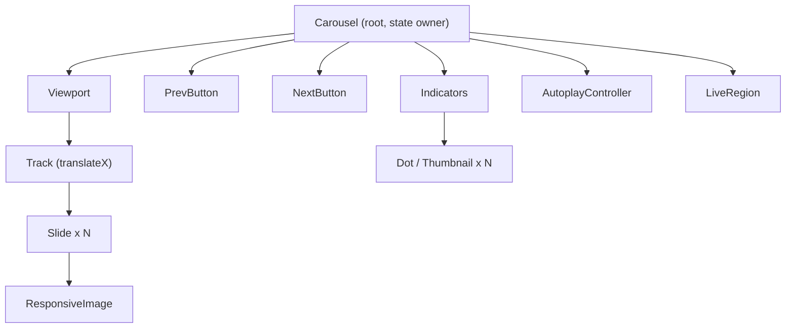

# Image Carousel

**Category:** Frontend System Design
**Difficulty:** 🟢 Easy
**Seniority:** junior
**Companies:** Google, Meta, Amazon, Airbnb, Uber, Shopify
**Tags:** component-design, lazy-loading, keyboard-navigation, aria, touch-gestures, responsive-images
**Time:** 45 min

---

## Problem Statement

Design a reusable image carousel component, like the photo gallery on an Airbnb listing or an Amazon product page. The user sees one image at a time (or a few on wide screens), can move to the previous/next image with arrows, swipe on touch devices, jump to a specific slide via dot indicators or thumbnails, and optionally have the carousel auto-advance.

The component will be used across many pages, some with 3 images and some with 50+ high-resolution photos. It must be fast on mobile networks, accessible to keyboard and screen-reader users, and easy for other teams to embed.

## Clarifying Questions

- How many images per carousel? *Typically 5-30, worst case ~100.*
- Is the image list static or fetched? *Passed in as props by the parent; the parent fetches the URLs.*
- Do we need autoplay? *Yes, optional and off by default; must pause on hover/focus.*
- Should it loop (last → first)? *Configurable, default true.*
- One slide visible or multiple? *One by default; `slidesPerView` configurable for desktop.*
- Touch support? *Yes, swipe on mobile is required.*
- Do we need a fullscreen/lightbox mode? *Out of scope for the core; mention as follow-up.*
- Browser support? *Evergreen browsers, iOS Safari 15+.*

## Requirements

### Functional

- Show the current image with previous/next controls.
- Dot indicators (or thumbnails) to jump to any slide and show position.
- Swipe left/right on touch devices; drag on desktop optional.
- Optional autoplay with configurable interval; pauses on hover, focus, and when tab hidden.
- Optional looping.
- Caption / alt text per image.

### Non-Functional

- Fast first paint: first image is the LCP element on many pages; target LCP < 2.5s on 4G.
- No layout shift (CLS < 0.1) — reserve image aspect ratio.
- Smooth 60fps transitions using GPU-composited transforms.
- WCAG 2.2 AA accessible: keyboard operable, screen-reader announces slide changes, respects `prefers-reduced-motion`.
- Small bundle (< 5 KB gzipped), no heavy dependencies.

### Out of Scope

- Image upload/editing, video slides, zoom/pinch.

## Component Architecture



- **Carousel**: owns `currentIndex`, exposes the public API, handles keyboard events and autoplay timers.
- **Viewport**: `overflow: hidden` window; captures pointer/touch events for swipe.
- **Track**: a flex row of slides moved by `transform: translateX(-index * 100%)` — compositor-only, no layout.
- **Slide / ResponsiveImage**: renders `` with `srcset`, `sizes`, `width/height`, and loading strategy.
- **Prev/Next/Indicators**: stateless controls that call `goTo(index)`.
- **AutoplayController**: logic-only (hook in React, service/directive in Angular) managing interval + pause conditions.
- **LiveRegion**: visually hidden `aria-live="polite"` text: "Slide 3 of 12".

Alternative: CSS `scroll-snap-type: x mandatory` on a scroll container gives native swipe and momentum for free; JS then only syncs `currentIndex` via `IntersectionObserver`. Good choice for simple carousels.

## Data Model & State

```text
props:
  images: [{ id, src, srcSet?, alt, caption?, width, height }]
  initialIndex: number = 0
  loop: boolean = true
  autoplay: boolean = false
  intervalMs: number = 5000
  slidesPerView: number = 1
  onChange?: (index) => void

internal UI state:
  currentIndex: number
  isPaused: boolean            // hover, focus, user-paused, tab hidden
  isDragging: boolean
  dragOffsetPx: number         // live finger offset during swipe
  loadedIds: Set<id>           // which images have finished loading
```

- No server cache: the parent owns data fetching; the carousel is a presentational component.
- Support both **uncontrolled** (`initialIndex`) and **controlled** (`index` + `onChange`) modes, like `<input value>` in React or `[(index)]` two-way binding in Angular.
- Derived values (`canGoPrev`, `canGoNext`, visible range) are computed, not stored.

```text
FUNCTION goTo(target)
  SET n ← images.length
  IF loop THEN
    SET target ← (target MOD n + n) MOD n
  ELSE
    SET target ← clamp(target, 0, n - 1)
  IF target = currentIndex THEN RETURN
  SET currentIndex ← target
  CALL onChange(target)
  SET liveRegion.text ← "Slide " + (target + 1) + " of " + n
```

## API & Interfaces

Server contract (owned by the parent, shown for context):

```text
GET /api/listings/{id}/photos
200 → { photos: [{ id, url, width, height, alt, caption, blurHash }] }
Image CDN: https://img.cdn.com/{id}?w=800&fmt=avif   // resizing + format negotiation at edge
```

Public component interface:

```text
<Carousel
  images=[...]
  loop=true
  autoplay=false
  intervalMs=5000
  ariaLabel="Listing photos"
  onChange=(index) => ...
/>

Imperative handle (ref in React, @ViewChild in Angular):
  next(), prev(), goTo(index), pause(), play()

Events: change(index), imageError(id)
Slots: renderSlide(image) for custom content, renderIndicator(i, active)
```

## Rendering & Performance

- **LCP image**: first slide uses `loading="eager"` and `fetchpriority="high"`; optionally `<link rel="preload" as="image" imagesrcset=...>` when SSR'd.
- **Lazy loading**: other slides use `loading="lazy"`; additionally only mount `src` for `currentIndex ± 1` and prefetch the next image on hover of the Next button or when idle.
- **Responsive images**: `srcset` with 400/800/1600w variants and `sizes="(max-width: 768px) 100vw, 800px"`; serve AVIF/WebP from the CDN.
- **No CLS**: set `width`/`height` attributes or `aspect-ratio` CSS; show a blurhash/dominant-color placeholder.
- **Animation**: `transform` + `transition` only (compositor), `will-change: transform` during drag only. Avoid animating `left`/`margin`.
- **Swipe**: Pointer Events with `touch-action: pan-y` so vertical scrolling still works; update `dragOffsetPx` inside `requestAnimationFrame`.
- **SSR**: render the first slide as plain HTML so it is visible before hydration; controls become active after hydration.
- **Large sets (100 images)**: windowing — render only nearby slides, use placeholders elsewhere; thumbnails are tiny (`w=80`) and lazy.

```text
FUNCTION onPointerUp(event)
  SET delta ← event.x - dragStartX
  SET threshold ← viewportWidth * 0.2
  SET velocity ← delta / (now() - dragStartTime)
  IF delta < -threshold OR velocity < -0.5 THEN CALL goTo(currentIndex + 1)
  ELSE IF delta > threshold OR velocity > 0.5 THEN CALL goTo(currentIndex - 1)
  SET dragOffsetPx ← 0      // snap back or animate to new slide
  SET isDragging ← false
```

## Accessibility & UX

- Root: `<section aria-roledescription="carousel" aria-label="Listing photos">` (WAI-ARIA APG carousel pattern).
- Each slide: `role="group" aria-roledescription="slide" aria-label="3 of 12"`; hidden slides get `aria-hidden="true"` and `inert` so their content is not tabbable.
- Prev/Next are real `<button>`s with `aria-label="Previous slide"`; disabled (not hidden) at ends when `loop=false`.
- Indicators: buttons with `aria-label="Go to slide 4"` and `aria-current="true"` on the active one (or a tablist pattern).
- Keyboard: Left/Right arrows when focus is within the carousel; Home/End jump to first/last.
- Live region `aria-live="polite"` announces changes on manual navigation; set to `off` during autoplay to avoid spam.
- Autoplay: visible Pause/Play button (WCAG 2.2.2), pause on hover and focus, stop when `document.hidden`, disable entirely under `prefers-reduced-motion: reduce`.
- Meaningful `alt` text per image; decorative images get `alt=""`.
- RTL: flip arrow icons and swipe direction when `dir="rtl"`.
- States: skeleton while loading, broken-image fallback with retry, empty state hides controls.

## Edge Cases & Resilience

- **Image load failure**: `onerror` → show fallback tile, emit `imageError`, keep navigation working.
- **Single image**: hide arrows, dots, and autoplay.
- **Rapid clicks**: navigation is index-based so repeated clicks are idempotent; queue or interrupt the transition rather than stacking timers.
- **Images prop changes**: clamp `currentIndex` to new length; reset if the list identity changes.
- **Resize/orientation change**: percentage-based transforms avoid recomputation; re-measure only if using pixel offsets.
- **Timer leaks**: clear intervals on unmount (`useEffect` cleanup / `ngOnDestroy`).
- **Security**: captions rendered as text, never via `innerHTML` / `dangerouslySetInnerHTML`; only allow image URLs from trusted CDN hosts.
- **Slow network**: low-quality placeholder first, then swap to full image on `load`.

## Trade-offs

| Decision | Option A | Option B | Choice & Why |
|---|---|---|---|
| Movement mechanism | JS `translateX` track | CSS scroll-snap container | Scroll-snap for simple cases (native momentum, less JS); translateX when you need precise control, looping, and custom animation |
| Looping | Clone first/last slides for seamless wrap | Jump back with no animation | Clones give seamless UX but complicate a11y (duplicates must be `aria-hidden`); choose based on design |
| Image loading | Load all eagerly | Load current ±1, lazy rest | Lazy: saves bandwidth on mobile, protects LCP |
| Indicators | Dots | Thumbnails | Dots for < 10 images; thumbnails for large galleries where preview helps |
| Autoplay default | On | Off | Off: autoplay hurts a11y and engagement data often shows users ignore it |

## Follow-up Questions

1. **How would you add a fullscreen lightbox?** Reuse the same Carousel inside an accessible modal dialog, pass `initialIndex`, load higher-resolution variants, and return focus to the clicked thumbnail on close.
2. **How do you support infinite seamless looping?** Clone the last N and first N slides at the ends; after transitioning onto a clone, disable transition and jump to the real slide on `transitionend`.
3. **How would you measure success?** Track LCP for the first image, slide-view events, swipe vs click usage, and image error rates via RUM.
4. **How to show 3 slides on desktop and 1 on mobile?** `slidesPerView` driven by container queries or `ResizeObserver`; slide width becomes `100% / slidesPerView`, step size stays 1.
5. **How to support video slides?** Slot-based `renderSlide`; pause video when it leaves the viewport and pause autoplay while video is playing.

## Common Mistakes

- Animating `left` or `margin` instead of `transform`, causing jank and layout thrashing.
- Loading all 50 full-resolution images upfront, destroying LCP and mobile data.
- Using `<div onclick>` for arrows instead of `<button>`, breaking keyboard and screen readers.
- Autoplay without a pause control or ignoring `prefers-reduced-motion`.
- Forgetting `touch-action: pan-y`, which blocks vertical page scroll on mobile.
- Leaving off-screen slides focusable, so Tab moves into invisible content.

## Key Takeaways

- Keep the carousel presentational: state is just `currentIndex` plus pause/drag flags.
- Performance is about the first image (LCP) and not loading the rest prematurely.
- Use compositor-only transforms or native scroll-snap for smooth motion.
- Follow the WAI-ARIA carousel pattern: real buttons, live region, pausable autoplay.
