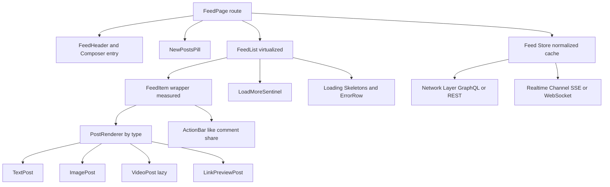

# Infinite Scroll News Feed

**Category:** Frontend System Design
**Difficulty:** 🟡 Medium
**Seniority:** senior
**Companies:** Meta, Twitter, LinkedIn, Reddit, Pinterest, TikTok, Instagram
**Tags:** infinite-scroll, cursor-pagination, virtualization, normalized-cache, optimistic-updates, ssr
**Time:** 60 min

---

## Problem Statement

Design the client side of a news feed like Facebook, X (Twitter), or LinkedIn. Users scroll through a never-ending list of posts containing text, images, videos, and link previews. They can like, comment, and share; new posts arrive while they browse; and the experience must remain smooth after scrolling through hundreds of posts on a mid-range Android phone.

Focus on the component architecture, pagination, data normalization, rendering performance (virtualization, media loading), real-time updates, and accessibility of an infinite list.

## Clarifying Questions

- Which platforms? *Web, desktop and mobile browsers; mobile web is 60% of traffic.*
- Post types? *Text, images (1-4), video, link preview, shared post.*
- Interactions in scope? *Like, comment count, share, and a "new posts" indicator; full comment threads are out of scope.*
- How fresh does the feed need to be? *New posts surfaced within ~30s via a "N new posts" pill — never auto-inserted above the reading position.*
- Is ranking client or server? *Server-ranked; client just renders pages in order.*
- SEO? *Feed is personalized and behind login; SEO not needed, but fast first paint is.*
- Session depth? *Heavy users scroll 500+ posts in a session.*
- Offline? *Show cached feed when offline, read-only.*

## Requirements

### Functional

- Load initial feed and fetch more as the user nears the bottom.
- Render heterogeneous post types.
- Like/unlike with instant feedback; share; open comments.
- "New posts" pill that loads fresh posts on click and scrolls to top.
- Preserve scroll position when navigating to a post and back.

### Non-Functional

- LCP < 2.5s, INP < 200ms, CLS < 0.1 on a mid-tier mobile device over 4G.
- 60fps scrolling; memory bounded even after 1000 posts.
- Minimal over-fetching; resilient to flaky networks.
- Accessible: keyboard navigation through posts, screen-reader friendly feed semantics.

### Out of Scope

- Ranking algorithm, post composer, ads auction, full comment threading.

## Component Architecture



- **FeedPage**: route-level container; kicks off initial fetch (or receives SSR data) and restores scroll on back navigation.
- **FeedList**: virtualized list (react-virtuoso / TanStack Virtual / Angular CDK `cdk-virtual-scroll-viewport` with autosize) rendering only visible items plus overscan.
- **FeedItem**: measures its height (ResizeObserver) and reports it to the virtualizer; wraps an error boundary so one broken post does not kill the feed.
- **PostRenderer**: strategy map from `post.type` to component; rare types lazily code-split.
- **ActionBar**: subscribes to only the post's counters/flags (fine-grained selectors) so likes don't re-render the list.
- **LoadMoreSentinel**: `IntersectionObserver` target near the end that triggers the next page.
- **Feed Store**: normalized entities (posts, users, media) + ordered list of post ids per feed.

## Data Model & State

```text
entities (normalized server cache):
  posts: { [postId]: { id, authorId, type, text, mediaIds[], linkPreview?,
                       createdAt, likeCount, commentCount, viewerHasLiked } }
  users: { [userId]: { id, name, avatarUrl, verified } }
  media: { [mediaId]: { id, kind: "image"|"video", url, width, height,
                         blurhash, posterUrl?, durationSec? } }

feed state:
  feeds: { home: { postIds: [id...], nextCursor, hasMore,
                   status: "idle"|"loading"|"error", pendingNewIds: [id...] } }

UI state:
  heightCache: Map<postId, px>      // for virtualization + scroll restore
  scrollAnchor: { postId, offsetPx } // saved on navigation away
  expandedText: Set<postId>
  pendingMutations: Map<postId, { type: "like"|"unlike", prev }>
```

- **Normalization** means an author's name change or a like on a post that appears twice (original + share) updates everywhere once. Apollo/Relay do this automatically; with REST use normalizr + Redux Toolkit entity adapters or NgRx Entity.
- Server data (posts) lives in the query cache; pure UI concerns (expanded text, measured heights) live in local component/store state.
- Memory bound: keep at most ~500 post entities for the feed; evict far-off ones (and re-fetch if the user scrolls back).

## API & Interfaces

```text
GET /api/feed?cursor=<opaque>&limit=20
200 → {
  posts: [{ id, type, text, author:{id,name,avatarUrl},
            media:[{id,kind,url,width,height,blurhash}],
            likeCount, commentCount, viewerHasLiked, createdAt }],
  nextCursor: "eyJ0cyI6...",       // opaque; encodes rank position + snapshot id
  hasMore: true
}

GET /api/feed/new?since=<topCursor>       → { count, posts? }   // for the pill
POST   /api/posts/{id}/like   (Idempotency-Key)  → { likeCount, viewerHasLiked }
DELETE /api/posts/{id}/like                      → { likeCount, viewerHasLiked }

Realtime (SSE):
  event: feed.new_posts      data: { count }
  event: post.counters       data: { postId, likeCount, commentCount }  // visible posts only
```

GraphQL alternative uses Relay-style connections (`edges`, `pageInfo { endCursor, hasNextPage }`) with fragments colocated per post type.

Component interfaces:

```text
<FeedList
  items=postIds
  renderItem=(id) => <FeedItem id />
  onEndReached=loadMore
  endReachedThreshold="1500px"
  estimateSize=400
/>
<FeedItem id onAction=(type, id) => ... />
```

## Rendering & Performance

- **Initial load**: SSR or streaming SSR the first ~5 posts (or app shell + inline JSON) so LCP happens before the JS bundle executes; hydrate progressively. Alternatively CSR with skeletons if the shell is cached by a service worker.
- **Cursor pagination**, not offset — stable when new posts are inserted at the top; prefetch the next page when the sentinel is ~1.5 viewports away.
- **Virtualization**: render visible items + overscan (~3 screens). Variable heights handled with estimated size + measurement; cache measured heights by post id.
- **Scroll anchoring**: when items above the viewport change height (image loads, expand text), adjust scroll offset (CSS `overflow-anchor` or virtualizer's anchor logic) to prevent jumps.
- **Images**: reserved aspect ratio (no CLS), `srcset` + AVIF/WebP via CDN, `loading="lazy"` except first post's image (`fetchpriority="high"`), blurhash placeholder.
- **Video**: poster image only until near viewport; autoplay muted when ≥ 50% visible, pause when out of view; one active video at a time; `preload="none"`.
- **Re-render isolation**: memoized items (`React.memo` / `OnPush`), selectors by id; like action touches only one entity.
- **Code splitting**: rare post types (polls, events) and the comment drawer loaded on demand.
- **Main thread**: defer analytics/impression logging to `requestIdleCallback`; batch impression events (IntersectionObserver ≥ 50% for 1s).
- **Alternative to JS virtualization**: `content-visibility: auto` + `contain-intrinsic-size` gives cheap rendering skip with native find-in-page, but DOM nodes still accumulate.

```text
FUNCTION loadMore()
  IF feed.status = "loading" OR NOT feed.hasMore THEN RETURN
  SET feed.status ← "loading"
  TRY
    SET page ← GET /api/feed?cursor=feed.nextCursor&limit=20
    UPSERT page.posts INTO entities (normalize)
    SET newIds ← [p.id FOR p IN page.posts IF p.id NOT IN feed.postIds]  // dedupe
    APPEND newIds TO feed.postIds
    SET feed.nextCursor ← page.nextCursor; SET feed.hasMore ← page.hasMore
    SET feed.status ← "idle"
  CATCH
    SET feed.status ← "error"      // render ErrorRow with Retry; no auto-loop
```

## Accessibility & UX

- Use the WAI-ARIA **feed** pattern: container `role="feed"` with `aria-busy="true"` while loading; each post `<article>` with `aria-labelledby` (author) and `aria-describedby` (content), `aria-posinset` and `aria-setsize` (`-1` when unknown).
- Keyboard: Page Down / Page Up move between articles (feed pattern), plus shortcuts like `j`/`k`; Ctrl+End to skip past the feed. Provide a "Skip feed" link.
- Virtualization caveat: removing focused items from the DOM loses focus — keep the focused item mounted, and ensure overscan covers keyboard movement.
- New posts are **not** injected automatically; a polite announcement "5 new posts" plus a pill button. Clicking it loads them and moves focus to the first new article.
- Like button: `aria-pressed` reflects state; counts formatted with `Intl.NumberFormat` compact ("1.2K").
- Infinite scroll traps the footer: put footer links elsewhere or provide a "Load more" button fallback after N pages.
- States: skeleton cards on initial load, inline error row with Retry, end-of-feed message, empty state with suggestions to follow people.
- Respect `prefers-reduced-motion` (no autoplay video), `prefers-reduced-data` / Save-Data (lower image quality, no video preload).
- i18n: relative times via `Intl.RelativeTimeFormat`, RTL layout via logical CSS properties, mixed-direction text with `dir="auto"` on user content.

## Edge Cases & Resilience

- **Duplicate posts across pages** (ranking shifts): dedupe by id when appending.
- **Concurrent loadMore triggers**: status guard; sentinel observer fires repeatedly while visible.
- **Error loops**: do not auto-retry endlessly when the sentinel is visible; show manual Retry, auto-retry with exponential backoff limited to 3.
- **Optimistic like conflicts**: rapid toggling — serialize mutations per post or send the final desired state (`PUT like {liked:true}`), rollback to `prev` on failure.
- **Scroll restoration**: store `{ postId, offsetPx }` + cached feed on navigate away; on back, render from cache and scroll to the anchor (works with bfcache too).
- **Stale feed**: after long background time (> 10 min), show "New posts" rather than silently refetching and shifting content.
- **Offline**: service worker serves cached shell + last feed snapshot from IndexedDB; queue likes for replay with Background Sync.
- **Deleted/blocked post**: realtime or 404 on interaction → replace with tombstone "This post is unavailable".
- **Security**: user content rendered as text with linkification by a safe parser; link previews sanitized server-side; `rel="noopener noreferrer"` for external links; CSRF tokens / SameSite cookies on mutations; strict CSP.
- **Memory leaks**: disconnect observers and pause videos on unmount; cap entity cache.

## Trade-offs

| Decision | Option A | Option B | Choice & Why |
|---|---|---|---|
| Pagination | Offset/page number | Opaque cursor | Cursor — stable under inserts, no duplicates/skips, server can snapshot ranking |
| List rendering | Full DOM | Virtualization | Virtualize for long sessions (bounded DOM/memory); cost is complexity with variable heights, focus, and find-in-page |
| New posts | Auto-insert at top | "N new posts" pill | Pill — never shift content under the reader (CLS, lost place) |
| Initial render | CSR + skeleton | SSR/streaming first page | Streaming SSR for best LCP; CSR acceptable if shell is SW-cached and data prefetched |
| Data layer | Denormalized page arrays | Normalized entity cache | Normalized — consistent updates across duplicates and views |
| Realtime | WebSocket | SSE + polling fallback | SSE: server-to-client only, HTTP-friendly, auto-reconnect |

## Follow-up Questions

1. **How would you handle 10K posts in one session?** Virtualize, evict entities and media far from viewport, keep only ids + heights, refetch evicted pages by cursor if user scrolls back.
2. **How do you restore position after opening a post and pressing back?** Keep the feed cache alive across routes, save the anchor post id + offset, and re-scroll after the first render using cached heights.
3. **How would you log impressions accurately?** IntersectionObserver with ≥ 50% visibility for ≥ 1s, batched and sent via `navigator.sendBeacon` on page hide.
4. **How would you add ads into the feed?** Server interleaves ad slots in the response; client renders an AdItem with reserved height to avoid CLS and isolates third-party scripts in iframes.
5. **How would you make it work on low-end devices?** Smaller pages, lower overscan, no video autoplay, reduced image quality under Save-Data, and ship less JS via islands/partial hydration.
6. **GraphQL vs REST?** GraphQL fragments per post type avoid over-fetching and give normalized caching out of the box (Relay); REST is simpler with CDN caching but needs manual normalization.

## Common Mistakes

- Using offset pagination, causing duplicates or skipped posts when new content arrives.
- Rendering every post in the DOM forever, leading to memory bloat and janky scroll.
- Auto-inserting new posts above the viewport, shifting what the user is reading.
- Images without reserved dimensions, producing massive CLS.
- Triggering multiple concurrent loadMore requests or infinite error retry loops.
- Ignoring keyboard and screen-reader users (no feed semantics, focus lost on virtualization).

## Key Takeaways

- Cursor pagination + IntersectionObserver prefetch makes infinite loading reliable.
- Normalized entity cache keeps likes and author data consistent everywhere.
- Virtualization with measured heights and scroll anchoring bounds memory and prevents jumps.
- Protect Core Web Vitals: SSR the first posts, reserve media space, lazy-load everything else.
- Use the ARIA feed pattern and never move content under the user without consent.
