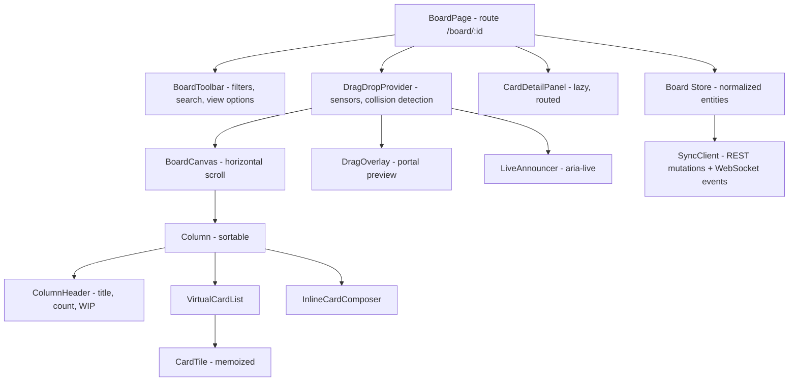

# Kanban Board

**Category:** Frontend System Design
**Difficulty:** 🟡 Medium
**Seniority:** senior
**Companies:** Atlassian, Asana, Monday.com, Microsoft, Linear, Notion
**Tags:** drag-and-drop, optimistic-updates, fractional-indexing, real-time-sync, virtualization, keyboard-accessibility
**Time:** 45 min

---

## Problem Statement

Design the frontend of a Kanban board like Trello, Jira boards or Linear. A board has columns (statuses), and each column holds an ordered list of cards. Users drag cards within and between columns, reorder columns, create and edit cards inline, filter by assignee or label, and see teammates' changes live.

Large boards can have 20 columns and 5,000+ cards, and many people edit them at once. The interviewer wants to hear about drag-and-drop architecture, ordering that survives concurrent edits, optimistic updates with rollback, rendering performance, and accessible drag-and-drop.

## Clarifying Questions

- What is the largest board? *Up to 30 columns and 10k cards. A typical board has around 300.*
- Do we need real-time collaboration? *Yes. Changes from others appear within about 1 s, but true co-editing of card text is not required.*
- Is there swimlane support (rows by assignee or epic)? *Nice to have. Design so it can be added.*
- Does the board enforce WIP limits or workflow rules? *WIP limits are a soft warning. Some transitions are disallowed, and the server can reject them.*
- Do we need a card detail view? *Yes, as a modal or side panel with a deep link `/board/:id/card/:cardId`.*
- Do we need mobile and touch support? *Yes. Touch drag with long-press, plus keyboard drag for accessibility.*
- Offline? *Read-only offline is nice to have. Mutations require a connection, but brief disconnects should be tolerated.*

## Requirements

### Functional
- Render columns with ordered cards, card counts and WIP limits.
- Drag cards within and across columns, and drag to reorder columns. Use mouse, touch and keyboard.
- Inline create and quick edit (title). A detail panel handles the full edit.
- Filter and search (assignee, label, text) without losing ordering.
- Real-time updates from other users, with clear handling of conflicts.

### Non-Functional
- Drag at 60 fps on a 5k-card board, and a drop takes effect in under 100 ms (optimistic).
- Consistent ordering across clients after concurrent moves.
- WCAG 2.1 AA, including keyboard-operable drag-and-drop with screen reader announcements.
- Initial board render under 1.5 s for 1,000 cards.

### Out of Scope
- Reports and burndown charts, automation rules, and rich-text collaborative editing.

## Component Architecture



- **DragDropProvider** abstracts the input sensors (pointer, touch with a long-press delay, keyboard) and collision detection, such as nearest center or the pointer inside the column. It emits `dragStart`, `dragOver` and `dragEnd` with ids, not DOM nodes. In React this maps to dnd-kit or `@atlaskit/pragmatic-drag-and-drop`; in Angular, to CDK `DragDropModule` (`cdkDropListGroup`, `cdkDrag`).
- **DragOverlay** renders the dragged card in a portal that follows the pointer through `transform: translate3d`, so the source list does not re-layout on every pointer move.
- **Column / VirtualCardList.** Each column scrolls vertically and virtualizes when it has more than about 100 cards. Placeholder gaps are drawn by the list during a drag.
- **CardTile** is a pure, memoized component that receives `cardId` and selects only its own data, so one card's update re-renders only that card.
- **SyncClient** sends mutations over REST, listens to a board channel on a WebSocket, and reconciles server events into the store.
- **Native HTML5 DnD vs pointer events.** HTML5 DnD gives cross-window drag and file drop for free, but has poor touch support, limited styling and no keyboard support. Pointer-based libraries give full control. Use pointer events, with HTML5 DnD only for external file drops.

## Data Model & State

```text
BoardState {
  board: { id, title, columnOrder: List<ColumnId>, version }
  columns: Map<ColumnId, { id, title, wipLimit, rank: String }>
  cards: Map<CardId, {
    id, columnId, rank: String,               // fractional index, e.g. "a0", "a0V", "a1"
    title, assigneeIds, labelIds, dueDate, updatedAt, version
  }>
  cardIdsByColumn: Map<ColumnId, List<CardId>>  // derived: sort by rank, memoized
  users: Map<UserId, User>, labels: Map<LabelId, Label>
  pending: Map<MutationId, { kind, cardId, before: Snapshot, after: Snapshot }>
  ui: {
    filters: { assigneeIds, labelIds, text }, // also in URL query
    drag: { activeId, overColumnId, overIndex } | null,
    openCardId: CardId | null,                // from route
    collapsedColumns: Set<ColumnId>
  }
}
```

**Ordering with fractional indexing.** Storing each card's position as an integer index means a single move rewrites the index of every card below it, which causes conflicts and large writes. Instead, each card has a lexicographically sortable `rank` string. Moving a card between A and B assigns `rankBetween(A.rank, B.rank)`, and only one row changes.

```text
FUNCTION rankBetween(a, b)            // a < b, either may be null (start/end)
  // base-62 digit strings; returns a string strictly between a and b
  IF a == null AND b == null THEN RETURN "a0"
  IF a == null THEN RETURN decrementKey(b)
  IF b == null THEN RETURN incrementKey(a)
  RETURN midpoint(a, b)               // e.g. between "a0" and "a1" -> "a0V"
  // append jitter digits to avoid two clients picking the identical key concurrently
```

- If two clients insert at the same spot, both ranks are still valid. Ties are broken by `id`, so every client sorts identically.
- Ranks grow longer after many inserts in the same gap. The server rebalances occasionally (rewrites a column's ranks) and broadcasts the result.
- **Normalization.** Cards are stored once by id, and the column lists are derived. A move is then a single field update (`columnId` and `rank`), which makes rollback trivial.
- **Filtering** is a derived view and does not mutate order. When dropping in a filtered view, compute the rank from the nearest visible neighbors. Ranks are global, so hidden cards remain correctly ordered.

## API & Interfaces

```text
GET   /api/boards/{id}?include=columns,cards,users,labels
      200 { board, columns: [...], cards: [...], users: [...], labels: [...], cursor }
GET   /api/boards/{id}/cards?column={cid}&after_rank=&limit=200   // lazy-load huge columns
POST  /api/boards/{id}/cards        { clientId, columnId, rank, title }
      201 Card
PATCH /api/cards/{id}               { version, columnId?, rank?, title?, assigneeIds? }
      200 Card
      409 { current: Card }                       // stale version
      422 { code: "TRANSITION_NOT_ALLOWED" }      // workflow rule
PATCH /api/columns/{id}             { rank?, title?, wipLimit? }

WebSocket channel board:{id}
  server -> client
    { type: "card.upserted", card, actorId, mutationId?, eventSeq }
    { type: "card.deleted", cardId, eventSeq }
    { type: "column.upserted", column, eventSeq }
    { type: "ranks.rebalanced", columnId, ranks: [{id, rank}], eventSeq }
  client -> server
    { type: "subscribe", boardId, sinceSeq }
```

Component interfaces:

```text
Column
  props:  columnId, cardIds, isDropTarget, wipLimit, collapsed
  events: onCreateCard(title), onToggleCollapse()

DragDropProvider
  props:  sensors: [pointer, touch(delay=250ms), keyboard], collisionStrategy
  events: onDragStart(id), onDragOver(id, overId), onDragEnd(id, dest{columnId, index}), onDragCancel()
```

## Rendering & Performance

**Rendering.** CSR behind auth, with a skeleton board. The initial payload ships all columns plus the first ~200 cards per column. Huge columns lazy-load further cards on scroll.

**Drag performance.**
- During a drag, only the overlay and placeholder positions change. Move items with CSS `transform` rather than layout properties, on a compositor layer (`will-change: transform`).
- Keep drag state in a separate, small store slice, or in refs/signals, so pointer moves do not re-render every card. Only the source and target columns subscribe to `overIndex`.
- Collision detection uses cached column and card rects measured at drag start, refreshed when the board auto-scrolls. Never call `getBoundingClientRect` per card per frame.
- Auto-scroll the board horizontally and columns vertically when the pointer nears an edge, using `requestAnimationFrame`.

**Optimistic move.**

```text
FUNCTION onDragEnd(cardId, dest)
  SET neighbors ← visibleCards(dest.columnId)
  SET newRank ← rankBetween(neighbors[dest.index - 1]?.rank, neighbors[dest.index]?.rank)
  SET mutationId ← uuid()
  SET before ← snapshot(cards[cardId])
  store.update(cardId, { columnId: dest.columnId, rank: newRank })     // instant
  pending[mutationId] ← { before }
  live.announce("Moved " + title + " to " + colName + ", position " + (dest.index + 1))
  TRY
    SET card ← AWAIT PATCH /cards/{cardId} { columnId, rank: newRank, version, mutationId }
    store.merge(card); DELETE pending[mutationId]
  CATCH 409 conflict -> store.merge(conflict.current); toast("Card was updated by someone else")
  CATCH 422 or network -> store.update(cardId, before); toast("Couldn't move card", retry)
```

**Applying remote events.** Ignore echoes whose `mutationId` is in `pending`. Otherwise merge when the incoming `version` is greater than the local one. If a remote event targets the card being dragged, defer it until the drop.

**Virtualization.** Columns with many cards use variable-height virtualization with measured heights. During a drag, the placeholder index is mapped into the virtual list. Columns scrolled out horizontally can also be virtualized on boards with 30+ columns.

**Bundle.** The card detail panel (rich text editor, comments, attachments) is lazy-loaded and prefetched on card hover. The DnD library is small, at about 10–15 KB.

## Accessibility & UX

- **Keyboard drag.** Focus a card, press Space or Enter to lift it, use Arrow Up/Down to move within a column and Left/Right to move across columns, Space to drop and Esc to cancel. This matches dnd-kit and Atlassian's accessible patterns.
- **Announcements.** Use an `aria-live="assertive"` region: "Picked up card 'Fix login'. Column To Do, position 3 of 12." Announce each movement, then the drop or cancel. Give instructions through `aria-describedby`.
- **Semantics.** Each column is a `role="region"`/`list` with an `aria-label` containing its name and count. Cards are `listitem` buttons that open the detail view. Do not rely on `aria-grabbed`, which is deprecated.
- **Alternative to drag.** A "Move to…" menu (column plus position) on each card for users who cannot drag at all. This is also good for mobile.
- **Focus.** After a keyboard move, keep focus on the moved card. Closing the detail panel returns focus to its card. Inline create returns focus to the composer for rapid entry.
- **States.** Skeleton columns while loading. An empty column shows a drop hint ("Drop cards here"). Exceeding the WIP limit turns the column header amber and adds text, not just color. A server rejection rolls the card back with an animation and a toast.
- **RTL.** Reverse the column order with logical properties and swap the meaning of Left/Right arrows.

## Edge Cases & Resilience

- **Concurrent moves of the same card.** The last write wins, decided by the server's version. The losing client receives the server state and animates the card to its true position, with a toast.
- **Concurrent inserts in the same gap.** Fractional ranks plus an id tiebreak give a deterministic order on every client.
- **Dropping into a filtered view.** Compute the rank against visible neighbors. The card may then land between hidden cards, which is acceptable and documented.
- **Card deleted remotely while open or dragged.** Cancel the drag, close the panel and show "This card was deleted".
- **Reconnect.** Resubscribe with `sinceSeq`. If the gap is too large, refetch the board, then replay pending mutations on top.
- **Rank exhaustion.** Keys grow long under repeated insertion at the same spot. The server rebalances the column and broadcasts `ranks.rebalanced`.
- **Long-press conflicts on touch.** Use a 250 ms activation delay and a small movement tolerance so scrolling still works.
- **Security.** Card titles and descriptions are user content, so render titles as text and sanitize rich text with DOMPurify. Authorization is checked server-side per board, and the WebSocket subscription is validated against board membership. Use CSRF protection on PATCH.

## Trade-offs

| Decision | Option A | Option B | Choice & Why |
|---|---|---|---|
| Ordering | Integer positions | Fractional rank strings | Fractional. O(1) writes per move, and mergeable concurrent inserts. Occasional rebalance. |
| DnD engine | Native HTML5 DnD | Pointer-events library | Pointer events. Touch and keyboard support, custom previews, consistent behavior across browsers. |
| Update model | Pessimistic (wait for server) | Optimistic + rollback | Optimistic. Drag must feel instant, and rollback is cheap because a move is a single field update. |
| Conflict resolution | CRDT for everything | Server version, last write wins per card | LWW per card. Card moves rarely conflict, so a CRDT is overkill without text co-editing. |
| Large columns | Render all | Virtualize + lazy-load | Virtualize above about 100 cards. Small columns render fully for simplicity. |

## Follow-up Questions

1. **How would you add swimlanes?** Make the drop target a (row, column) cell and keep the rank global within a column. Swimlanes then become a grouping view. Virtualize in two dimensions if needed.
2. **How do you support multi-select drag?** Keep a selected set and drag them as a stack overlay. On drop, assign consecutive ranks between the neighbors in a single batch request.
3. **How would you show other users' cursors or drags?** Broadcast ephemeral `presence` events (throttled to about 10 Hz) without persisting them, and render ghost outlines labeled with avatars.
4. **How do you make it work offline?** Persist the store in IndexedDB and queue mutations with their base versions. On reconnect, replay them in order, and the server resolves conflicts and returns canonical state.
5. **How would you test drag-and-drop?** Unit-test `rankBetween` and the reducer. Test component interactions through the keyboard sensor, which is deterministic. Use Playwright for pointer drags on real browsers.

## Common Mistakes

- Persisting integer indexes and renumbering whole columns on every move.
- Re-rendering every card on each pointer move because drag state sits in a global context.
- Ignoring keyboard and screen reader users, or offering no non-drag alternative.
- Applying remote events blindly, which yanks a card out of the user's hand mid-drag.
- Missing rollback when the server rejects a workflow transition.
- Measuring the DOM every frame during collision detection.

## Key Takeaways

- Normalized entities plus fractional ranks make a move a tiny, mergeable, easily rolled-back update.
- Isolate drag state and use transforms for 60 fps drag. Measure once, not every frame.
- Optimistic UI with mutation ids and versioned server reconciliation handles real-time collaboration well.
- Accessible drag-and-drop means a keyboard sensor, live announcements and a "Move to…" fallback.
