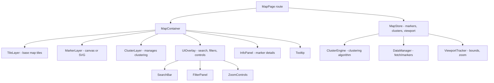

# Map with Clustering

**Category:** Frontend System Design
**Difficulty:** 🟡 Medium
**Seniority:** mid-level
**Companies:** Google Maps, Mapbox, Uber, Lyft, Airbnb, Foursquare
**Tags:** maps, clustering, performance
**Time:** 45-60 min

---

## Problem Statement

Design a map interface that displays thousands of location markers (restaurants, hotels, points of interest) across a city or region. When zoomed out, nearby markers should cluster together to show a count. When zoomed in, clusters should expand to reveal individual markers. Users can click clusters to zoom to that area, click individual markers to see details, and the map must remain smooth at 60 fps even with 10,000+ markers.

Focus on the clustering algorithm, rendering performance, efficient data loading, smooth zoom/pan interactions, and handling dynamic marker updates.

## Clarifying Questions

- How many markers total? *Up to 10,000 in the viewport at zoom level 10, potentially 100,000+ across the entire region.*
- What marker types? *Points of interest with icons, labels, and metadata (rating, price, category).*
- Update frequency? *Static dataset mostly, but some markers may be added/removed in real-time (e.g., available ride locations).*
- Zoom levels? *Standard web map zoom levels 0-20, with clustering active at zoom levels 0-12.*
- Interaction requirements? *Click to open info panel, hover for tooltip, filter by category, search.*
- Platform? *Web browsers (desktop and mobile), with consideration for low-end devices.*
- Offline support? *Not required for this round, but caching tiles is acceptable.*

## Requirements

### Functional

- Display map with base tiles and overlay markers.
- Cluster markers dynamically based on zoom level and viewport.
- Click cluster to zoom in and expand; click marker to show details.
- Filter markers by category (e.g., restaurants, hotels).
- Search for markers by name.
- Handle marker additions/removals in real-time.

### Non-Functional

- 60 fps during pan and zoom operations.
- Initial render under 2 seconds for 10,000 markers.
- Memory usage proportional to visible markers, not total dataset.
- Responsive design for mobile and desktop.
- Accessible keyboard navigation and screen reader support.

### Out of Scope

- Custom tile rendering, routing/directions, geocoding, complex animations.

## Component Architecture



- **MapContainer**: Wraps the map library (Leaflet, Mapbox GL, Google Maps) and coordinates layers.
- **TileLayer**: Loads and caches base map tiles from a tile provider.
- **MarkerLayer**: Renders individual markers using canvas (for performance) or SVG.
- **ClusterLayer**: Manages the clustering algorithm and renders cluster circles with counts.
- **ClusterEngine**: Implements the clustering logic (grid-based, quadtree, or k-means).
- **DataManager**: Fetches marker data with spatial filtering (bounding box queries).
- **ViewportTracker**: Monitors map bounds and zoom level to trigger data loading and reclustering.
- **InfoPanel**: Shows detailed information when a marker is clicked.

## Data Model & State

```text
Marker {
  id, lat, lng, category, name, rating, price, icon, metadata
}

Cluster {
  id, lat, lng, count, markerIds[], categoryBreakdown: { [category]: count }
}

MapState {
  markers: Map<MarkerId, Marker>           // all loaded markers
  visibleMarkers: Set<MarkerId>           // markers in current viewport
  clusters: Map<ClusterId, Cluster>       // computed clusters
  viewport: { bounds: { north, south, east, west }, zoom }
  filters: { categories: Set<Category>, searchQuery: string }
  selectedMarker: MarkerId | null
  hoveredMarker: MarkerId | null
}

UIState {
  infoPanelOpen: boolean
  tooltipVisible: boolean
  loading: boolean
}
```

- **Markers** are stored in a normalized map for efficient lookup and updates.
- **Clusters** are computed on-demand based on viewport and zoom level.
- **Viewport state** drives data loading and reclustering.
- **Filters** are applied client-side for instant feedback.

## API & Interfaces

```text
GET /api/markers?bounds={north,south,east,west}&categories={cat1,cat2}
200 → {
  markers: [{ id, lat, lng, category, name, rating, price, icon, metadata }],
  total: 10000,
  hasMore: true
}

GET /api/markers/{id}
200 → { id, lat, lng, category, name, rating, price, icon, metadata, description, images }

WebSocket wss://api.example.com/markers/updates
  server -> { type: "add", marker }
  server -> { type: "remove", markerId }
  server -> { type: "update", marker }
```

Component interfaces:

```text
<MapContainer
  markers={markers}
  onMarkerClick={(marker) => setSelectedMarker(marker.id)}
  onClusterClick={(cluster) => zoomToCluster(cluster)}
  filters={filters}
/>

<ClusterEngine
  markers={visibleMarkers}
  zoom={viewport.zoom}
  clusterRadius={50}  // pixels
/>
```

## Rendering & Performance

**Clustering Algorithm:**

```text
FUNCTION computeClusters(markers, zoom, clusterRadius)
  // Grid-based clustering for O(n) performance
  SET gridSize ← clusterRadius / pixelsPerMeter(zoom)
  SET grid ← Map<GridKey, Marker[]>
  FOR EACH marker IN markers
    SET key ← { x: floor(marker.lat / gridSize), y: floor(marker.lng / gridSize) }
    grid[key].push(marker)
  SET clusters ← []
  FOR EACH cell IN grid
    IF cell.markers.length > 1
      SET cluster ← createCluster(cell.markers)
      clusters.push(cluster)
    ELSE
      clusters.push(cell.markers[0])  // individual marker
  RETURN clusters
```

- **Grid-based clustering** is O(n) and fast enough for real-time reclustering during zoom.
- **Quadtree clustering** offers better quality but is more complex; use if clusters need to be more accurate.
- **Cluster radius** scales with zoom level (larger clusters when zoomed out).

**Rendering:**

- **Canvas** for markers and clusters: draw thousands of items at 60 fps.
- **Icon caching**: pre-render marker icons to offscreen canvases.
- **Level-of-detail**: show simple circles for clusters at low zoom, detailed icons at high zoom.
- **RequestAnimationFrame**: batch rendering updates to avoid layout thrashing.
- **Debounced reclustering**: recompute clusters 100ms after zoom ends, not during every intermediate frame.

**Data Loading:**

- **Spatial queries**: fetch only markers within current viewport bounds.
- **Prefetching**: load markers for adjacent areas when user is panning quickly.
- **Caching**: keep markers in memory for recently viewed areas.
- **Progressive loading**: show markers as they arrive, don't block on full dataset.

**Memory Management:**

- Evict markers far from current viewport (e.g., > 3 viewport widths away).
- Limit total markers in memory to ~20,000.
- Use object pooling for marker objects to reduce GC pressure.

## Accessibility & UX

- **Keyboard navigation**: Tab through markers, Enter to select, Arrow keys to pan map.
- **Screen reader support**: ARIA live region announces marker count and selected marker details.
- **Focus management**: when a cluster is clicked, focus moves to the expanded markers.
- **High contrast mode**: ensure markers and clusters are visible in forced-colors mode.
- **Touch targets**: minimum 44x44px for marker tap targets on mobile.
- **Loading states**: show skeleton markers or spinner while data loads.
- **Error states**: show retry button if tile loading fails.
- **Zoom feedback**: show current zoom level and cluster count.
- **Cluster expansion animation**: smooth transition when cluster expands to individual markers.

## Edge Cases & Resilience

- **Markers at identical locations**: stack them with a slight offset or show as a cluster with count.
- **Edge of viewport**: markers partially visible should still be included in clustering.
- **Rapid zoom/pan**: debounce reclustering to avoid excessive computation.
- **Network failure**: show cached markers with "offline" indicator, retry silently.
- **Marker updates during clustering**: use marker IDs to track updates, recompute clusters incrementally.
- **Large clusters (1000+ markers)**: cap displayed count (e.g., "999+") and show "zoom in to see more".
- **Category filtering**: reclustering should respect filters (only cluster visible markers).
- **Mobile performance**: reduce cluster radius, use simpler icons, limit markers in memory.
- **Browser compatibility**: fallback to DOM rendering if canvas is not supported.

## Trade-offs

| Decision | Option A | Option B | Choice & Why |
|---|---|---|---|
| Clustering algorithm | Grid-based | Quadtree | Grid-based for O(n) performance and simplicity; quadtree if cluster quality is critical |
| Rendering | Canvas | SVG/DOM | Canvas for 60 fps with thousands of markers; SVG/DOM easier for accessibility but slower |
| Data loading | Load all at once | Spatial queries | Spatial queries to keep memory bounded and initial load fast |
| Cluster updates | Recompute on every change | Incremental updates | Recompute for simplicity; incremental if updates are very frequent |
| Marker storage | In-memory only | IndexedDB | In-memory for this scope; IndexedDB if offline support is needed |

## Follow-up Questions

1. **How would you handle 100,000+ markers?** Use hierarchical clustering (pre-compute clusters at different zoom levels), load clusters from server instead of computing client-side, and use web workers for clustering.
2. **How would you add heat map visualization?** Use a separate canvas layer with radial gradient rendering per marker, with opacity based on density, and composite with blend modes.
3. **How would you support custom marker shapes?** Use SVG paths for custom shapes, cache them as canvas images, and fall back to default shapes for performance.
4. **How would you implement marker animations?** Use CSS animations for DOM markers, or requestAnimationFrame for canvas with interpolation between positions.
5. **How would you optimize for low-end mobile devices?** Reduce cluster radius, use simpler icons, limit markers to 5,000, disable animations, and use WebGL rendering.

## Common Mistakes

- Loading all markers at once, causing memory issues and slow initial render.
- Using DOM nodes for thousands of markers, causing janky scrolling.
- Recomputing clusters on every zoom frame instead of debouncing.
- Not handling markers at identical locations, causing overlap.
- Forgetting to evict old markers from memory, causing memory leaks.
- Ignoring accessibility, making the map unusable for keyboard/screen reader users.

## Key Takeaways

- Grid-based clustering with spatial data loading keeps performance high for large marker sets.
- Canvas rendering enables 60 fps with thousands of markers; use DOM overlays for interactivity.
- Debounce reclustering and batch rendering updates to avoid excessive computation.
- Spatial queries and memory eviction keep the application responsive as the dataset grows.
- Accessibility requires thoughtful design: keyboard navigation, ARIA labels, and focus management.
