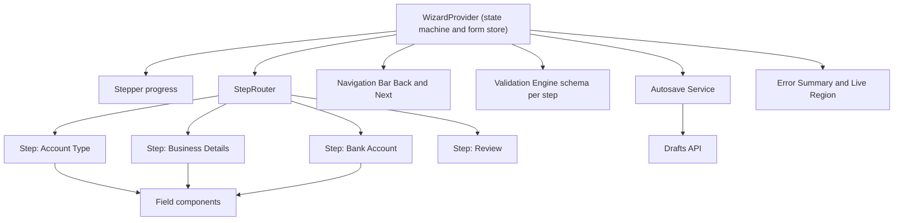

# Multi-Step Form

**Category:** Frontend System Design
**Difficulty:** 🟡 Medium
**Seniority:** mid
**Companies:** Stripe, Airbnb, Intuit, Shopify, Google, Amazon, Robinhood
**Tags:** form-state, validation, state-machine, autosave, routing, accessibility
**Time:** 45 min

---

## Problem Statement

Design a multi-step form (wizard), such as a merchant onboarding flow at Stripe, a host listing flow at Airbnb, or a tax-filing wizard at Intuit. The user progresses through steps — personal info, business details, bank account, review, submit — with per-step validation, a progress indicator, the ability to go back, and conditional steps that depend on earlier answers.

The flow is long, so users may leave and come back days later on another device. It must not lose data, must validate on both client and server, and must be accessible.

## Clarifying Questions

- How many steps? *5-8, some conditional (e.g. "Company" vs "Individual" changes which steps appear).*
- Can users jump to arbitrary steps? *Only to completed steps or the current step; review step allows "Edit" links back.*
- Should progress persist? *Yes, server-side drafts so they can resume on any device; local backup too.*
- Is the schema static or server-driven? *Static per release, but should be configurable (config-driven steps).*
- Sensitive data? *Yes — SSN/bank account; must not be stored in localStorage.*
- Async validation? *Yes, e.g. checking a business tax ID or routing number.*
- Deep links / browser back? *Browser back should go to the previous step, not leave the flow.*

## Requirements

### Functional

- Render steps with fields; Next/Back navigation and a stepper showing progress.
- Per-step validation (sync and async), with errors shown inline.
- Conditional steps and fields based on prior answers.
- Autosave drafts; resume later on any device.
- Review step summarizing all answers with edit links.
- Final submit with server-side validation and error mapping back to steps.

### Non-Functional

- Never lose user input (refresh, network blip, tab close).
- Fast step transitions (< 100ms); load step code lazily.
- WCAG 2.2 AA: labels, error announcements, focus management between steps.
- Secure handling of PII; no sensitive data in URLs or local storage.

### Out of Scope

- Form builder UI for admins, identity verification backend.

## Component Architecture



- **WizardProvider**: holds form values, the current step, completed steps, and the step graph. Implemented as a finite state machine (XState / reducer in React; a service with signals or NgRx in Angular).
- **Stepper**: displays steps derived from the current answers (conditional steps appear/disappear); completed steps clickable.
- **StepRouter**: maps `currentStepId` to a lazily loaded step component; syncs with the URL (`/onboarding/bank`).
- **Field components**: controlled inputs bound to the form store (React Hook Form / Formik; Angular Reactive Forms `FormGroup` per step).
- **Validation Engine**: schema per step (zod/yup) used for client validation; the same schema ideally shared with the server (TypeScript monorepo).
- **Autosave Service**: debounced PATCH of draft, with status indicator ("Saved 2s ago").
- **Error Summary**: list of errors at top of step with links to fields.

## Data Model & State

```text
step config (data-driven):
  steps: [
    { id: "accountType", fields: ["type"], schema: AccountTypeSchema },
    { id: "company", fields: [...], schema: CompanySchema,
      when: (values) => values.type = "company" },
    { id: "individual", fields: [...], when: (values) => values.type = "individual" },
    { id: "bank", fields: ["routing", "account"], schema: BankSchema, sensitive: true },
    { id: "review" }
  ]

wizard state:
  draftId: string
  values: { [field]: value }            // single source of truth across steps
  currentStepId: string
  visitedSteps: Set<stepId>
  stepStatus: { [stepId]: "untouched" | "valid" | "invalid" }
  errors: { [field]: message }
  touched: { [field]: bool }
  saveStatus: "idle" | "saving" | "saved" | "error"
  version: number                       // server draft version for conflicts
  machineState: "editing" | "validating" | "submitting" | "submitted" | "failed"

derived:
  activeSteps = steps.filter(s => !s.when OR s.when(values))
  progress = index(currentStepId in activeSteps) / activeSteps.length
```

- One **values** object across all steps (not separate per-step stores) so conditional logic and review can read everything.
- When a branch becomes inactive (user switches from company to individual), either retain hidden values (for easy switching back) but **exclude them from submit**, or clear them — decide explicitly.
- Server draft is the durable store; sessionStorage holds a non-sensitive backup for refresh-without-network.

```text
FUNCTION next()
  SET step ← current step config
  SET result ← validate(step.schema, pick(values, step.fields))
  IF result has sync errors THEN
    SET errors ← result.errors; focus error summary; RETURN
  SET machineState ← "validating"
  SET asyncErrors ← await runAsyncValidators(step)    // e.g. routing number lookup
  IF asyncErrors THEN show them; SET machineState ← "editing"; RETURN
  MARK step valid; CALL autosave.flush()
  SET currentStepId ← nextActiveStep(currentStepId, values)
  PUSH history entry "/onboarding/" + currentStepId
  MOVE focus to new step heading
```

## API & Interfaces

```text
POST  /api/onboarding/drafts                    → 201 { draftId, version: 1 }
GET   /api/onboarding/drafts/{draftId}          → { values, currentStepId, version, updatedAt }
PATCH /api/onboarding/drafts/{draftId}
      headers: If-Match: <version>
      body: { values: { changed fields only }, currentStepId }
      200 → { version }    409 → { serverValues, version }   // edited on another device

POST  /api/validate/routing-number { routing }  → { valid, bankName }
POST  /api/onboarding/drafts/{draftId}/submit   (Idempotency-Key)
      200 → { applicationId }
      422 → { errors: [{ field: "company.taxId", message, stepId: "company" }] }
```

Sensitive fields (bank account, SSN) are sent to a tokenization endpoint and only a token is stored in the draft.

Component interface:

```text
<Wizard
  steps=stepConfig
  draftId?=id
  onSubmit=(values) => Promise
  onStepChange=(stepId) => void
  autosaveMs=1000
/>
<Step id="company" title="Business details"> ...fields... </Step>
Hooks/services: useWizard() → { values, next, back, goTo, errors, saveStatus }
```

## Rendering & Performance

- **CSR within an authenticated app**; the first step can be SSR'd for faster start but most cost is JS.
- **Lazy-load steps**: each step is a code-split chunk; prefetch the next step's chunk when the current step renders.
- **Field-level subscriptions**: uncontrolled inputs with refs (React Hook Form) or Angular Reactive Forms avoid re-rendering the whole wizard per keystroke.
- **Validation timing**: validate on blur and on Next; after first error, re-validate that field on change (reward early, punish late).
- **Async validation**: debounce 300-500ms, cancel stale calls, cache results per input value.
- **Autosave**: debounce 1s after changes plus flush on step change and `visibilitychange` (`hidden`) via `fetch(..., { keepalive: true })` or `sendBeacon`; send only diffs.
- **Heavy widgets** (address autocomplete, date pickers, file upload) loaded only on the steps that use them.
- **CLS**: reserve space for inline error messages or render them without shifting critical controls; keep nav bar position stable.

```text
FUNCTION onFieldChange(field, value)
  SET values[field] ← value
  ADD field TO dirtyFields
  CALL debounce(saveDraft, autosaveMs)

FUNCTION saveDraft()
  IF dirtyFields empty OR saveStatus = "saving" THEN RETURN
  SET patch ← pick(values, dirtyFields EXCLUDING sensitive fields)
  CLEAR dirtyFields; SET saveStatus ← "saving"
  TRY
    SET res ← PATCH draft { values: patch } If-Match version
    SET version ← res.version; SET saveStatus ← "saved"
  CATCH conflict 409 → open merge prompt ("Keep mine / Use latest")
  CATCH network → re-add patch fields to dirtyFields; retry with backoff; SET saveStatus ← "error"
```

## Accessibility & UX

- Each step is a `<form>` (or `<fieldset>` with `<legend>`) with a visible `<h2>` title; on step change, move focus to that heading (`tabindex="-1"`) and update `document.title` ("Step 3 of 6: Bank account").
- Stepper: `<nav aria-label="Progress"><ol>`; current step has `aria-current="step"`; completed steps are links/buttons; future steps are not focusable (or `aria-disabled`).
- Fields: real `<label for>`; hints via `aria-describedby`; errors linked with `aria-describedby` and `aria-invalid="true"`.
- On failed Next: show an **error summary** at top ("There are 2 problems") with links to fields, focus it; GOV.UK pattern.
- Correct `autocomplete` tokens (`given-name`, `postal-code`, `organization`) and `inputmode` for numeric fields; don't block paste.
- Save status announced politely ("Draft saved"); don't steal focus.
- Back button never loses data; browser Back maps to previous step via history entries.
- Warn on leaving with unsaved changes (`beforeunload` only if unsaved, plus in-app route guards: `CanDeactivate` in Angular, router blockers in React).
- Mobile: one column, large touch targets, sticky nav bar above the virtual keyboard.
- i18n: externalized strings and error messages, locale-specific formats (addresses, phone, dates), RTL-safe layout.
- Timeouts: if session expires, warn before and allow extension (WCAG 2.2.1).

## Edge Cases & Resilience

- **Refresh mid-step**: restore from server draft (or sessionStorage backup if offline), return to `currentStepId`.
- **Deep link to a future step** (`/onboarding/review` without completing earlier steps): guard redirects to the first incomplete active step.
- **Branch change invalidates later steps**: re-evaluate active steps; mark dependent steps as needing revisit.
- **Multi-device edit conflicts**: optimistic concurrency with version/ETag; prompt to merge or reload.
- **Double submit**: disable button, idempotency key, state machine prevents `submitting → submitting`.
- **Server 422 on submit**: map field errors to their steps, navigate to the first invalid step, and focus the error summary.
- **Network loss**: keep editing; queue autosave; show "Offline — changes will save when reconnected".
- **Schema change between releases**: drafts store a `schemaVersion`; migrate old drafts on load.
- **Security**: never put PII in URLs or analytics events; sensitive fields tokenized and excluded from local storage; CSRF tokens on mutations; server re-validates everything (client validation is UX only); mask sensitive inputs and set `autocomplete="off"` only where appropriate.

## Trade-offs

| Decision | Option A | Option B | Choice & Why |
|---|---|---|---|
| Flow control | Ad hoc booleans | Finite state machine | State machine — explicit transitions prevent impossible states (submitting while editing) and simplify guards |
| Step definition | Hardcoded JSX/templates | Config-driven schema | Config-driven step graph with custom components for complex steps — easy to add/reorder conditional steps |
| Persistence | localStorage only | Server drafts + session backup | Server drafts for cross-device resume and PII safety; session backup for offline refresh |
| Validation timing | On every keystroke | On blur + on Next | Blur/Next first, then live re-validation of errored fields — less noisy |
| URL per step | Single URL | `/flow/:step` routes | Per-step routes — browser back works, analytics per step, guarded deep links |
| Hidden branch values | Clear on branch switch | Retain but exclude on submit | Retain for UX, exclude on submit; clear if sensitive |

## Follow-up Questions

1. **How would you make the form fully server-driven?** Server returns a JSON schema of steps/fields/rules (JSON Schema + UI schema); client has a field registry mapping types to components; versioned for compatibility.
2. **How would you measure drop-off?** Emit step_viewed/step_completed/validation_error events (no PII) and build a funnel to find problematic steps.
3. **How do you share validation between client and server?** Single schema package (zod in a TypeScript monorepo, or JSON Schema consumed by both); server remains authoritative.
4. **How would you handle file uploads in a step?** Upload directly to S3 via pre-signed URLs with progress and resumable chunks; store only the file key in the draft.
5. **How would you A/B test step order?** Step graph from config/feature flags; ensure drafts store which variant they started with.

## Common Mistakes

- Keeping each step's state locally so it is lost when navigating back.
- Validating only on final submit, surfacing all errors at the end.
- Not moving focus on step change, leaving screen-reader users unaware anything happened.
- Storing SSN or bank details in localStorage or URLs.
- Allowing double submissions and having no mapping of server errors back to steps.
- Breaking the browser Back button (leaving the flow entirely).

## Key Takeaways

- Model the wizard as a state machine over a single values object and a derived list of active steps.
- Validate per step with shared schemas; the server is authoritative.
- Autosave diffs to server drafts with versioning; never lose input, never persist PII client-side.
- Manage focus, error summaries, and per-step URLs for an accessible, resilient flow.
