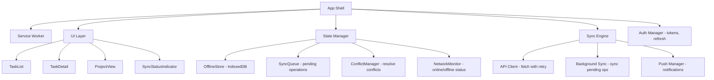

# Offline-first PWA

**Category:** Frontend System Design
**Difficulty:** 🔴 Hard
**Seniority:** senior
**Companies:** Common PWA pattern, Twitter Lite, Instagram Lite, Airbnb, Uber, Progressive Web Apps
**Tags:** service worker, sync, offline
**Time:** 60-90 min

---

## Problem Statement

Design an offline-first Progressive Web App (PWA) for a task management application similar to Todoist or Trello. Users can create, edit, and delete tasks, organize them into projects, and collaborate with team members. The app must work seamlessly offline, sync changes when connectivity is restored, handle conflicts, and provide a fast, app-like experience on mobile devices.

Focus on the service worker strategy, offline data storage (IndexedDB), sync queue management, conflict resolution, background sync, and the overall architecture for offline-first functionality.

## Clarifying Questions

- What data types? *Tasks, projects, labels, comments, attachments, user profiles.*
- Collaboration model? *Real-time collaboration with presence, or async with sync?*
- Conflict scenarios? *Two users edit the same task offline, then sync.*
- Platform? *Web browsers (desktop and mobile), with focus on mobile PWA experience.*
- Offline duration? *Users may be offline for hours or days.*
- Data size? *Up to 10,000 tasks per user, with attachments up to 10MB each.*
- Push notifications? *Yes, for task reminders and collaboration updates.*

## Requirements

### Functional

- Create, edit, delete tasks and projects offline.
- Organize tasks with labels, due dates, and priorities.
- Add comments and attachments to tasks.
- Collaborate with team members (assign tasks, comment).
- Sync changes automatically when online.
- Handle conflicts intelligently (last-write-wins, merge, or user resolution).
- Receive push notifications for reminders and updates.
- Install as a PWA with app shell and offline support.

### Non-Functional

- Fast first paint (< 2s) on slow 3G networks.
- Works offline for extended periods (hours to days).
- Sync completes within 5 seconds of regaining connectivity.
- Data integrity: no data loss due to sync failures.
- Battery-efficient background sync.
- Accessible keyboard navigation and screen reader support.

### Out of Scope

- Real-time collaboration (WebSocket), advanced conflict resolution UI, file sharing beyond attachments.

## Component Architecture



- **App Shell**: The minimal UI skeleton cached by the service worker for instant loading.
- **Service Worker**: Caches assets, intercepts network requests, serves offline content, and manages background sync.
- **UI Layer**: React/Vue/Angular components that read from OfflineStore and dispatch actions.
- **OfflineStore**: IndexedDB wrapper for storing tasks, projects, and metadata offline.
- **SyncQueue**: Queue of pending operations (create, update, delete) to sync when online.
- **ConflictManager**: Detects and resolves conflicts when syncing.
- **NetworkMonitor**: Tracks online/offline status and triggers sync.
- **Sync Engine**: Coordinates syncing, retries, and background sync.
- **API Client**: HTTP client with retry logic and offline detection.
- **Background Sync**: Uses Background Sync API to sync when connectivity is restored.
- **Push Manager**: Handles push notifications for reminders and updates.
- **Auth Manager**: Manages authentication tokens and refresh logic.

## Data Model & State

```text
Task {
  id, title, description, completed, dueDate, priority,
  projectId, labelIds[], assigneeId, createdAt, updatedAt,
  version: number,  // for conflict detection
  deleted: boolean
}

Project {
  id, name, color, icon, createdAt, updatedAt,
  version: number, deleted: boolean
}

Label {
  id, name, color, createdAt, updatedAt
}

User {
  id, name, email, avatarUrl
}

SyncOperation {
  id, type: "create" | "update" | "delete",
  entityType: "task" | "project" | "label",
  entityId, data, timestamp, retryCount: number
}

OfflineState {
  tasks: Map<TaskId, Task>,
  projects: Map<ProjectId, Project>,
  labels: Map<LabelId, Label>,
  syncQueue: SyncOperation[],
  lastSyncTime: timestamp,
  isOnline: boolean
}
```

- **Version field** on entities for optimistic concurrency control.
- **Deleted flag** for soft deletes (synced later).
- **SyncQueue** tracks pending operations with retry count.
- **OfflineState** is the source of truth for the UI; API is the source of truth for sync.

## API & Interfaces

```text
GET /api/tasks
200 → { tasks: Task[], version: string }

GET /api/tasks/{id}
200 → { task }

POST /api/tasks
201 → { task }

PUT /api/tasks/{id}
200 → { task }

DELETE /api/tasks/{id}
204 → { success }

GET /api/sync?since={timestamp}
200 → { changes: { tasks: Task[], projects: Project[] }, version: string }

POST /api/sync
200 → { applied: SyncOperation[], conflicts: Conflict[] }

WebSocket wss://api.example.com/realtime
  server -> { type: "task_updated", task }
  server -> { type: "task_deleted", taskId }
```

Service worker events:

```text
self.addEventListener('install', event => {
  event.waitUntil(cacheAppShell());
});

self.addEventListener('fetch', event => {
  event.respondWith(staleWhileRevalidate(event.request));
});

self.addEventListener('sync', event => {
  event.waitUntil(syncPendingOperations());
});

self.addEventListener('push', event => {
  event.waitUntil(showNotification(event.data.json()));
});
```

## Rendering & Performance

**Service Worker Caching Strategy:**

```text
FUNCTION handleRequest(request)
  IF request.url IN staticAssets
    RETURN cacheFirst(request)  // CSS, JS, images
  ELSE IF request.url IN apiEndpoints
    RETURN networkFirst(request)  // API calls
  ELSE
    RETURN staleWhileRevalidate(request)  // HTML, dynamic content
```

- **Cache-first** for static assets (CSS, JS, images) for instant loading.
- **Network-first** for API calls to ensure fresh data.
- **Stale-while-revalidate** for HTML to show cached content immediately and update in background.

**IndexedDB Storage:**

```text
FUNCTION storeTask(task)
  SET transaction ← db.transaction(['tasks'], 'readwrite')
  SET store ← transaction.objectStore('tasks')
  store.put(task)
  RETURN transaction.complete

FUNCTION getTask(id)
  SET transaction ← db.transaction(['tasks'], 'readonly')
  SET store ← transaction.objectStore('tasks')
  RETURN store.get(id)
```

- Use IndexedDB for offline storage (larger capacity than localStorage).
- Store tasks, projects, labels, and sync queue in separate object stores.
- Use indexes for efficient queries (e.g., tasks by projectId).

**Sync Queue Management:**

```text
FUNCTION enqueueOperation(operation)
  SET operation.id ← generateId()
  SET operation.timestamp ← Date.now()
  SET operation.retryCount ← 0
  syncQueue.push(operation)
  storeSyncQueue(syncQueue)
  IF isOnline THEN triggerSync()

FUNCTION syncPendingOperations()
  WHILE syncQueue.length > 0 AND isOnline
    SET operation ← syncQueue[0]
    TRY
      SET result ← sendOperationToServer(operation)
      IF result.conflict
        SET resolved ← conflictManager.resolve(operation, result.serverData)
        IF resolved
          syncQueue.shift()
          updateLocalData(resolved)
        ELSE
          SHOW conflict UI to user
          BREAK
      ELSE
        syncQueue.shift()
        updateLocalData(result.data)
    CATCH error
      operation.retryCount++
      IF operation.retryCount > 5
        MOVE operation to failedQueue
        SHOW error to user
      ELSE
        WAIT exponentialBackoff(operation.retryCount)
```

- **Exponential backoff** for retrying failed operations.
- **Failed queue** for operations that couldn't be synced after retries.
- **Conflict UI** for user resolution when automatic resolution fails.

**Conflict Resolution:**

```text
FUNCTION resolveConflict(localOp, serverData)
  IF localOp.type = "delete" AND serverData.deleted
    RETURN { action: "ignore" }  // already deleted on server
  IF localOp.type = "update" AND serverData.version > localOp.data.version
    IF localOp.data.version = serverData.version - 1
      // Simple conflict: merge non-conflicting fields
      RETURN { action: "merge", data: mergeFields(localOp.data, serverData) }
    ELSE
      // Complex conflict: require user resolution
      RETURN { action: "manual", local: localOp.data, remote: serverData }
  RETURN { action: "apply", data: localOp.data }
```

- **Last-write-wins** for simple conflicts.
- **Field-level merge** for non-conflicting updates.
- **Manual resolution** for complex conflicts (show UI to user).

**Background Sync:**

```text
FUNCTION registerBackgroundSync()
  navigator.serviceWorker.ready.then(registration => {
    registration.sync.register('sync-tasks').catch(err => {
      console.log('Background sync failed:', err)
    })
  })
```

- Use **Background Sync API** to sync when connectivity is restored.
- Fallback to **sync on visibility change** if Background Sync is not supported.

## Accessibility & UX

- **Offline indicator**: Show clear indicator when offline (e.g., "You're offline" banner).
- **Sync status**: Show sync progress (e.g., "Syncing 3 changes...").
- **Error states**: Show retry button for failed sync operations.
- **Keyboard navigation**: Full keyboard support for all actions.
- **Screen reader support**: Announce offline/online status changes, sync errors.
- **Loading states**: Show skeleton screens while data loads.
- **Optimistic UI**: Apply changes immediately, show sync status in background.
- **Conflict UI**: Clear UI for resolving conflicts (e.g., "Keep yours" vs "Keep theirs").
- **Push notifications**: Request permission, show actionable notifications.
- **App-like experience**: Smooth transitions, no page reloads, install prompt.

## Edge Cases & Resilience

- **Offline during initial load**: Show cached app shell, then cached data, then sync when online.
- **Large attachments**: Store attachments in IndexedDB, sync when online, show progress.
- **Concurrent edits**: Two users edit same task offline, then sync → conflict resolution.
- **Sync failure**: Retry with exponential backoff, show error after max retries.
- **Data corruption**: Validate data structure on load, recover from backup if needed.
- **Storage quota exceeded**: Show error, suggest clearing old data or upgrading storage.
- **Auth token expired**: Refresh token automatically, retry failed operations.
- **Network flapping**: Debounce online/offline events to avoid excessive sync triggers.
- **Service worker update**: Show "New version available" prompt, update on user action.
- **Browser compatibility**: Fallback for browsers without service worker support.

## Trade-offs

| Decision | Option A | Option B | Choice & Why |
|---|---|---|---|
| Offline storage | localStorage | IndexedDB | IndexedDB for larger capacity and async operations; localStorage simpler but limited |
| Sync strategy | Manual sync | Background sync | Background sync for automatic sync; manual sync as fallback |
| Conflict resolution | Last-write-wins | Field-level merge | Field-level merge for better UX; last-write-wins simpler |
| Caching | Cache-first | Network-first | Cache-first for static assets; network-first for API calls |
| Sync queue | In-memory | Persistent | Persistent (IndexedDB) to survive page reloads |

## Follow-up Questions

1. **How would you handle real-time collaboration?** Add WebSocket for real-time updates, use CRDT for conflict-free collaboration, and show presence indicators.
2. **How would you handle large file uploads offline?** Store files in IndexedDB, chunk uploads, resume uploads when online, show progress.
3. **How would you implement differential sync?** Send only changed fields instead of full entities, reduce bandwidth, and handle partial updates.
4. **How would you handle schema migrations?** Version the data schema, run migrations on app load, handle backward compatibility.
5. **How would you add end-to-end encryption?** Encrypt data in IndexedDB, sync encrypted data, decrypt on client, manage keys securely.

## Common Mistakes

- Using localStorage for offline storage, hitting quota limits and blocking the main thread.
- Not handling conflicts, leading to data loss or overwrites.
- Syncing on every change, causing excessive network traffic and battery drain.
- Not showing offline status, confusing users when actions don't sync.
- Forgetting to handle service worker updates, leaving users on old versions.
- Not validating data on sync, propagating corrupted data to the server.

## Key Takeaways

- Service worker with cache-first for static assets and network-first for API calls provides the best offline experience.
- IndexedDB is essential for storing large datasets offline and surviving page reloads.
- Sync queue with exponential backoff and conflict resolution ensures data integrity and resilience.
- Background Sync API enables automatic syncing when connectivity is restored.
- Clear UX for offline status, sync progress, and conflict resolution is critical for user trust.
- Accessibility requires announcing state changes and providing keyboard navigation for all actions.
