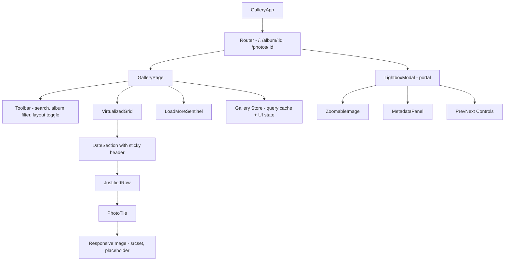

# Photo Gallery

**Category:** Frontend System Design
**Difficulty:** 🟡 Medium
**Seniority:** mid
**Companies:** Google, Meta, Pinterest, Flickr, Shutterstock, Airbnb
**Tags:** infinite-scroll, virtualization, responsive-images, lazy-loading, masonry-layout, lightbox
**Time:** 45 min

---

## Problem Statement

Design the client side of a photo gallery like Google Photos, Pinterest or Unsplash. Users browse a large, possibly endless feed of photos in a responsive grid, open any photo in a full-screen lightbox, move between photos with arrows or swipes, and filter by album or search term.

Some users have libraries of 50k+ photos, and many are on mid-range phones with slow networks. The interviewer wants to hear how you load and render a huge, image-heavy list without janky scrolling, without layout shift, and without wasting bandwidth.

## Clarifying Questions

- Is the layout a uniform grid, a justified row (Google Photos), or masonry (Pinterest)? *Justified rows, with masonry as an option. The server sends each photo's aspect ratio.*
- How many photos per user or feed? *Anywhere from tens to 100k. Treat it as unbounded.*
- Do we need upload and editing? *Out of scope. This is read-only browsing plus the lightbox.*
- Which devices and networks? *Mobile first, slow 3G to fiber, and every evergreen browser.*
- Does the image CDN support on-the-fly resizing and format conversion? *Yes, through URL parameters for width, quality and format (AVIF/WebP/JPEG).*
- Is SEO needed? *Yes for public feeds such as Explore. Private libraries are behind auth.*
- Do we need deep links to a single photo? *Yes. `/photos/:id` should open the lightbox directly.*

## Requirements

### Functional
- Show photos in a responsive justified or masonry grid with infinite scroll.
- Filter by album and search query, and group by date with sticky date headers.
- Open a lightbox showing the full-resolution image, metadata, and prev/next navigation.
- Support keyboard, mouse, touch swipe and pinch-zoom in the lightbox.
- Give each photo a deep-linkable URL, and have the back button close the lightbox.

### Non-Functional
- Scrolling at 60 fps even with 100k items. DOM node count stays bounded.
- LCP < 2.5 s, CLS < 0.1, INP < 200 ms on a mid-range Android phone.
- Never download images larger than the rendered size × DPR.
- Accessible (WCAG 2.1 AA), with full keyboard operation.

### Out of Scope
- Upload, editing, sharing permissions, and face recognition.

## Component Architecture



- **GalleryPage** owns the query (album, search) and reads paged data from the store. It knows nothing about how items are laid out.
- **VirtualizedGrid** takes the item list and container width. It computes row layouts and renders only the rows near the viewport plus some overscan. The React equivalents are `react-window`/`@tanstack/react-virtual`; in Angular it is CDK `cdk-virtual-scroll-viewport` with a custom strategy for variable heights.
- **JustifiedRow** is a pure layout component. Given aspect ratios and a target row height, it returns a width for each tile.
- **ResponsiveImage** handles `srcset`/`sizes`, the blur-hash or dominant-color placeholder, `loading="lazy"`, `decoding="async"`, and the fade-in once loaded.
- **LightboxModal** renders through a portal (React `createPortal`, Angular CDK Overlay). It is driven by the route, so a deep link or a refresh reopens it. It preloads the neighboring images.
- **LoadMoreSentinel** is an IntersectionObserver target placed about 2 viewports before the end of the list.

## Data Model & State

```text
GalleryState {
  photosById: Map<PhotoId, Photo>            // normalized server cache
  queries: Map<QueryKey, {                   // QueryKey = hash(albumId, search, sort)
    pages: List<{ ids: List<PhotoId>, nextCursor: String | null }>
    status: idle | loading | error
    lastFetchedAt: Timestamp
  }>
  ui: {
    layout: justified | masonry | grid
    activeQueryKey: QueryKey
    lightboxPhotoId: PhotoId | null           // mirrored from URL
    scrollAnchor: { photoId, offsetPx }       // restore scroll on back nav
  }
}

Photo {
  id, width, height, aspectRatio,
  placeholder: blurhash | dominantColor,
  urlTemplate: "https://img.cdn/{id}?w={w}&fmt={fmt}&q={q}",
  takenAt, title, alt, albumIds
}

LayoutCache: Map<(QueryKey, containerWidth), List<Row{ top, height, items[{id, x, w}] }>>
```

- **Server cache vs UI state.** Photos and pages are server state, held in a query cache (TanStack Query, RTK Query, or an Angular service with signals or RxJS). Layout, lightbox and scroll anchor are UI state. The lightbox id lives in the URL so links can be shared.
- **Normalization.** A photo can appear in several albums and in search results. Storing it once by id keeps a metadata update (a title edit, say) consistent everywhere.
- **Derived layout.** Row positions are computed from aspect ratios and are never stored on the server. They are memoized per container width and recomputed on resize, debounced to one `requestAnimationFrame`.

## API & Interfaces

```text
GET /api/photos?album={id}&q={query}&cursor={c}&limit=100
  200 { items: [ { id, width, height, placeholder, takenAt, title, alt } ],
        nextCursor: "eyJ0IjoxNjk..." | null }

GET /api/photos/{id}
  200 { id, width, height, exif: {...}, location, albums: [...], urlTemplate }

GET /api/photos/{id}/neighbors?album={id}&q={query}
  200 { prevId, nextId }            // for lightbox deep links outside loaded pages

Image CDN:
GET https://img.cdn/{id}?w=400&fmt=avif&q=70      // resized, cached at edge
```

Cursor pagination is better than offset pagination here. The feed changes as new photos arrive, and offsets would then produce duplicates or skipped items.

Public component interfaces:

```text
VirtualizedGrid
  props:  items: List<{id, aspectRatio}>, targetRowHeight = 220, gap = 4,
          overscanPx = 1000, renderTile(item, rect)
  events: onRangeChange(firstIndex, lastIndex), onEndReached()

ResponsiveImage
  props:  photo, sizes, priority: Boolean (eager + fetchpriority=high for LCP)
  events: onLoad, onError

LightboxModal
  props:  photoId, getNeighbor(id, dir)
  events: onNavigate(id), onClose()
```

## Rendering & Performance

**Rendering strategy.** Public feeds use SSR or SSG for the first page, so they are crawlable and get a fast LCP; the rest hydrates on the client. Private libraries use CSR behind an app shell. Either way the first row ships as HTML with real `` tags.

**Justified layout algorithm.**

```text
FUNCTION layoutRows(items, containerWidth, targetH, gap)
  SET rows ← [], current ← [], top ← 0
  FOR item IN items
    APPEND item TO current
    SET sumAR ← SUM(i.aspectRatio FOR i IN current)
    SET rowH ← (containerWidth - gap * (LEN(current) - 1)) / sumAR
    IF rowH <= targetH THEN                 // row is full
      APPEND Row(top, rowH, current) TO rows
      SET top ← top + rowH + gap
      SET current ← []
  IF current NOT EMPTY THEN APPEND Row(top, targetH, current) TO rows  // last row not stretched
  RETURN rows
```

**Virtualization.** Only rows that intersect `[scrollTop - overscan, scrollTop + viewportH + overscan]` are rendered. A binary search over row `top` values finds the first visible row in O(log n). A spacer element with the total height keeps the native scrollbar correct. The DOM holds about 30–60 tiles no matter how large the library is.

**Images.**
- Use `srcset` with CDN widths (200, 400, 800, 1600) and `sizes` taken from the computed tile width, so a 180 px tile on a 3x DPR screen downloads the ~600 px variant.
- Negotiate formats with `<picture>` (AVIF, then WebP, then JPEG), or let the CDN choose from the `Accept` header.
- Give every image explicit `width`/`height` or `aspect-ratio` so CLS is 0. Show a blurhash or dominant-color background until the image decodes.
- Use `loading="lazy"` for images below the fold. The LCP image gets `fetchpriority="high"` and is never lazy.
- During a fast scroll, cancel or skip images for tiles that left the viewport, either by unmounting or by clearing `src`.

**Data fetching.** Prefetch the next page when the sentinel comes within 2 viewports. Deduplicate in-flight requests per cursor. Debounce search input by 300 ms and cancel stale requests with `AbortController`.

**Lightbox.** Preload the prev and next full-size images with `new Image()` or `<link rel="preload">`. Use CSS `transform` for zoom and pan so the work stays on the compositor. Handle gestures with Pointer Events.

**Bundle.** Lazy-load the lightbox, the zoom library and the EXIF panel with dynamic `import()`. The grid is the critical path, so keep it under about 50 KB gzipped.

## Accessibility & UX

- **Semantics.** The grid is a `role="list"` of `role="listitem"`, or a `role="grid"` if arrow-key navigation between cells is supported. Every image needs meaningful `alt` text from the server, falling back to "Photo taken {date}".
- **Keyboard.** Tab reaches the grid. Arrow keys move between tiles using a roving `tabindex`. Enter opens the lightbox. In the lightbox, Left/Right navigates, Esc closes, and +/- zooms.
- **Virtualization and focus.** Do not unmount the focused tile; pin it in the rendered range. Expose `aria-setsize`/`aria-posinset` so screen readers can announce "photo 37 of 12,450".
- **Lightbox focus.** Use `role="dialog"` with `aria-modal="true"`. Trap focus inside it, return focus to the originating tile on close, and announce the photo title through an `aria-live` region when navigating.
- **States.** Show skeleton tiles shaped like the expected aspect ratios while loading. Empty album gets an illustration and a CTA. A failed image shows a broken-image icon with a retry option. A failed page shows an inline "Retry" row at the bottom.
- **Motion.** Respect `prefers-reduced-motion` by turning off the zoom/fade transitions.
- **RTL.** Mirror the row fill direction and swap the meaning of prev/next arrows when `dir="rtl"`.

## Edge Cases & Resilience

- **Failed image load.** Retry once with a different format, or with the original JPEG if AVIF decode fails. After that, show the fallback.
- **Pagination races.** If the query changes while page 3 is in flight, abort it. Store responses under their QueryKey so a late response never pollutes the current list.
- **Duplicates across pages.** Deduplicate by id when appending, since cursor feeds can return overlaps after inserts.
- **Scroll restoration.** Save `{anchorPhotoId, offset}` on navigation and restore it after layout. The browser's native restoration fails with virtualized lists.
- **Resize/orientation change.** Recompute the layout, keep the top visible photo anchored, and adjust `scrollTop` so the user does not lose their place.
- **Deep link to an unloaded photo.** Fetch `/photos/{id}` and `/neighbors` directly instead of paging until the photo is found.
- **Offline.** A Service Worker caches the app shell and recently viewed thumbnails (stale-while-revalidate), and an offline banner is shown.
- **Security.** Titles and EXIF are user-generated, so render them as text, never as `innerHTML`. Use signed, expiring CDN URLs for private photos. Set a CSP `img-src` limited to the CDN domain.

## Trade-offs

| Decision | Option A | Option B | Choice & Why |
|---|---|---|---|
| Pagination | Offset/page number | Cursor | Cursor. Stable while photos are added, and works with infinite scroll. |
| Layout | CSS Grid / CSS masonry | JS-computed absolute positions | JS-computed. Virtualization needs known row positions, and native masonry support is still limited. |
| Virtualization | Render all + `content-visibility: auto` | Windowed rendering | Windowed for 10k+ items. `content-visibility` is fine below about 1k items and simpler. |
| Placeholder | Dominant color | Blurhash/LQIP | Blurhash. Better perceived quality for about 30 bytes per photo. Dominant color as fallback. |
| Lightbox state | Local component state | URL route | URL. Shareable, survives refresh, and the back button closes it. |

## Follow-up Questions

1. **How would you support a timeline scrubber (jump to 2019)?** Fetch a lightweight index of photo counts by month so the total height can be estimated per section. Jumping means fetching the page for that date cursor and anchoring scroll to it.
2. **What if aspect ratios are unknown until the image loads?** Use fixed-ratio square crops (`object-fit: cover`) for the grid, or make the server compute the dimensions at upload. Re-laying out after load causes CLS.
3. **How do you handle multi-select for bulk actions?** Keep a `Set<PhotoId>` of selected ids in UI state, support Shift-click range selection by index, and keep selection independent of rendering so it survives virtualization.
4. **How would you make the gallery work offline?** Cache metadata pages in IndexedDB and thumbnails in Cache Storage under an LRU size budget. Queue actions to sync later.
5. **How would you measure performance in production?** RUM through `web-vitals` (LCP, CLS, INP), a long-task observer during scroll, and the image bytes per session, broken down by device class.

## Common Mistakes

- Rendering every loaded photo in the DOM, which leads to memory blowups and scroll jank past a few thousand items.
- Serving a single full-size image to every tile, or omitting `sizes`, so the browser picks the largest `srcset` candidate.
- Missing width/height or aspect-ratio, which causes heavy layout shift as images load.
- Lazy-loading the LCP image, or loading everything eagerly.
- Keeping lightbox state out of the URL, which breaks deep links and the back button.
- Forgetting focus management when virtualization unmounts the focused element.

## Key Takeaways

- Server-provided aspect ratios let you compute the layout up front, which is what makes virtualization and zero CLS possible.
- Responsive images (`srcset`/`sizes`, modern formats, CDN resizing) save the most bandwidth.
- Cursor pagination, an IntersectionObserver sentinel and request cancellation give robust infinite scroll.
- A route-driven lightbox with focus trapping, keyboard navigation and preloaded neighbors gives a polished, accessible experience.
