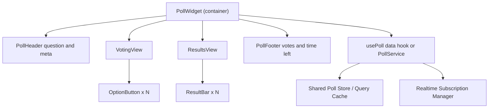

# Poll Widget

**Category:** Frontend System Design
**Difficulty:** 🟢 Easy
**Seniority:** mid
**Companies:** Meta, Twitter, LinkedIn, Reddit, Slack, Discord
**Tags:** embeddable-widget, optimistic-updates, real-time, polling, web-components, state-management
**Time:** 45 min

---

## Problem Statement

Design a poll widget like the polls in X (Twitter) posts, LinkedIn, or Slack messages. A poll has a question, 2-4 options, and an end time. Users vote once; after voting (or after the poll closes) they see results as percentage bars with total vote count, and their own choice highlighted.

The widget appears inside a feed (many polls on one page) and may also be embedded on third-party sites via a script tag. Popular polls can receive thousands of votes per minute, so results should update in near real time without hammering the server.

## Clarifying Questions

- Single-choice or multi-choice? *Single-choice; multi-choice is a follow-up.*
- Can users change their vote? *No, votes are final (like X).*
- Must users be logged in? *Yes in-app; embedded version requires login via popup or is read-only.*
- How fresh must results be? *Within ~5-10 seconds is fine; not a real-time game.*
- Are results visible before voting? *No — hidden until the user votes or the poll ends to avoid bias.*
- How many polls per page? *Up to ~20 in a feed viewport session.*
- Embeddable on third-party sites? *Yes, must not conflict with host CSS/JS.*

## Requirements

### Functional

- Render question, options, time remaining, total votes.
- Vote on one option; show results with percentages and user's choice.
- Show final results when closed.
- Live-ish updates of counts while visible.
- Embeddable via `<script>` + custom element.

### Non-Functional

- Vote feedback < 100ms perceived (optimistic UI).
- Efficient: no per-poll websocket storm when 20 polls are on screen.
- Accessible: screen readers convey options, selection, and results.
- Embedded version: style isolation, < 15 KB gzipped, no global leaks.

### Out of Scope

- Poll creation UI, analytics dashboard, anti-fraud backend logic.

## Component Architecture



- **PollWidget**: container deciding which view to show: `VotingView` if `!userVote && !closed`, else `ResultsView`.
- **OptionButton**: radio-like option; disabled while submitting.
- **ResultBar**: label, percentage text, animated bar width (via `transform: scaleX`).
- **usePoll / PollService**: fetches poll, submits vote with optimistic update, subscribes to updates.
- **Shared Store** (React Query / Apollo / NgRx entity): normalized by poll id so the same poll in two places stays in sync.
- **Subscription Manager**: one connection per page, multiplexing subscriptions for visible polls only.

## Data Model & State

```text
server cache (normalized):
  polls: {
    [pollId]: {
      id, question,
      options: [{ id, text, votes }],
      totalVotes,
      endsAt: ISO timestamp,
      status: "open" | "closed",
      userVoteOptionId: string | null,
      version: number            // monotonic, for discarding stale updates
    }
  }

UI state (per widget):
  pendingOptionId: string | null
  error: string | null
  isVisible: boolean             // from IntersectionObserver
```

- Percentages are **derived**, never stored: `round(votes / totalVotes * 100)`; use largest-remainder rounding so they sum to 100.
- `status` can also be derived client-side from `endsAt` vs server-synced clock; a timer flips to closed at the deadline.

```text
FUNCTION percentages(options, total)
  IF total = 0 THEN RETURN all zeros
  SET raw ← [o.votes * 100 / total FOR o IN options]
  SET floors ← [floor(r) FOR r IN raw]
  SET remaining ← 100 - sum(floors)
  SORT indices BY (raw[i] - floors[i]) DESC
  FOR i IN first `remaining` indices: floors[i] ← floors[i] + 1
  RETURN floors
```

## API & Interfaces

```text
GET  /api/polls/{pollId}
     200 → { id, question, options:[{id,text,votes}], totalVotes, endsAt, status,
             userVoteOptionId, version }
     // votes hidden (null) if user hasn't voted and poll open

POST /api/polls/{pollId}/votes
     headers: Idempotency-Key: <uuid>, X-CSRF-Token
     body: { optionId }
     201 → full poll payload (authoritative counts)
     409 → already voted (return current poll)
     410 → poll closed

GET  /api/polls/batch?ids=a,b,c        // refresh visible polls in one request

Realtime (SSE or WebSocket):
     client → { type:"subscribe", pollIds:[...] } / { type:"unsubscribe", ... }
     server → { type:"poll.update", pollId, options:[{id,votes}], totalVotes, version }
```

Component interface:

```text
<PollWidget pollId="p_123" initialData?=... onVote=(optionId)=>... theme="light|dark" />

Embed:
<script src="https://cdn.example.com/poll-widget.js" async></script>
<poll-widget poll-id="p_123"></poll-widget>
Events: CustomEvent("vote", { detail: { pollId, optionId } })
```

## Rendering & Performance

- **SSR in-app**: poll content is part of the post HTML (good for SEO and LCP); hydrate interactivity.
- **Optimistic vote**: increment chosen option and total locally, show results immediately, reconcile with server response.
- **Visibility-gated updates**: subscribe only while the widget is in the viewport (`IntersectionObserver`) and the tab is visible; unsubscribe otherwise.
- **Transport**: one shared SSE/WebSocket connection per page multiplexing all visible polls; fallback to batched polling every 10s (`/batch`). Server can coalesce updates (max 1 per poll per 2s).
- **Animation**: bar widths animate with `transform: scaleX()` from 0 on first reveal; skip on reduced motion. Number changes use `tabular-nums` to avoid jitter.
- **Embed bundle**: Web Component (or Preact/Lit) with Shadow DOM, loaded `async`, lazy-initialized when near the viewport.
- **Re-render scope**: the store notifies only widgets whose poll changed (selector by pollId).

```text
FUNCTION vote(optionId)
  IF poll.userVoteOptionId OR pending THEN RETURN
  SET snapshot ← copy(poll)
  SET pending ← optionId
  APPLY optimistic: option.votes += 1, totalVotes += 1, userVoteOptionId ← optionId
  TRY
    SET res ← POST /votes { optionId } with Idempotency-Key
    REPLACE poll WITH res IF res.version >= poll.version
  CATCH err
    IF err.status = 409 THEN refetch poll       // already voted elsewhere
    ELSE restore snapshot; SET error ← "Vote failed, try again"
  FINALLY SET pending ← null
```

## Accessibility & UX

- Voting view: `<fieldset>` with `<legend>` = question; options as a `role="radiogroup"` of buttons, or one-click buttons each labeled "Vote for Option A".
- Results view: each bar is text-first — "Option A, 42 percent, 1,204 votes" — with the visual bar `aria-hidden`; mark the user's choice ("your vote") textually, not only by color.
- Announce vote confirmation via `aria-live="polite"`: "Vote recorded. Option A has 42 percent." Do **not** announce every live update (too noisy).
- Keep focus stable when switching views: move focus to the results heading or the chosen option's result.
- Time remaining in human format ("2 days left") using `Intl.RelativeTimeFormat`; numbers via `Intl.NumberFormat` ("1.2K").
- States: skeleton loading, "Poll ended" badge, error with retry, closed with zero votes.
- RTL: bars grow from inline-start using logical properties.
- Color contrast ≥ 4.5:1 for text over bars.

## Edge Cases & Resilience

- **Double click / multi-tab voting**: disable on pending, idempotency key on server, 409 handling by refetching.
- **Out-of-order updates**: drop realtime messages with `version` lower than the cached one; after own vote, the server response may be older than a broadcast.
- **Poll closes while user is deciding**: client timer flips to closed; a late vote gets 410 → show final results with message.
- **Clock skew**: compute `endsAt` relative to server time (offset from `Date` response header).
- **Offline**: disable vote button with "You're offline"; optionally queue vote and send on reconnect.
- **Reconnect**: exponential backoff with jitter for the socket; on reconnect, batch refetch visible polls.
- **Security**: escape question/option text (user-generated) — no `innerHTML`; CSRF token or SameSite cookies for POST; embed uses popup/OAuth for login rather than third-party cookies; strict CSP for the embed script.
- **Embed isolation**: Shadow DOM prevents host CSS bleed; prefix globals; never touch host `window` state.

## Trade-offs

| Decision | Option A | Option B | Choice & Why |
|---|---|---|---|
| Live updates | WebSocket/SSE push | Short polling | SSE multiplexed per page (one-way data fits); polling fallback for restrictive networks |
| Vote feedback | Optimistic | Wait for server | Optimistic — vote rarely fails; rollback path handles errors |
| Show results before vote | Yes | No | No — prevents bandwagon bias; matches product expectation |
| Embed tech | iframe | Web Component + Shadow DOM | Web Component for seamless sizing/theming; iframe if strong security isolation or auth cookies are required |
| Percent rounding | Naive round | Largest remainder | Largest remainder so totals show exactly 100% |

## Follow-up Questions

1. **How would you support multi-choice polls?** Store `userVoteOptionIds[]`, use checkboxes with a Submit button; percentages become per-voter (can exceed 100% in total), so show "of voters".
2. **What if a viral poll gets 50K votes/minute?** Server aggregates counts in Redis and broadcasts throttled snapshots every few seconds; clients never receive per-vote events.
3. **How do you keep the same poll consistent in feed and detail view?** Normalized cache keyed by pollId; both components select from the same entity.
4. **How would you lazy-load 20 polls on a long page?** Server-render core content, hydrate and subscribe only when near the viewport.
5. **How do you test it?** Unit test percentage math and reducer, component tests for vote flow and rollback, mock SSE in integration tests, visual regression for bars.

## Common Mistakes

- Opening one WebSocket per poll widget instead of multiplexing.
- Storing percentages instead of deriving them, leading to inconsistencies and 99%/101% totals.
- No rollback path for failed optimistic votes.
- Conveying the user's choice and results purely through color.
- Rendering user-generated option text with `innerHTML`.
- Updating polls that are off-screen or in background tabs.

## Key Takeaways

- Optimistic update + idempotent server endpoint gives instant, safe voting.
- Normalize poll data by id and derive percentages.
- Gate real-time updates by visibility and multiplex over one connection.
- For embeds, isolate with Shadow DOM or iframe and keep the bundle tiny.
