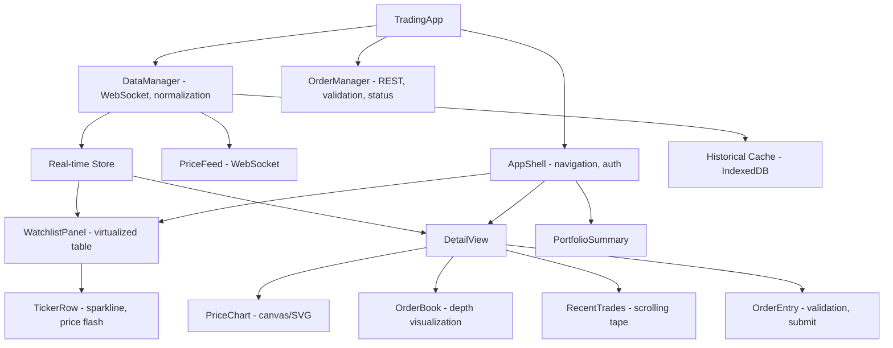

# Real-time Trading Dashboard

**Category:** Frontend System Design
**Difficulty:** 🔴 Hard
**Seniority:** senior
**Companies:** Robinhood, Bloomberg, Interactive Brokers, Webull, Fidelity, Charles Schwab
**Tags:** websockets, real-time, performance, virtualization, data-visualization, state-management
**Time:** 60-90 min

---

## Problem Statement

Design a real-time trading dashboard like Robinhood or Bloomberg Terminal. Users see a watchlist of stocks with live prices, percent changes, and mini-charts. They can click into a stock to see detailed charts (candlestick, line), order book depth, recent trades, and place market/limit orders. Prices update multiple times per second during market hours, and the UI must stay responsive with hundreds of tickers streaming simultaneously.

The dashboard handles 500+ tickers in a watchlist, with price updates arriving at 10-50 Hz per ticker during active trading. Users expect sub-100ms latency from price receipt to display, smooth chart animations, and the ability to execute orders in under 200ms. The interviewer cares about the real-time data pipeline, rendering performance at scale, and the order execution flow.

## Clarifying Questions

- How many tickers can a user watch simultaneously? *Up to 500 in a watchlist, with 20-50 visible in the viewport at once.*
- What chart types and timeframes? *Line, candlestick, area charts with 1m, 5m, 15m, 1h, 1D, 1W timeframes. No technical indicators for this round.*
- Order types? *Market, limit, stop-limit. No options or complex order types.*
- Real-time collaboration? *No. Single-user experience.*
- Offline support? *No. Trading requires live connectivity.*
- Mobile vs desktop? *Responsive web app that works on both. Desktop can show more data density.*
- What's the update rate? *Price quotes: 10-50 Hz per ticker during market hours. Order book: 5-10 Hz. Trades: as they occur.*

## Requirements

### Functional
- Watchlist with sortable columns (symbol, price, change %, volume, market cap) and mini sparkline charts.
- Detail view with interactive price chart (zoom, pan, crosshair), order book (bids/asks), recent trades tape, and order entry form.
- Real-time price updates with visual indicators (flash green/red on change).
- Order placement with validation, confirmation, and order status tracking.
- Portfolio summary with total value, day P&L, and position list.

### Non-Functional
- Price updates display within 100ms of receipt (p95).
- 60fps scrolling and chart animations even with 500 streaming tickers.
- Memory usage proportional to visible data, not total tickers.
- Graceful degradation on network hiccups (reconnect, backfill data).
- Accessible to keyboard-only and screen reader users.

### Out of Scope
- Options, futures, crypto, technical indicators, news feed, social features, and backtesting.

## Component Architecture



- **DataManager** is the single source of truth for market data. It owns the WebSocket connection, handles subscription management, normalizes incoming data, and writes to the store. It also manages reconnection with backoff and data backfilling.
- **WatchlistPanel** uses a virtualized table (react-window or similar) because rendering 500+ ticker rows with sparklines would be prohibitively expensive. Only visible rows are rendered.
- **PriceChart** uses canvas for performance with hundreds of thousands of data points. It supports zoom/pan via coordinate transformation and renders crosshairs and tooltips on hover.
- **OrderBook** visualizes bid/ask depth as a histogram or stacked bars, updating in real-time. It should batch updates to avoid excessive re-renders.
- **OrderManager** handles order submission via REST API, tracks order status updates (filled, partial, cancelled), and updates the portfolio state.
- **Framework notes.** React with Zustand or Redux for state management. Use `useSyncExternalStore` to subscribe to the real-time store. Chart components should be framework-agnostic for performance.

## Data Model & State

```text
MarketData {
  tickers: Map<TickerId, {
    symbol, name, exchange, currency,
    price: Number, change: Number, changePercent: Number,
    volume: Number, marketCap: Number,
    bid: Number, ask: Number, bidSize: Number, askSize: Number,
    lastTrade: { price, size, timestamp },
    dayOpen: Number, dayHigh: Number, dayLow: Number,
    prevClose: Number,
    sparkline: Array<{ time, price }>,  // last 100 points
    updatedAt: Timestamp
  }>
  orderBook: Map<TickerId, {
    bids: Array<{ price, size, total }],  // sorted desc
    asks: Array<{ price, size, total }>,  // sorted asc
    timestamp
  }>
  trades: Map<TickerId, Array<{ price, size, timestamp, side }>>  // last 50
}

Portfolio {
  cash: Number,
  positions: Map<TickerId, {
    quantity: Number, avgCost: Number, currentPrice: Number,
    dayP&L: Number, totalP&L: Number
  }>
  orders: Map<OrderId, {
    id, ticker, type: market|limit|stopLimit, side: buy|sell,
    quantity, price?, stopPrice?, status: pending|filled|partial|cancelled,
    filledQty, avgFillPrice, createdAt, updatedAt
  }>
  totalValue: Number, dayP&L: Number
}

UI State {
  selectedTicker: TickerId | null,
  watchlistOrder: Array<TickerId>,
  chartTimeframe: '1m' | '5m' | '15m' | '1h' | '1D' | '1W',
  chartRange: { start, end },
  orderForm: { ticker, side, type, quantity, price, stopPrice, errors }
}
```

- **Market data** is ephemeral and updated frequently. Sparklines are kept as rolling arrays of the last N points. Historical chart data is loaded on demand and cached.
- **Portfolio and orders** are persistent data synced with the server. Orders have a lifecycle and transition through states.
- **UI state** is local and not persisted, except perhaps the watchlist order and selected ticker for session continuity.

## API & Interfaces

```text
WebSocket wss://api.trading.example.com/stream?token=...
  client -> server
    { type: "subscribe", tickers: ["AAPL", "GOOGL", ...] }
    { type: "unsubscribe", tickers: ["AAPL"] }
    { type: "ping" }
  server -> client
    { type: "quote", ticker, price, change, changePercent, volume, bid, ask, ... }
    { type: "trade", ticker, price, size, timestamp, side }
    { type: "depth", ticker, bids: [{price, size}], asks: [{price, size}] }
    { type: "pong" }
    { type: "error", message }

REST API
  GET  /api/tickers?symbols=AAPL,GOOGL
       200 { tickers: [{ symbol, name, exchange, ... }] }
  GET  /api/tickers/{symbol}/chart?interval=1m&start=...&end=...
       200 { candles: [{ time, open, high, low, close, volume }] }
  GET  /api/portfolio
       200 { cash, positions, orders }
  POST /api/orders
       { ticker, side, type, quantity, price?, stopPrice? }
       201 { order: { id, status, ... } }
  GET  /api/orders/{id}
       200 { order }
  DELETE /api/orders/{id}
       204
```

Component interfaces:

```text
WatchlistPanel
  props:  tickers, sortColumn, sortDirection, selectedTicker
  events: onSelectTicker(ticker), onSort(column), onReorder(from, to)

PriceChart
  props:  candles, timeframe, range, crosshair
  events: onRangeChange(start, end), onCrosshair(x, y)

OrderForm
  props:  ticker, portfolio, defaultValues
  events: onSubmit(order), onCancel()
```

## Rendering & Performance

**Virtualized watchlist.**
- Use react-window or react-virtualized to render only visible rows (typically 20-50 out of 500+).
- Each row contains a sparkline canvas (drawn once and cached, updated on price changes).
- Sort and filter operations work on the full dataset but only trigger re-renders for visible rows.
- Use `React.memo` on individual rows to prevent unnecessary re-renders when other tickers update.

**Price flash animation.**
- When a price changes, apply a CSS animation class (`flash-green` or `flash-red`) for 300ms.
- Use a Set to track tickers currently flashing to avoid re-applying the class on every update.
- Remove the class after animation ends using `animationend` event or a timeout.

**Chart rendering.**
- Use HTML5 Canvas for performance with large datasets (100k+ candles).
- Implement a level-of-detail system: render fewer candles when zoomed out, more when zoomed in.
- Cache rendered chart frames or use an offscreen canvas for static background elements (grid lines, axis labels).
- For crosshair and tooltips, use a DOM overlay positioned absolutely over the canvas.
- Debounce chart updates: if data arrives faster than 16ms, coalesce updates and render once per frame.

**Data batching.**
- WebSocket messages may arrive in bursts. Batch updates and apply them to the store in a single transaction per animation frame.
- Use `requestAnimationFrame` to schedule store updates and re-renders, ensuring 60fps maximum.
- For order book updates, which can be very frequent (5-10Hz), apply diffs rather than full replacements.

**Memory management.**
- Keep only the last N trades (e.g., 50) per ticker in memory. Older trades are discarded.
- Evict historical chart data for tickers not in the active watchlist after a timeout.
- Use object pooling for frequently created/destroyed objects (e.g., trade objects, candle objects).

**WebSocket optimization.**
- Subscribe only to tickers in the watchlist. Unsubscribe when removed.
- Use a single WebSocket connection with multiplexed subscriptions rather than one per ticker.
- Implement a heartbeat (ping every 30s) to detect dead connections early.
- On reconnect, request a backfill of the latest data for all subscribed tickers to fill gaps.

## Accessibility & UX

- **Keyboard navigation.** Tab through the watchlist, Enter to select a ticker. Arrow keys to navigate within the detail view. Escape to close modals or cancel order entry.
- **Screen reader support.** Use ARIA live regions for price updates (`aria-live="polite"`). Announce significant changes (e.g., "AAPL price $150.25, up 1.2%"). Provide alternative text for charts (e.g., "AAPL 1-day chart: opened at $148, closed at $150").
- **Color coding.** Never rely on color alone. Use up/down arrows or +/- symbols alongside green/red colors. Support high-contrast mode.
- **Order form validation.** Show inline errors with clear messages. Disable the submit button until the form is valid. Show a confirmation modal before placing orders.
- **Loading states.** Show skeleton loaders while data is loading. Show a connection status indicator (connected/reconnecting/offline).
- **Responsive design.** On mobile, show a simplified view with essential data. Hide the order book or move it to a separate tab. Use bottom sheets for order entry.

## Edge Cases & Resilience

- **Network disconnection.** Detect disconnection via WebSocket close event or missed heartbeats. Show a "Reconnecting..." banner. Attempt reconnection with exponential backoff (1s, 2s, 4s, ..., max 30s). On reconnect, backfill data for all subscribed tickers.
- **Data gaps.** If the server cannot backfill all data, show a "Data may be incomplete" warning and mark affected tickers.
- **Stale data.** Show a timestamp for the last update. If data is stale (>30s), dim the price or show a warning.
- **Order execution failures.** Handle rejected orders (insufficient funds, market closed, invalid symbol). Show clear error messages. Allow retry with corrected parameters.
- **Rapid price changes.** During high volatility, updates may arrive faster than can be rendered. Drop intermediate updates and render the latest state to avoid UI lag.
- **Memory leaks.** Ensure event listeners (WebSocket, ResizeObserver) are cleaned up on component unmount. Use weak references for cached data if needed.
- **Timezone handling.** Display timestamps in the user's local timezone. Use `Intl.DateTimeFormat` for formatting.
- **Market hours.** Show market status (open/closed/pre-market/after-hours). Disable order entry when market is closed (unless extended hours are supported).

## Trade-offs

| Decision | Option A | Option B | Choice & Why |
|---|---|---|---|
| Chart rendering | SVG | Canvas | Canvas. Better performance with large datasets. SVG is easier for accessibility but can be slow with 100k+ points. |
| State management | Redux | Zustand/Jotai | Zustand. Simpler API, better TypeScript support, less boilerplate. Redux is overkill for this use case. |
| Virtualization | react-window | Custom implementation | react-window. Battle-tested, well-maintained, good performance. Custom adds maintenance burden. |
| Data subscription | Per-ticker WebSockets | Single multiplexed WebSocket | Single multiplexed. Fewer connections, easier to manage, less overhead. |
| Order book updates | Full replacement | Diff-based patches | Diff-based. Reduces data transfer and re-render cost. More complex but worth it for high-frequency updates. |

## Follow-up Questions

1. **How would you handle 10,000 tickers instead of 500?** Implement server-side filtering and pagination for the watchlist. Use infinite scroll with virtualization. Load data on demand as the user scrolls. Consider WebAssembly for faster data processing.
2. **How would you add technical indicators (MA, RSI, MACD)?** Compute indicators in a Web Worker to avoid blocking the UI. Cache computed indicators per timeframe. Allow users to customize indicator parameters.
3. **How do you ensure order execution consistency?** Use optimistic UI for order submission but verify with the server. Handle race conditions (e.g., price changed between quote and order execution) by showing a warning and requiring confirmation.
4. **How would you support paper trading?** Add a toggle to switch between live and paper modes. In paper mode, simulate order execution locally without real money. Track paper portfolio separately.
5. **How do you test the real-time data pipeline?** Mock the WebSocket server with scripted scenarios (rapid updates, disconnections, out-of-order data). Use visual regression tests for charts. Load test with hundreds of tickers.

## Common Mistakes

- Rendering all watchlist rows instead of virtualizing, causing performance issues with large watchlists.
- Using SVG for charts with large datasets, leading to slow rendering and high memory usage.
- Not batching WebSocket updates, causing the UI to re-render on every message.
- Forgetting to handle WebSocket reconnection and data backfilling, leading to stale or missing data.
- Not debouncing chart updates, causing the UI to freeze during high-frequency updates.
- Relying solely on color for price changes, making the UI inaccessible to colorblind users.

## Key Takeaways

- Virtualization is essential for rendering large lists with real-time updates.
- Canvas is the right choice for high-performance charting with large datasets.
- Batch and coalesce real-time updates to maintain 60fps rendering.
- Design for failure: handle disconnections, data gaps, and stale data gracefully.
- Accessibility is critical even in data-dense applications; use ARIA live regions and never rely on color alone.
