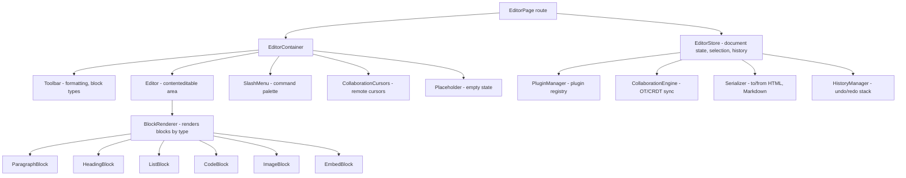

# Rich Text Editor

**Category:** Frontend System Design
**Difficulty:** 🟡 Medium
**Seniority:** mid-level
**Companies:** Notion, Medium, Quip, Google Docs, WordPress, CKSource
**Tags:** contenteditable, serialization, plugins
**Time:** 45-60 min

---

## Problem Statement

Design a rich text editor similar to Notion or Medium that allows users to create and edit documents with formatted text, headings, lists, images, code blocks, and embedded content. The editor should support collaborative editing, have a clean and intuitive interface, handle large documents efficiently, and provide a plugin system for extensibility.

Focus on the content model, serialization/deserialization, plugin architecture, performance with large documents, and the editing experience (selection, formatting, undo/redo).

## Clarifying Questions

- What content types? *Text with formatting (bold, italic, underline), headings (H1-H6), lists (ordered/unordered), links, images, code blocks, blockquotes, and embeds (YouTube, tweets).*
- Document size? *Up to 100,000 characters, with hundreds of blocks.*
- Collaboration? *Real-time collaborative editing with presence (cursors) and conflict resolution.*
- Platform? *Web browsers (desktop and mobile), with consideration for touch devices.*
- Export formats? *HTML, Markdown, and plain text export.*
- Plugin system? *Yes, support custom block types and formatting options.*
- Offline support? *Nice to have, but not required for this round.*

## Requirements

### Functional

- Rich text editing with formatting toolbar (bold, italic, underline, etc.).
- Block types: headings, paragraphs, lists, code blocks, blockquotes.
- Insert and edit images, links, and embeds.
- Slash commands to insert blocks (e.g., "/heading" for H1).
- Collaborative editing with real-time cursor positions.
- Undo/redo with deep history.
- Export to HTML, Markdown, and plain text.
- Plugin system for custom blocks and formatting.

### Non-Functional

- 60 fps typing performance even with large documents.
- Sub-100ms latency for collaborative updates.
- Memory usage proportional to document size.
- Accessible keyboard navigation and screen reader support.
- Works on mobile browsers with touch input.

### Out of Scope

- Page layout and design system, full comment system, version history, advanced collaboration features (suggestions, comments).

## Component Architecture



- **EditorContainer**: Manages the editor state and coordinates all sub-components.
- **Toolbar**: Provides formatting options and block type selection.
- **Editor**: The main `contenteditable` area where users type.
- **BlockRenderer**: Renders different block types based on the content model.
- **SlashMenu**: Command palette triggered by "/" to insert blocks.
- **CollaborationCursors**: Renders remote user cursors and selections.
- **EditorStore**: Centralized state management for document, selection, and history.
- **PluginManager**: Manages registered plugins and their lifecycle.
- **CollaborationEngine**: Handles real-time sync using OT or CRDT.
- **Serializer**: Converts between internal format and export formats.
- **HistoryManager**: Manages undo/redo stack with deep history.

## Data Model & State

```text
Document {
  id, version, title,
  blocks: Block[]
}

Block {
  id, type: "paragraph" | "heading" | "list" | "code" | "image" | "embed" | "quote",
  content: InlineNode[] | string,  // for code blocks
  props: { level?: 1-6, listType?: "bullet" | "number", url?, src?, alt?, embedType? }
}

InlineNode {
  type: "text" | "link" | "mention" | "emoji",
  text: string,
  marks: Mark[]
}

Mark {
  type: "bold" | "italic" | "underline" | "strikethrough" | "code"
}

EditorState {
  document: Document,
  selection: { anchor: {blockId, offset}, focus: {blockId, offset} } | null,
  isComposing: boolean,  // IME composition
  collaborators: Map<UserId, { name, color, cursor: {blockId, offset} }>
}

HistoryState {
  past: Document[],
  future: Document[],
  maxSize: 100
}
```

- **Block-based content model** (similar to Notion's block model) for flexibility and plugin support.
- **Inline nodes** with marks for text formatting.
- **Selection** tracks cursor position across blocks.
- **History** stores full document snapshots for undo/redo.

## API & Interfaces

```text
GET /api/documents/{id}
200 → { id, title, blocks, version, collaborators }

WebSocket wss://api.example.com/documents/{id}/collaborate
  client -> { type: "op", operation, version }
  server -> { type: "op", operation, version, authorId }
  server -> { type: "presence", userId, cursor }
  server -> { type: "ack", version }

POST /api/documents/{id}/blocks
201 → { block }

PUT /api/documents/{id}/blocks/{blockId}
200 → { block }

DELETE /api/documents/{id}/blocks/{blockId}
200 → { success }
```

Component interfaces:

```text
<Editor
  document={document}
  onChange={(newDocument) => updateDocument(newDocument)}
  onSelectionChange={(selection) => updateSelection(selection)}
  plugins={[HeadingPlugin, ListPlugin, ImagePlugin, CodePlugin]}
  readOnly={false}
  collaboration={collaborationEngine}
/>

<Plugin
  name="heading"
  blockTypes={["heading"]}
  toolbarButton={<HeadingButton />}
  slashCommand="/heading"
  renderBlock={(block) => <HeadingBlock level={block.props.level} />}
/>
```

## Rendering & Performance

**Contenteditable Strategy:**

- Use a single `contenteditable` div for the entire document to enable native IME and spellcheck.
- Each block is a separate DOM element (e.g., `<div data-block-id="123">`).
- Selection is tracked using the native Selection API and mapped to block/offset.
- Use `MutationObserver` to detect changes and update the document state.

**Virtualization for Large Documents:**

- For documents with 500+ blocks, use virtual scrolling (react-virtuoso, TanStack Virtual).
- Render only visible blocks plus overscan (e.g., 10 blocks above/below).
- Maintain scroll position and selection state during virtualization.

**Optimistic Updates:**

- Apply local changes immediately to the editor state.
- Send operations to the server and reconcile with server response.
- Roll back on conflict or error.

**Collaboration:**

- Use **Operational Transformation (OT)** or **CRDT** for conflict resolution.
- Transform local operations against incoming remote operations.
- Render remote cursors with user names and colors.
- Debounce cursor position updates to reduce network traffic.

**Serialization:**

```text
FUNCTION toMarkdown(document)
  SET output ← ""
  FOR EACH block IN document.blocks
    SWITCH block.type
      CASE "heading"
        output ← output + "#".repeat(block.props.level) + " " + block.content + "\n\n"
      CASE "paragraph"
        output ← output + renderInline(block.content) + "\n\n"
      CASE "list"
        output ← output + (block.props.listType === "bullet" ? "- " : "1. ") + renderInline(block.content) + "\n"
      CASE "code"
        output ← output + "```\n" + block.content + "\n```\n\n"
  RETURN output
```

- **HTML serialization**: Use a library like Turndown or custom mapping.
- **Markdown serialization**: Custom walker over blocks and inline nodes.
- **Plain text**: Strip all formatting and block structure.

**Plugin System:**

```text
Plugin {
  name: string,
  blockTypes: string[],
  toolbarButton?: ReactNode,
  slashCommand?: string,
  renderBlock: (block: Block) => ReactNode,
  onKeyDown?: (event: KeyboardEvent) => boolean,
  onPaste?: (data: DataTransfer) => Block | null
}
```

- Plugins register block types and provide rendering logic.
- Plugins can hook into keyboard events (e.g., Enter to create new block).
- Plugins can handle paste events (e.g., paste image to create image block).

## Accessibility & UX

- **Keyboard navigation**: Arrow keys move within and between blocks, Enter creates new block, Backspace deletes empty blocks.
- **Screen reader support**: Use ARIA roles (`role="document"`, `role="textbox"`), announce block types and formatting changes.
- **Focus management**: Maintain focus in the editor, trap focus in modals.
- **High contrast mode**: Ensure text and toolbar buttons are visible in forced-colors mode.
- **Touch support**: Handle touch events for mobile, show mobile-optimized toolbar.
- **Placeholder**: Show helpful placeholder text when document is empty.
- **Slash menu**: Show command palette on "/" with keyboard navigation.
- **Formatting shortcuts**: Cmd+B for bold, Cmd+I for italic, etc.
- **Auto-save**: Save document periodically and on blur.
- **Loading states**: Show skeleton or spinner while document loads.

## Edge Cases & Resilience

- **IME composition**: Handle IME input (e.g., Chinese, Japanese) correctly by tracking `isComposing` state.
- **Copy/paste from rich text sources**: Sanitize HTML to remove unwanted styles and scripts.
- **Paste images**: Convert pasted images to base64 or upload to server and create image blocks.
- **Large image uploads**: Show progress indicator, compress images before upload.
- **Collaboration conflicts**: Use OT/CRDT to resolve conflicts, show conflict UI if needed.
- **Undo/redo with collaboration**: Undo only local operations, not remote changes.
- **Mobile keyboard**: Handle virtual keyboard showing/hiding, adjust scroll position.
- **Browser compatibility**: Fallback for older browsers (e.g., no contenteditable support).
- **Plugin errors**: Isolate plugin errors to prevent crashing the entire editor.
- **Document corruption**: Validate document structure on load, recover from errors.

## Trade-offs

| Decision | Option A | Option B | Choice & Why |
|---|---|---|---|
| Content model | HTML-based | Block-based | Block-based for flexibility and plugin support; HTML-based simpler but less extensible |
| Collaboration | OT | CRDT | OT for simpler implementation with central server; CRDT for stronger eventual consistency |
| Rendering | Full DOM | Virtualized | Full DOM for simplicity; virtualized for large documents (500+ blocks) |
| History | Deep snapshots | Delta-based | Deep snapshots for simplicity; delta-based for memory efficiency |
| Plugin system | Global registry | Per-instance | Global registry for simplicity; per-instance for isolation |

## Follow-up Questions

1. **How would you handle 1,000,000 character documents?** Use virtual scrolling, lazy loading of blocks, and store document in chunks. Consider using a database-backed content model.
2. **How would you add real-time comments?** Add comment annotations to the content model, render comment threads in a sidebar, and sync comments via the collaboration engine.
3. **How would you support tables?** Add a table block type with cell-based content model, handle table selection and editing, and provide table-specific toolbar options.
4. **How would you implement drag-and-drop for blocks?** Add drag handles to blocks, use HTML5 drag-and-drop API, and update block order in the document state.
5. **How would you add AI-powered writing assistance?** Integrate with an AI API, add a slash command for AI suggestions, and render AI-generated content as blocks with attribution.

## Common Mistakes

- Using raw HTML as the content model, making it hard to extend and collaborate.
- Not handling IME composition correctly, causing issues for international users.
- Loading the entire document into DOM at once, causing performance issues for large documents.
- Not sanitizing pasted content, leading to security vulnerabilities (XSS).
- Forgetting to handle keyboard navigation, making the editor unusable for keyboard-only users.
- Not debouncing collaborative updates, causing excessive network traffic.

## Key Takeaways

- Block-based content model provides flexibility and plugin support while maintaining a clean internal representation.
- Contenteditable with careful selection tracking enables native IME and spellcheck support.
- Virtual scrolling and lazy loading keep performance high for large documents.
- OT or CRDT enables real-time collaboration with conflict resolution.
- Plugin system allows extensibility without modifying core editor logic.
- Accessibility requires thoughtful design: keyboard navigation, ARIA roles, and screen reader support.
