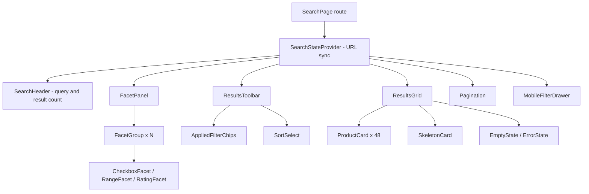

# Search Results Page

**Category:** Frontend System Design
**Difficulty:** 🟡 Medium
**Seniority:** mid
**Companies:** Amazon, eBay, Walmart, Etsy, Shopify, Airbnb, Zalando
**Tags:** url-state, ssr, faceted-search, pagination, caching, seo
**Time:** 45 min

---

## Problem Statement

Design the search results page (SRP) of a large e-commerce site, like Amazon or Etsy. A user submits a query (or lands from Google on a URL like `/search?q=running+shoes&brand=nike`), sees a grid of product cards, and refines results with facets (brand, price range, size, rating), sorting, and pagination.

The page is a major entry point from search engines and a top revenue driver, so it must be crawlable, fast on mid-range mobile devices, shareable via URL, and correct when users click filters quickly or use the browser Back button.

## Clarifying Questions

- Is SEO important for this page? *Yes, category and query pages are indexed; SSR is required for the first page.*
- Pagination or infinite scroll? *Numbered pagination on desktop for SEO; "Load more" on mobile is a follow-up discussion.*
- How many results per page and total? *48 per page; queries can match 100k+ products.*
- Which facets? *Brand, category, price range, size, color, rating, availability; facet counts update with every filter.*
- Should filters apply instantly or via an "Apply" button? *Instantly on desktop; on mobile a filter drawer with "Show N results".*
- Must URLs be shareable and Back/Forward work? *Yes, the URL is the source of truth for query, filters, sort, page.*
- Personalization? *Ranking may be personalized server-side, but the HTML must stay cacheable for anonymous users.*
- Device mix? *70% mobile, many on 4G and mid-range Android.*

## Requirements

### Functional

- Render results for a query with product cards (image, title, price, rating, badges).
- Facet sidebar (desktop) / filter drawer (mobile) with counts; multi-select within a facet (OR), AND across facets.
- Sort (relevance, price asc/desc, newest, rating).
- Pagination with page links; applied-filter chips with "clear all".
- Full state encoded in the URL; Back/Forward restores state and scroll position.
- Empty state with spelling suggestion ("Did you mean ...") and filter relaxation.

### Non-Functional

- LCP < 2.5s on 4G mobile at p75; INP < 200ms when toggling a filter; CLS < 0.1.
- Crawlable server-rendered HTML with canonical URLs.
- Never display results that don't match the current URL (no stale responses).
- Accessible: WCAG 2.2 AA.
- JS bundle for the page < 150KB gzipped.

### Out of Scope

- Search ranking and indexing backend (Elasticsearch/Solr internals).
- Autocomplete in the header (separate component).

## Component Architecture



- **SearchPage route**: server entry; fetches results during SSR (Next.js `getServerSideProps`/RSC, Angular Universal resolver, Remix loader) and streams HTML.
- **SearchStateProvider**: parses the URL into a typed `SearchParams` object, exposes `setFilter`, `setSort`, `setPage`, and serializes changes back into the URL with `history.pushState`. In React this is a hook over `useSearchParams`; in Angular a service wrapping `ActivatedRoute.queryParamMap` and `Router.navigate`.
- **FacetPanel / FacetGroup**: presentational; renders facet values and counts from the response, emits toggle events. Collapsed groups with "Show more" for long lists (brand can have 500 values; add an in-facet search box).
- **ResultsToolbar**: count, sort, removable chips.
- **ResultsGrid / ProductCard**: pure, memoized cards; image uses `srcset` and fixed aspect ratio.
- **Pagination**: real `<a href>` links so crawlers and middle-click work; intercepted client-side for SPA navigation.
- **MobileFilterDrawer**: holds a draft copy of filters and commits on "Show N results" (fetching count-only preview).

## Data Model & State

```text
SearchParams (derived from URL, single source of truth)
  q: string
  filters: Map<facetId, string[]>      // brand: [nike, adidas], size: [10]
  price: { min?: number, max?: number }
  sort: "relevance" | "price_asc" | "price_desc" | "newest" | "rating"
  page: number                          // 1-based

SearchResponse (server cache, keyed by canonical query string)
  results: ProductSummary[]             // id, title, price, imageUrl, rating, badges
  total: number
  facets: Facet[]                       // id, label, type, values: [{ value, label, count, selected }]
  spellSuggestion?: string
  requestId: string

UI state (local, not in URL)
  isMobileDrawerOpen: boolean
  draftFilters: SearchParams.filters    // mobile drawer only
  expandedFacetGroups: Set<facetId>
  facetSearchText: Map<facetId, string>
```

- **URL = state**: derived values are never duplicated in component state. Canonicalize the query string (sorted keys, sorted values, default values omitted: no `page=1`, no `sort=relevance`) so equivalent states map to one URL and one cache key.
- **Server cache**: TanStack Query / SWR / Angular service with a `Map<canonicalKey, {data, fetchedAt}>`, LRU of ~20 entries, `staleTime` 60s. Back navigation is instant from cache.
- **Normalization**: not needed for the grid (read-only list), but product summaries can be keyed by id if the cart or wishlist mutates them (e.g. "in wishlist" heart).
- **SSR hydration**: server serializes the initial `SearchResponse` into the page (`__NEXT_DATA__`, Angular `TransferState`) so the client does not refetch on hydrate.

## API & Interfaces

```text
GET /api/search?q=running+shoes&brand=nike,adidas&size=10&price=50-120&sort=price_asc&page=2
  200 {
    requestId: "r_8f2",
    total: 1342,
    page: 2, pageSize: 48,
    results: [{ id, title, price: { amount, currency }, imageUrl, rating, reviewCount, badges }],
    facets: [{ id: "brand", label: "Brand", type: "multi",
               values: [{ value: "nike", label: "Nike", count: 412, selected: true }] }],
    spellSuggestion: null
  }
  Cache-Control: public, s-maxage=60, stale-while-revalidate=300   // anonymous only

GET /api/search/count?q=...&filters...     // cheap preview for mobile drawer "Show N results"
  200 { total: 87 }

HTML route: GET /search?q=...              // SSR, same params, CDN-cacheable
  <link rel="canonical" href="/search?q=running+shoes&brand=nike">
```

Component interfaces:

```text
FacetGroup props: facet: Facet, onToggle(facetId, value), onRangeChange(facetId, min, max), collapsed: boolean
ProductCard props: product: ProductSummary, position: number, onClick(productId, position)   // position for analytics
Pagination props: page, total, pageSize, buildHref(page) -> string
useSearchState() -> { params, setFilter(id, values), setSort(s), setPage(n), clearAll() }
```

## Rendering & Performance

- **SSR + streaming** for the initial page: HTML contains the first 48 results and facets, so LCP image is discoverable immediately; mark the first 4-6 card images `fetchpriority="high"` and not lazy; lazy-load the rest with `loading="lazy"`.
- **Edge caching**: anonymous SRP HTML cached at the CDN for 60s keyed by canonical URL; personalized bits (cart count, wishlist hearts) hydrate client-side.
- **Client-side transitions**: after hydration, filter changes do `pushState` + fetch JSON, not a full page reload. Keep the old grid visible with reduced opacity and a top progress bar for quick responses (< 300ms); swap to skeletons only if the request exceeds ~300ms to avoid flashing. React `useTransition` / `startTransition` keeps the click responsive (INP).
- **Skeletons**: same dimensions as real cards (fixed aspect-ratio boxes) so CLS stays ~0.
- **Range slider debounce**: price slider updates the URL with `replaceState` while dragging and fetches debounced at 300ms; commit with `pushState` on release so Back doesn't replay every pixel.
- **Prefetch**: prefetch page N+1 JSON on idle or on hover of the "Next" link.
- **Pagination vs infinite scroll**: pagination gives crawlable URLs, stable positions, reachable footer, and easy "return to item". Infinite scroll suits mobile browsing; a hybrid "Load more" button that appends and updates `?page=N` via `replaceState` keeps SEO (each page also exists as an SSR URL) while reducing friction.
- **Bundle**: facet components for rarely used types (color swatches, map) loaded with dynamic `import()`; the mobile drawer is lazy. Avoid heavy date/i18n libraries; use `Intl.NumberFormat` for prices.
- **Images**: CDN resizing with `srcset`/`sizes`, AVIF/WebP, explicit width/height.

## Accessibility & UX

- Facets are native checkboxes in a `<fieldset>` with `<legend>`; price range uses two labeled number inputs plus an optional slider with `role="slider"` and `aria-valuetext`.
- After results update, announce via a polite live region: "1,342 results for running shoes". Do not move focus on filter toggle (users may toggle several); on page change, move focus to the results heading and scroll to top.
- Applied chips are buttons with `aria-label="Remove filter Brand: Nike"`; after removal, focus moves to the next chip or the "Clear all" button.
- Mobile drawer is a modal dialog: focus trap, Escape to close, return focus to the "Filters" button.
- Pagination wrapped in `<nav aria-label="Pagination">`, current page has `aria-current="page"`.
- States: skeletons for loading; empty state with "Did you mean", list of active filters to remove, and popular categories; error state with Retry, keeping the previous results if available.
- i18n: localized prices and counts via `Intl`, RTL layout with logical CSS properties (`margin-inline-start`), translated facet labels from the server.
- Restore scroll position on Back (`history.scrollRestoration` plus cached data so the grid renders at full height before restoring).

## Edge Cases & Resilience

- **Race conditions**: fast filter clicks issue overlapping requests. Abort the previous request with `AbortController` (or RxJS `switchMap` in Angular), and additionally ignore any response whose canonical key differs from the current URL.

```text
FUNCTION onUrlChange(params)
    SET key ← canonicalize(params)
    IF cache.has(key) AND NOT cache.isStale(key) THEN render(cache.get(key)); RETURN
    IF inFlight THEN inFlight.abort()
    SET inFlight ← fetch("/api/search?" + key)
    SET data ← AWAIT inFlight
    IF key ≠ canonicalize(currentUrlParams()) THEN RETURN   // stale response
    cache.set(key, data)
    render(data)
```

- **Invalid URL params**: unknown facet values or `page=9999` beyond total; server returns the closest valid state and the client `replaceState`s to it; out-of-range pages return 404 or redirect for SEO.
- **Zero results after filtering**: show facet counts so users see which filters lead to zero; disable zero-count values rather than hiding them abruptly.
- **Network failure**: retry once with backoff for GETs; keep last good results and show inline error banner.
- **Inventory changes**: totals may shift between pages (duplicates or skipped items); dedupe by product id when appending in "Load more" mode.
- **SEO crawl traps**: facet combinations explode URL space; `noindex` for multi-facet combinations, canonical to the base category, `rel="nofollow"` on facet links beyond 1-2 filters.
- **Security**: the query `q` is reflected in the page ("results for ..."); always render as text, never `innerHTML`, to prevent reflected XSS. Validate/whitelist filter keys server-side.
- **Bots/abuse**: rate limit the search API; CDN caching absorbs crawler load.

## Trade-offs

| Decision | Option A | Option B | Choice & Why |
|---|---|---|---|
| Initial rendering | CSR SPA | SSR with hydration | SSR: SEO and LCP on mobile matter most; client-side navigation afterwards |
| Source of truth for filters | Component/global store | URL query string | URL: shareable, Back/Forward works, single cache key; store only derives from it |
| Result paging | Numbered pagination | Infinite scroll | Pagination on desktop for SEO and footer access; "Load more" hybrid on mobile |
| Loading feedback | Skeletons immediately | Keep stale grid dimmed, skeleton after delay | Delayed skeleton avoids flicker on fast responses, keeps layout stable |
| Facet apply | Instant per click | Batched "Apply" | Instant on desktop, batched draft in mobile drawer where each reflow is costly |
| HTML caching | Per-user render | CDN-cached anonymous HTML + client personalization | CDN cache: huge traffic from bots and anonymous users, personalization hydrated later |

## Follow-up Questions

1. **How would you add infinite scroll without hurting SEO?** Keep SSR URLs for every page (`?page=N`), append on scroll via IntersectionObserver, update the URL with `replaceState`, and render a fallback pagination nav for crawlers.
2. **How do you restore position when the user returns from a product page?** Cache the response by key, render synchronously from cache on popstate, then restore the saved scroll offset; for infinite lists also store the number of loaded pages.
3. **How would you measure success?** RUM Core Web Vitals per route, search-to-click rate, zero-result rate, filter usage, and conversion; log `requestId` and card position on clicks.
4. **How do you handle a facet with 2,000 values?** Show top 10 by count, in-facet search box that queries a facet-values endpoint, and virtualize the expanded list.
5. **How would you A/B test a new ranking or card layout?** Server assigns the variant; include it in the CDN cache key (or vary only client-side elements) so cached HTML isn't mixed across variants.

## Common Mistakes

- Keeping filters only in component state, breaking shareable links and the Back button.
- Not handling out-of-order responses, so the grid shows results for an earlier filter set.
- Pushing a history entry for every slider movement or keystroke.
- Using buttons with click handlers instead of real links for pagination, hurting crawlability.
- Skeletons with different dimensions than the real cards, causing CLS.
- Lazy-loading the above-the-fold images, delaying LCP.

## Key Takeaways

- The URL is the state: canonicalize it and use it as the cache key.
- SSR for the first render (SEO, LCP), client-side JSON transitions afterwards.
- Guard against races with AbortController plus a key check on response.
- Pagination vs infinite scroll is an SEO/UX trade-off; a hybrid covers both.
- Design loading states to avoid flicker and layout shift.
