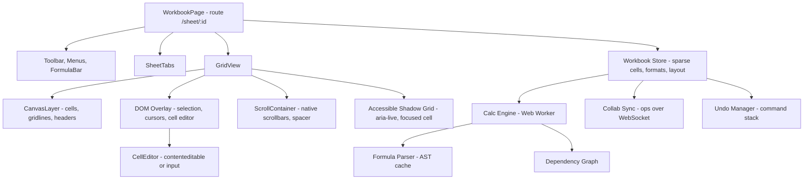

# Spreadsheet

**Category:** Frontend System Design
**Difficulty:** 🔴 Hard
**Seniority:** staff
**Companies:** Google, Microsoft, Airtable, Notion, Smartsheet, Figma
**Tags:** canvas-rendering, 2d-virtualization, dependency-graph, formula-engine, web-workers, collaborative-editing
**Time:** 60 min

---

## Problem Statement

Design the frontend of a web spreadsheet like Google Sheets or Excel for the web. Users scroll a grid that can hold millions of cells, select ranges, type values and formulas (`=SUM(A1:A100)`), see dependent cells recalculate instantly, format cells, resize rows and columns, freeze headers, copy/paste to and from other apps, and collaborate in real time.

Sheets can reach 1M rows × 100 columns, with up to about 10M populated cells across several tabs. The interviewer is looking for a data model that scales, a rendering approach that stays at 60 fps (DOM vs canvas), a formula engine with incremental recalculation off the main thread, accessibility for a non-DOM grid, and the collaboration model.

## Clarifying Questions

- How big are sheets? *Up to 1M rows × 100 columns per tab, with up to 10M non-empty cells per workbook.*
- How rich is the formula support? *Arithmetic, references and ranges, cross-sheet refs, about 100 common functions, and volatile functions (`NOW`, `RAND`). No macros.*
- Real-time collaboration? *Yes. Multiple editors, presence, and cell-level conflict handling.*
- Where is computation done? *Client-side for interactivity. The server also computes, for API reads and for workbooks too large for the client.*
- Formatting depth? *Number formats, fonts, fill colors, borders, alignment, merged cells and conditional formatting.*
- Offline? *Nice to have. Prioritize fast load and real-time sync.*
- Charts and pivots? *Out of scope for this round.*

## Requirements

### Functional
- Infinite-feeling grid with row and column headers, frozen panes, resize, hide, and insert/delete of rows and columns.
- Selection (single, range, multi-range, whole row or column), keyboard navigation, fill handle, copy/paste (TSV/HTML).
- Cell editing with a formula bar, autocomplete for functions, and highlighting of referenced ranges.
- Formula evaluation with dependency tracking and incremental recalculation, plus error values (`#REF!`, `#DIV/0!`, `#CIRCULAR!`).
- Real-time multi-user editing with presence (colored selections) and undo/redo.

### Non-Functional
- 60 fps scroll on 1M-row sheets. Typing latency under 16 ms. Recalculation of 10k dependents in under 100 ms.
- Memory proportional to populated cells, not grid size.
- Accessible to screen reader and keyboard-only users.
- Deterministic recalculation that matches the server engine exactly.

### Out of Scope
- Charts, pivot tables, scripting/macros, and the import/export pipeline (XLSX is converted server-side).

## Component Architecture



- **GridView** coordinates the viewport. It turns scroll offsets into a visible row and column range using prefix sums of row heights and column widths.
- **CanvasLayer** draws cell text, fills, borders, gridlines and headers onto a `<canvas>`, one per frozen pane quadrant. Google Sheets and Excel Online both moved to canvas because DOM grids with thousands of styled cells cannot scroll at 60 fps.
- **DOM Overlay** holds the interactive pieces that need real DOM: the cell editor (IME, spellcheck, selection), the selection rectangle and fill handle, remote cursors, comment indicators and the context menu.
- **ScrollContainer** is a native scrollable div containing a spacer element whose size equals the total sheet size. The canvas is `position: sticky`. This keeps native scroll physics, inertia and scrollbars.
- **Calc Engine** runs in a Web Worker so recalculation never blocks input. It owns the parsed formulas and the dependency graph, and posts back changed values.
- **Accessible Shadow Grid** is a small, offscreen ARIA grid that mirrors the focused cell and its neighbors for screen readers, since canvas content is invisible to assistive technology.
- **Framework notes.** React or Angular render the chrome (toolbar, menus, dialogs, formula bar). The grid core is imperative and framework-agnostic, and frameworks talk to it through a typed controller API. Diffing is pointless for canvas.

## Data Model & State

```text
Workbook {
  sheets: Map<SheetId, Sheet>, sheetOrder: List<SheetId>, namedRanges
}

Sheet {
  id, name, rowCount: 1_000_000, colCount: 100,
  cells: SparseStore                         // only non-empty cells
    // chunked: Map<ChunkKey(rowBlock=row>>8, colBlock=col>>5), Chunk>
    // Chunk: column-major typed arrays for values + Map for strings/formulas
  cell (logical) { raw: "=A1*2" | "42" | "Hello", value: Number | String | Bool | Error,
                   formulaId?: AstId, styleId: Int }
  styles: InternTable<StyleId, { numFmt, font, fill, border, align }>  // dedupe styles
  rowHeights: SparseOverrides + defaultHeight 21, prefixSums: FenwickTree
  colWidths:  SparseOverrides + defaultWidth 100, prefixSums: FenwickTree
  merges: IntervalIndex<Range>, frozen: { rows: 1, cols: 1 },
  conditionalFormats: List<{ range, rule, styleId }>
}

Row/column identity: stable ids per row/col (rowIds[index]) so inserting a row does not
rewrite every cell key; formulas store references as ids or are rewritten by the op.

UI State { activeSheet, selection: { ranges: List<Range>, active: CellRef },
           editing: { cell, draft } | null, scroll: { x, y }, clipboardMarquee,
           remoteSelections: Map<UserId, Range> }
```

- **Sparse, chunked storage.** A dense 1M × 100 array would hold 100M slots, which is impossible. Keep a chunked sparse map with typed arrays for numbers, and intern repeated strings and styles. Chunks also make it cheap to load the visible region of huge sheets lazily from the server.
- **Fenwick trees (prefix sums)** for row heights and column widths answer "what is the y-offset of row r?" and "which row is at y?" in O(log n), and update in O(log n) on resize.
- **Server vs UI state.** Cells, formats and layout are shared and synced documents. Selection, scroll, the edit draft and the clipboard marquee are local. Remote selections are ephemeral presence.

## API & Interfaces

```text
GET  /api/workbooks/{id}                     200 { meta, sheets: [{ id, name, rowCount, colCount, frozen }] }
GET  /api/sheets/{id}/chunks?rows=0-1023&cols=0-63
     200 binary/packed { cells, styles, rowHeights, colWidths, version }
WebSocket wss://sheets.example.com/wb/{id}
  client -> { type: "ops", baseRev, ops: [
               { op: "setCell", sheet, row, col, raw },
               { op: "insertRows", sheet, at, count },
               { op: "setStyle", sheet, range, styleDelta },
               { op: "resizeCol", sheet, col, width } ], clientOpId }
  server -> { type: "ack", clientOpId, rev }
  server -> { type: "ops", rev, ops, actorId }        // already transformed by server (OT)
  both   -> { type: "presence", userId, selection }

Worker message protocol (main <-> calc worker)
  main -> worker: { type: "applyOps", ops }  |  { type: "evaluate", cells }
  worker -> main: { type: "values", changes: [{ sheet, row, col, value, display }], calcId }
```

Grid controller interface (used by toolbar and framework UI):

```text
SpreadsheetGrid
  props:   workbookId, readOnly, locale, onSelectionChange(ranges), onEditStart(cell)
  methods: select(range), scrollTo(cell), setCell(ref, raw), applyStyle(range, delta),
           insertRows(at, n), undo(), redo(), getValue(ref)
```

Collaboration uses **server-ordered OT on structured ops**. A spreadsheet is a grid of cells rather than a sequence, so the operations that need transforming are few: row and column inserts/deletes shift references and positions. Cell writes are last-writer-wins by server revision. This is simpler than a CRDT for this data shape, and it is what Google Sheets does.

## Rendering & Performance

**Viewport math.**

```text
FUNCTION visibleRange(scrollX, scrollY, viewW, viewH)
  SET r0 ← rowHeights.findIndex(scrollY)            // Fenwick lower_bound, O(log n)
  SET r1 ← rowHeights.findIndex(scrollY + viewH) + 1
  SET c0 ← colWidths.findIndex(scrollX)
  SET c1 ← colWidths.findIndex(scrollX + viewW) + 1
  RETURN { r0, r1, c0, c1 }                         // ~40 rows x 15 cols typical
```

**Canvas drawing.**
- Redraw on scroll in `requestAnimationFrame`, coalescing multiple scroll events per frame. Scale the backing store by `devicePixelRatio` for crisp text.
- Draw in layers: fills, then gridlines (a single path of 0.5 px-aligned lines), then borders, then text (clipped per cell with `ctx.save/clip`, or truncated by measured width), then the selection overlay.
- Cache `measureText` results by (font, string), and cache formatted display strings (`Intl.NumberFormat`) per (value, numFmt).
- **Dirty-rect redraw.** When a few cells change, redraw only their rects. When scrolling, blit the existing canvas by the delta with `drawImage` and paint only the newly exposed strip, which is cheap.
- Use an `OffscreenCanvas` in a worker if main-thread paint becomes a bottleneck.

**Incremental recalculation.**

```text
// Dependency graph: precedents(cell) and dependents(cell); ranges stored as range nodes
// (interval index) instead of expanding A1:A100000 into 100k edges.
FUNCTION onCellChanged(cell)
  SET dirty ← collectDependentsTransitive(cell)      // BFS over dependents + range index
  SET order ← topologicalSort(dirty)                 // Kahn's algorithm
  IF cycle detected THEN mark cycle cells #CIRCULAR!
  FOR c IN order
    SET c.value ← evaluate(c.ast, getValue)          // AST cached per formula string
  post changed values to main thread in batches of ~1000 (time-sliced every ~8 ms)
```

- Visible cells are evaluated first (a priority queue keyed on viewport distance). Off-screen cells finish in later time slices.
- Volatile functions (`NOW`, `RAND`) are always dirty on recalc. `INDIRECT` and `OFFSET` create dynamic dependencies that are resolved at evaluation time.
- The formula engine must match the server bit for bit. Ship the same engine, written in TypeScript or compiled to WASM from a shared Rust or C++ core, to both client and server.

**Loading.** Load the visible chunks plus the formula cells needed for dependencies first, then stream in the rest. For workbooks above client limits, display server-computed values and evaluate only locally edited regions.

**Bundle.** Load the function library lazily by category. Load the conditional formatting and import dialogs on demand.

## Accessibility & UX

- **Canvas is invisible to AT.** Maintain an offscreen `role="grid"` that contains only the focused cell's row and column context. Keep its `aria-rowcount`/`aria-colcount` set to the full size, give each cell `aria-rowindex`/`aria-colindex`, and use `aria-activedescendant` for the active cell. On navigation, announce "B7, 1,250.00, formula: =SUM(B2:B6)".
- **Keyboard (Excel parity).** Arrows move. Shift+Arrows extend the selection. Ctrl+Arrows jump to the data edge. Tab/Enter move with wrap. F2 edits, Esc cancels, Ctrl+Z/Y undo/redo, Ctrl+Space and Shift+Space select a column or row. Page Up/Down scroll by a screen.
- **Editing.** The cell editor is a real DOM element positioned over the cell, so IME, spellcheck, emoji pickers and screen readers all work. During formula entry, clicking cells inserts references. Show colored range highlights and function signature help.
- **Visual.** High-contrast mode support, by reading `forced-colors` and redrawing the canvas with system colors. Zoom (Ctrl+Plus, pinch) re-renders the canvas at the new scale. Never convey errors by color alone: show `#REF!` text and a tooltip.
- **States.** Skeleton grid while chunks load, with cells showing "Loading…" when you scroll beyond the loaded region. A calculating indicator appears in the status bar for long recalcs. A connection indicator and read-only banner are shown as needed.
- **i18n.** Locale-aware number, date and currency formats. Formula argument separators follow the locale (`;` in de-DE). Localized function names map to canonical names. RTL sheets mirror column order (A on the right).

## Edge Cases & Resilience

- **Circular references.** Detect them during topological sort, mark the cells in the cycle, and do not hang. Iterative calculation, with a max of 100 iterations and an epsilon, is optional, as in Excel.
- **Concurrent row insert vs cell edit.** User A inserts a row above row 10 while user B edits B12. The server transforms B's op to B13, and formulas referencing shifted rows are rewritten. Deleting a referenced row turns the reference into `#REF!`.
- **Paste of 100k cells.** Parse TSV/HTML in the worker and apply it as one op batch (one undo step). Show progress, and rate-limit the sync payload by chunking it.
- **Out-of-order worker results.** Each recalculation has a `calcId`. Drop results from superseded calcs.
- **Floating point.** Use IEEE 754 doubles like Excel, with display rounding to 15 significant digits. Do not "fix" results such as 0.1+0.2 in the stored value.
- **Reconnect.** Resend unacked ops with `baseRev`. The server transforms them against the ops the client missed, and the client rebases its pending local ops on the incoming server ops (classic OT client state machine).
- **Memory pressure.** Evict far-away chunks of display caches, but never evict formula-relevant data.
- **Security.**
  - Cell content is rendered on canvas (no HTML), so there is no injection there. The DOM overlay and comments still need escaping.
  - Pasted HTML is parsed into values only.
  - `HYPERLINK()` allows only `http(s)` and `mailto` URLs.
  - Exported CSVs are protected against formula injection by prefixing cells that start with `=`, `+`, `-` or `@` on export.
  - Server-side permission checks apply per op, including protected ranges.

## Trade-offs

| Decision | Option A | Option B | Choice & Why |
|---|---|---|---|
| Grid rendering | DOM cells (virtualized divs) | Canvas + DOM overlay | Canvas. Thousands of styled cells per frame at 60 fps. The DOM overlay keeps editing and IME native. |
| Recalc location | Main thread | Web Worker | Worker. Long recalcs never block typing or scrolling. Costs message passing. |
| Storage | Dense 2D array | Sparse chunked + typed arrays | Sparse chunked. Memory scales with data, and lazy loading comes for free. |
| Collaboration | CRDT | Server-ordered OT on structured ops | OT. Grid ops are few and easy to transform, and there is a central server anyway. LWW per cell. |
| Range dependencies | Expand to per-cell edges | Range nodes + interval index | Range nodes. `SUM(A:A)` would otherwise create a million edges. |

## Follow-up Questions

1. **How would you implement filters and sorting without rewriting cells?** Keep a view-level row permutation, a mapping from visual row to data row, and render through it. Formulas keep referencing data rows. A real "sort range" is an op that rewrites positions.
2. **How do you support 50M-cell workbooks?** Make the server authoritative for values. The client loads viewport chunks on demand, evaluates only locally edited cells, and requests server recalculation for the dependency closure that is not loaded.
3. **How would you add charts?** Charts subscribe to range values through the store. Render them as separate canvas or SVG overlays, debounce redraws on recalc, and lazy-load the chart library.
4. **How is undo handled with collaborators?** Undo applies the inverse of my own ops, transformed against later remote ops. If a remote user has since overwritten the same cell, skip that cell or warn.
5. **How do you test formula correctness?** Golden test suites comparing results against Excel and LibreOffice for each function, property tests for incremental vs full recalculation equivalence, and fuzzed formulas for the parser.

## Common Mistakes

- Rendering every cell as a DOM node, or even a virtualized DOM grid with heavy styling, then wondering why scrolling janks.
- Dense storage of the full grid, which exhausts memory.
- Recalculating the whole sheet on every edit instead of the dirty dependency closure in topological order.
- Running the calc engine on the main thread.
- Forgetting that canvas has no accessibility tree, and shipping an unusable grid for screen readers.
- Keying cells by row index, so a row insert must rewrite millions of keys and references.

## Key Takeaways

- Canvas for the grid, DOM for interaction: native scroll container, sticky canvas, DOM cell editor and overlays.
- Sparse chunked storage with Fenwick-tree layouts makes 1M-row sheets cheap to address and scroll.
- A worker-hosted formula engine with a range-aware dependency graph and topological, viewport-prioritized recalculation keeps input fast.
- Structured-op OT with LWW cells, plus a mirrored ARIA grid, covers collaboration and accessibility.
