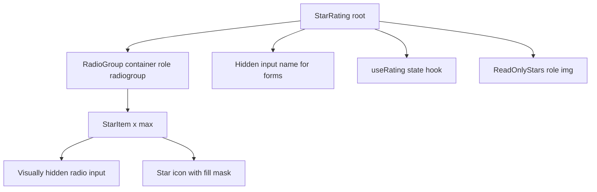

# Star Rating

**Category:** Frontend System Design
**Difficulty:** 🟢 Easy
**Seniority:** junior
**Companies:** Amazon, Airbnb, Uber, Yelp, Shopify, Booking.com
**Tags:** accessibility, radio-group, keyboard-navigation, controlled-components, form-integration, reusable-components
**Time:** 30 min

---

## Problem Statement

Design a reusable star rating component like the ones on Amazon product reviews, Airbnb stays, or Uber trip feedback. In interactive mode a user picks a rating from 1 to 5 (optionally in half-star steps) with mouse, touch, or keyboard. In read-only mode the component displays an average rating such as 4.3 with partially filled stars.

The interviewer wants to see a clean public API, correct accessibility semantics (it is a form control, not a set of decorative images), hover preview, half-star support, and integration with forms and a backend that persists the user's rating.

## Clarifying Questions

- Is the maximum fixed at 5? *Default 5, configurable via a `max` prop.*
- Are half stars needed? *Yes for input via `precision: 0.5`; read-only display should support any fraction, e.g. 4.27.*
- Can a user clear their rating? *Yes, optionally via `allowClear` — clicking the current value resets to 0.*
- Should it work inside native forms? *Yes, it should submit a value under a `name` like a native input.*
- Is the rating saved immediately or on form submit? *Both modes: controlled by parent; product review page saves immediately.*
- Touch support? *Yes — tap selects, no hover state on touch.*
- Custom icons (hearts, thumbs)? *Nice-to-have via an icon slot.*

## Requirements

### Functional

- Interactive mode: select a value 1..max (step 1 or 0.5), hover/focus preview, optional clear.
- Read-only mode: render any fractional value with partial fill and a text alternative.
- Controlled (`value` + `onChange`) and uncontrolled (`defaultValue`) usage.
- Sizes and custom icons; disabled state.
- Native form participation via hidden input with `name`.

### Non-Functional

- Fully keyboard operable and screen-reader friendly (WAI-ARIA radio group pattern).
- Tiny: under 3 KB gzipped, no runtime dependencies.
- No layout shift; crisp at any size (SVG or icon font, not PNGs).
- RTL support.

### Out of Scope

- Review text editor, aggregate rating computation on the server, anti-spam.

## Component Architecture



- **StarRating root**: chooses interactive vs read-only rendering, merges controlled/uncontrolled state.
- **RadioGroup container**: groups items with an accessible label (`aria-labelledby` pointing to "Rate this product").
- **StarItem**: one per step. For half stars, each star holds two radios (left half = n - 0.5, right half = n). Using real `<input type="radio">` elements visually hidden gives keyboard behavior, form integration, and screen reader semantics for free.
- **Star icon**: SVG with a clip-path or a linear-gradient mask to draw partial fill.
- **useRating hook**: holds `value`, `hoverValue`, and computes `displayValue = hoverValue ?? value`. React: custom hook; Angular: component with `ControlValueAccessor` so it works with `formControlName`.
- **ReadOnlyStars**: a single `role="img"` with `aria-label="Rated 4.3 out of 5"`; the stars are `aria-hidden`.

## Data Model & State

```text
RatingState {
  value: number          // committed value, 0 = unrated
  hoverValue: number|null // preview while pointer hovers
  focusedValue: number|null
}

Props {
  value?, defaultValue?, max = 5, precision = 1 | 0.5,
  readOnly = false, disabled = false, allowClear = false,
  name?, size = "md", icon?, label, getLabelText?(v) -> string,
  onChange?(v), onHoverChange?(v)
}

FUNCTION displayValue(state):
  RETURN state.hoverValue ?? state.value

FUNCTION fillFor(starIndex, display):   // starIndex 1..max
  RETURN clamp(display - (starIndex - 1), 0, 1)   // 0, 0.5, 1 or any fraction for read-only
```

- Server cache: the user's own rating and the product aggregate (`avg`, `count`) live in the data-fetching cache (React Query / Angular service with signals), not inside the component.
- UI state: hover and focus are purely local and never leave the component.
- The component is presentation-only; it never calls the API itself. A container (`ProductRatingContainer`) handles persistence.

## API & Interfaces

```text
GET  /api/products/{id}/rating
  -> { average: 4.3, count: 1284, myRating: 4 | null }

PUT  /api/products/{id}/rating
  body: { value: 4.5 }   headers: Idempotency-Key, CSRF token
  -> { average: 4.31, count: 1285, myRating: 4.5 }

DELETE /api/products/{id}/rating   -> { average, count, myRating: null }
```

Component public interface:

```text
<StarRating
  label="Rate this product"
  value={rating} onChange={setRating}
  precision={0.5} max={5} allowClear
  name="rating"
  getLabelText={v => `${v} stars`} />

<StarRating readOnly value={4.3} label="Average rating" />

Events: onChange(value), onHoverChange(value | null)
Angular: @Input() value, @Output() valueChange, implements ControlValueAccessor
```

Rounding rule: read-only `value` is displayed at full precision for fill, but the text label rounds to one decimal.

## Rendering & Performance

- Pure CSR component; SSR-safe because it has no browser-only APIs at render time. Read-only stars render identically on the server, avoiding hydration mismatch and CLS.
- Use one inline SVG `<symbol>` sprite referenced with `<use>` so a list of 50 product cards does not duplicate path data.
- Partial fill: render an empty star and overlay a filled star clipped to `width: fill * 100%`. A CSS custom property `--fill` keeps it declarative and avoids re-render cost.
- Hover updates touch only local state; memoize `StarItem` so only stars whose fill changed re-render (in React `memo`, in Angular `OnPush`).
- Reserve fixed width (`max * size`) to prevent layout shift.
- For half stars, compute the half from pointer position: `x < rect.width / 2` → n - 0.5. Cache the rect on `pointerenter` instead of calling `getBoundingClientRect` every move.

## Accessibility & UX

- Semantics: `role="radiogroup"` with label; each step is a native radio with an accessible name like "3.5 stars". Native radios give Arrow-key navigation, roving focus, and Space selection.
- Keyboard: Tab enters the group on the checked radio (or the first if none); Left/Down decrements, Right/Up increments by `precision`; Home/End go to min/max. In RTL, arrow direction mirrors visually, handled automatically by native radios with `dir="rtl"`.
- Unrated state: no radio checked is valid; with `allowClear`, include a visually hidden "No rating" radio (value 0) so keyboard users can clear too.
- Focus visibility: show a clear focus ring on the star corresponding to the focused radio (`:focus-visible` on the input styles the sibling icon).
- Read-only: do not render radios; use `role="img"` with `aria-label="Rated 4.3 out of 5 stars"`. Avoid `aria-readonly` radio groups that still look interactive.
- Disabled: `disabled` on the fieldset; reduce opacity, keep contrast at least 3:1 for the icon outline (WCAG 1.4.11).
- Do not rely on color only: filled vs empty stars differ by fill and outline.
- Touch: targets at least 44x44 px via padding; no hover preview on `pointer: coarse`.
- i18n: labels via `getLabelText`, number formatting with `Intl.NumberFormat` (e.g. "4,3" in German).

## Edge Cases & Resilience

- Out-of-range values (`value > max` or negative): clamp and warn in dev.
- Non-step values in interactive mode (4.3 with step 0.5): round to nearest step for the checked radio, but display exact fill.
- Pointer leaves mid-hover: reset `hoverValue` to null on `pointerleave` and on blur.
- Rapid clicks while saving: container applies optimistic update, debounces or cancels the in-flight request (AbortController) and keeps last-write-wins; roll back on failure with a toast.
- Double submit: idempotency key on PUT.
- Controlled without `onChange`: dev warning (React-style), component stays read-only effectively.
- Security: labels rendered as text, never as HTML; rating endpoint requires auth and CSRF token.

## Trade-offs

| Decision | Option A | Option B | Choice & Why |
|---|---|---|---|
| Semantics | Native hidden radio inputs | `div`s with `role="radio"` and manual key handling | Native radios: free keyboard, form submit, and AT support with less code |
| Half-star input | Two radios per star | One radio per star plus pointer math | Two radios: keyboard and screen readers can reach halves without pointer |
| Partial fill rendering | SVG clip / overlay width | Multiple icon variants (empty, half, full) | Overlay: supports any fraction for read-only averages |
| State ownership | Controlled with optional uncontrolled | Internal only | Both: fits forms and server-synced usage |
| Read-only markup | Single `role="img"` with label | Disabled radio group | `role="img"`: concise announcement, no fake interactivity |

## Follow-up Questions

1. **How would you integrate with React Hook Form or Angular Reactive Forms?** Expose `value`/`onChange`/`onBlur` and forward a ref (React) or implement `ControlValueAccessor` with `writeValue`, `registerOnChange`, `registerOnTouched`, `setDisabledState` (Angular).
2. **How do you support custom icons like hearts?** Accept an `icon` render prop or content projection slot receiving `{ fill }`, keeping the fill mask logic in the component.
3. **How would you show the rating distribution histogram on hover?** Separate `RatingSummary` component with a popover; the star component stays focused on input/display.
4. **How do you test it?** Unit tests for clamp/round and fill math; Testing Library tests via `getByRole("radio", { name: "3 stars" })`; axe for a11y; visual regression for partial fills.
5. **What if the product page has 100 read-only ratings?** Shared SVG sprite and CSS-only fill means near-zero JS cost; could even render as a static server component.

## Common Mistakes

- Using clickable `<span>` stars with no role, label, or keyboard support.
- Announcing each of 5 stars individually in read-only mode instead of one summary label.
- Making half stars reachable only by mouse position.
- Letting hover preview overwrite the committed value.
- Fetching or saving inside the presentational component, making it impossible to reuse in forms.
- Forgetting RTL, where fill should start from the right.

## Key Takeaways

- A star rating is a radio group: lean on native inputs for keyboard, forms, and accessibility.
- Separate committed value from hover preview, and presentation from persistence.
- One fill formula `clamp(value - (i - 1), 0, 1)` handles full, half, and fractional stars.
- Read-only mode should be a single labeled image, not a disabled control.
