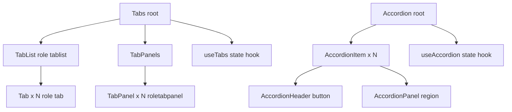

# Tabs and Accordion

**Category:** Frontend System Design
**Difficulty:** 🟢 Easy
**Seniority:** junior
**Companies:** Common UI component
**Tags:** state management, accessibility, patterns
**Time:** 30-45 min

---

## Problem Statement

Design reusable tabs and accordion components for organizing content. Tabs display content in a horizontal tab bar where only one panel is visible at a time. Accordions display vertically stacked panels where each panel can be expanded/collapsed, optionally allowing multiple open at once.

The interviewer wants to see proper state management (controlled/uncontrolled), accessibility (keyboard navigation, ARIA attributes), and the ability to compose these patterns into a cohesive component library.

## Clarifying Questions

- Tabs: horizontal or vertical orientation? *Horizontal by default; vertical is a variant.*
- Accordion: allow multiple panels open at once? *Configurable: single (one open) or multiple (collapsible).*
- Should tabs/accordions be nested? *Yes, but avoid deep nesting for accessibility.*
- Do panels have lazy loading? *Optional: render only when active (lazy) vs always rendered.*
- Custom styling? *Yes, accept className or render props for tab/panel headers.*
- Animation on expand/collapse? *Yes, smooth height transition for accordions.*
- URL sync for tabs? *Optional: sync active tab with query param or hash.*

## Requirements

### Functional

- Tabs: tab list with selectable tabs, active tab panel visible, others hidden.
- Accordion: collapsible panels, optional single-open constraint.
- Controlled (`activeIndex` + `onChange`) and uncontrolled (`defaultActiveIndex`) modes.
- Keyboard navigation: Arrow keys, Home/End, Enter/Space to activate.
- Optional lazy rendering of panels.
- Optional URL sync for tabs.

### Non-Functional

- Accessible: proper ARIA roles, states, and keyboard support.
- Performant: no jank on expand/collapse; smooth animations.
- Reusable: composable API for custom styling.
- Small bundle footprint.

### Out of Scope

- Drag-and-drop reordering, nested tabs/accordions beyond 2 levels, complex animations.

## Component Architecture



- **Tabs root**: manages active index, renders `TabList` and `TabPanels`, merges controlled/uncontrolled state.
- **TabList**: container with `role="tablist"`, handles arrow key navigation.
- **Tab**: individual tab button with `role="tab"`, `aria-selected`, `aria-controls`.
- **TabPanel**: content panel with `role="tabpanel"`, `aria-labelledby`, hidden when inactive.
- **useTabs hook**: holds `activeIndex`, handles keyboard events, exposes `selectTab`.
- **Accordion root**: manages open state(s), enforces single-open if configured.
- **AccordionItem**: per-panel wrapper, holds its own open state (or managed by root).
- **AccordionHeader**: button with `aria-expanded`, `aria-controls`.
- **AccordionPanel**: collapsible content with `role="region"`, `aria-labelledby`.

## State Management

```text
TabsState {
  activeIndex: number
  orientation: "horizontal" | "vertical"
}

TabsProps {
  activeIndex?, defaultActiveIndex = 0,
  onChange?(index: number),
  orientation = "horizontal",
  lazy = false
}

AccordionState {
  openIndices: Set<number>    // or single index for single-open mode
  allowMultiple: boolean
}

AccordionProps {
  defaultOpenIndices = [],
  allowMultiple = false,
  onChange?(openIndices: Set<number>)
}

FUNCTION selectTab(index)
  SET activeIndex ← index
  IF onChange THEN onChange(index)

FUNCTION togglePanel(index)
  IF allowMultiple THEN
    IF index in openIndices THEN delete ELSE add
  ELSE
    SET openIndices ← index === currentOpen ? empty : [index]
  IF onChange THEN onChange(openIndices)
```

- For lazy tabs, only render the active `TabPanel`; others render `null` or a placeholder.
- For accordions, `openIndices` is a Set for O(1) lookups; single-open mode stores at most one index.

## API Integration

```text
// Tabs
<Tabs defaultActiveIndex={0} onChange={(i) => console.log(i)}>
  <TabList>
    <Tab>Tab 1</Tab>
    <Tab>Tab 2</Tab>
    <Tab>Tab 3</Tab>
  </TabList>
  <TabPanels>
    <TabPanel>Content 1</TabPanel>
    <TabPanel>Content 2</TabPanel>
    <TabPanel>Content 3</TabPanel>
  </TabPanels>
</Tabs>

// Controlled tabs
<Tabs activeIndex={activeIndex} onChange={setActiveIndex}>
  ...
</Tabs>

// Accordion (single-open)
<Accordion defaultOpenIndices={[0]}>
  <AccordionItem>
    <AccordionHeader>Section 1</AccordionHeader>
    <AccordionPanel>Content 1</AccordionPanel>
  </AccordionItem>
  <AccordionItem>
    <AccordionHeader>Section 2</AccordionHeader>
    <AccordionPanel>Content 2</AccordionPanel>
  </AccordionItem>
</Accordion>

// Accordion (multiple-open)
<Accordion allowMultiple defaultOpenIndices={[0, 1]}>
  ...
</Accordion>
```

No backend API — these are purely presentational components.

## Rendering & Performance

- **Tabs**: hide inactive panels with `display: none` or `hidden` attribute; for lazy tabs, don't render them at all.
- **Accordion**: animate height using `grid-template-rows` trick or `max-height` transition. Modern approach: use `grid-template-rows: 0fr` → `1fr` with a wrapper.
- **Re-render scope**: only the active tab panel and selected tab re-render on change; others stay static.
- **SSR**: render the default active tab/panel; avoid hydration mismatch by using the same default on server and client.
- **Virtual scrolling**: not needed for typical use (tabs < 20, accordions < 10). If many items, consider virtualization.

```css
/* Accordion animation with grid */
.accordion-panel {
  display: grid;
  grid-template-rows: 0fr;
  transition: grid-template-rows 0.3s ease-out;
}
.accordion-panel.open {
  grid-template-rows: 1fr;
}
.accordion-panel-inner {
  overflow: hidden;
}
```

## Accessibility & UX

- **Tabs ARIA**:
  - `TabList`: `role="tablist"`, `aria-label` or `aria-labelledby`.
  - `Tab`: `role="tab"`, `aria-selected`, `aria-controls` (points to panel id), `tabindex="0"` for active, `-1` for others.
  - `TabPanel`: `role="tabpanel"`, `aria-labelledby` (points to tab id), `hidden` when inactive.
- **Accordion ARIA**:
  - `AccordionHeader`: `button`, `aria-expanded`, `aria-controls` (points to panel id).
  - `AccordionPanel`: `role="region"`, `aria-labelledby` (points to header id), `hidden` when collapsed.
- **Keyboard navigation**:
  - Tabs: Arrow Left/Right (or Up/Down for vertical) to move focus; Home/End to first/last; Enter/Space to activate.
  - Accordion: Tab to headers; Enter/Space to toggle; optional Arrow keys to move between headers.
- **Focus management**: when activating a tab, move focus to its panel (optional) or keep focus on tab (common pattern). For accordions, keep focus on header after toggle.
- **Screen reader**: announce tab/panel changes via `aria-live` on the panel or rely on focus movement.
- **Motion**: respect `prefers-reduced-motion`; skip animations.
- **Color**: use focus rings, not just color, to indicate active state.

## Edge Cases & Resilience

- **Invalid active index**: clamp to valid range or reset to 0; warn in dev.
- **Empty tabs/accordions**: render gracefully; don't break if no children.
- **Controlled without onChange**: warn in dev; component becomes read-only.
- **Nested tabs/accordions**: avoid more than 2 levels for a11y; ensure unique IDs for ARIA references.
- **URL sync for tabs**: parse query param on mount, update on change; handle back/forward with popstate listener.
- **Lazy loading**: ensure previously active panels are not unmounted (keep state) or accept remount.
- **Animation jank**: use `will-change: transform` sparingly; test on low-end devices.

## Trade-offs

| Decision | Option A | Option B | Choice & Why |
|---|---|---|---|
| Accordion animation | `max-height` transition | `grid-template-rows` | Grid: no magic number, smooth, modern |
| Lazy tabs | Unmount inactive | Hide with `display: none` | Configurable: lazy for heavy content, hide for lightweight |
| State management | Root-controlled | Per-item controlled | Root-controlled: simpler API, single source of truth |
| URL sync | Built-in | Manual | Manual: keeps component pure; built-in is a wrapper |
| Keyboard nav | Manual arrow key handling | Native radio group | Manual: more control, consistent across frameworks |

## Follow-up Questions

1. **How would you add vertical tabs?** Add an `orientation` prop; change arrow keys (Up/Down) and flex direction.
2. **What if tabs need to be draggable?** Use a drag-and-drop library (dnd-kit, react-beautiful-dnd); update order in state, re-render.
3. **How would you support nested accordions?** Allow nesting but limit depth; ensure unique IDs for ARIA; consider a recursive component.
4. **How do you test it?** Unit tests for state logic; Testing Library tests for keyboard nav and ARIA attributes; visual regression for animations.
5. **What if a tab panel has a form?** Keep form state in the panel; if lazy, preserve state via a cache or accept remount.

## Common Mistakes

- Missing ARIA roles (`tablist`, `tab`, `tabpanel`) or incorrect `aria-selected` states.
- Not handling keyboard navigation (arrow keys, Home/End).
- Using `display: none` for accordions without `hidden` attribute (screen readers may still read).
- Animating `height` directly causing reflows.
- Forgetting to sync `aria-controls` and `aria-labelledby` with unique IDs.
- Not respecting `prefers-reduced-motion`.

## Key Takeaways

- Tabs and accordions are stateful patterns; centralize state in a root component or hook.
- ARIA roles and keyboard navigation are non-negotiable for accessibility.
- Use CSS grid for smooth accordion height animations without magic numbers.
- Support both controlled and uncontrolled modes for flexibility.
- Lazy rendering is optional but useful for heavy content.
