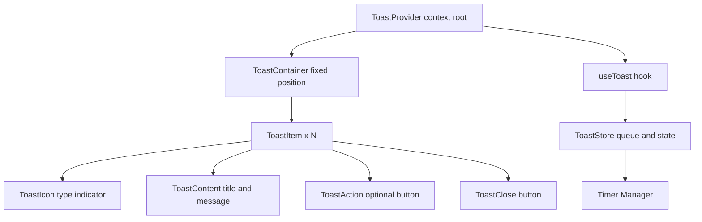

# Toast Notification System

**Category:** Frontend System Design
**Difficulty:** 🟢 Easy
**Seniority:** junior
**Companies:** Common UI component
**Tags:** state management, queue, animations
**Time:** 30-45 min

---

## Problem Statement

Design a toast notification system like the notification banners in web applications (success messages, error alerts, info toasts). Users trigger toasts through actions (form submissions, API calls, background events), and they appear in a fixed position (typically top-right or bottom-right) with auto-dismiss after a timeout. Multiple toasts should stack neatly, and users should be able to manually dismiss them.

The interviewer wants to see a clean API for adding toasts, proper queue management (max visible toasts, stacking order), smooth animations, and handling of different toast types (success, error, warning, info).

## Clarifying Questions

- Maximum number of visible toasts at once? *Default 3-4; older toasts auto-dismiss or queue.*
- Position fixed or configurable? *Configurable: top-right, bottom-right, top-left, bottom-left.*
- Auto-dismiss timeout? *Default 4-5 seconds, configurable per toast or globally.*
- Can toasts have actions (buttons, links)? *Yes, optional action button (e.g., "Undo", "View").*
- Should toasts persist across page navigation? *No, session-only; for persistence, use in-app notifications.*
- Are toasts dismissible by keyboard? *Yes, Escape key closes the most recent toast.*
- Do we need different visual styles per type? *Yes: success (green), error (red), warning (yellow), info (blue).*

## Requirements

### Functional

- Add toasts programmatically with type, message, optional title, action, and custom timeout.
- Auto-dismiss after timeout; manual dismiss via close button or keyboard.
- Stack multiple toasts with smooth enter/exit animations.
- Limit visible toasts; queue extras when at capacity.
- Support different positions and visual themes.

### Non-Functional

- Animations 60fps, no layout jank.
- Accessible: screen readers announce toasts, keyboard operable.
- Lightweight: minimal bundle impact.
- No memory leaks (cleanup timers, event listeners).

### Out of Scope

- Push notifications, in-app notification center, backend storage.

## Component Architecture



- **ToastProvider**: context provider wrapping the app; holds the toast store and renders the container.
- **ToastContainer**: fixed-position container in one of four corners; renders toasts in a stack (newest at top or bottom based on position).
- **ToastItem**: individual toast with icon, content, action, and close button; handles its own enter/exit animations.
- **useToast hook**: API for adding toasts (`toast.success()`, `toast.error()`, etc.) and dismissing by id.
- **ToastStore**: manages the queue of toasts, auto-dismiss timers, and max capacity.
- **Timer Manager**: centralized timeout handling to avoid drift and enable cleanup.

## State Management

```text
Toast {
  id: string                    // unique identifier
  type: "success" | "error" | "warning" | "info"
  title?: string
  message: string
  action?: { label: string, onClick: () => void }
  duration: number              // ms, 0 = no auto-dismiss
  createdAt: number             // timestamp
}

ToastState {
  toasts: Toast[]               // visible toasts
  queue: Toast[]                // waiting toasts (when at capacity)
  maxVisible: number            // default 4
}

FUNCTION addToast(toast)
  IF toasts.length < maxVisible THEN
    toasts.push(toast)
    IF toast.duration > 0 THEN scheduleDismiss(toast.id, toast.duration)
  ELSE
    queue.push(toast)

FUNCTION dismissToast(id)
  REMOVE toast from toasts
  IF queue.length > 0 THEN
    SHIFT next from queue to toasts
    scheduleDismiss(next.id, next.duration)
```

- State is global (context/store) so any component can trigger toasts.
- Toasts are ordered by creation time; newest appears at the top (for top positions) or bottom (for bottom positions).
- Duration 0 means sticky (no auto-dismiss) — useful for critical errors.

## API Integration

```text
// Hook API
const { toast } = useToast()

toast.success("Saved successfully")
toast.error("Failed to save", { title: "Error", action: { label: "Retry", onClick: () => ... } })
toast.info("New message received", { duration: 6000 })
toast.warning("Session expiring soon", { duration: 0 })  // sticky

// Generic API
toast.show({ type: "success", message: "Done", duration: 5000 })

toast.dismiss(id)      // dismiss specific
toast.dismissAll()     // clear all

// Configuration (optional)
<ToastProvider maxVisible={4} position="bottom-right" defaultDuration={4000}>
  <App />
</ToastProvider>
```

No backend API — toasts are purely client-side UI feedback.

## Rendering & Performance

- **Animations**: use CSS transforms (`translateX`, `opacity`) with GPU acceleration; avoid animating `height` or `margin` which trigger reflow. Enter: slide in from side; exit: slide out and fade.
- **Stacking**: use a flex column with `gap`; when a toast dismisses, remaining toasts smoothly collapse via FLIP or CSS grid with `auto-flow`.
- **Timer precision**: use `requestAnimationFrame` or a single `setInterval` loop to check due times instead of many `setTimeout` calls, reducing drift and cleanup complexity.
- **Cleanup**: on unmount, clear all timers and remove event listeners.
- **Bundle**: tree-shakeable; if using a library, import only the hook and container.

```text
FUNCTION scheduleDismiss(id, duration)
  SET dueTime ← Date.now() + duration
  timers.set(id, dueTime)
  // Single loop checks all timers every 100ms
```

- **SSR**: render empty container on server; hydrate with no initial toasts (session-only).

## Accessibility & UX

- **ARIA live region**: container has `role="status"` or `role="alert"` for errors, with `aria-live="polite"` (or `assertive` for critical errors). Each toast is an `aria-live` region itself or the container announces changes.
- **Focus management**: toasts are non-modal; they don't trap focus. However, the close button must be focusable (`tabindex="0"`).
- **Keyboard**: `Escape` dismisses the most recent toast; `Tab` navigates to close button and action buttons.
- **Screen reader announcement**: announce type and message, e.g., "Success: Saved successfully". Avoid announcing every toast if many appear rapidly — consider debouncing announcements.
- **Color contrast**: ensure text meets WCAG AA (4.5:1) against the toast background. Use icons + color, not color alone.
- **Motion**: respect `prefers-reduced-motion` — skip animations, show toasts instantly.
- **Touch**: close button and action button at least 44x44px.

## Edge Cases & Resilience

- **Rapid toasts**: if many toasts fire quickly, queue them; don't flood the screen. Consider merging similar toasts (e.g., "3 new messages").
- **Long messages**: truncate with ellipsis or allow expansion; max-width to prevent covering the viewport.
- **Action button clicks**: dismiss the toast after action (or keep it if action is non-destructive).
- **Component unmount**: if a toast's action references component state, clean up references to avoid memory leaks.
- **Timer drift**: use a single timer loop checking `Date.now()` vs due times; adjust for background tab throttling by re-syncing on visibility change.
- **Zero duration**: sticky toasts must only be dismissed manually; ensure close button is always visible.

## Trade-offs

| Decision | Option A | Option B | Choice & Why |
|---|---|---|---|
| Timer implementation | Per-toast `setTimeout` | Single loop checking due times | Single loop: less drift, easier cleanup, handles background tab throttling |
| Queue behavior | Drop oldest when full | Queue extras | Queue extras: no information loss |
| Animation | CSS transitions | JS FLIP | CSS transitions: simpler, sufficient for slide/fade |
| ARIA live region | Per-toast | Container-level | Container-level: less noise, but may miss rapid toasts; per-toast for critical errors |
| Position | Fixed corners only | Configurable anywhere | Configurable: more flexibility, but fixed corners cover 99% of use cases |

## Follow-up Questions

1. **How would you support undo actions?** Add an `undo` callback; on click, execute and dismiss the toast. Store a history stack for multi-step undo.
2. **What if toasts need to persist across navigation?** Use a global state manager (Redux, Zustand) or localStorage; on page load, restore session toasts.
3. **How would you handle toasts in a multi-tab app?** Use BroadcastChannel to sync dismissals across tabs, or keep toasts tab-local (usually fine).
4. **How do you test it?** Unit tests for queue logic and timer math; component tests for add/dismiss flow; visual regression for animations; axe for a11y.
5. **What if the user is on a slow device?** Reduce animation duration or disable animations; ensure toasts don't block the main thread.

## Common Mistakes

- Using many `setTimeout` calls without cleanup, causing memory leaks.
- Animating layout properties (`height`, `margin`) causing reflows.
- Not respecting `prefers-reduced-motion`.
- Forgetting keyboard support (Escape to dismiss).
- Making toasts modal (trapping focus) when they should be non-intrusive.
- Allowing toasts to cover critical UI (e.g., form submit buttons).

## Key Takeaways

- Toasts are a global, queue-based UI pattern; centralize state in a context/store.
- Use a single timer loop for auto-dismiss to avoid drift and simplify cleanup.
- Animate with transforms only; avoid layout-triggering properties.
- Make toasts accessible via ARIA live regions and keyboard, but keep them non-modal.
- Queue extras when at capacity to avoid screen flooding.
