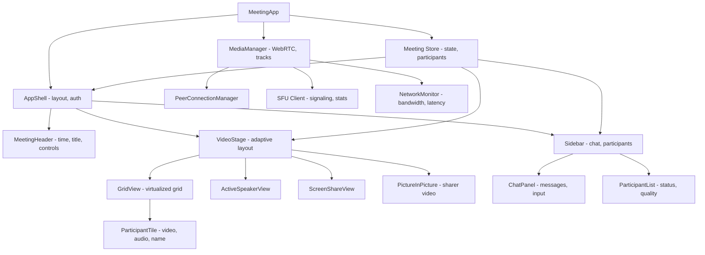

# Video Conferencing UI

**Category:** Frontend System Design
**Difficulty:** 🔴 Hard
**Seniority:** senior
**Companies:** Zoom, Google Meet, Microsoft Teams, Webex, Discord, Slack Huddles
**Tags:** WebRTC, layout, signaling, real-time, performance, accessibility, state-management
**Time:** 60-90 min

---

## Problem Statement

Design the web client for a video conferencing application like Google Meet or Zoom. Users can join meetings with up to 50 participants, see and hear each other in real-time, share their screen, use chat, raise their hand, and see active speaker indicators. The UI must adapt to different participant counts (1:1, small group, large gallery), handle network fluctuations gracefully, and provide a consistent experience across desktop and mobile.

The application uses WebRTC for media transport, with a signaling server for session management. Video quality adapts to network conditions (bandwidth estimation, resolution scaling). The interviewer cares about the WebRTC integration, adaptive layout algorithms, signaling flow, and performance under varying network conditions.

## Clarifying Questions

- Maximum participants per meeting? *Up to 50 for this design. Larger meetings (100+) would require pagination.*
- Video quality tiers? *720p for active speaker, 360p for others in gallery, adaptive based on bandwidth.*
- Screen sharing? *Yes. One participant can share at a time. Shared content is shown in a large view with picture-in-picture for the sharer.*
- Audio only mode? *Yes. Users can turn off video to save bandwidth.*
- Recording? *Server-side recording is out of scope. Client-side recording is optional.*
- Breakout rooms? *Out of scope for this round.*
- Mobile support? *Responsive design, but focus on desktop first. Mobile has layout constraints.*
- What's the network profile? *Variable. Some users on high-speed fiber, others on 4G or spotty Wi-Fi.*

## Requirements

### Functional
- Join meeting with camera/microphone permissions, mute/unmute, video on/off.
- Adaptive video layout: active speaker, grid view (2x2, 3x3, etc.), and spotlight mode.
- Screen sharing with shared content view and participant picture-in-picture.
- Real-time chat with message history and @mentions.
- Hand raise, reactions (emoji), and active speaker indicators.
- Participant list with mute/video status and connection quality indicators.
- Network quality visualization (signal strength, bandwidth usage).

### Non-Functional
- Video latency under 400ms (p95). Audio latency under 150ms (p95).
- Smooth layout transitions when participants join/leave.
- Graceful degradation on poor networks (reduce resolution, frame rate, or disable video).
- 60fps UI animations even with 25 video streams.
- Accessible to keyboard-only and screen reader users.

### Out of Scope
- Breakout rooms, whiteboard, polls, recording, virtual backgrounds (beyond basic blur), and SIP integration.

## Component Architecture



- **MediaManager** owns all WebRTC PeerConnections, local media tracks (camera, microphone, screen), and the SFU (Selective Forwarding Unit) client. It handles track negotiation, ICE candidates, and media statistics.
- **PeerConnectionManager** manages one PeerConnection per remote participant (or per stream if using SFU). It handles track addition/removal and quality adaptation.
- **VideoStage** is responsible for adaptive layout. It switches between grid view, active speaker, and screen share based on participant count and user preference.
- **GridView** uses virtualization for large participant counts (25+). Only visible video tiles are rendered to save CPU/GPU.
- **NetworkMonitor** tracks RTT, packet loss, and bandwidth estimation from WebRTC stats. It signals quality changes to the UI and MediaManager.
- **Meeting Store** holds the shared state: participants, chat messages, hand raises, reactions, and UI state (layout mode, sidebar open/closed).
- **Framework notes.** React with a state management library (Zustand/Redux). Media components should be framework-agnostic where possible for performance.

## Data Model & State

```text
Meeting {
  id, title, startTime, hostId,
  participants: Map<UserId, Participant>
}

Participant {
  id, name, avatarUrl,
  audioTrack: MediaStreamTrack | null,
  videoTrack: MediaStreamTrack | null,
  screenTrack: MediaStreamTrack | null,
  isMuted: Boolean, isVideoOff: Boolean,
  isHandRaised: Boolean, reaction: Emoji | null,
  isActiveSpeaker: Boolean,
  connectionQuality: 'excellent' | 'good' | 'poor' | 'offline',
  joinedAt: Timestamp
}

LocalUser {
  id, name, avatarUrl,
  audioTrack, videoTrack, screenTrack,
  isMuted, isVideoOff, isScreenSharing,
  bandwidthEstimate: Number,  // kbps
  packetLoss: Number,
  rtt: Number
}

Chat {
  messages: Array<{
    id, userId, name, text, timestamp,
    isSystem: Boolean  // e.g., "Alice joined"
  }>
}

UI State {
  layoutMode: 'grid' | 'activeSpeaker' | 'screenShare',
  sidebarTab: 'chat' | 'participants' | null,
  pinnedParticipant: UserId | null,
  spotlightParticipants: Array<UserId>
}
```

- **Participants** include both local and remote users. Remote participants' tracks are received via WebRTC. Local tracks are from getUserMedia/getDisplayMedia.
- **Connection quality** is derived from WebRTC stats (RTT, packet loss, bitrate). It's updated periodically (every 1-2s).
- **Chat messages** are ephemeral for the meeting duration. They could be persisted but are typically not required for this scope.
- **UI state** is local and not synced across clients (except perhaps pinned participant for consistency).

## API & Interfaces

```text
WebSocket signaling wss://meet.example.com/signaling?token=...
  client -> server
    { type: "join", meetingId, userId, name }
    { type: "offer", sdp, targetUserId }
    { type: "answer", sdp, targetUserId }
    { type: "ice", candidate, targetUserId }
    { type: "leave" }
    { type: "chat", text }
    { type: "reaction", emoji }
    { type: "handRaise", isRaised }
  server -> client
    { type: "userJoined", user }
    { type: "userLeft", userId }
    { type: "offer", sdp, fromUserId }
    { type: "answer", sdp, fromUserId }
    { type: "ice", candidate, fromUserId }
    { type: "chat", message }
    { type: "reaction", userId, emoji }
    { type: "handRaise", userId, isRaised }
    { type: "activeSpeaker", userId }

REST API
  GET  /api/meetings/{id}
       200 { meeting }
  POST /api/meetings
       { title, hostId }
       201 { meetingId, joinUrl }
  POST /api/meetings/{id}/join
       { userId, name }
       200 { token, sfuUrl, iceServers }
```

WebRTC interfaces:

```text
MediaManager
  methods:
    async initLocalTracks(audioConstraints, videoConstraints)
    async startScreenShare()
    async stopScreenShare()
    toggleAudio(enabled)
    toggleVideo(enabled)
    async connectToSFU(token, sfuUrl)
    subscribeToParticipant(userId)
    unsubscribeFromParticipant(userId)
    getStats() -> { bandwidth, packetLoss, rtt }

ParticipantTile
  props:  participant, isLocal, isPinned, isActiveSpeaker
  events: onPin(), onMute(remoteUserId), onRemove()
```

## Rendering & Performance

**Adaptive layout algorithm.**

```text
FUNCTION calculateLayout(participantCount, containerSize)
  IF participantCount <= 2 THEN
    RETURN { mode: 'activeSpeaker', mainSize: 100%, secondarySize: 30% }
  ELSE IF participantCount <= 6 THEN
    RETURN { mode: 'grid', columns: 2, rows: ceil(participantCount / 2) }
  ELSE IF participantCount <= 16 THEN
    RETURN { mode: 'grid', columns: 4, rows: ceil(participantCount / 4) }
  ELSE
    RETURN { mode: 'grid', columns: 5, rows: ceil(participantCount / 5), virtualized: true }
```

- **Grid view** uses CSS Grid for small participant counts (<16). For larger counts, use virtualization with react-window or similar.
- **Active speaker mode** shows one large video (the active speaker) with a strip of smaller videos for other participants.
- **Screen share mode** shows the shared content in a large view with the sharer's video in a picture-in-picture corner.

**Video tile optimization.**
- Use `object-fit: cover` for video elements to fill the tile without distortion.
- Disable hardware acceleration for video elements if it causes rendering issues (check for GPU bugs).
- Use `will-change: transform` for animated tiles (e.g., when a participant joins/leaves).
- For inactive participants (not in viewport), pause video decoding to save CPU. Resume when they become visible.

**Bandwidth adaptation.**
- Monitor WebRTC stats (inbound/outbound bitrate, packet loss, RTT) every 1-2s.
- If packet loss > 5% or RTT > 500ms, request lower resolution from the SFU (via signaling or REMB/transport-wide CC).
- If bandwidth is very low (<500 kbps), disable video for non-active speakers or switch to audio-only mode.
- Show a network quality indicator (green/yellow/red) based on these metrics.

**CPU adaptation.**
- Monitor frame rate and rendering performance. If the UI drops below 30fps, reduce the number of concurrent video decodes.
- Use a priority queue: active speaker > pinned participants > visible tiles > hidden tiles.
- On mobile, limit video resolution to 360p or lower to save battery.

**Chat performance.**
- Virtualize the chat message list if it grows beyond 100 messages.
- Debounce message sending to avoid flooding the signaling channel.
- Use `Intl.DateTimeFormat` for timestamp formatting.

**Memory management.**
- Release video tracks for participants who leave the meeting.
- Clear chat messages older than a certain threshold (e.g., 500 messages) to prevent memory bloat.
- Use object pooling for frequently created objects (e.g., message objects, stats objects).

## Accessibility & UX

- **Keyboard navigation.** Tab through video tiles, Enter to pin a participant. Ctrl+M to mute/unmute. Ctrl+V to toggle video. Escape to exit full screen.
- **Screen reader support.** Use `aria-live="polite"` for chat messages. Announce "Alice joined" or "Bob raised hand". Provide accessible names for video tiles (e.g., "Alice, video on, audio muted").
- **Audio indicators.** Show a clear mute/unmute button with icon and tooltip. Flash the border when a participant is speaking.
- **Visual feedback.** Show a "You're muted" reminder if the user tries to speak while muted. Show a "Poor connection" warning if network quality degrades.
- **Responsive design.** On mobile, show a single large video with a carousel for other participants. Move chat to a bottom sheet. Simplify controls.
- **Loading states.** Show a spinner while connecting to the SFU. Show "Connecting..." for each participant as their stream loads.
- **Error handling.** Show clear error messages for permission denied (camera/microphone), network errors, or unsupported browsers. Provide retry buttons.

## Edge Cases & Resilience

- **Permission denied.** If the user denies camera/microphone access, show a clear message and allow them to retry or join with audio/video off.
- **Network disconnect.** Detect via WebSocket close event or ICE connection state changes. Show a "Reconnecting..." banner. Attempt reconnection with exponential backoff. Buffer chat messages locally and sync on reconnect.
- **ICE failure.** If ICE fails to establish a connection, try a different ICE server or fallback to TURN. Show a "Connection failed" message if all attempts fail.
- **High CPU usage.** If the device cannot handle multiple video streams, automatically reduce quality or switch to audio-only for some participants. Show a notification.
- **Participant join/leave.** Animate tiles smoothly when participants join or leave. Use CSS transitions for position changes.
- **Screen share start/stop.** When screen sharing starts, switch the layout to screen share mode. When it stops, revert to the previous layout.
- **Audio echo.** Use echo cancellation (AEC) in the WebRTC configuration. If echo is detected, warn the user to use headphones.
- **Time zone handling.** Display meeting time in the user's local timezone. Use `Intl.DateTimeFormat` for formatting.

## Trade-offs

| Decision | Option A | Option B | Choice & Why |
|---|---|---|---|
| Media transport | Mesh (P2P) | SFU (Selective Forwarding Unit) | SFU. Scales better for 50 participants. Mesh would require O(n²) connections. |
| Layout rendering | CSS Grid | Virtualized list | CSS Grid for small counts (<16), virtualized for larger. CSS Grid is simpler but doesn't scale. |
| Bandwidth adaptation | Client-side only | Server-side simulcast | Server-side simulcast. SFU can send different resolutions to different clients based on their needs. |
| Chat transport | WebSocket signaling | Separate chat server | WebSocket signaling. Simpler for this scope. Separate server adds complexity but scales better for large meetings. |
| Video codec | VP8/VP9 | H.264 | H.264. Better hardware support across browsers. VP9 has better compression but less support. |

## Follow-up Questions

1. **How would you scale to 500+ participants?** Implement pagination in the grid view (show 25 at a time with scroll). Use audio-only for most participants, with video on-demand. Consider a hierarchical SFU architecture.
2. **How would you add virtual backgrounds?** Use a ML model (e.g., MediaPipe Selfie Segmentation or TensorFlow.js) to segment the user and replace the background. Run in a Web Worker to avoid blocking the UI. Offer a set of predefined backgrounds.
3. **How do you handle echo cancellation?** Use WebRTC's built-in AEC (Acoustic Echo Cancellation). If echo persists, detect it (via audio feedback loop) and warn the user to use headphones.
4. **How would you add recording?** Use the MediaRecorder API to capture local streams. For server-side recording, the SFU would mix streams and record. Handle permissions and notify all participants.
5. **How do you test WebRTC integration?** Use automated testing with mock SDP offers/answers. Test with different network conditions (using Chrome's network throttling). Manual testing with real devices is essential.

## Common Mistakes

- Using mesh (P2P) for large meetings, causing O(n²) connection overhead and poor scalability.
- Not adapting video quality based on network conditions, leading to buffering or high latency.
- Forgetting to handle ICE connection failures, leaving participants with no media.
- Not virtualizing the grid view for large participant counts, causing UI freezes.
- Ignoring accessibility, making the app unusable for keyboard-only or screen reader users.
- Not releasing media tracks when participants leave, causing memory leaks.

## Key Takeaways

- SFU is the right choice for scalable video conferencing with many participants.
- Adaptive layout algorithms are essential for a smooth experience across different participant counts.
- Bandwidth and CPU adaptation ensure the app works on poor networks and low-end devices.
- Virtualization is critical for rendering large numbers of video tiles.
- Accessibility is non-negotiable: provide keyboard navigation, screen reader support, and clear visual indicators.
- Design for failure: handle network disconnects, permission issues, and ICE failures gracefully.
