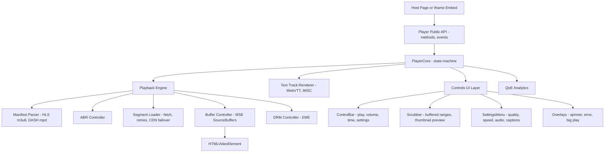

# Video Player

**Category:** Frontend System Design
**Difficulty:** 🔴 Hard
**Seniority:** senior
**Companies:** Netflix, YouTube, Meta, Twitch, Disney+, Amazon, Vimeo
**Tags:** adaptive-bitrate, media-source-extensions, hls-dash, buffering, drm, captions, media-accessibility
**Time:** 60 min

---

## Problem Statement

Design a web video player like the ones on YouTube, Netflix or Twitch. It plays on-demand and live streams with adaptive quality, and supports seeking, captions and subtitles, multiple audio tracks, fullscreen, picture-in-picture, playback speed and keyboard shortcuts. It must work across desktop and mobile browsers and report quality-of-experience (QoE) metrics.

The player is embedded on many pages and in third-party sites, so it needs a clean public API and a small footprint. The interviewer wants to hear how streaming works in the browser (HLS/DASH, MSE, ABR), how you keep startup fast and rebuffering rare, how the UI layer is structured, accessibility, DRM, and resilience.

## Clarifying Questions

- VOD, live, or both? *Both. Live includes low-latency HLS/DASH with DVR (seek back up to 2 h).*
- Which streaming formats? *HLS (CMAF fMP4 segments) and DASH. Safari on iOS uses native HLS.*
- Is DRM required? *Yes for premium content: Widevine (Chrome, Firefox, Android), FairPlay (Safari) and PlayReady (Edge) through EME.*
- Will there be ads? *Out of scope for the core, but the design should allow a plug-in (SSAI or IMA SDK).*
- Embeddable on third-party sites? *Yes, through an iframe embed plus a JS SDK for first-party pages.*
- Which devices? *Desktop browsers, mobile web, and smart TVs or consoles running a browser engine.*
- Target metrics? *Startup time under 1 s at p50, rebuffer ratio under 0.5%, and video start failures under 0.5%.*

## Requirements

### Functional
- Play, pause, seek (scrubber with thumbnail previews), volume, speed, fullscreen and PiP.
- Adaptive bitrate with a manual quality override, and multi-audio and subtitle tracks.
- Live playback with a "Go live" button and DVR window. VOD resume from the last position.
- Keyboard shortcuts, captions styling, and a QoE analytics beacon.
- Public API: `load(source)`, `play()`, `seek(t)`, plus events for host pages.

### Non-Functional
- Time to first frame under 1 s at p50 on broadband. Minimal rebuffering, and smooth quality switches.
- The player's own bundle under about 100 KB gzipped for the core. Plugins load lazily.
- WCAG 2.1 AA and FCC/CVAA caption requirements.
- Resilient to CDN errors, network drops and decoder errors.

### Out of Scope
- Encoding and packaging pipeline, recommendation UI, ad decisioning server.

## Component Architecture



- **PlayerCore** is a framework-agnostic state machine: `idle`, `loading`, `ready`, `playing`, `paused`, `buffering`, `seeking`, `ended`, `error`. It is the single source of truth for both the UI and the public API.
- **Playback Engine.** Where native HLS exists (iOS Safari), it just sets `video.src`. Elsewhere it uses Media Source Extensions (MSE, or `ManagedMediaSource` on iOS 17.1+): parse the manifest, pick a rendition, fetch segments and `appendBuffer` them into `SourceBuffer`s. This is the role of hls.js, dash.js and Shaka Player.
- **ABR Controller** chooses the rendition for the next segment from bandwidth estimates and buffer level.
- **Controls UI** is a thin view over the core state. It can be written in vanilla Web Components so it embeds anywhere, or wrapped as React or Angular components for first-party apps. Native `controls` stay off, but the UI falls back to them if JS fails.
- **Text Track Renderer** draws WebVTT/IMSC cues in a custom overlay, which allows user styling and positioning above the controls. Native `TextTrack` rendering is used for iOS fullscreen.
- **QoE Analytics** samples events (startup time, rebuffers, bitrate switches, errors) and sends batches with `navigator.sendBeacon`.

## Data Model & State

```text
PlayerState {
  status: idle | loading | ready | playing | paused | buffering | seeking | ended | error
  source: { url, type: hls | dash | mp4, drm?: { keySystem, licenseUrl, certUrl } }
  isLive: Boolean, liveEdge: Seconds, dvrWindow: Seconds, latencyTarget: Seconds
  currentTime, duration, playbackRate, volume, muted
  buffered: List<{ start, end }>               // from video.buffered
  renditions: List<{ id, bandwidth, width, height, codecs, frameRate }>
  activeRenditionId, abrMode: auto | manual
  audioTracks: List<{ id, lang, label }>, activeAudioId
  textTracks: List<{ id, lang, label, kind: subtitles | captions }>, activeTextId | null
  ui: { controlsVisible, settingsOpen, fullscreen, pip, hoverTime, thumbnailSprite }
  error: { code, fatal: Boolean, message } | null
  prefs (localStorage): { volume, muted, captionsLang, captionStyle, preferredQuality }
}

QoE Session {
  sessionId, startRequestedAt, firstFrameAt, rebufferEvents: [{ at, durationMs }],
  bitrateSwitches: [{ at, from, to }], droppedFrames, errors, watchTimeMs
}
```

- **The media element is the truth for playback.** Derive `currentTime`, `paused`, `buffered` and `readyState` from `HTMLMediaElement` events (`timeupdate`, `waiting`, `playing`, `seeking`, `progress`) rather than duplicating them. The core maps those events onto its state machine.
- **Server-provided data.** Manifest, renditions, thumbnail sprites (VTT plus sprite images), and the resume position. These are cached per video id.
- **UI state.** Control visibility (auto-hide after 3 s idle while playing), menus and hover previews. Throttle it so `timeupdate`, which fires at about 4–66 Hz, does not re-render the whole UI.

## API & Interfaces

```text
GET /api/videos/{id}/playback
  200 { manifests: { hls: "https://cdn/.../master.m3u8", dash: "https://cdn/.../manifest.mpd" },
        drm: { widevine: { licenseUrl }, fairplay: { licenseUrl, certUrl } },
        thumbnails: "https://cdn/.../thumbs.vtt", resumeAt: 1312.4,
        captions: [ { lang: "en", url: ".../en.vtt", kind: "captions" } ],
        cdnFallbacks: ["cdn-a", "cdn-b"] }
POST /api/videos/{id}/progress      { position, sessionId }     // every 10-30 s + on pause/unload
POST /api/drm/license               (binary challenge from EME) -> license bytes
POST /api/qoe/events                (batched, sendBeacon)

CDN
GET  .../master.m3u8 -> variant playlists -> .../720p/seg_000123.m4s (2-6 s CMAF segments)
```

Public player API (SDK and postMessage bridge for the iframe embed):

```text
Player.create(containerEl, { autoplay, muted, startTime, controls, plugins[] })
  methods: load(source), play() -> Promise, pause(), seek(seconds), setVolume(0..1),
           setPlaybackRate(r), setQuality(id | "auto"), setTextTrack(id | null),
           requestFullscreen(), requestPiP(), destroy()
  events:  ready, play, pause, timeupdate (throttled 4 Hz), seeking, seeked,
           waiting, qualitychange, ended, error { code, fatal }
```

`play()` returns a Promise because browsers may reject autoplay with sound. Hosts must handle that rejection, typically by falling back to muted autoplay or showing a big play button.

## Rendering & Performance

**Startup optimization.**
- `preconnect` to the manifest and segment CDN. Prefetch the playback API response and the master manifest on hover or viewport entry for the likely-next video.
- Start at a conservative rendition that matches the last known bandwidth (stored in localStorage) and the player size. There is no point in 4K for a 360 px player.
- Use short segments at startup (or a low-latency partial segment) and begin playing after about 2 s of buffer.
- Use a poster image (`` with `fetchpriority="high"`) as the LCP element, and render the controls shell before the engine loads.

**ABR algorithm (hybrid throughput + buffer).**

```text
FUNCTION chooseRendition(renditions, bwEstimate, bufferLevel, playerWidth)
  // bwEstimate: EWMA of recent segment download throughput (fast + slow, take min)
  SET cap ← renditions WHERE width <= playerWidth * devicePixelRatio
  IF bufferLevel < 5s THEN SET safety ← 0.5          // low buffer: be conservative
  ELSE IF bufferLevel > 20s THEN SET safety ← 0.9    // healthy buffer: allow upswitch
  ELSE SET safety ← 0.7
  SET target ← MAX(r IN cap WHERE r.bandwidth <= bwEstimate * safety)
  IF target.bandwidth > current.bandwidth AND bufferLevel < 10s THEN RETURN current  // avoid oscillation
  RETURN target OR lowest(cap)
```

Buffer-based variants (BOLA) and throughput-based variants are both production-proven. Hybrids such as dash.js "Dynamic" are typical. Also drop quality when `getVideoPlaybackQuality().droppedVideoFrames` rises, since that means the CPU cannot decode the rendition.

**Buffer management.**
- Target a forward buffer of 30 s for VOD, or 2–6 s for low-latency live. Evict back buffer older than 30 s with `SourceBuffer.remove()` to avoid `QuotaExceededError`, since MSE quotas are about 100–300 MB.
- On seek, abort in-flight segment fetches (`AbortController`), find the segment that contains the target time, and keep any buffered ranges that already cover it.
- For live, keep latency near the target by adjusting `playbackRate` slightly (0.95–1.05) rather than hard seeking.

**UI performance.**
- Update the scrubber position with `requestAnimationFrame`, driven by `video.currentTime`, with transforms. Do not set React or Angular state on every `timeupdate`.
- Scrubber thumbnails come from one sprite sheet per N seconds, defined by a WebVTT thumbnail track: one image request covers many previews.
- Load plugins lazily (DRM, captions renderer, ads, Chromecast/AirPlay). Load the MSE engine only if native HLS is unavailable.

**Off main thread.** Run segment transmuxing (MPEG-TS to fMP4, as hls.js does) in a Web Worker so long tasks do not cause frame drops or input delay.

## Accessibility & UX

- **Controls.** Every control is a real `<button>` with an `aria-label` that reflects its state ("Pause", "Unmute", "Turn on captions"). The scrubber is `role="slider"` with `aria-valuemin`, `aria-valuemax`, `aria-valuenow` and a human-readable `aria-valuetext` ("1 minute 32 seconds of 10 minutes").
- **Keyboard.** Space/K toggles play. Left/Right (or J/L) seek 5 s or 10 s. Up/Down change volume. M mutes, F toggles fullscreen, C toggles captions, and 0–9 jump to percentages. Shortcuts apply only when the player has focus, so they do not hijack page scrolling.
- **Captions.** Captions default on if the user preference or OS setting says so. Users control size, color, background and opacity, following the FCC requirements. Captions move up when the controls show, so they are never hidden.
- **Focus.** Settings menus use `role="menu"` with arrow-key navigation and return focus to their trigger. Controls stay visible while anything inside the player has focus. Fullscreen keeps focus inside the player.
- **Announcements.** Announce seek results and quality changes through a polite live region, debounced. Visible states cover buffering (spinner after a 500 ms delay to avoid flicker), errors with retry, ended with replay or next, and autoplay blocked.
- **Motion and audio.** Never autoplay with sound. Respect `prefers-reduced-motion` for preview animations. Audio-description tracks are offered as audio tracks.
- **RTL/i18n.** Localized labels and time formats. The control bar layout mirrors in RTL, but the scrubber's progress direction usually stays left to right (YouTube convention). Decide explicitly.

## Edge Cases & Resilience

- **Segment fetch failures.** Retry with exponential backoff (up to 3 times). After that, fail over to the next CDN in `cdnFallbacks`. On repeated failure, drop to a lower rendition before declaring a fatal error.
- **Media decode errors.** `MEDIA_ERR_DECODE` can often be recovered by `recoverMediaError()`: reset the SourceBuffer and re-append from the current time. If it happens again, swap the codec (for example from HEVC or AV1 to H.264).
- **Network offline.** Pause fetching and keep playing from the buffer. Resume on the `online` event. Show "Waiting for network" only when the buffer actually runs dry.
- **Tab hidden or backgrounded.** Reduce the forward buffer target. Mobile browsers may pause video, so handle `visibilitychange`. Use the Media Session API for lock-screen controls.
- **Race conditions.** If a user loads video B while video A's manifest is in flight, the load must abort or ignore stale responses (a load token per `load()` call). Concurrent `appendBuffer` calls are illegal while `updating`, so queue them.
- **Live edge drift and discontinuities.** Handle `EXT-X-DISCONTINUITY` (ad boundaries) and timestamp offsets. If the player falls behind the DVR window, jump to the earliest available segment.
- **DRM.** The license request needs a short-lived token. Renew licenses before expiry. Show a clear error for HDCP or output protection failures, and fall back to lower-resolution renditions allowed without HDCP.
- **Security.** Use signed CDN URLs or cookies with expiry. The iframe embed uses `postMessage` with origin checks in both directions. Caption files are parsed as text (VTT cue text is never `innerHTML`). The embed can be restricted by `frame-ancestors` CSP to licensed domains.

## Trade-offs

| Decision | Option A | Option B | Choice & Why |
|---|---|---|---|
| Playback path | Native `video.src` (HLS) everywhere | MSE engine + native fallback | MSE where available, for control over ABR, buffering and metrics. Native HLS on iOS where MSE is limited. |
| ABR strategy | Throughput-only | Hybrid throughput + buffer | Hybrid. Throughput reacts fast, the buffer term prevents oscillation and rebuffering. |
| Segment duration | 2 s | 6 s | 2–4 s for live and startup (faster switches), 6 s for VOD efficiency. CMAF chunks for low latency. |
| UI tech | Framework components | Web Components / vanilla | Vanilla core UI for a small, embeddable bundle, with framework wrappers for apps. |
| Caption rendering | Native TextTrack | Custom overlay | Custom overlay for styling and positioning. Native in iOS fullscreen, where an overlay is impossible. |

## Follow-up Questions

1. **How would you insert ads?** SSAI stitches ads into the manifest, which is simple and resists ad blockers. The player only reads ad markers (SCTE-35, `EXT-X-DATERANGE`) to change the UI. Client-side insertion (IMA SDK) uses a second video element and resume logic.
2. **How do you achieve under 3 s latency for live?** LL-HLS partial segments or LL-DASH chunked CMAF with chunked-transfer fetch, a 1–2 s buffer target, playback-rate catch-up, and an ABR adapted to chunked throughput measurement.
3. **How do you measure and improve QoE?** Track startup time, rebuffer ratio, average bitrate, switches per minute and video start failures. Segment them by CDN, ISP, device and player version, then A/B test ABR parameters.
4. **How would you support offline downloads on web?** Download segments into Cache Storage or IndexedDB through a Service Worker that serves them to MSE. DRM persistent licenses are limited on the web, so most premium apps keep downloads native.
5. **How do you prevent memory leaks in an SPA with many players?** `destroy()` detaches MSE, revokes object URLs, closes MediaKeys sessions, removes listeners and aborts fetches. Pause and release players that scroll off-screen in feeds, and reuse a pool of video elements.

## Common Mistakes

- Assuming `video.src = "x.m3u8"` works everywhere. Only Safari plays HLS natively.
- Driving UI state from every `timeupdate` through the framework, which causes re-render storms.
- Ignoring the autoplay policy, so a rejected `play()` promise leaves a broken UI.
- Never evicting back buffer, which leads to `QuotaExceededError` on long videos.
- Picking quality by bandwidth alone, ignoring player size, dropped frames and buffer level.
- Inaccessible custom controls: div buttons, no slider semantics, no caption styling.

## Key Takeaways

- Browsers stream video through MSE, which appends fMP4 segments from HLS/DASH manifests. Native HLS covers Safari and iOS.
- A hybrid ABR algorithm with buffer management determines startup time, rebuffering and quality.
- Keep a framework-agnostic core state machine with a thin UI layer and a stable public API with events.
- Resilience means retries, CDN failover, decoder recovery, race-safe loads and DRM handling. Accessibility means real controls, keyboard shortcuts and styled captions.
