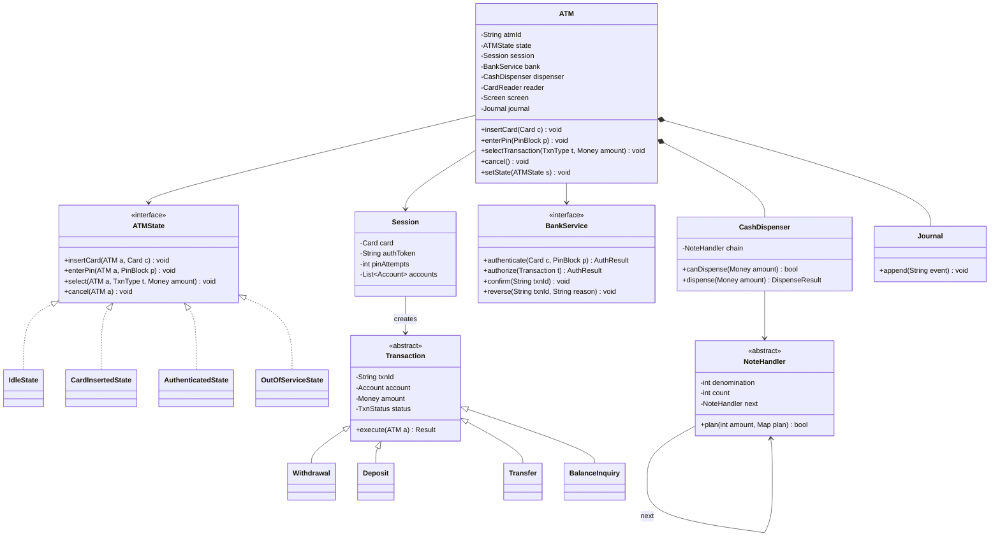
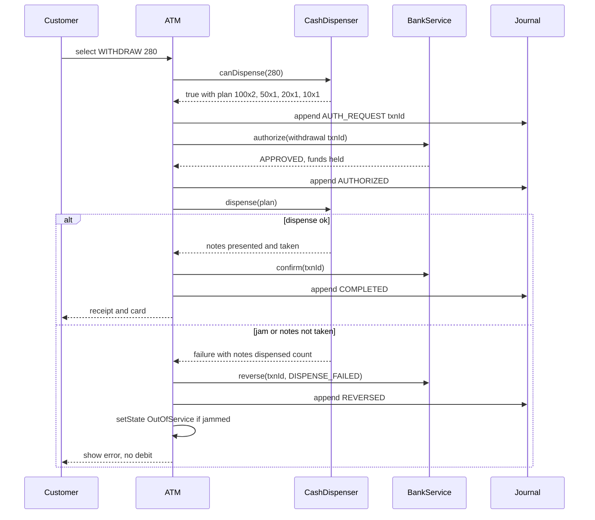

# ATM

**Category:** Low-Level Design
**Difficulty:** 🟡 Medium
**Seniority:** mid
**Companies:** Amazon, Microsoft, Goldman Sachs, JPMorgan Chase, Visa, PayPal
**Tags:** oop, state-pattern, chain-of-responsibility, transactions, idempotency, hardware-abstraction
**Time:** 45 min

---

## Problem Statement

Design the software for an Automated Teller Machine. A customer inserts a card, enters a PIN, chooses a transaction (balance inquiry, cash withdrawal, deposit, transfer), and the ATM communicates with the bank's backend to authorize and complete it. The ATM controls hardware: card reader, keypad, screen, cash dispenser, deposit slot, and receipt printer.

The interviewer is looking for a state-machine-driven session, a clean abstraction over hardware and the bank network, a correct cash-dispensing algorithm, and — most importantly — money safety when something fails between "bank debited" and "cash dispensed".

## Clarifying Questions

- Which transactions? *Balance inquiry, withdrawal, deposit (cash/cheque), transfer between own accounts.*
- Who authorizes? *The bank's backend over a secure network; the ATM never stores balances.*
- PIN verification? *Done by the bank (PIN block encrypted in the keypad's secure module); 3 wrong attempts retain the card.*
- Note denominations? *Cassettes of 100, 50, 20, 10; each cassette has a count.*
- Limits? *Per-transaction and daily withdrawal limits enforced by the bank; ATM enforces its own max notes per dispense.*
- Multiple accounts per card? *Yes, customer picks checking or savings.*
- What if the dispenser jams after the bank debits? *Must reverse the debit — this is a key case.*

## Requirements

### Functional
- Card insertion, PIN authentication, account selection.
- Balance inquiry, withdrawal, deposit, transfer.
- Dispense cash using available denominations; print receipt.
- Cancel at any step; eject card; retain card after repeated failures.
- Admin: refill cassettes, collect deposits, view logs.

### Non-Functional
- Money safety: a debit without dispense must be reversed; no double debits on retries (idempotency).
- Security: PIN never in plaintext outside the encrypting PIN pad; TLS to bank; session timeout.
- Auditability: every hardware action and bank message journaled locally.
- Extensible to new transaction types and hardware vendors.

### Out of Scope
- Bank backend internals, card network (Visa/Mastercard) switching, EMV chip cryptography details.

## Core Entities

- **ATM** → context: holds state, current session, hardware components, bank client.
- **ATMState** → Idle, CardInserted, Authenticated, Transaction, OutOfService.
- **Session** → card, authenticated account(s), PIN attempts, start time.
- **Card** → card number (PAN token), expiry, bank id.
- **Transaction** (abstract) → id, account, amount, status; subclasses Withdrawal, Deposit, Transfer, BalanceInquiry.
- **BankService** → interface to backend: authenticate, authorize, commit, reverse.
- **CashDispenser** → cassettes, dispense algorithm via handler chain.
- **Hardware**: CardReader, Keypad, Screen, ReceiptPrinter, DepositSlot.
- **Journal** → append-only local log for reconciliation.

## Class Diagram



## Design Patterns

| Pattern | Where | Why |
|---|---|---|
| State | `IdleState`, `CardInsertedState`, `AuthenticatedState`, `OutOfServiceState` | Each screen/step allows only specific actions; e.g., can't select withdrawal before PIN. |
| Chain of Responsibility | `NoteHandler` per denomination (100 → 50 → 20 → 10) | Each cassette takes as many notes as it can and passes the remainder on; adding a denomination = inserting a handler. |
| Command / Template Method | `Transaction.execute` with subclasses | Uniform authorize → perform → confirm/reverse skeleton; subclasses fill in the hardware step. |
| Adapter | Vendor-specific `CashDispenser`, `CardReader` drivers | Same interface over different hardware vendors (XFS/CEN standard). |
| Factory | `TransactionFactory.create(type, ...)` | UI selection maps to transaction objects. |

## Key Workflows

### Cash withdrawal with failure handling



The ATM checks it can physically dispense the amount *before* asking the bank, so it doesn't place a hold it can't fulfil. Authorization places a hold; `confirm` finalizes; `reverse` releases it. All messages carry the same `txnId` so retries are idempotent.

## Implementation

```text
CLASS ATM
    FIELDS state ← IdleState, session ← NULL, bank, dispenser, reader, screen, journal

    FUNCTION insertCard(card)           state.insertCard(this, card)
    FUNCTION enterPin(pinBlock)         state.enterPin(this, pinBlock)
    FUNCTION selectTransaction(t, amt)  state.select(this, t, amt)
    FUNCTION cancel()                   state.cancel(this)

CLASS IdleState IMPLEMENTS ATMState
    FUNCTION insertCard(atm, card)
        IF card.isExpired()
            atm.reader.eject()
            RETURN
        SET atm.session ← NEW Session(card)
        atm.setState(CardInsertedState)
        atm.screen.show("Enter PIN")

CLASS CardInsertedState IMPLEMENTS ATMState
    FUNCTION enterPin(atm, pinBlock)           // pinBlock already encrypted by PIN pad
        SET res ← atm.bank.authenticate(atm.session.card, pinBlock)
        IF res.ok
            SET atm.session.authToken ← res.token
            SET atm.session.accounts ← res.accounts
            atm.setState(AuthenticatedState)
            RETURN
        SET atm.session.pinAttempts ← atm.session.pinAttempts + 1
        IF atm.session.pinAttempts ≥ 3
            atm.reader.retain()
            atm.endSession()
        ELSE
            atm.screen.show("Wrong PIN, try again")
    FUNCTION cancel(atm)
        atm.reader.eject()
        atm.endSession()

CLASS AuthenticatedState IMPLEMENTS ATMState
    FUNCTION select(atm, type, amount)
        SET txn ← TransactionFactory.create(type, atm.session, amount, uuid())
        SET result ← txn.execute(atm)
        atm.screen.show(result.message)
        // stay authenticated for another transaction, or end session

ABSTRACT CLASS Transaction
    FUNCTION execute(atm)                       // template method
        IF NOT precheck(atm)       RETURN Result.fail("Unable to process")
        atm.journal.append("AUTH_REQ", txnId)
        SET auth ← atm.bank.authorize(this)    // retried with same txnId on timeout
        IF NOT auth.approved       RETURN Result.fail(auth.reason)
        atm.journal.append("AUTHORIZED", txnId)
        IF perform(atm)                         // hardware step
            atm.bank.confirm(txnId)
            atm.journal.append("COMPLETED", txnId)
            RETURN Result.ok
        atm.bank.reverse(txnId, "HARDWARE_FAILURE")
        atm.journal.append("REVERSED", txnId)
        RETURN Result.fail("Transaction cancelled, you were not charged")

CLASS Withdrawal EXTENDS Transaction
    FIELDS plan
    FUNCTION precheck(atm)
        IF amount MOD 10 ≠ 0      RETURN false
        SET plan ← atm.dispenser.plan(amount)
        RETURN plan ≠ NULL
    FUNCTION perform(atm)
        SET r ← atm.dispenser.dispense(plan)
        RETURN r.success AND r.notesTaken

CLASS NoteHandler
    FIELDS denomination, count, next
    // Greedy-first with backtracking: try the most notes of this denomination,
    // fall back to fewer if the remainder can't be served downstream.
    // Example: 60 with no 10s -> 50x1 leaves 10 (fail) -> retry 50x0, 20x3 (ok).
    FUNCTION plan(amount, planMap)
        IF amount = 0  RETURN true
        FOR k FROM min(amount / denomination, count) DOWN TO 0
            SET planMap[denomination] ← k
            SET rest ← amount - k * denomination
            IF rest = 0
                RETURN true
            IF next ≠ NULL AND next.plan(rest, planMap)
                RETURN true
        SET planMap[denomination] ← 0
        RETURN false

CLASS CashDispenser
    FIELDS chain, maxNotes ← 40
    FUNCTION plan(amount)
        SET p ← {}
        IF chain.plan(amount, p) AND sum(p.values) ≤ maxNotes  RETURN p
        RETURN NULL
    FUNCTION dispense(plan)
        // hardware call; decrement cassette counts by what the hardware reports
        SET r ← hardware.dispense(plan)
        FOR (d, n) IN r.dispensedCounts  cassette[d].count ← cassette[d].count - n
        RETURN r
```

## Concurrency & Extensibility

- **Single customer per ATM**, but events arrive from multiple sources (keypad, card reader, network responses, session timeout timer). Serialize them through a single event loop per ATM so state transitions are atomic; the timeout posts a `cancel` event rather than mutating state directly.
- **Network timeouts:** if `authorize` times out, the ATM does not know whether the bank approved. It retries with the same `txnId` (bank dedupes) or sends `reverse(txnId)`; never dispense without a definitive approval.
- **Crash recovery:** on reboot, scan the journal for transactions in AUTHORIZED without COMPLETED/REVERSED and send reversals (or flag for reconciliation if the dispenser reports notes were presented).
- **Bank side:** concurrent withdrawals from the same account at different ATMs are serialized by the bank (row lock or conditional balance update); the ATM is a client and must not cache balances.
- **New transaction types** (bill payment, mobile cash-out with a one-time code): add a `Transaction` subclass and factory entry; the state machine is unchanged.
- **New denominations:** insert a `NoteHandler` into the chain in descending order.

## Trade-offs

| Decision | Option A | Option B | Choice & Why |
|---|---|---|---|
| When to debit | Debit, then dispense | Authorize hold, dispense, then confirm | Hold + confirm: failures release the hold instead of needing a refund. |
| Dispense algorithm | Pure greedy | Greedy with backtracking over counts | Backtracking: greedy fails with limited counts (e.g., 60 with no 10s needs 20x3). Search space is tiny. |
| PIN check | Verify locally against card data | Bank verifies encrypted PIN block | Bank-side: PCI requirements; ATM never sees plaintext PIN. |
| Concurrency model | Locks around shared ATM state | Single event loop per ATM | Event loop: hardware events are naturally sequential; avoids lock bugs. |
| Pre-dispense check | Ask bank first | Check cassettes first | Cassettes first: avoid holding customer funds for an amount the ATM can't dispense. |

## Follow-up Questions

1. **What if the customer doesn't take the cash?** After a timeout, the dispenser retracts the notes into a reject bin; the ATM reverses the transaction and journals the event for reconciliation.
2. **How do you make bank calls idempotent?** Every request carries a unique `txnId` generated by the ATM; the bank stores processed ids and returns the original response on retry.
3. **How do you handle deposits?** Deposit slot counts and validates notes; the customer confirms the count; the ATM sends a credit with the counted amount, often with funds availability rules (pending until verified).
4. **How do you support cardless withdrawal?** A `MobileTokenAuth` alternative to card+PIN in `IdleState` that validates a QR or one-time code with the bank; transactions reuse the same flow.
5. **How do you detect low cash?** The dispenser publishes cassette levels; below a threshold the ATM notifies the operations system, and when it can't dispense common amounts it restricts the menu or goes OutOfService.

## Common Mistakes

- Debiting the account before verifying the ATM can physically dispense the amount.
- Not handling the "debited but cash not dispensed" failure with a reversal.
- Retrying bank requests without an idempotency key, causing double debits.
- Using greedy dispensing without considering limited note counts.
- Storing or transmitting the PIN in plaintext; verifying it locally.
- Modeling the flow with flags instead of explicit states.

## Key Takeaways

- An ATM is a state machine wrapped around hardware and a remote bank client.
- Money safety comes from authorize → perform → confirm/reverse with idempotent transaction ids and a local journal.
- Chain of Responsibility models cassettes cleanly; add backtracking for correctness with limited notes.
- Hardware and bank behind interfaces make the logic testable and vendor-agnostic.
