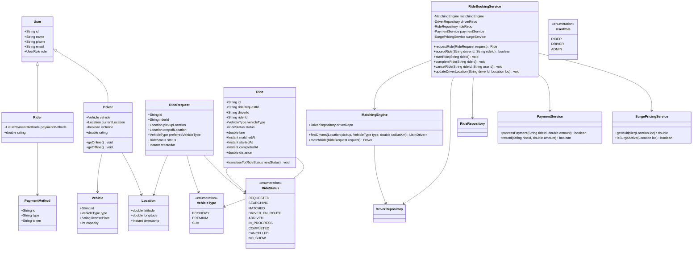
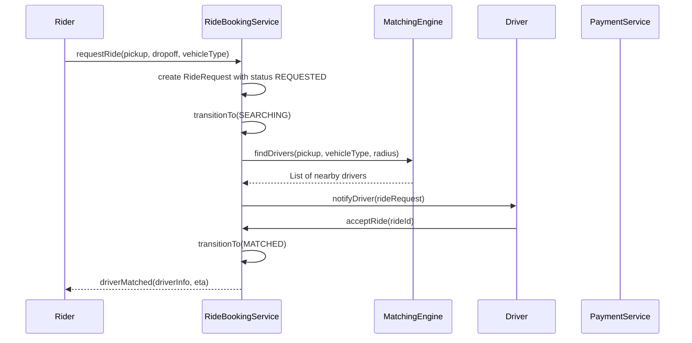
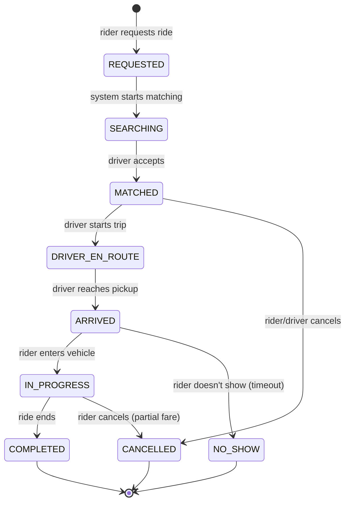

# Cab Booking System

**Category:** Low-Level Design
**Difficulty:** 🟡 Medium
**Seniority:** mid
**Companies:** Uber, Lyft
**Tags:** patterns, matching, state
**Time:** 45-60 min

---

## Problem Statement

Design a cab booking system similar to Uber or Lyft. Users can request rides, drivers can accept rides, and the system matches riders with nearby available drivers. The system should handle ride states (requested, matched, in-progress, completed, cancelled), support different vehicle types, and handle edge cases like driver cancellation, rider no-show, and surge pricing.

The interviewer is looking for a clean state machine for ride lifecycle, an efficient matching algorithm for rider-driver pairing, handling of concurrent requests, and robust error handling for real-world scenarios.

## Clarifying Questions

- Vehicle types? *Economy, Premium, SUV, each with different pricing and availability.*
- Matching strategy? *Nearest available driver within radius, considering vehicle type preference.*
- Ride states? *Requested, Searching, Matched, DriverEnRoute, Arrived, InProgress, Completed, Cancelled, NoShow.*
- Pricing model? *Base fare + distance + time + surge multiplier during high demand.*
- Payment? *Rider adds payment method upfront; charged after ride completion.*
- Rating system? *Both rider and driver rate each other after completion (optional for scope).*
- Scheduling? *On-demand only; scheduled rides are a follow-up.*
- GPS tracking? *Drivers report location periodically; used for matching and ETA calculation.*

## Requirements

### Functional

- Rider requests a ride with pickup/dropoff locations and vehicle type.
- Driver goes online/offline and accepts ride requests.
- Match riders with nearby available drivers based on location and vehicle type.
- Track ride state transitions through the lifecycle.
- Handle cancellations by rider or driver with different refund policies.
- Calculate fare based on distance, time, and surge pricing.
- Process payment after successful ride completion.
- Support driver location updates for real-time tracking.

### Non-Functional

- Low latency matching: find drivers within seconds.
- High availability: system should handle driver/rider disconnections.
- Consistency: ride state must be consistent across concurrent operations.
- Scalability: handle thousands of concurrent ride requests.
- Real-time: location updates and matching should be near real-time.

### Out of Scope

- Scheduled rides, pooling/shared rides, complex routing optimization, promo codes.

## Core Entities

- **User** → id, name, phone, email, role (RIDER/DRIVER).
- **Rider** → extends User, paymentMethods, rating.
- **Driver** → extends User, vehicleInfo, currentLocation, isOnline, rating.
- **Vehicle** → id, type (ECONOMY/PREMIUM/SUV), licensePlate, capacity.
- **RideRequest** → id, riderId, pickupLocation, dropoffLocation, vehicleType, status, createdAt.
- **Ride** → id, rideRequestId, driverId, riderId, vehicleType, status, fare, startTime, endTime, distance.
- **RideStatus** → enum: REQUESTED, SEARCHING, MATCHED, DRIVER_EN_ROUTE, ARRIVED, IN_PROGRESS, COMPLETED, CANCELLED, NO_SHOW.
- **Location** → latitude, longitude, timestamp.
- **SurgePricing** → areaId, multiplier, startTime, endTime.
- **MatchingEngine** → finds available drivers near pickup location.
- **PaymentService** → processes payment after ride completion.

## Class Diagram



## Key Workflows

### Ride request and matching



### Ride lifecycle with state transitions



## Implementation

```text
CLASS RideBookingService
    FIELDS matchingEngine, driverRepo, rideRepo, paymentService, surgeService

    FUNCTION requestRide(request)
        SET ride ← NEW Ride(request)
        SET surge ← surgeService.getMultiplier(request.pickupLocation)
        ride.surgeMultiplier ← surge
        rideRepo.save(ride)
        ride.transitionTo(RideStatus.SEARCHING)
        SET driver ← matchingEngine.matchRide(ride)
        IF driver IS NOT NULL
            ride.driverId ← driver.id
            ride.transitionTo(RideStatus.MATCHED)
            notifyDriver(driver, ride)
            notifyRider(ride.riderId, driver)
        ELSE
            scheduleRetryMatching(ride)
        RETURN ride

    FUNCTION acceptRide(driverId, rideId)
        SET ride ← rideRepo.findById(rideId)
        IF ride.status ≠ RideStatus.SEARCHING THEN RETURN false
        SET lock ← distributedLock.acquire("ride:" + rideId)
        TRY
            IF ride.status ≠ RideStatus.SEARCHING THEN RETURN false
            ride.driverId ← driverId
            ride.transitionTo(RideStatus.MATCHED)
            rideRepo.save(ride)
            RETURN true
        FINALLY
            lock.release()

    FUNCTION startRide(rideId)
        SET ride ← rideRepo.findById(rideId)
        IF ride.status ≠ RideStatus.ARRIVED THEN THROW InvalidState
        ride.transitionTo(RideStatus.IN_PROGRESS)
        ride.startedAt ← now()
        rideRepo.save(ride)

    FUNCTION completeRide(rideId)
        SET ride ← rideRepo.findById(rideId)
        IF ride.status ≠ RideStatus.IN_PROGRESS THEN THROW InvalidState
        ride.transitionTo(RideStatus.COMPLETED)
        ride.completedAt ← now()
        ride.distance ← calculateDistance(ride.pickup, ride.dropoff)
        ride.fare ← calculateFare(ride)
        rideRepo.save(ride)
        paymentService.processPayment(ride.id, ride.fare)

CLASS Ride
    FIELDS id, rideRequestId, driverId, riderId, vehicleType, status
    FIELDS fare, matchedAt, startedAt, completedAt, distance, surgeMultiplier

    FUNCTION transitionTo(newStatus)
        IF NOT isValidTransition(status, newStatus) THEN THROW InvalidTransition
        SET status ← newStatus
        SET lastUpdated ← now()

    FUNCTION isValidTransition(from, to)
        VALID_TRANSITIONS ← {
            REQUESTED: [SEARCHING],
            SEARCHING: [MATCHED, CANCELLED],
            MATCHED: [DRIVER_EN_ROUTE, CANCELLED],
            DRIVER_EN_ROUTE: [ARRIVED, CANCELLED],
            ARRIVED: [IN_PROGRESS, NO_SHOW, CANCELLED],
            IN_PROGRESS: [COMPLETED, CANCELLED]
        }
        RETURN to IN VALID_TRANSITIONS[from]

CLASS MatchingEngine
    FIELDS driverRepo, geoIndex

    FUNCTION matchRide(request)
        SET drivers ← geoIndex.nearby(request.pickupLocation, 5km)
        SET available ← drivers.filter(d -> d.isOnline AND d.vehicle.type = request.vehicleType)
        IF available IS EMPTY THEN RETURN null
        RETURN available.sortByDistance(request.pickupLocation)[0]

CLASS SurgePricingService
    FIELDS zoneRepo, demandTracker

    FUNCTION getMultiplier(location)
        SET zone ← zoneRepo.findZone(location)
        SET demand ← demandTracker.getCurrentDemand(zone.id)
        SET supply ← demandTracker.getCurrentSupply(zone.id)
        IF demand ≤ supply THEN RETURN 1.0
        SET ratio ← demand / supply
        IF ratio < 1.5 THEN RETURN 1.2
        IF ratio < 2.0 THEN RETURN 1.5
        RETURN 2.0
```

## Design Patterns

| Pattern | Where | Why |
|---|---|---|
| State | `Ride` with `RideStatus` and `transitionTo` | Ride lifecycle has clear states with specific allowed transitions. |
| Strategy | Different matching algorithms (nearest, best-rated) | Pluggable matching strategies for different business rules. |
| Factory | Ride creation from RideRequest | Encapsulates ride initialization logic. |
| Observer | Location updates and ride status changes | Notify riders/drivers of updates in real-time. |
| Repository | DriverRepository, RideRepository | Abstract data access, enables swapping storage implementations. |
| Command | Ride state transitions (start, complete, cancel) | Encapsulates actions as objects for undo/redo or audit logging. |

## Scalability

- **Geospatial indexing:** Use geospatial databases (PostGIS, MongoDB geospatial indexes) or quadtree/s2 geometry libraries for efficient nearby driver queries.
- **Driver location updates:** Drivers send location updates every few seconds. Use a time-series database or Redis with geospatial indexing for fast lookups.
- **Matching optimization:** Pre-index drivers by location and vehicle type. Use geohash or S2 cell indexing to quickly find drivers in a radius.
- **Horizontal scaling:** Stateless service instances behind a load balancer. State (ride status, driver locations) in shared databases/Redis.
- **Pub/sub for real-time:** Use WebSocket or server-sent events for real-time updates to riders and drivers. Backed by a message broker (Kafka, Redis Pub/Sub).
- **Caching:** Cache driver locations in Redis with TTL. Cache surge pricing zones to reduce database load.

## Error Handling

- **No drivers available:** Return "no drivers available" to rider with suggestion to try different vehicle type or wait. Keep request in a queue for a timeout period.
- **Driver cancellation:** If driver cancels after matching, return ride to SEARCHING state. If multiple cancellations, offer rider option to cancel with no fee.
- **Rider cancellation:** Different policies based on timing: no fee if cancelled before matching, small fee if cancelled after matching but before pickup, full fare if cancelled after pickup.
- **Rider no-show:** Driver arrives, waits for a timeout (e.g., 5 minutes), then marks ride as NO_SHOW. Rider is charged a cancellation fee.
- **Payment failure:** If payment fails after ride completion, mark ride as PAYMENT_FAILED and retry. Notify rider to update payment method.
- **Concurrent matching:** Use distributed locks or database transactions to prevent multiple drivers from accepting the same ride. First to claim wins.
- **Network failures:** Implement idempotent operations. If a location update is lost, the next update corrects it. Ride state transitions are idempotent.

## Trade-offs

| Decision | Option A | Option B | Choice & Why |
|---|---|---|
| Matching algorithm | Nearest driver | Best-rated nearby driver | Nearest for speed; rating as secondary filter for quality. |
| State storage | In-memory | Database with cache | Database with cache — durability + performance. |
| Location updates | Push from driver | Pull from service | Push — more real-time, reduces server load. |
| Cancellation policy | Fixed rules | Configurable per market | Configurable — different markets have different policies. |
| Surge pricing | Static zones | Dynamic based on demand | Dynamic — responds to real-time supply/demand. |
| Payment timing | Pre-authorize | Charge after ride | Charge after ride — accurate fare calculation. |

## Follow-up Questions

1. **How do you handle surge pricing?** Calculate supply/demand ratio per geospatial zone. If demand > supply, apply multiplier (1.5x, 2x, etc.). Show rider the surge price before they confirm. Surge decays over time if demand decreases.
2. **How do you prevent race conditions in matching?** Use database row-level locks or Redis distributed locks when a driver accepts a ride. Mark ride as MATCHED atomically. Other drivers get "ride already taken" error.
3. **How do you handle driver location updates at scale?** Drivers send updates every 5-10 seconds. Use a geospatial index in Redis (GEOADD) for O(log N) updates and nearby queries. Expire old entries to handle disconnected drivers.
4. **How do you calculate fare?** Base fare + (distance × perKmRate) + (time × perMinuteRate) × surgeMultiplier. Distance calculated via mapping API (Google Maps, Mapbox) using actual route, not straight-line distance.
5. **How do you support scheduled rides?** Add scheduledTime to RideRequest. Matching runs closer to scheduled time. Driver gets advance notification. Different state: SCHEDULED → SEARCHING (at scheduled time).

## Common Mistakes

- Not implementing a proper state machine, leading to invalid state transitions.
- Using straight-line distance instead of actual route distance for matching and pricing.
- Not handling concurrent matching, causing double-booking.
- Missing cancellation policies, leading to disputes.
- Not considering surge pricing in the matching algorithm.
- Not implementing idempotent operations for network resilience.
- Forgetting to handle edge cases like rider no-show and driver cancellation.

## Key Takeaways

- Use a state machine to model the ride lifecycle with clear transition rules.
- Implement efficient geospatial indexing for nearby driver queries.
- Handle concurrent operations with locks or transactions to prevent race conditions.
- Design flexible cancellation policies based on timing and who cancels.
- Calculate fare based on actual route distance, time, and surge multiplier.
- Use real-time communication (WebSockets) for rider-driver coordination.
- Consider edge cases: no-show, cancellations, payment failures, network issues.
