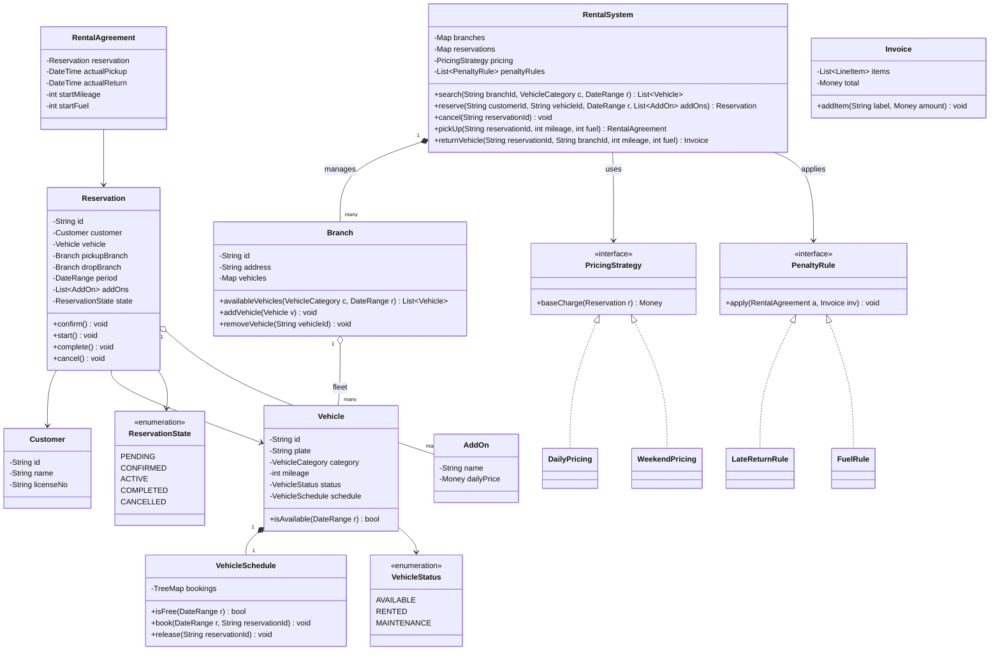
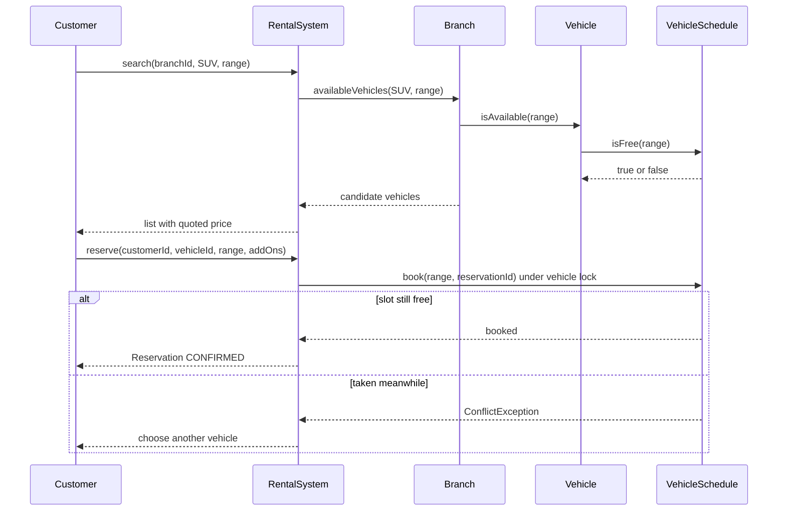
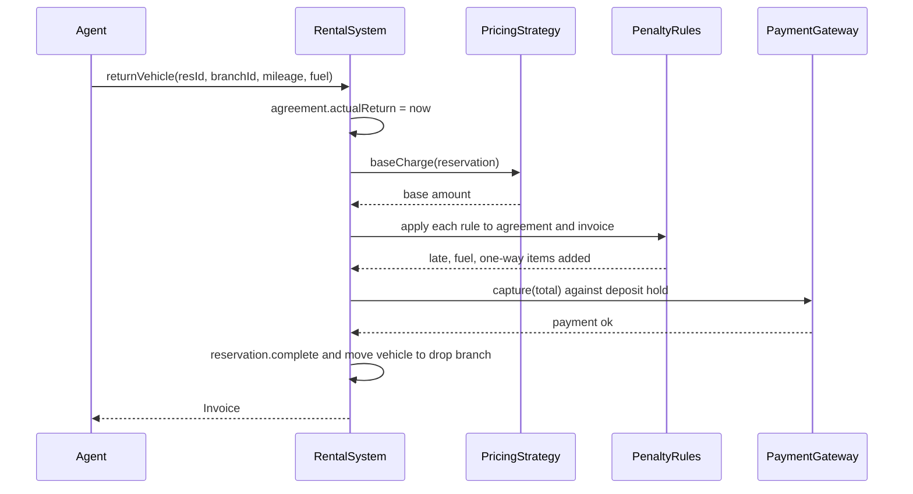

# Car Rental System

**Category:** Low-Level Design
**Difficulty:** 🟡 Medium
**Seniority:** mid
**Companies:** Amazon, Microsoft, Uber, Booking.com, Expedia, Flipkart
**Tags:** oop, state-pattern, strategy-pattern, reservations, concurrency, solid
**Time:** 45 min

---

## Problem Statement

Design the object model for a car rental company such as Hertz or Zoomcar. The company operates several branches, each with a fleet of vehicles of different types (economy, SUV, luxury). Customers search for available vehicles at a branch for a date range, reserve one, pick it up, return it (possibly at a different branch), and pay a bill that includes the base rental, add-ons (GPS, child seat, insurance) and penalties (late return, fuel, damage).

The interviewer wants clean entities, a correct vehicle and reservation lifecycle, pluggable pricing, and protection against two customers booking the same car for overlapping dates.

## Clarifying Questions

- Do customers reserve a specific car or a car category? *A category at a branch; a concrete vehicle is assigned at reservation time so availability is exact.*
- Can a car be returned to a different branch? *Yes (one-way rental) with a drop-off fee; the vehicle then belongs to the new branch's fleet.*
- How is pricing done? *Daily rate per category, weekend/seasonal multipliers, add-ons per day, late fee per extra hour; must be swappable.*
- What happens on cancellation? *Free up to 24 hours before pickup, otherwise a cancellation fee.*
- Do we handle payments? *Through an external payment gateway; we model a deposit hold at reservation and final charge at return.*
- Maintenance? *Vehicles can be taken out of service and must not be offered.*
- Scale? *~200 branches, ~50k vehicles; single service instance per region is fine for LLD.*

## Requirements

### Functional
- Search available vehicles by branch, category and date range.
- Create, modify and cancel reservations.
- Pick up a vehicle (check-out) and return it (check-in) with mileage, fuel level and damage notes.
- Generate a bill: base rate, add-ons, one-way fee, late fee, fuel and damage charges.
- Manage fleet: add vehicles, move to maintenance, transfer between branches.

### Non-Functional
- No double booking: a vehicle has at most one active reservation for any time instant.
- Availability search fast enough for interactive use (sub-100 ms per branch).
- Extensible pricing, vehicle categories and add-ons without changing core classes.

### Out of Scope
- Loyalty programs, dynamic ML pricing, driver-license verification internals, telematics.

## Core Entities

- **RentalSystem** → facade; entry point for search, reserve, pickup, return.
- **Branch** → location; owns its fleet and the reservation calendar of each vehicle.
- **Vehicle** → VIN, plate, category, mileage, status (AVAILABLE, RESERVED, RENTED, MAINTENANCE).
- **VehicleCategory** → enum-like type (ECONOMY, SEDAN, SUV, LUXURY) with base daily rate.
- **Customer** → id, name, license number, payment profile.
- **Reservation** → customer, vehicle, pickup/drop-off branch, date range, add-ons, state.
- **AddOn** → GPS, child seat, insurance; per-day or flat price.
- **RentalAgreement** → created at pickup; records start mileage/fuel, actual times.
- **Invoice** → line items and total.
- **PricingStrategy** → computes base charge (daily, weekend, seasonal).
- **PenaltyRule** → chain of rules adding late/fuel/damage charges.
- **VehicleSchedule** → per-vehicle sorted interval set of booked periods.

## Class Diagram



## Design Patterns

| Pattern | Where | Why |
|---|---|---|
| Facade | `RentalSystem` | Clients (web, counter app) call one API; branches, schedules and billing stay hidden. |
| Strategy | `PricingStrategy` | Daily, weekend, seasonal or corporate pricing swapped by config without touching reservation logic. |
| State | `ReservationState` transitions | Each state permits only legal moves (cannot pick up a CANCELLED reservation, cannot cancel a COMPLETED one). |
| Chain of Responsibility | `List~PenaltyRule~` | Late, fuel, damage, one-way rules each add line items; new rules are appended. |
| Decorator (optional) | Add-ons wrapping base price | Each add-on adds its cost on top of the base charge, composable in any order. |

## Key Workflows

### Search and reserve



Search is optimistic and lock-free; the authoritative check happens again inside `book` while holding the vehicle's lock, so a race between two customers results in exactly one success.

### Return and billing



## Implementation

```text
ENUM ReservationState { PENDING, CONFIRMED, ACTIVE, COMPLETED, CANCELLED }

CLASS DateRange
    start, end                       // half-open interval [start, end)
    FUNCTION overlaps(other)
        RETURN start < other.end AND other.start < end
    FUNCTION days()
        RETURN ceil((end - start) / 24h)

CLASS VehicleSchedule
    bookings ← TreeMap<startTime, (endTime, reservationId)>
    lock ← new Mutex()

    FUNCTION isFree(range)
        SET floor ← bookings.floorEntry(range.start)       // booking starting at or before
        IF floor ≠ null AND floor.end > range.start THEN RETURN false
        SET ceil ← bookings.ceilingEntry(range.start)      // next booking
        IF ceil ≠ null AND ceil.start < range.end THEN RETURN false
        RETURN true                                        // O(log n)

    FUNCTION book(range, reservationId)
        lock.acquire()
        TRY
            IF NOT isFree(range) THEN THROW ConflictException
            bookings.put(range.start, (range.end, reservationId))
        FINALLY lock.release()

    FUNCTION release(reservationId)
        lock.acquire()
        REMOVE entry WHERE value.reservationId = reservationId   // keep reverse index for O(log n)
        lock.release()
```

```text
CLASS Reservation
    FUNCTION transition(target)
        SET allowed ← {
            PENDING   → [CONFIRMED, CANCELLED],
            CONFIRMED → [ACTIVE, CANCELLED],
            ACTIVE    → [COMPLETED],
            COMPLETED → [], CANCELLED → [] }
        IF target NOT IN allowed[state] THEN THROW IllegalStateException
        SET state ← target

CLASS RentalSystem
    FUNCTION reserve(customerId, vehicleId, range, addOns)
        SET vehicle ← findVehicle(vehicleId)
        IF vehicle.status = MAINTENANCE THEN THROW UnavailableException
        SET res ← new Reservation(newId(), customer(customerId), vehicle, range, addOns)
        vehicle.schedule.book(range, res.id)          // throws on conflict
        SET quote ← pricing.baseCharge(res)
        IF NOT paymentGateway.hold(res.customer, quote * 0.2) THEN
            vehicle.schedule.release(res.id)
            THROW PaymentException
        res.transition(CONFIRMED)
        reservations.put(res.id, res)
        RETURN res

    FUNCTION cancel(reservationId)
        SET res ← reservations.get(reservationId)
        res.transition(CANCELLED)
        res.vehicle.schedule.release(res.id)
        IF now > res.period.start - 24h THEN chargeCancellationFee(res)

    FUNCTION pickUp(reservationId, mileage, fuel)
        SET res ← reservations.get(reservationId)
        res.transition(ACTIVE)
        res.vehicle.status ← RENTED
        RETURN new RentalAgreement(res, now, mileage, fuel)

    FUNCTION returnVehicle(reservationId, branchId, mileage, fuel)
        SET agreement ← agreements.get(reservationId)
        agreement.recordReturn(now, mileage, fuel)
        SET invoice ← new Invoice()
        invoice.addItem("Base rental", pricing.baseCharge(agreement.reservation))
        FOR addOn IN agreement.reservation.addOns
            invoice.addItem(addOn.name, addOn.dailyPrice * agreement.reservation.period.days())
        FOR rule IN penaltyRules
            rule.apply(agreement, invoice)
        paymentGateway.capture(agreement.reservation.customer, invoice.total)
        agreement.reservation.transition(COMPLETED)
        transferVehicle(agreement.reservation.vehicle, branchId)   // one-way support
        agreement.reservation.vehicle.status ← AVAILABLE
        RETURN invoice

CLASS LateReturnRule IMPLEMENTS PenaltyRule
    graceMinutes ← 59, hourlyFee
    FUNCTION apply(agreement, invoice)
        SET lateBy ← agreement.actualReturn - agreement.reservation.period.end
        IF lateBy > graceMinutes THEN
            invoice.addItem("Late return", ceil(lateBy / 1h) * hourlyFee)
```

## Concurrency & Extensibility

- **Per-vehicle locking:** `VehicleSchedule.book` holds a mutex on that vehicle only, so bookings on different cars proceed in parallel. Check-and-insert happens atomically under the lock, eliminating double booking.
- **Search is optimistic:** reads may see slightly stale data; the final `book` re-validates. In a DB-backed version, use a PostgreSQL exclusion constraint (`EXCLUDE USING gist (vehicle_id WITH =, period WITH &&)`) or `SELECT ... FOR UPDATE` on the vehicle row.
- **Pending holds expire:** if payment hold fails or times out, the booked interval is released so inventory is not leaked.
- **New categories / add-ons:** data-driven (`VehicleCategory` and `AddOn` loaded from config), no code change.
- **New pricing:** implement `PricingStrategy` (e.g. `CorporatePricing`) and inject it — Open/Closed.
- **New penalties:** add a `DamageRule` or `TollRule` to the rule list.
- **Category-level booking:** if customers book a category, allocate any vehicle whose schedule is free, trying vehicles in order of least fragmentation to maximise utilisation.

## Trade-offs

| Decision | Option A | Option B | Choice & Why |
|---|---|---|---|
| What is reserved | Specific vehicle at booking | Category count, vehicle assigned at pickup | Specific vehicle: exact availability via interval checks, simpler correctness; category-count is more flexible but risks overbooking. |
| Availability check | Scan all reservations | Per-vehicle sorted interval map | Sorted map: O(log n) overlap check per vehicle. |
| Locking granularity | Global lock | Per-vehicle lock | Per-vehicle: no contention between unrelated bookings. |
| Penalties | Hard-coded in billing method | Pluggable rule chain | Rule chain: business adds penalties often. |
| Vehicle status | Single status field | Derived from schedule plus maintenance flag | Hybrid: RENTED/MAINTENANCE stored, future availability derived from schedule. |

## Follow-up Questions

1. **How would you support overbooking like airlines do?** Book against category capacity times an overbooking factor, and assign concrete vehicles at pickup; upgrade customers when the category runs out.
2. **How do you handle a car returned late that blocks the next reservation?** Detect on return (or at the next pickup) and reassign the next reservation to another free vehicle of the same or higher category; notify the customer.
3. **How would you make this distributed?** Store schedules in PostgreSQL with an exclusion constraint per vehicle, or shard by branch and use row locks; the in-memory lock becomes a DB transaction.
4. **How do you add seasonal pricing?** A `SeasonalPricing` decorator multiplies daily rates for dates falling in configured seasons; compose with weekend pricing.
5. **How to handle pending payment holds that never complete?** Reservation stays PENDING with a TTL; a scheduler cancels expired ones and releases the interval.

## Common Mistakes

- Storing only a `status` on the vehicle, which cannot represent future reservations.
- Checking availability and booking in two separate unlocked steps (race condition).
- Putting all pricing and penalty logic in one giant `calculateBill` method.
- Forgetting one-way rentals change which branch owns the vehicle.
- Using inclusive end dates, causing back-to-back rentals to falsely conflict.

## Key Takeaways

- Model availability as per-vehicle time intervals, not a boolean.
- Make check-and-book atomic per vehicle; re-validate after optimistic search.
- Use State for the reservation lifecycle and Strategy/Chain for pricing and penalties.
- Keep the facade thin and push behavior into entities that own the data.
