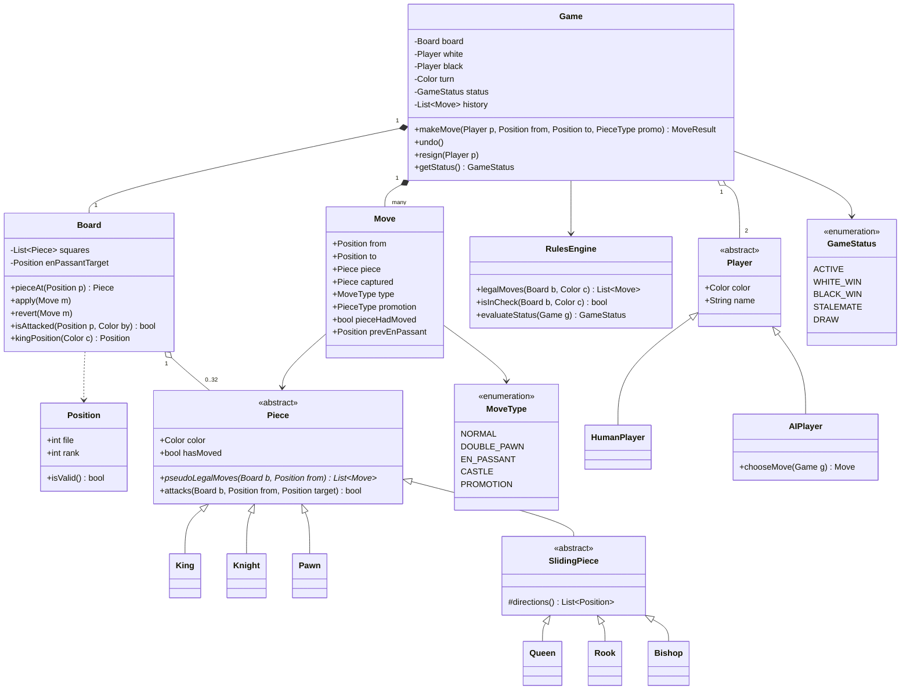
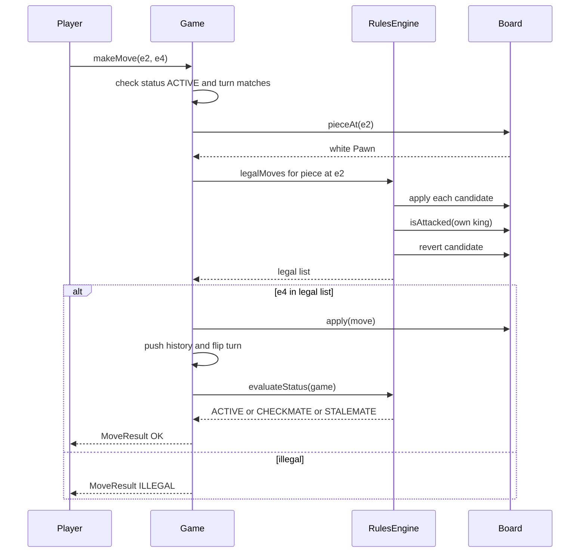
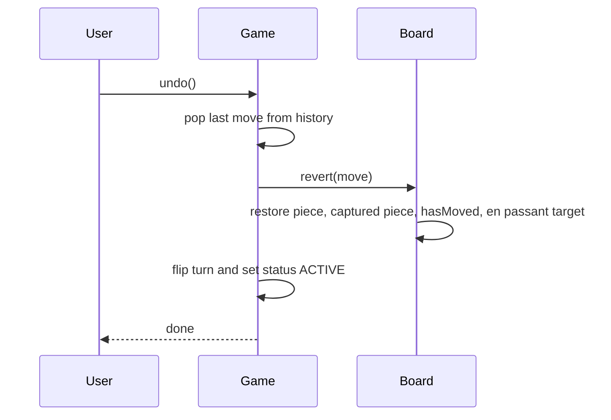

# Chess Game

**Category:** Low-Level Design
**Difficulty:** 🔴 Hard
**Seniority:** senior
**Companies:** Amazon, Microsoft, Google, Chess.com, Bloomberg, Adobe
**Tags:** oop, polymorphism, state-machine, command-pattern, move-validation, game-design
**Time:** 60 min

---

## Problem Statement

Design a two-player chess game. The system must represent the board and pieces, validate moves according to the rules of chess (including check, checkmate, stalemate, castling, en passant and promotion), alternate turns, record move history, and detect the end of the game.

The interviewer is testing object modeling with polymorphism (each piece type moves differently), separation of move generation from move legality (a move is illegal if it leaves your own king in check), the game lifecycle as a state machine, and undo via the Command pattern. Rendering and AI are out of scope unless time permits.

## Clarifying Questions

- Human vs human only, or also vs computer? *Human vs human; the `Player` abstraction should allow an AI player later.*
- Full rules including castling, en passant, promotion? *Yes.*
- Draw rules? *Stalemate, threefold repetition, fifty-move rule, insufficient material, and draw by agreement.*
- Timers/clocks? *Optional; design a `Clock` hook but focus on rules.*
- Undo moves? *Yes, for analysis mode.*
- Input format? *Moves given as from/to squares (e.g. e2 to e4) plus optional promotion piece.*
- Online multiplayer? *Out of scope; the game engine should be UI/network agnostic.*

## Requirements

### Functional

- Initialize standard board; white moves first.
- `makeMove(player, from, to, promotion?)` validates and applies a move, or rejects it.
- Enforce turn order and piece-specific movement; block moves through pieces (except knight).
- Special moves: castling (king/rook unmoved, path empty and not attacked, king not in check), en passant, pawn double-step, promotion.
- Disallow any move that leaves the mover's king in check.
- Detect check, checkmate, stalemate and draw conditions; resign/offer draw.
- Move history in algebraic notation; undo last move.

### Non-Functional

- Rules engine independent of UI and transport.
- Easy to add variants (Chess960) or new piece types.
- Move validation fast enough for interactive play (< 1 ms per move).

### Out of Scope

- Chess engine/AI search, rating system, matchmaking, rendering.

## Core Entities

- **Game** → owns board, players, turn, status, move history; entry point for moves.
- **Board** → 8x8 grid of squares; piece lookup, apply/revert move, attack detection.
- **Square/Position** → file and rank value object.
- **Piece** (abstract) → color, hasMoved; `pseudoLegalMoves(board, from)`.
- **King, Queen, Rook, Bishop, Knight, Pawn** → concrete movement rules.
- **Move** → from, to, moved piece, captured piece, special type (CASTLE, EN_PASSANT, PROMOTION, DOUBLE_PAWN), previous state for undo.
- **MoveValidator / RulesEngine** → legality (king safety), game-end detection.
- **Player** → color and a strategy for choosing moves (Human, AI).
- **GameStatus** → ACTIVE, WHITE_WIN, BLACK_WIN, STALEMATE, DRAW, RESIGNED.

## Class Diagram



## Design Patterns

| Pattern | Where | Why |
|---|---|---|
| Polymorphism / Template Method | `Piece.pseudoLegalMoves`, `SlidingPiece.directions` | Each piece defines its movement; sliding pieces share ray-walking logic. |
| Command | `Move` with `apply`/`revert` | Undo/redo, history replay, PGN export, and trial moves for legality checks. |
| State | `GameStatus` transitions in `Game` | Moves allowed only while ACTIVE; terminal states reject input. |
| Strategy | `Player` (Human vs AI), optional `RulesEngine` variant | Swap AI difficulty or Chess960 rules. |
| Factory | `PieceFactory.create(type, color)` and board setup | Centralized creation for initial layout and promotion. |
| Observer | Game events to UI/clock/network | Keep the engine UI-agnostic. |

## Key Workflows

### Make a move



### Undo



## Implementation

```text
CLASS Position
    FIELDS file (0..7), rank (0..7)
    FUNCTION isValid() RETURN 0 <= file < 8 AND 0 <= rank < 8
    FUNCTION plus(df, dr) RETURN NEW Position(file + df, rank + dr)

ABSTRACT CLASS SlidingPiece EXTENDS Piece
    ABSTRACT FUNCTION directions()
    FUNCTION pseudoLegalMoves(board, from)
        SET moves ← []
        FOR (df, dr) IN directions()
            SET p ← from.plus(df, dr)
            WHILE p.isValid()
                SET occ ← board.pieceAt(p)
                IF occ IS NULL THEN APPEND Move(from, p, this) TO moves
                ELSE
                    IF occ.color != color THEN APPEND Move(from, p, this, captured=occ) TO moves
                    BREAK                                   // blocked
                SET p ← p.plus(df, dr)
        RETURN moves

CLASS Rook   EXTENDS SlidingPiece: directions() = [(1,0),(-1,0),(0,1),(0,-1)]
CLASS Bishop EXTENDS SlidingPiece: directions() = [(1,1),(1,-1),(-1,1),(-1,-1)]
CLASS Queen  EXTENDS SlidingPiece: directions() = Rook.directions + Bishop.directions

CLASS Knight EXTENDS Piece
    FUNCTION pseudoLegalMoves(board, from)
        FOR (df, dr) IN [(1,2),(2,1),(2,-1),(1,-2),(-1,-2),(-2,-1),(-2,1),(-1,2)]
            SET p ← from.plus(df, dr)
            IF p.isValid() AND (board.pieceAt(p) IS NULL OR board.pieceAt(p).color != color)
                YIELD Move(from, p, this, captured=board.pieceAt(p))

CLASS Pawn EXTENDS Piece
    FUNCTION pseudoLegalMoves(board, from)
        SET dir ← +1 IF color == WHITE ELSE -1
        SET lastRank ← 7 IF color == WHITE ELSE 0
        SET one ← from.plus(0, dir)
        IF one.isValid() AND board.pieceAt(one) IS NULL
            YIELD withPromotion(Move(from, one, this), lastRank)
            SET two ← from.plus(0, 2*dir)
            IF NOT hasMoved AND board.pieceAt(two) IS NULL
                YIELD Move(from, two, this, type=DOUBLE_PAWN)
        FOR df IN [-1, +1]
            SET diag ← from.plus(df, dir)
            IF NOT diag.isValid() THEN CONTINUE
            SET occ ← board.pieceAt(diag)
            IF occ IS NOT NULL AND occ.color != color
                YIELD withPromotion(Move(from, diag, this, captured=occ), lastRank)
            ELSE IF diag == board.enPassantTarget
                YIELD Move(from, diag, this, type=EN_PASSANT,
                           captured=board.pieceAt(diag.plus(0, -dir)))

CLASS King EXTENDS Piece
    FUNCTION pseudoLegalMoves(board, from)
        FOR each of 8 neighbours p: IF valid AND not own piece YIELD Move(from, p, this)
        IF NOT hasMoved AND NOT board.isAttacked(from, opponent(color))
            FOR side IN [KINGSIDE, QUEENSIDE]
                SET rook ← board.pieceAt(rookSquare(side))
                IF rook IS Rook AND NOT rook.hasMoved
                   AND squaresBetween(from, rookSquare(side)) ALL EMPTY
                   AND kingPathSquares(side) NONE attacked by opponent
                    YIELD Move(from, castleTarget(side), this, type=CASTLE)

CLASS Board
    FUNCTION apply(m)
        SET m.pieceHadMoved ← m.piece.hasMoved
        SET m.prevEnPassant ← enPassantTarget
        SET grid[m.from] ← NULL
        IF m.type == EN_PASSANT THEN SET grid[m.captured position] ← NULL
        IF m.type == CASTLE THEN move rook to the square the king crossed
        SET grid[m.to] ← PieceFactory.create(m.promotion, m.piece.color) IF m.type == PROMOTION
                         ELSE m.piece
        SET m.piece.hasMoved ← true
        SET enPassantTarget ← midpoint(m.from, m.to) IF m.type == DOUBLE_PAWN ELSE NULL

    FUNCTION revert(m)                               // exact inverse of apply
        SET grid[m.from] ← m.piece
        SET grid[m.to] ← NULL
        IF m.captured IS NOT NULL THEN restore captured at its square
        IF m.type == CASTLE THEN move rook back
        SET m.piece.hasMoved ← m.pieceHadMoved
        SET enPassantTarget ← m.prevEnPassant

    FUNCTION isAttacked(target, byColor)
        FOR (pos, piece) IN pieces of byColor
            IF piece.attacks(this, pos, target) THEN RETURN true   // pawns attack diagonally only
        RETURN false

CLASS RulesEngine
    FUNCTION legalMoves(board, color)
        SET result ← []
        FOR (pos, piece) IN pieces of color
            FOR m IN piece.pseudoLegalMoves(board, pos)
                board.apply(m)
                IF NOT board.isAttacked(board.kingPosition(color), opponent(color))
                    APPEND m TO result
                board.revert(m)
        RETURN result

    FUNCTION evaluateStatus(game)
        SET side ← game.turn
        IF legalMoves(game.board, side) IS EMPTY
            IF isInCheck(game.board, side) THEN RETURN winFor(opponent(side))   // checkmate
            ELSE RETURN STALEMATE
        IF game.halfmoveClock >= 100 OR repetitionCount(game) >= 3
           OR insufficientMaterial(game.board) THEN RETURN DRAW
        RETURN ACTIVE

CLASS Game
    FUNCTION makeMove(player, from, to, promo)
        IF status != ACTIVE THEN RETURN GAME_OVER
        IF player.color != turn THEN RETURN NOT_YOUR_TURN
        SET piece ← board.pieceAt(from)
        IF piece IS NULL OR piece.color != turn THEN RETURN ILLEGAL
        SET move ← find m IN rules.legalMoves(board, turn)
                   WHERE m.from == from AND m.to == to AND m.promotion == promo
        IF move IS NULL THEN RETURN ILLEGAL
        board.apply(move)
        APPEND move TO history
        update halfmoveClock and position hash counts (Zobrist)
        SET turn ← opponent(turn)
        SET status ← rules.evaluateStatus(this)
        notifyObservers(move, status)
        RETURN OK
```

## Concurrency & Extensibility

- **Concurrency:** a single game is inherently sequential; guard `makeMove`/`undo` with a per-game lock (or single-threaded actor per game) so duplicate network requests cannot apply two moves. Many games run in parallel with no shared mutable state.
- **Validation performance:** generate legal moves via apply/check/revert on a mutable board; cache the king position. For engines, switch to bitboards (64-bit masks) and precomputed attack tables.
- **Repetition detection:** maintain a Zobrist hash incrementally on apply/revert and a count map of positions.
- **Open/Closed:** new piece types (fairy chess) extend `Piece`; Chess960 swaps the setup factory and castling rules in a `RulesEngine` subclass; AI players implement `Player.chooseMove` using minimax with alpha-beta.
- **Clocks:** a `Clock` observer starts/stops timers on move events and flags a loss on timeout.

## Trade-offs

| Decision | Option A | Option B | Choice & Why |
|---|---|---|---|
| Board representation | 8x8 object grid | Bitboards | Object grid — readable for interviews; bitboards for engine speed. |
| Legality check | Simulate move and test king safety | Compute pins and check rays analytically | Simulate — simple and obviously correct; analytic pins only if profiling demands. |
| Undo | Store full board snapshots | Command with inverse (`revert`) | Command — O(1) memory per move; snapshot is simpler but heavier. |
| Movement logic | Big switch in Board on piece type | Polymorphic `Piece` subclasses | Polymorphism — Open/Closed and each rule testable in isolation. |
| Promotion | Mutate Pawn into another type | Replace the piece object | Replace — keeps classes immutable in type; revert restores the pawn. |

## Follow-up Questions

1. **How would you add a computer opponent?** `AIPlayer` runs minimax with alpha-beta pruning over `legalMoves`, using `apply`/`revert` for search and an evaluation function (material, mobility, king safety).
2. **How would you support online play?** Wrap `Game` in a server-side session; clients send moves, the server validates via the same engine and broadcasts events over WebSockets; the server is the authority.
3. **How do you export/import games?** Serialize history to PGN (SAN notation) and positions to FEN; replay moves through the engine to rebuild state.
4. **How do you detect threefold repetition efficiently?** Incremental Zobrist hashing including side to move, castling rights and en passant file; count occurrences in a hash map.
5. **How would you add Chess960?** Randomize back-rank setup via a different factory and generalize castling to use the king's and rook's starting files.

## Common Mistakes

- Validating piece movement but forgetting that a move cannot leave your own king in check (pins, discovered checks).
- Allowing castling through attacked squares or while in check.
- Forgetting en passant is only valid immediately after the double pawn push.
- Treating stalemate as a loss or not checking it at all.
- Putting all movement rules in one giant `Board.isValidMove` switch.

## Key Takeaways

- Separate pseudo-legal move generation (per piece) from legality (king safety) in a rules engine.
- Use polymorphism for pieces and a shared sliding-piece base for rook, bishop and queen.
- A `Move` command with complete inverse state enables undo, history and search.
- Game end detection: no legal moves plus in check means checkmate, otherwise stalemate.
