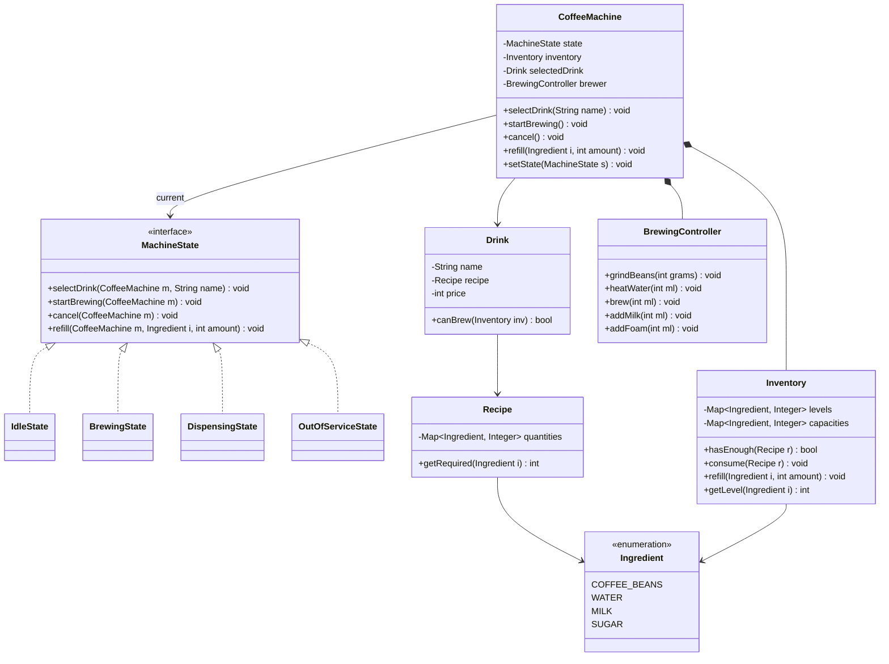
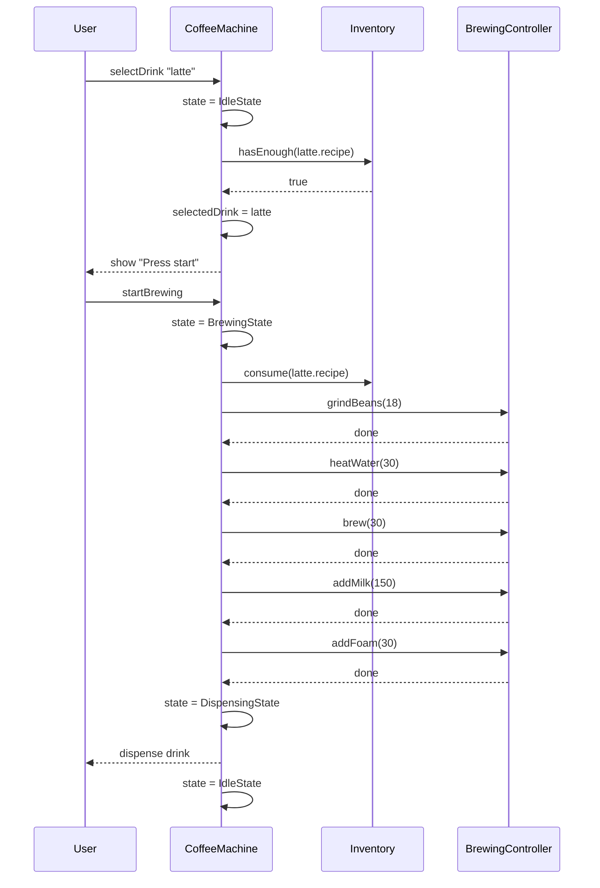
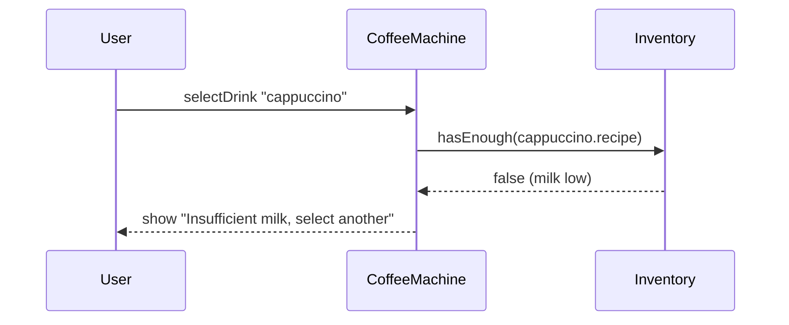

# Coffee Machine

**Category:** Low-Level Design
**Difficulty:** 🟢 Easy
**Seniority:** junior
**Companies:** Common interview question
**Tags:** state machine, patterns
**Time:** 30-45 min

---

## Problem Statement

Design the software for a coffee machine. A user selects a drink type (espresso, americano, latte, cappuccino), the machine grinds beans, heats water, brews the coffee, adds milk/foam if needed, and dispenses the drink. The machine must track ingredient levels, handle insufficient ingredients, allow cancellation, and support an admin mode for refilling.

The interviewer is looking for a clean state machine, proper ingredient management, and extensible design for new drink recipes.

## Clarifying Questions

- Which drink types? *Espresso, americano, latte, cappuccino initially.*
- What ingredients? *Coffee beans, water, milk, sugar.*
- How are quantities measured? *Beans in grams, water and milk in milliliters, sugar in packets.*
- Can users customize drinks? *Extra shot, more milk, sugar count — out of scope initially.*
- What happens when ingredients run out? *Show error message, disable affected drinks.*
- Is there a payment system? *Out of scope for this problem.*
- Admin functionality? *Refill ingredients, view usage stats.*
- Can a user cancel? *Yes, before brewing starts.*

## Requirements

### Functional
- Display available drinks with prices.
- Select a drink, brew it, dispense to cup.
- Track ingredient levels and disable drinks when insufficient.
- Cancel before brewing starts.
- Admin: refill ingredients, reset machine, view logs.

### Non-Functional
- Never dispense incomplete drinks.
- Clear feedback for errors (insufficient ingredients, machine busy).
- Easy to add new drink recipes.
- Thread-safe for concurrent button presses and hardware events.

### Out of Scope
- Payment processing, user accounts, remote monitoring, custom drink configurations.

## Class Design

- **CoffeeMachine** → context; holds state, inventory, current drink, delegates to state.
- **MachineState** (interface) → `selectDrink`, `startBrewing`, `cancel`, `refill`; concrete Idle, Brewing, Dispensing, OutOfService.
- **Drink** → name, recipe (ingredient → quantity), price.
- **Ingredient** → enum (COFFEE_BEANS, WATER, MILK, SUGAR) with unit.
- **Inventory** → ingredient → current level, max capacity.
- **Recipe** → map of ingredient → required quantity.
- **BrewingController** → coordinates grinding, heating, brewing steps.
- **Dispenser** → hardware interface for dispensing ingredients.

## Class Diagram



## Key Classes and Relationships

- **CoffeeMachine** is the context class that holds the current state and delegates all operations to the state object.
- **MachineState** is an interface with concrete implementations for each state; states transition by calling `setState()` on the machine.
- **Inventory** manages ingredient levels and is used by states to check availability and consume resources.
- **Drink** contains a Recipe which maps ingredients to required quantities.
- **BrewingController** encapsulates hardware operations and is called by the BrewingState.

## Design Patterns

| Pattern | Where | Why |
|---|---|---|
| State | `IdleState`, `BrewingState`, `DispensingState`, `OutOfServiceState` | Each state defines valid actions; prevents illegal operations like selecting during brewing. |
| Factory | `DrinkFactory.create(name)` | Maps drink names to configured recipes. |
| Template Method | `BrewingController.brewDrink(Drink)` | Standardize grind → heat → brew → add extras sequence; drinks customize steps. |
| Singleton | `CoffeeMachine` per device | One physical machine has one controller. |

## Key Workflows

### Successful latte brewing



### Insufficient ingredients



## Implementation

```text
CLASS CoffeeMachine
    FIELDS state ← IdleState, inventory, brewer, selectedDrink ← NULL

    FUNCTION selectDrink(name)
        state.selectDrink(this, name)

    FUNCTION startBrewing()
        state.startBrewing(this)

    FUNCTION cancel()
        state.cancel(this)

    FUNCTION refill(ingredient, amount)
        state.refill(this, ingredient, amount)

CLASS IdleState IMPLEMENTS MachineState
    FUNCTION selectDrink(machine, name)
        SET drink ← DrinkFactory.create(name)
        IF NOT drink.canBrew(machine.inventory)
            machine.display("Insufficient ingredients")
            RETURN
        SET machine.selectedDrink ← drink
        machine.display("Press Start to brew")
    FUNCTION startBrewing(machine)
        IF machine.selectedDrink = NULL
            machine.display("Select a drink first")
            RETURN
        machine.inventory.consume(machine.selectedDrink.recipe)
        machine.setState(BrewingState)
        machine.brewer.brewDrink(machine.selectedDrink)
    FUNCTION cancel(machine)
        SET machine.selectedDrink ← NULL
        machine.display("Selection cancelled")
    FUNCTION refill(machine, ingredient, amount)
        machine.inventory.refill(ingredient, amount)

CLASS BrewingState IMPLEMENTS MachineState
    FUNCTION selectDrink(machine, name)
        machine.display("Machine busy, please wait")
    FUNCTION startBrewing(machine)
        machine.display("Already brewing")
    FUNCTION cancel(machine)
        machine.display("Cannot cancel during brewing")
    FUNCTION refill(machine, ingredient, amount)
        machine.display("Cannot refill during brewing")

CLASS DispensingState IMPLEMENTS MachineState
    FUNCTION selectDrink(machine, name)
        machine.display("Dispensing, please wait")
    FUNCTION startBrewing(machine)
        machine.display("Dispensing, please wait")
    FUNCTION cancel(machine)
        machine.display("Dispensing, please wait")
    FUNCTION refill(machine, ingredient, amount)
        machine.display("Cannot refill during dispensing")

CLASS Drink
    FIELDS name, recipe, price

    FUNCTION canBrew(inventory)
        FOR EACH (ingredient, qty) IN recipe.quantities
            IF inventory.getLevel(ingredient) < qty
                RETURN false
        RETURN true

CLASS Inventory
    FIELDS levels, capacities

    FUNCTION hasEnough(recipe)
        FOR EACH (ingredient, qty) IN recipe.quantities
            IF levels[ingredient] < qty
                RETURN false
        RETURN true

    FUNCTION consume(recipe)
        FOR EACH (ingredient, qty) IN recipe.quantities
            SET levels[ingredient] ← levels[ingredient] - qty

    FUNCTION refill(ingredient, amount)
        SET levels[ingredient] ← min(levels[ingredient] + amount, capacities[ingredient])

CLASS BrewingController
    FUNCTION brewDrink(drink)
        grindBeans(drink.recipe.getRequired(COFFEE_BEANS))
        heatWater(drink.recipe.getRequired(WATER))
        brew(drink.recipe.getRequired(WATER))
        IF drink.recipe.getRequired(MILK) > 0
            addMilk(drink.recipe.getRequired(MILK))
        IF drink.name = "cappuccino" OR drink.name = "latte"
            addFoam(30)
        machine.setState(DispensingState)
```

## Scalability

- Physical machine has single user, but hardware events (buttons, sensors, timers) arrive from different threads. Serialize through a single event queue or mutex on `CoffeeMachine`.
- Brewing is a multi-step process; if hardware reports failure mid-brew, transition to OutOfService and alert admin.
- New drink types: add to `DrinkFactory` with recipe; no state machine changes needed.
- New ingredients: add to `Ingredient` enum, update inventory tracking, add to recipes.
- Custom drinks: extend `Recipe` to support optional modifiers (extra shot, more milk) with a builder pattern.
- Temperature control: add `Heater` component with target temperature and PID controller logic.

## Error Handling

- **Insufficient ingredients:** Check availability before allowing selection; display specific missing ingredient message.
- **Hardware failure:** If grinder, heater, or dispenser fails, transition to OutOfService state, alert admin, prevent further operations.
- **Invalid state transitions:** State pattern inherently prevents invalid operations; each state only allows its valid actions.
- **Power loss mid-brew:** Persist current state and consumed ingredients; on reboot, complete or cancel based on hardware state.
- **Ingredient consumption rollback:** If brewing fails after consumption, restore ingredient levels from backup or mark as waste.

## Trade-offs

| Decision | Option A | Option B | Choice & Why |
|---|---|---|---|
| State handling | Enum + switch | State pattern classes | State pattern: isolates state-specific logic, easier to add states. |
| Ingredient consumption | Consume at selection | Consume at brewing start | Brewing start: allows cancellation without waste. |
| Recipe storage | Hardcoded per drink | Configurable recipes | Configurable: easier to add drinks without code changes. |
| Error handling | Exception-based | Return codes | Return codes/state: simpler for embedded systems, no exception overhead. |

## Follow-up Questions

1. **How do you handle brewing failure (e.g., grinder jam)?** Hardware reports error → transition to OutOfService, refund/restore consumed ingredients if possible, alert admin.
2. **How do you support multiple cup sizes?** Add size parameter to `Drink`, scale recipe quantities proportionally, update UI.
3. **How do you track usage statistics?** Add `UsageTracker` that logs each drink brewed; aggregate by drink type, time of day, ingredient consumption.
4. **How do you handle power loss mid-brew?** Persist current state and consumed ingredients; on reboot, complete or cancel based on hardware state.
5. **How do you add milk temperature control?** Add `MilkSteamer` component with temperature sensor; extend recipe to specify milk temperature.

## Common Mistakes

- Consuming ingredients at selection instead of brewing start (wastes ingredients on cancellation).
- Not checking ingredient availability before allowing selection.
- Using boolean flags instead of explicit state machine.
- Hardcoding drink recipes instead of making them configurable.
- Not handling hardware failures during brewing.

## Key Takeaways

- Coffee machine is a classic state machine problem; draw states and transitions first.
- Separate ingredient inventory management from brewing logic.
- Consume resources only when the operation is committed (brewing starts).
- Make recipes data-driven for easy extensibility.
- Hardware interfaces should be abstracted for testability.
