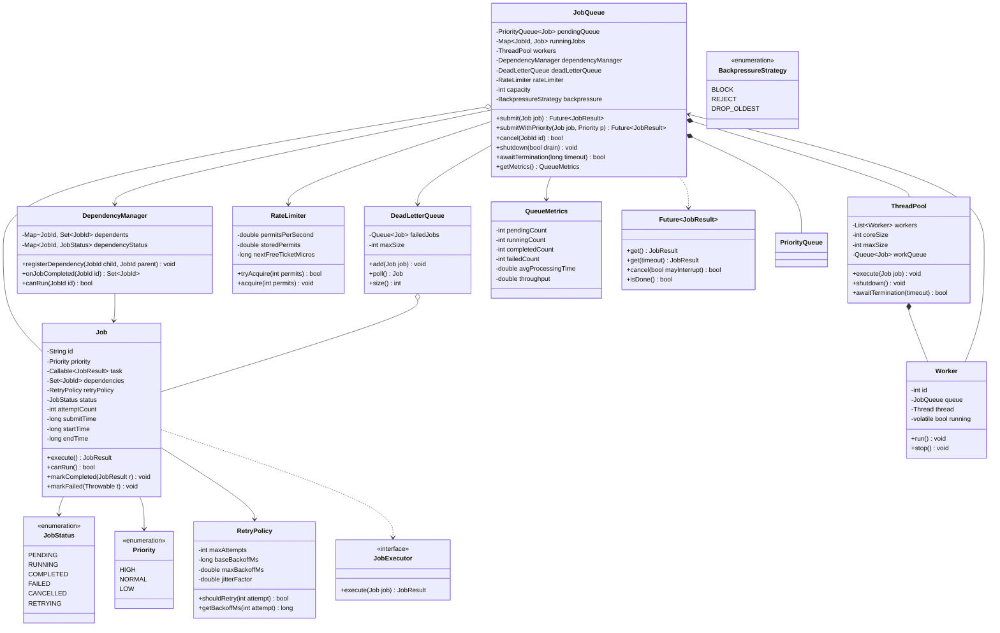
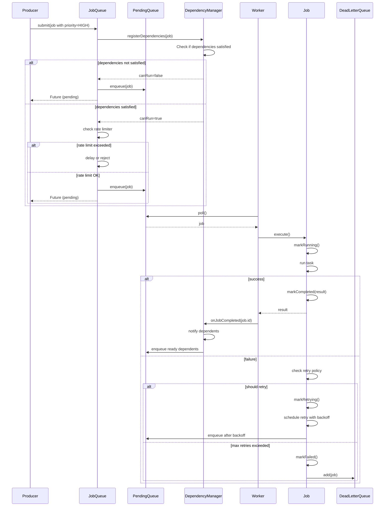
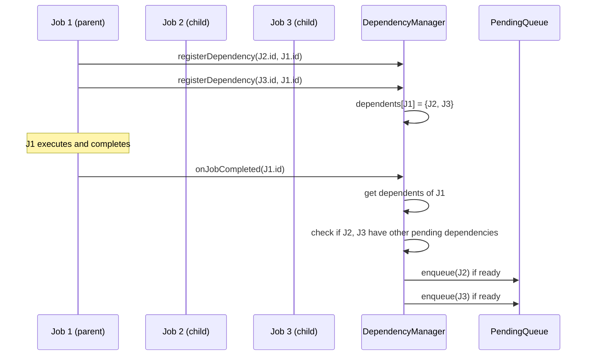
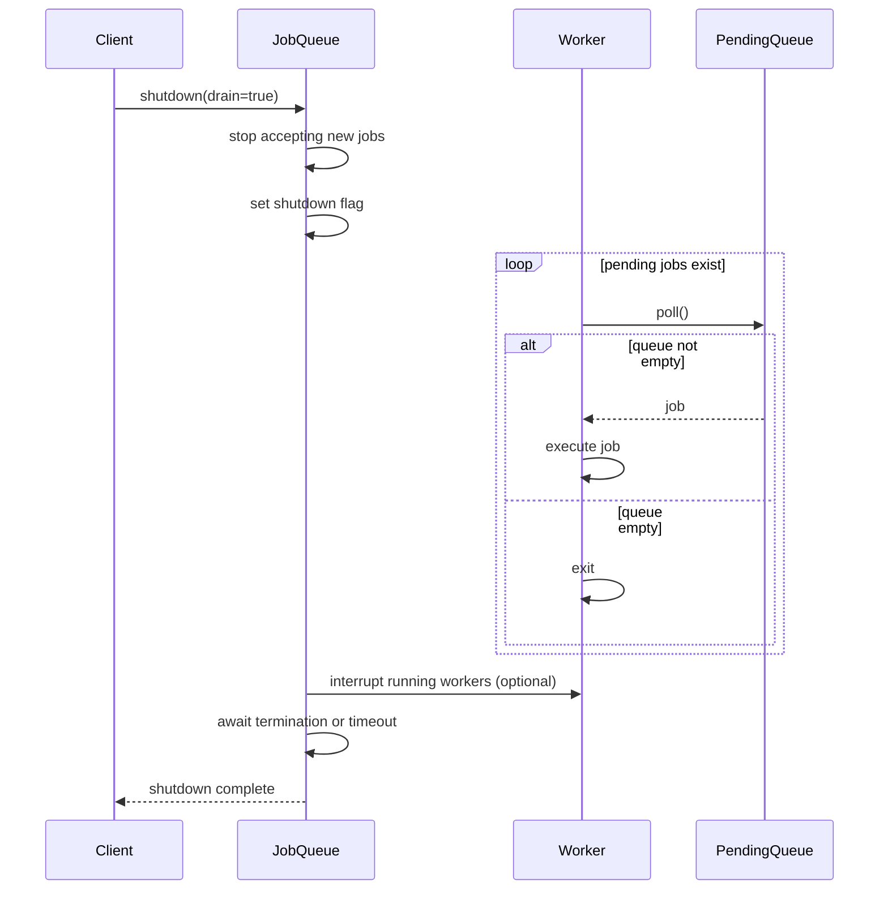

# Concurrent Job Queue

**Category:** Low-Level Design
**Difficulty:** 🔴 Hard
**Seniority:** Senior
**Companies:** Common interview question at Amazon, Google, Meta, Netflix, Uber, Stripe
**Tags:** concurrency, patterns, producer-consumer, thread-pool, back-pressure, priority, scheduling
**Time:** 60-90 min

---

## Problem Statement

Design a concurrent job queue system that efficiently handles the producer-consumer pattern with multiple producer threads submitting jobs and multiple consumer (worker) threads processing them. The system must support job priorities, dependency management (jobs that depend on other jobs), retry logic with exponential backoff, rate limiting, dead-letter queueing for failed jobs, and graceful shutdown with job completion guarantees.

The interviewer is looking for a deep understanding of concurrency primitives, thread pool design, back-pressure mechanisms, job scheduling algorithms, and the ability to handle edge cases like producer/consumer imbalance, job failures, and system shutdown while ensuring no jobs are lost.

## Clarifying Questions

- How many producer and consumer threads? *Assume configurable: default 8 producers, 16 consumers (CPU-bound workloads may differ).*
- Job types and execution time? *Mixed: some quick (<10ms), some long-running (seconds to minutes).*
- Priority levels? *3 levels: HIGH, NORMAL, LOW.*
- Job dependencies? *Yes, jobs can depend on other jobs completing first.*
- Retry behavior? *Retry up to N times with exponential backoff, then send to DLQ.*
- Ordering requirements? *Within same priority, FIFO; across priorities, priority first then FIFO.*
- Memory constraints? *Bounded queue size with back-pressure when full.*
- Persistence? *In-memory for this design; durable storage is a follow-up.*
- Shutdown behavior? *Graceful: accept no new jobs, complete in-flight jobs, optionally drain queue.*

## Requirements

### Functional

- Submit jobs with priority, optional dependencies, and retry configuration.
- Multiple worker threads consume and process jobs concurrently.
- Priority-based scheduling: higher priority jobs processed before lower priority.
- Job dependency resolution: dependent jobs wait for dependencies to complete.
- Retry with exponential backoff and jitter.
- Dead-letter queue for jobs that exceed max retry attempts.
- Rate limiting per job type or globally.
- Job cancellation: cancel pending jobs, attempt to interrupt running jobs.
- Job status tracking: pending, running, completed, failed, cancelled.
- Metrics: queue size, processing rate, success/failure rates, worker utilization.

### Non-Functional

- Thread-safe under concurrent job submission and consumption.
- No job loss: all submitted jobs are either completed or moved to DLQ.
- Back-pressure: block or reject producers when queue is full.
- Fairness: prevent starvation of low-priority jobs.
- Graceful shutdown: complete in-flight jobs, optionally drain queue.
- Configurable worker pool size, queue capacity, retry policy.
- Low overhead for job submission and scheduling.

### Out of Scope

- Distributed execution across multiple machines.
- Persistent job storage (database, file system).
- Job scheduling with cron-like timing.
- Complex dependency graphs (DAG with cycles).
- Resource quotas beyond thread count.

## Core Entities

- **JobQueue** → main facade, manages submission, workers, and queues.
- **Job** → task with id, priority, task, dependencies, retry config, status.
- **JobStatus** → PENDING, RUNNING, COMPLETED, FAILED, CANCELLED, RETRYING.
- **Priority** → HIGH, NORMAL, LOW.
- **Worker** → consumer thread that pulls and executes jobs.
- **ThreadPool** → manages worker threads, supports dynamic scaling.
- **DependencyManager** → tracks job dependencies, triggers dependents when parent completes.
- **RetryPolicy** → max attempts, backoff strategy, jitter.
- **RateLimiter** → token bucket or leaky bucket for rate limiting.
- **DeadLetterQueue** → stores failed jobs for inspection/reprocessing.
- **JobExecutor** → interface for actual job execution logic.
- **BackpressureStrategy** → BLOCK, REJECT, DROP_OLDEST when queue full.
- **MetricsCollector** → tracks and reports system metrics.

## Class Diagram



## Design Patterns

| Pattern | Where | Why |
|---|---|---|
| Producer-Consumer | Job queue with worker threads | Decouples job submission from execution, enables concurrent processing. |
| Thread Pool | `ThreadPool` managing workers | Reuses threads, avoids thread creation overhead, limits concurrency. |
| Strategy | `BackpressureStrategy`, `RetryPolicy` | Pluggable behaviors for queue full handling and retry logic. |
| Observer | `DependencyManager` notifying dependents | Triggers dependent jobs when parent completes without tight coupling. |
| Future | Job submission returns `Future` | Allows producers to wait for results or check status asynchronously. |
| Factory | Job creation with configuration | Centralizes job construction with dependencies and retry settings. |
| Singleton | `JobQueue` instance per application | Single point of control for job execution. |
| Command | `Job` objects encapsulate tasks | Jobs are first-class objects that can be queued, cancelled, and retried. |

## Key Workflows

### Job submission and execution



### Dependency resolution



### Graceful shutdown with drain



## Implementation

```text
CLASS Job IMPLEMENTS Comparable~Job~
    FIELDS id, priority, task, dependencies, retryPolicy
    FIELDS status ← PENDING, attemptCount ← 0
    FIELDS submitTime, startTime, endTime
    FIELDS lock, completedCondition

    FUNCTION compareTo(other)
        // Higher priority first
        IF priority != other.priority THEN
            RETURN other.priority.ordinal() - priority.ordinal()
        // FIFO within same priority
        RETURN Long.compare(submitTime, other.submitTime)

    FUNCTION canRun()
        IF dependencies.isEmpty() THEN RETURN true
        FOR depId IN dependencies
            IF dependencyManager.getStatus(depId) != COMPLETED THEN
                RETURN false
        RETURN true

    FUNCTION execute()
        LOCK lock
            SET status ← RUNNING
            SET startTime ← now()
        UNLOCK lock
        TRY
            SET result ← task.call()
            markCompleted(result)
            RETURN result
        CATCH Throwable e
            markFailed(e)
            THROW e

    FUNCTION markCompleted(result)
        LOCK lock
            SET status ← COMPLETED
            SET endTime ← now()
            completedCondition.signalAll()
        UNLOCK lock

    FUNCTION markFailed(error)
        LOCK lock
            SET attemptCount ← attemptCount + 1
            IF retryPolicy.shouldRetry(attemptCount) THEN
                SET status ← RETRYING
                SET retryTime ← now() + retryPolicy.getBackoffMs(attemptCount)
            ELSE
                SET status ← FAILED
                SET endTime ← now()
            completedCondition.signalAll()
        UNLOCK lock

CLASS JobQueue
    FIELDS pendingQueue : PriorityQueue~Job~, capacity ← 1000
    FIELDS runningJobs : ConcurrentMap~JobId, Job~
    FIELDS workers : ThreadPool, dependencyManager, deadLetterQueue
    FIELDS rateLimiter, backpressure ← BLOCK
    FIELDS shutdownFlag ← false, lock, notEmpty : Condition

    FUNCTION submit(job)
        IF shutdownFlag THEN THROW RejectedExecutionException
        LOCK lock
            WHILE pendingQueue.size() >= capacity AND backpressure == BLOCK
                IF shutdownFlag THEN THROW RejectedExecutionException
                notEmpty.await(100ms)
            IF pendingQueue.size() >= capacity THEN
                IF backpressure == REJECT THEN
                    THROW RejectedExecutionException("Queue full")
                ELSE IF backpressure == DROP_OLDEST THEN
                    pendingQueue.poll()
        UNLOCK lock
        job.id ← generateId()
        job.submitTime ← now()
        dependencyManager.registerDependencies(job)
        IF job.canRun() AND rateLimiter.tryAcquire(1) THEN
            LOCK lock
                pendingQueue.offer(job)
                notEmpty.signal()
            UNLOCK lock
        ELSE IF NOT job.canRun()
            LOCK lock
                pendingQueue.offer(job)  // Will wait for dependencies
                notEmpty.signal()
            UNLOCK lock
        ELSE
            // Rate limited: schedule for later
            scheduler.schedule(() → submit(job), rateLimiter.reserve(1), MILLISECONDS)
        RETURN NEW JobFuture(job)

    FUNCTION cancel(jobId)
        LOCK lock
            SET job ← runningJobs.get(jobId)
            IF job != NULL THEN
                job.status ← CANCELLED
                job.task.cancel(true)  // Attempt interruption
                runningJobs.remove(jobId)
                RETURN true
            // Check pending queue
            FOR j IN pendingQueue
                IF j.id == jobId THEN
                    pendingQueue.remove(j)
                    j.status ← CANCELLED
                    RETURN true
            RETURN false
        UNLOCK lock

    FUNCTION shutdown(drain)
        LOCK lock
            SET shutdownFlag ← true
            IF NOT drain THEN
                pendingQueue.clear()
            notEmpty.signalAll()
        UNLOCK lock
        workers.shutdown()
        IF drain THEN
            workers.awaitTermination(5, MINUTES)

CLASS Worker IMPLEMENTS Runnable
    FIELDS queue : JobQueue, running ← true

    FUNCTION run()
        WHILE running OR (queue.shutdownFlag AND NOT queue.pendingQueue.isEmpty())
            TRY
                SET job ← pollJob()
                IF job == NULL THEN CONTINUE
                queue.runningJobs.put(job.id, job)
                TRY
                    job.execute()
                    queue.dependencyManager.onJobCompleted(job.id)
                    queue.metrics.recordSuccess(job)
                CATCH Throwable e
                    IF job.status == RETRYING THEN
                        scheduleRetry(job)
                    ELSE IF job.status == FAILED THEN
                        queue.deadLetterQueue.add(job)
                        queue.metrics.recordFailure(job)
                FINALLY
                    queue.runningJobs.remove(job.id)
            CATCH InterruptedException
                running ← false

    FUNCTION pollJob()
        LOCK queue.lock
            WHILE queue.pendingQueue.isEmpty() AND running
                queue.notEmpty.await(500ms)
            IF NOT running THEN RETURN NULL
            SET job ← queue.pendingQueue.poll()
            IF job != NULL THEN
                queue.notEmpty.signal()  // Space available
            RETURN job
        UNLOCK queue.lock

    FUNCTION scheduleRetry(job)
        SET delay ← job.retryPolicy.getBackoffMs(job.attemptCount)
        scheduler.schedule(() →
            IF job.canRun() THEN
                queue.pendingQueue.offer(job)
        , delay, MILLISECONDS)

CLASS DependencyManager
    FIELDS dependents : ConcurrentMap~JobId, Set~JobId~
    FIELDS dependencyStatus : ConcurrentMap~JobId, JobStatus~

    FUNCTION registerDependency(childId, parentId)
        dependents.computeIfAbsent(parentId, k → ConcurrentHashMap.newKeySet()).add(childId)
        dependencyStatus.putIfAbsent(parentId, PENDING)

    FUNCTION onJobCompleted(jobId)
        SET children ← dependents.get(jobId)
        IF children != NULL THEN
            FOR childId IN children
                IF canRun(childId) THEN
                    SET child ← queue.getJobById(childId)
                    IF child != NULL THEN
                        queue.pendingQueue.offer(child)
            dependents.remove(jobId)
        dependencyStatus.put(jobId, COMPLETED)

    FUNCTION canRun(jobId)
        SET job ← queue.getJobById(jobId)
        IF job == NULL THEN RETURN false
        FOR depId IN job.dependencies
            IF dependencyStatus.get(depId) != COMPLETED THEN
                RETURN false
        RETURN true

CLASS RetryPolicy
    FIELDS maxAttempts ← 3, baseBackoffMs ← 1000
    FIELDS maxBackoffMs ← 30000, jitterFactor ← 0.1

    FUNCTION shouldRetry(attempt)
        RETURN attempt < maxAttempts

    FUNCTION getBackoffMs(attempt)
        SET backoff ← baseBackoffMs * POW(2, attempt - 1)
        SET backoff ← MIN(backoff, maxBackoffMs)
        SET jitter ← backoff * jitterFactor * (RANDOM() * 2 - 1)
        RETURN (long)(backoff + jitter)

CLASS RateLimiter  // Token bucket implementation
    FIELDS permitsPerSecond, storedPermits ← 0.0
    FIELDS maxStoredPermits, syncLock

    FUNCTION tryAcquire(permits)
        RESERVE syncLock
            SET now ← microTime()
            SET elapsed ← now - nextFreeTicketMicros
            SET storedPermits ← MIN(maxStoredPermits,
                storedPermits + elapsed * permitsPerSecond / 1_000_000)
            IF storedPermits >= permits THEN
                SET storedPermits ← storedPermits - permits
                RETURN true
            RETURN false
        RELEASE syncLock

    FUNCTION acquire(permits)
        RESERVE syncLock
            SET now ← microTime()
            SET elapsed ← now - nextFreeTicketMicros
            SET storedPermits ← MIN(maxStoredPermits,
                storedPermits + elapsed * permitsPerSecond / 1_000_000)
            SET needed ← permits - storedPermits
            IF needed > 0 THEN
                SET waitMs ← needed * 1_000_000 / permitsPerSecond
                SET nextFreeTicketMicros ← now + waitMs
                syncLock.wait(waitMs / 1_000_000)
            SET storedPermits ← storedPermits - permits
        RELEASE syncLock

CLASS ThreadPool
    FIELDS coreSize, maxSize, workers : List~Worker~
    FIELDS workQueue, keepAliveTime

    FUNCTION execute(job)
        IF workers.size() < coreSize THEN
            ADD NEW Worker(this)
        ELSE IF workQueue.offer(job) == FALSE AND workers.size() < maxSize THEN
            ADD NEW Worker(this)
        ELSE
            // Queue full, apply backpressure
            THROW RejectedExecutionException()

    FUNCTION shutdown()
        FOR worker IN workers
            worker.stop()
        FOR worker IN workers
            worker.thread.join()
```

## Concurrency & Extensibility

- **Lock granularity:** Separate locks for queue operations and job state changes. `JobQueue` uses a single lock for queue operations (simple, sufficient for most workloads). Individual jobs have their own locks for state transitions.
- **Worker synchronization:** Workers wait on a condition variable when the queue is empty. The condition is signaled when jobs are added or during shutdown.
- **Dependency manager:** Uses concurrent maps for thread-safe dependency tracking. No global lock needed for dependency resolution.
- **Rate limiting:** Token bucket with fine-grained synchronization. Acquire operations may block but don't hold locks during waits.
- **Graceful shutdown:** Two-phase shutdown: stop accepting new jobs, then wait for workers to finish. Optional drain mode processes remaining queued jobs.
- **Back-pressure handling:** Three strategies: BLOCK (wait for space), REJECT (throw exception), DROP_OLDEST (make room). Choice depends on application requirements.
- **Cancellation:** Best-effort cancellation via thread interruption. Jobs must check interruption status and handle it appropriately.
- **Extensibility:** New job types implement `Callable`. New retry strategies implement `RetryPolicy`. Custom rate limiters can be plugged in. Metrics can be extended with custom collectors.

## Trade-offs

| Decision | Option A | Option B | Choice & Why |
|---|---|---|---|
| Queue implementation | Single priority queue | Multiple queues per priority | Single queue with comparable jobs — simpler, fair FIFO within priority. |
| Dependency tracking | Centralized manager | Per-job dependency checks | Centralized — efficient bulk notification, easier to detect cycles. |
| Retry scheduling | Re-enqueue immediately | Schedule with delay | Schedule with delay — prevents immediate retry storms, respects backoff. |
| Rate limiting | Per-job type | Global | Global for simplicity; per-type is follow-up for multi-tenant systems. |
| Worker pool | Fixed size | Dynamic scaling | Dynamic with core/max sizes — adapts to load while bounding resources. |
| Back-pressure | Block producers | Reject jobs | Configurable — blocking for critical jobs, reject for non-critical. |
| Job cancellation | Immediate interrupt | Flag-based | Flag-based with optional interrupt — gives jobs chance to clean up. |

## Follow-up Questions

1. **How would you add persistence to survive crashes?** Write jobs to a durable log (WAL) before enqueueing, checkpoint completed job offsets, recover on startup by replaying the log. Use a database for job metadata and state.
2. **How do you handle long-running jobs that shouldn't be retried?** Add an `idempotent` flag to jobs — if true, skip retry and send to DLQ on first failure. Or add a `maxDuration` and timeout if exceeded.
3. **How would you implement job chaining (output of one job feeds into next)?** Extend `Job` with output storage, add `chainedJobs` list, and automatically enqueue dependent jobs with parent output as input.
4. **How do you prevent priority inversion (low-priority job holding lock needed by high-priority)?** Use lock-free data structures where possible, minimize critical sections, or use priority inheritance locks (complex, rarely needed).
5. **How would you add job deadlines (SLAs)?** Add `deadline` field to jobs, check deadline before execution, and fail/timout jobs that exceed their deadline. Implement priority boosting for near-deadline jobs.
6. **How do you handle resource exhaustion (e.g., too many threads)?** Implement circuit breakers, fallback to rejection with clear error messages, and add auto-scaling based on queue depth and system metrics.

## Common Mistakes

- Using a single global lock for all operations, causing contention.
- Not handling queue overflow, leading to unbounded memory growth.
- Forgetting to handle InterruptedException in worker threads.
- Implementing retry without backoff, causing retry storms.
- Not checking job dependencies before execution, leading to incorrect ordering.
- Mixing job status updates with queue operations under the same lock.
- Forgetting to signal waiting workers when jobs are added.
- Not handling shutdown properly, leaving jobs in limbo.
- Using `notify()` instead of `notifyAll()` on condition variables.
- Ignoring thread interruption, causing workers to not stop gracefully.

## Key Takeaways

- Producer-consumer pattern with thread pool is the foundation of concurrent job processing.
- Priority queues with comparable jobs enable fair scheduling across priority levels.
- Dependency management requires centralized tracking and notification of dependents.
- Retry with exponential backoff and jitter prevents retry storms and spreads load.
- Back-pressure is essential for bounded queues; choose strategy based on application needs.
- Graceful shutdown requires two phases: stop accepting, then wait for completion.
- Fine-grained locking minimizes contention; separate locks for different concerns.
- Rate limiting protects downstream services from overload.
- Dead-letter queue provides visibility into failed jobs for debugging and reprocessing.
- Metrics are critical for monitoring system health and tuning parameters.
