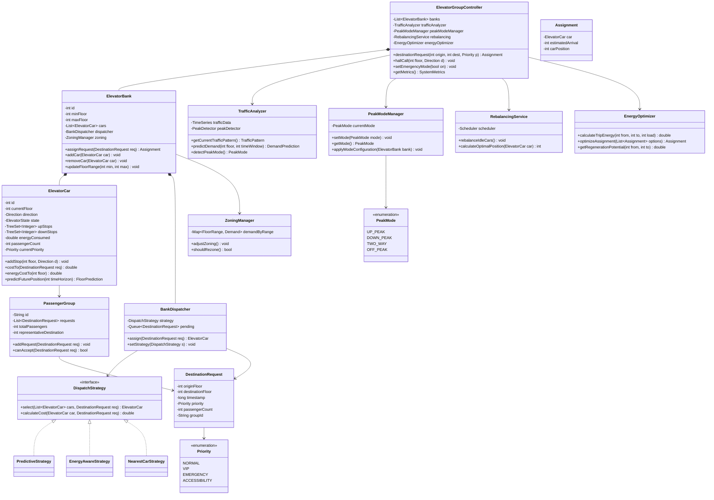
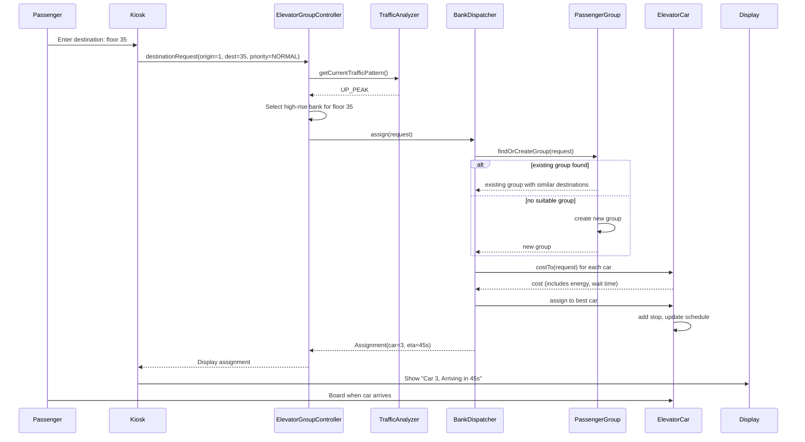
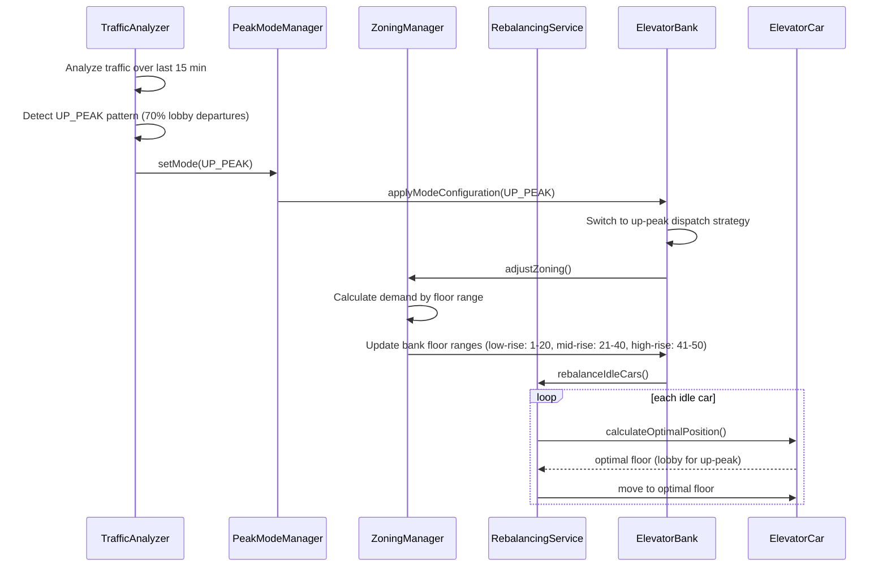
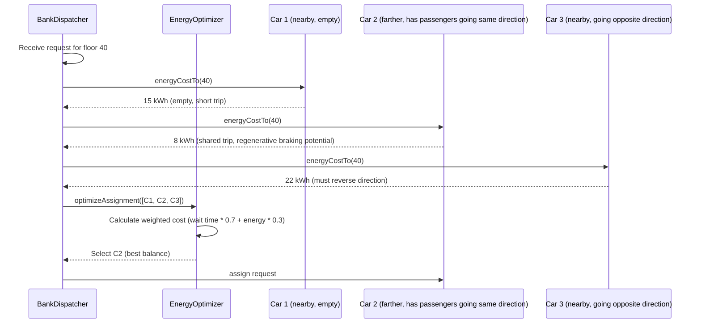

# Elevator Group Control

**Category:** Low-Level Design
**Difficulty:** 🔴 Hard
**Seniority:** Senior
**Companies:** Otis, Schindler, KONE, ThyssenKrupp, Mitsubishi Electric
**Tags:** patterns, scheduling, state, optimization, dispatching, real-time
**Time:** 60-90 min

---

## Problem Statement

Design an advanced elevator group control system (EGCS) for a high-rise building with multiple elevator banks. Unlike a simple single-bank system, this system must coordinate multiple groups of elevators (e.g., low-rise, mid-rise, high-rise banks) serving different floor ranges, handle complex dispatching algorithms that consider passenger traffic patterns, support destination dispatch (passengers select destination before entering), and provide advanced features like priority service, energy optimization, and predictive dispatching based on historical data.

The interviewer is looking for a sophisticated multi-bank dispatcher that can dynamically zone elevators, implement destination dispatch with passenger grouping, handle peak traffic patterns (morning up-peak, evening down-peak, lunch-time two-way), optimize for energy efficiency while maintaining service quality, and provide real-time rebalancing based on current demand.

## Clarifying Questions

- How many elevators and floors? *Assume 16 elevators across 3 banks (low-rise: 6 cars, floors 1-15; mid-rise: 6 cars, floors 1-30; high-rise: 4 cars, floors 1-50).*
- Destination dispatch or traditional hall-call? *Destination dispatch: passengers enter destination at lobby kiosks before boarding.*
- What are the optimization goals? *Primary: minimize average wait time; Secondary: minimize energy consumption; Tertiary: prevent starvation.*
- Traffic patterns? *Morning up-peak (70% lobby to upper floors), evening down-peak, lunch-time two-way, off-peak balanced.*
- Priority passengers? *VIP, emergency, handicapped priority with override capability.*
- Energy considerations? *Regenerative braking capture, idle car parking at optimal floors, coasting when possible.*
- Real-time vs predictive? *Real-time dispatch with predictive rebalancing based on historical patterns.*
- Bank zoning? *Dynamic zoning based on demand, not fixed floor ranges.*

## Requirements

### Functional

- Multi-bank elevator coordination with dynamic zoning.
- Destination dispatch: passengers select destination at lobby; system assigns car and displays assignment.
- Advanced dispatch algorithms: look-ahead, predictive, energy-aware.
- Peak traffic mode handling: up-peak, down-peak, two-way, off-peak.
- Priority service for VIP, emergency, and accessibility.
- Real-time rebalancing of idle cars to optimal positions.
- Passenger grouping: group passengers with similar destinations into same car.
- Energy optimization: minimize unnecessary trips, leverage regenerative braking.
- Maintenance mode: graceful degradation when cars go offline.
- Fire/emergency mode: all cars to lobby or designated safe floor.

### Non-Functional

- Sub-second dispatch decision latency.
- Handle thousands of hall calls per hour during peak.
- Thread-safe under concurrent passenger inputs and car state changes.
- Graceful degradation with partial car availability.
- Configurable optimization weights (wait time vs energy).
- Real-time monitoring and metrics collection.

### Out of Scope

- Physical motor control, door mechanics, weight sensors.
- Building access control integration.
- Mobile app integration (assume kiosk input).
- Multi-building coordination.

## Core Entities

- **ElevatorGroupController** → central coordinator, manages banks, dispatches requests.
- **ElevatorBank** → group of cars serving a floor range, owns its dispatcher.
- **BankDispatcher** → assigns requests to cars within a bank using `DispatchStrategy`.
- **ElevatorCar** → enhanced with energy metrics, predictive cost calculation.
- **DestinationRequest** → passenger request with origin, destination, timestamp, priority.
- **PassengerGroup** → passengers grouped by similar destinations for same car.
- **TrafficAnalyzer** → analyzes current and historical traffic patterns.
- **PeakModeManager** → switches between up-peak, down-peak, two-way, off-peak modes.
- **EnergyOptimizer** → calculates energy cost for potential assignments.
- **RebalancingService** → moves idle cars to optimal positions.
- **DispatchStrategy** → interface for various algorithms (nearest, predictive, energy-aware).
- **ZoningManager** → dynamically adjusts bank floor assignments based on demand.

## Class Diagram



## Design Patterns

| Pattern | Where | Why |
|---|---|---|
| Strategy | `DispatchStrategy` implementations | Switch between nearest-car, predictive, energy-aware, and peak-mode specific algorithms. |
| State | `ElevatorState` (from base system) | Encapsulate behavior differences for normal, maintenance, emergency, fire modes. |
| Observer | Cars → displays, traffic analyzer | Real-time updates for displays and traffic pattern detection. |
| Factory | `PassengerGroup` creation | Group passengers with similar destinations efficiently. |
| Command | `DestinationRequest` objects | Queueable, loggable requests with priority and metadata. |
| Facade | `ElevatorGroupController` | Single entry point hiding complexity of multi-bank coordination. |
| Template Method | Base `DispatchStrategy` with hooks | Common cost calculation framework with algorithm-specific extensions. |
| Chain of Responsibility | Priority handling | VIP → Emergency → Normal priority cascade. |

## Key Workflows

### Destination dispatch with passenger grouping



### Peak mode switching and rebalancing



### Energy-aware dispatch decision



## Implementation

```text
CLASS ElevatorGroupController
    FIELDS banks : List~ElevatorBank~, trafficAnalyzer, peakModeManager, rebalancing, energyOptimizer

    FUNCTION destinationRequest(origin, dest, priority)
        SET req ← NEW DestinationRequest(origin, dest, now(), priority)
        SET pattern ← trafficAnalyzer.getCurrentTrafficPattern()
        SET bank ← selectBankForDestination(dest, pattern)
        SET assignment ← bank.assignRequest(req)
        IF assignment == NULL THEN
            // All cars in maintenance or overloaded
            queueRequest(req)
        RETURN assignment

    FUNCTION selectBankForDestination(dest, pattern)
        IF pattern == UP_PEAK THEN
            RETURN banks.find(b → dest IN b.floorRange AND b.isHighRise())
        ELSE IF pattern == DOWN_PEAK THEN
            RETURN banks.find(b → dest IN b.floorRange)
        ELSE
            // Dynamic zoning based on current demand
            RETURN banks.minBy(b → b.zoning.demandForFloor(dest))

    FUNCTION hallCall(floor, direction)
        // Fallback for traditional hall buttons (no destination dispatch)
        SET bank ← selectBankForFloor(floor)
        bank.dispatcher.assignHallCall(floor, direction)

CLASS BankDispatcher
    FIELDS strategy : DispatchStrategy, pendingQueue, passengerGroups

    FUNCTION assign(req)
        // Try to group with existing passengers
        SET group ← findOrCreatePassengerGroup(req)
        SET bestCar ← NULL
        SET bestCost ← INF
        FOR car IN bank.cars
            IF car.canAccept(req) THEN
                SET cost ← strategy.calculateCost(car, req, group)
                IF cost < bestCost THEN
                    SET bestCar ← car
                    SET bestCost ← cost
        IF bestCar != NULL THEN
            bestCar.addDestinationRequest(req, group)
            group.addRequest(req)
            RETURN NEW Assignment(bestCar, estimateArrival(bestCar, req))
        ELSE
            pendingQueue.add(req)
            RETURN NULL

    FUNCTION findOrCreatePassengerGroup(req)
        FOR group IN passengerGroups
            IF group.canAccept(req) THEN
                RETURN group
        RETURN NEW PassengerGroup(req)

CLASS PredictiveStrategy IMPLEMENTS DispatchStrategy
    FUNCTION calculateCost(car, req, group)
        // Base cost: time to reach origin
        SET timeCost ← car.timeToReach(req.originFloor)
        // Predict future position based on current schedule
        SET prediction ← car.predictFuturePosition(timeCost + 30)
        // Add penalty if car will be moving away from request
        IF prediction.direction != directionTo(req.destinationFloor) THEN
            SET timeCost ← timeCost + PREDICTION_PENALTY
        // Consider passenger grouping efficiency
        SET groupEfficiency ← 1.0 - (group.totalStops() * 0.1)
        // Consider current load
        SET loadPenalty ← car.passengerCount / car.capacity
        RETURN timeCost * groupEfficiency + loadPenalty * 10

CLASS EnergyAwareStrategy IMPLEMENTS DispatchStrategy
    FUNCTION calculateCost(car, req, group)
        SET timeCost ← car.timeToReach(req.originFloor)
        SET energyCost ← car.energyCostTo(req.destinationFloor)
        // Check for regenerative braking opportunities
        SET regenGain ← energyOptimizer.getRegenerationPotential(
                            car.currentFloor, req.destinationFloor)
        // Weighted combination (configurable)
        SET weight ← 0.7  // 70% wait time, 30% energy
        RETURN timeCost * weight + (energyCost - regenGain) * (1 - weight) * 100

CLASS ElevatorCar
    FIELDS energyConsumed, passengerCount, currentPriority

    FUNCTION addDestinationRequest(req, group)
        LOCK stateLock
            IF req.priority > currentPriority THEN
                SET currentPriority ← req.priority
                // Bump lower priority stops if needed
                reprioritizeStops()
            upStops.add(req.destinationFloor)
            passengerCount ← passengerCount + req.passengerCount
            IF state == IDLE THEN
                SET direction ← (req.destinationFloor > currentFloor) ? UP : DOWN
                SET state ← MOVING
        UNLOCK stateLock

    FUNCTION predictFuturePosition(timeHorizon)
        SET simCar ← DEEP_COPY(this)
        FOR t FROM 0 TO timeHorizon STEP 1
            simCar.step()
        RETURN NEW FloorPrediction(simCar.currentFloor, simCar.direction)

    FUNCTION energyCostTo(floor)
        SET distance ← ABS(floor - currentFloor)
        SET baseEnergy ← distance * ENERGY_PER_FLOOR
        // Add energy for current passenger load
        SET loadFactor ← 1.0 + (passengerCount / capacity) * 0.5
        // Subtract regenerative braking if going down with load
        IF floor < currentFloor AND passengerCount > 0 THEN
            SET regen ← distance * REGEN_EFFICIENCY * loadFactor
            RETURN baseEnergy * loadFactor - regen
        RETURN baseEnergy * loadFactor

CLASS TrafficAnalyzer
    FIELDS trafficData : TimeSeries, slidingWindowMinutes ← 15

    FUNCTION getCurrentTrafficPattern()
        SET recent ← trafficData.getLast(slidingWindowMinutes)
        SET lobbyRatio ← recent.count(r → r.origin == LOBBY) / recent.size()
        SET downRatio ← recent.count(r → r.destination == LOBBY) / recent.size()
        IF lobbyRatio > 0.6 THEN RETURN UP_PEAK
        IF downRatio > 0.6 THEN RETURN DOWN_PEAK
        IF lobbyRatio > 0.3 AND downRatio > 0.3 THEN RETURN TWO_WAY
        RETURN OFF_PEAK

    FUNCTION predictDemand(floor, timeWindow)
        SET historical ← trafficData.getSameTimeLastWeek()
        SET recent ← trafficData.getLast(60)
        RETURN weightedAverage(historical, recent)

CLASS RebalancingService
    FIELDS scheduler, rebalanceIntervalSeconds ← 30

    FUNCTION start()
        scheduler.scheduleAtFixedRate(this::rebalanceIdleCars,
                                      rebalanceIntervalSeconds, rebalanceIntervalSeconds)

    FUNCTION rebalanceIdleCars()
        FOR bank IN controller.banks
            FOR car IN bank.cars
                IF car.state == IDLE AND car.upStops.isEmpty() AND car.downStops.isEmpty() THEN
                    SET optimalFloor ← calculateOptimalPosition(car)
                    IF optimalFloor != car.currentFloor THEN
                        car.addStop(optimalFloor, NONE)

    FUNCTION calculateOptimalPosition(car)
        SET pattern ← trafficAnalyzer.getCurrentTrafficPattern()
        IF pattern == UP_PEAK THEN RETURN LOBBY
        IF pattern == DOWN_PEAK THEN RETURN car.bank.maxFloor
        // Off-peak: position based on historical demand
        SET demand ← trafficAnalyzer.predictDemandByFloor()
        RETURN demand.keyWithMaxValue()
```

## Concurrency & Extensibility

- **Thread model:** Each `ElevatorCar` runs as an actor with an event queue (button presses, sensor events, timer callbacks). The `ElevatorGroupController` and each `BankDispatcher` have their own threads for dispatch decisions. `TrafficAnalyzer` runs periodically in a background thread.
- **Locking strategy:** Fine-grained locks per car for state changes. Bank dispatchers use concurrent queues for pending requests. Shared read-only data (traffic patterns) uses copy-on-write.
- **Dispatch latency:** Dispatch decisions are made in < 100ms by using pre-computed cost estimates and avoiding complex optimizations in the hot path. Heavy predictive calculations run asynchronously.
- **Graceful degradation:** If a bank goes offline (all cars in maintenance), requests are queued and reassigned to other banks with floor range adjustment. If all cars are busy, requests wait in the pending queue with timeout.
- **Dynamic zoning:** `ZoningManager` monitors demand per floor range and can reassign floor ranges between banks. This is done atomically by pausing new assignments, updating ranges, then resuming.
- **Extensibility:** New dispatch algorithms implement `DispatchStrategy`. New peak modes extend `PeakMode` enum with configuration in `PeakModeManager`. Energy models can be plugged in via `EnergyOptimizer` interface.

## Trade-offs

| Decision | Option A | Option B | Choice & Why |
|---|---|---|---|
| Dispatch timing | Immediate assignment | Continuous reassignment | Immediate for predictable lantern feedback; reassignment as advanced feature for dynamic optimization. |
| Passenger grouping | Strict grouping (wait for group) | Flexible grouping (assign immediately) | Flexible with timeout — balance efficiency vs wait time. |
| Energy optimization | Primary objective | Secondary objective | Secondary — passenger experience (wait time) is priority; energy is tie-breaker. |
| Zoning | Fixed floor ranges per bank | Dynamic zoning based on demand | Dynamic — adapts to traffic patterns, improves efficiency. |
| Peak mode detection | Manual configuration | Automatic detection | Automatic with manual override — responds to real patterns while allowing operator control. |
| Prediction model | Simple historical average | Machine learning model | Simple average for baseline — ML is follow-up for production systems. |

## Follow-up Questions

1. **How do you handle a sudden surge in demand (e.g., building evacuation)?** Switch to emergency mode immediately, override all normal dispatching, direct all cars to lobby/evacuation floors, disable destination grouping, and give absolute priority to emergency calls.
2. **How would you integrate with a mobile app for destination selection?** Add a REST API endpoint for mobile requests, authenticate users, associate requests with user accounts for personalization, and send push notifications with car assignments.
3. **How do you handle elevator failures mid-trip?** Detect failure via sensor timeout, mark car as maintenance, reassign pending stops to other cars, trigger emergency protocols if passengers are trapped, and notify maintenance staff.
4. **How would you add machine learning for better predictions?** Collect features (time of day, day of week, weather, events), train models (gradient boosting, neural networks) on historical data, deploy model serving infrastructure, and A/B test against baseline algorithms.
5. **How do you ensure fairness across different passenger priorities?** Implement starvation prevention by tracking wait times for normal requests, periodically boost priority of long-waiting requests, and limit VIP priority overrides to a percentage of capacity.

## Common Mistakes

- Designing a single-bank system instead of multi-bank coordination.
- Ignoring energy considerations entirely or making them the primary objective.
- Not handling peak traffic patterns with specialized algorithms.
- Over-engineering the prediction model before establishing baseline metrics.
- Forgetting graceful degradation when cars go offline.
- Not considering passenger grouping efficiency in destination dispatch.
- Mixing bank-level and car-level responsibilities in the dispatcher.
- Ignoring the complexity of dynamic zoning and its atomic transitions.

## Key Takeaways

- Multi-bank coordination requires hierarchical dispatching: group controller selects bank, bank dispatcher selects car.
- Destination dispatch with passenger grouping significantly improves efficiency by reducing stops per trip.
- Peak traffic patterns demand specialized algorithms (up-peak: lobby parking; down-peak: upper-floor parking).
- Energy optimization is a secondary concern that can be achieved through regenerative braking awareness and smart rebalancing.
- Dynamic zoning allows the system to adapt to changing demand patterns across floor ranges.
- Predictive dispatch uses future position estimation to avoid assigning cars that will be moving away from requests.
- Graceful degradation is critical: the system must function with partial car availability.
- Separate time-critical dispatch (<100ms) from background analytics (traffic analysis, rebalancing).
