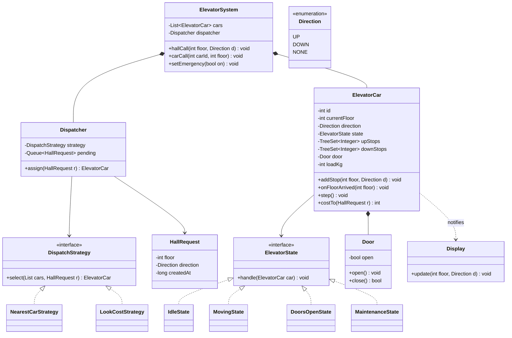
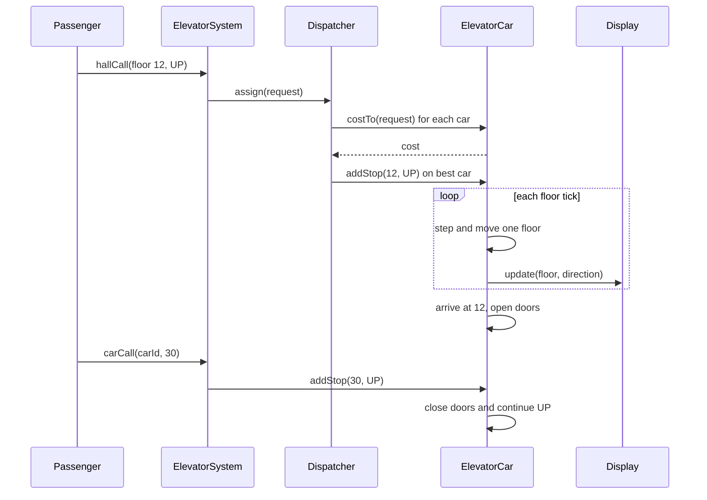

# Elevator System

**Category:** Low-Level Design
**Difficulty:** 🟡 Medium
**Seniority:** mid
**Companies:** Amazon, Google, Microsoft, Uber, Bloomberg, Salesforce
**Tags:** oop, state-pattern, strategy-pattern, scheduling, concurrency, event-driven
**Time:** 45 min

---

## Problem Statement

Design the control software for a bank of elevators in a building. Passengers press an Up/Down hall button on a floor and a destination button inside the car. A central dispatcher assigns hall calls to elevators, and each elevator moves floor by floor serving its stops efficiently.

The interviewer is looking for a clean separation between the dispatcher (which car takes a hall call), the per-elevator scheduler (in what order a car serves its stops), elevator state (moving, stopped, doors open, maintenance), and safe concurrent handling of button presses arriving while cars move.

## Clarifying Questions

- How many elevators and floors? *Assume 4 elevators, 50 floors.*
- Do hall buttons have direction? *Yes, Up and Down on each floor (bottom/top have one).*
- Destination dispatch (choose floor in the lobby)? *No, classic hall-call + car-call model; destination dispatch is a follow-up.*
- Capacity limits? *Each car has a weight limit; overloaded car won't close doors.*
- Optimization goal? *Minimize average wait time while avoiding starvation.*
- Special modes? *Maintenance (car removed from service) and fire emergency (all cars to lobby).*
- Is this a simulation or real hardware? *Design the controller logic; hardware is behind interfaces emitting floor-sensor events.*

## Requirements

### Functional
- Accept hall calls (floor, direction) and car calls (car, destination floor).
- Dispatcher assigns each hall call to the best elevator.
- Each elevator serves stops in an efficient order (SCAN/LOOK).
- Open/close doors at stops; hold doors on obstruction or overload.
- Display current floor and direction in each car and on each floor.
- Support maintenance and emergency modes.

### Non-Functional
- Safety first: never move with doors open; respect weight limit.
- No starvation: every request served within bounded time.
- Thread-safe under concurrent button presses and sensor events.
- Pluggable dispatch algorithms.

### Out of Scope
- Motor control physics, building access control, destination dispatch kiosks.

## Core Entities

- **ElevatorSystem** → facade; receives button presses, owns cars and dispatcher.
- **Dispatcher** → chooses an elevator for each hall call using a `DispatchStrategy`.
- **ElevatorCar** → id, current floor, direction, state, up-stops and down-stops sets.
- **ElevatorState** → Idle, MovingUp, MovingDown, DoorsOpen, Maintenance.
- **Request** → HallRequest(floor, direction) or CarRequest(floor).
- **Door** → open/close, obstruction sensor.
- **Display** → shows floor and direction (Observer of car).
- **DispatchStrategy** → nearest-car, LOOK-aware cost, zoning.
- **Direction** → UP, DOWN, NONE.

## Class Diagram



## Design Patterns

| Pattern | Where | Why |
|---|---|---|
| Strategy | `DispatchStrategy` | Swap nearest-car, cost-based LOOK, or zoning (low/high-rise banks) per building or time of day. |
| State | `ElevatorState` implementations | Legal actions differ per state (e.g., can't move in DoorsOpen, ignores calls in Maintenance). |
| Observer | Car → floor displays, hall lanterns | Displays update on each floor change without coupling to car logic. |
| Command | `HallRequest`, `CarRequest` objects queued to dispatcher | Requests are queued, logged, and can be re-dispatched if a car fails. |
| Facade | `ElevatorSystem` | Hardware button handlers call one interface. |

## Key Workflows

### Hall call assigned and served



### Car movement (LOOK algorithm)

The car keeps two sorted sets: `upStops` and `downStops`. While moving UP it serves the next higher stop in `upStops`; when none remain above it, it reverses and serves `downStops` from the highest down. When both are empty it becomes Idle. This is LOOK (elevator algorithm) — it bounds wait time to at most two full sweeps, preventing starvation.

## Implementation

```text
CLASS ElevatorCar
    FIELDS id, currentFloor ← 0, direction ← NONE, state ← IDLE
    FIELDS upStops (sorted set), downStops (sorted set), door, lock, observers

    FUNCTION addStop(floor, dir)
        LOCK lock
            IF floor = currentFloor AND state ∈ {IDLE, DOORS_OPEN}
                openDoors()
                RETURN
            IF dir = UP OR (dir = NONE AND floor > currentFloor)
                upStops.add(floor)
            ELSE
                downStops.add(floor)
            IF state = IDLE
                SET direction ← (floor > currentFloor) ? UP : DOWN
                SET state ← MOVING
        UNLOCK lock

    // Called by the control loop on every tick (e.g., every 100 ms)
    FUNCTION step()
        LOCK lock
            IF state ≠ MOVING  RETURN
            SET target ← nextTarget()
            IF target = NULL
                SET direction ← NONE
                SET state ← IDLE
                RETURN
            IF target > currentFloor  motor.up()   ELSE  motor.down()
        UNLOCK lock

    // Floor sensor event from hardware
    FUNCTION onFloorArrived(floor)
        LOCK lock
            SET currentFloor ← floor
            notifyObservers(floor, direction)
            IF (direction = UP AND upStops.contains(floor)) OR
               (direction = DOWN AND downStops.contains(floor))
                upStops.remove(floor) IF direction = UP
                downStops.remove(floor) IF direction = DOWN
                motor.stop()
                openDoors()
        UNLOCK lock

    FUNCTION nextTarget()
        IF direction = UP
            SET t ← upStops.ceiling(currentFloor)
            IF t ≠ NULL  RETURN t
            // nothing above: reverse; pick highest down-stop or any up-stop below
            SET direction ← DOWN
            RETURN downStops.max() ?? upStops.min()
        IF direction = DOWN
            SET t ← downStops.floor(currentFloor)
            IF t ≠ NULL  RETURN t
            SET direction ← UP
            RETURN upStops.min() ?? downStops.max()
        RETURN NULL

    FUNCTION openDoors()
        SET state ← DOORS_OPEN
        door.open()
        scheduler.after(5 seconds, closeDoors)

    FUNCTION closeDoors()
        LOCK lock
            IF loadKg > MAX_LOAD OR door.obstructed()
                scheduler.after(3 seconds, closeDoors)   // retry
                RETURN
            door.close()
            SET state ← (upStops ∪ downStops is empty) ? IDLE : MOVING
        UNLOCK lock

    FUNCTION costTo(req)
        // distance-based cost along the LOOK path
        IF state = MAINTENANCE  RETURN INF
        IF direction = NONE  RETURN |currentFloor - req.floor|
        IF direction = req.direction AND isAhead(req.floor)
            RETURN |currentFloor - req.floor|                // on the way
        // must finish current sweep then come back
        RETURN distanceToSweepEnd() + |sweepEnd - req.floor| + PENALTY

CLASS LookCostStrategy IMPLEMENTS DispatchStrategy
    FUNCTION select(cars, req)
        SET best ← NULL, bestCost ← INF
        FOR car IN cars
            SET c ← car.costTo(req) + LOAD_WEIGHT * car.pendingStops()
            IF c < bestCost  SET best ← car, bestCost ← c
        RETURN best

CLASS ElevatorSystem
    FUNCTION hallCall(floor, dir)
        SET req ← NEW HallRequest(floor, dir, now())
        SET car ← dispatcher.assign(req)
        IF car = NULL  dispatcher.pending.enqueue(req)   // all in maintenance
        ELSE car.addStop(floor, dir)

    FUNCTION setEmergency(on)
        FOR car IN cars
            car.clearStops()
            car.addStop(LOBBY, DOWN)
            car.setMode(on ? FIRE_SERVICE : NORMAL)
```

## Concurrency & Extensibility

- **Threads:** hardware button handlers, floor sensors, door timers, and a control loop all touch car state. Each `ElevatorCar` has its own lock (or runs as a single-threaded actor consuming an event queue), so cars never block each other. The actor model is often cleaner: every event (button, sensor, timer) is a message processed sequentially per car.
- **Dispatcher reads car state** for cost estimates without locks (slightly stale snapshots are fine); the actual `addStop` is atomic on the car.
- **Duplicate presses:** stop sets deduplicate naturally; hall button lights stay lit until the assigned car arrives.
- **Car failure:** if a car enters Maintenance with pending hall stops, the dispatcher re-dispatches those requests to other cars.
- **Safety invariants** (doors closed before moving, load under limit) are checked in the state transition, not in callers.
- **Extensibility:** new dispatch algorithms (zoning, peak-hour up-peak mode parking cars at lobby) are new strategies; new modes (VIP, freight) are new states; destination dispatch replaces hall calls with `DestinationRequest` and a grouping strategy.

## Trade-offs

| Decision | Option A | Option B | Choice & Why |
|---|---|---|---|
| Per-car scheduling | FCFS queue | LOOK with up/down sorted sets | LOOK: far fewer direction changes, bounded wait; FCFS zig-zags. |
| Assignment timing | Assign hall call immediately | Re-evaluate assignments continuously | Immediate for simplicity and lantern feedback; advanced systems reassign as conditions change. |
| Concurrency model | Shared locks per car | Actor/event queue per car | Actor: sequential event handling eliminates most race reasoning. |
| Dispatch cost | Nearest car by distance | Cost including direction, load, pending stops | Cost-based: nearest-by-distance often picks a car moving away. |
| Mode handling | Flags (`isEmergency`) checked everywhere | State objects | State: emergency/maintenance behavior encapsulated. |

## Follow-up Questions

1. **How do you prevent starvation?** LOOK guarantees service within two sweeps; additionally age pending hall calls and add an aging bonus to cost so old requests get priority.
2. **How would you handle morning up-peak?** Switch to an up-peak strategy: idle cars return to the lobby, and cars are zoned to floor ranges to reduce stops.
3. **How do you implement destination dispatch?** Passengers enter destinations in the lobby; the dispatcher groups passengers with nearby destinations into the same car, minimizing stops per trip.
4. **How do you test this?** Discrete-event simulation with a fake clock and fake motor/sensors; replay traffic patterns and measure average wait and travel time.
5. **What if a car call is pressed for a floor behind the car's direction?** Add it to the opposite-direction set; it's served after the current sweep reverses.

## Common Mistakes

- A single global queue served FCFS, causing zig-zag movement.
- Mixing dispatcher (which car) and car scheduler (which order) responsibilities.
- Ignoring direction of hall calls (picking up a down-going passenger on an up sweep).
- Using one global lock so all cars block on each other.
- Forgetting door, overload, and maintenance/emergency handling.

## Key Takeaways

- Split the problem: dispatcher selects a car, each car schedules its stops with LOOK.
- Two sorted sets (up, down) per car make LOOK simple and efficient.
- Model car modes with the State pattern and dispatch with Strategy.
- Per-car serialization (lock or actor) gives safe concurrency without global contention.
