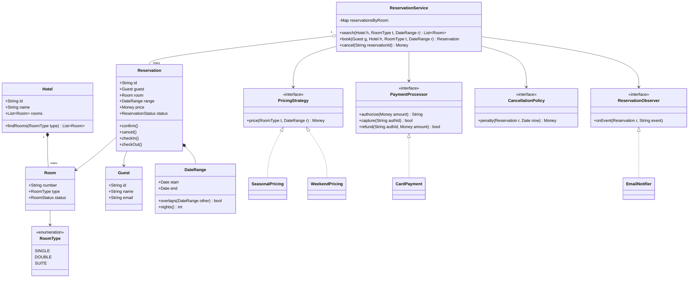
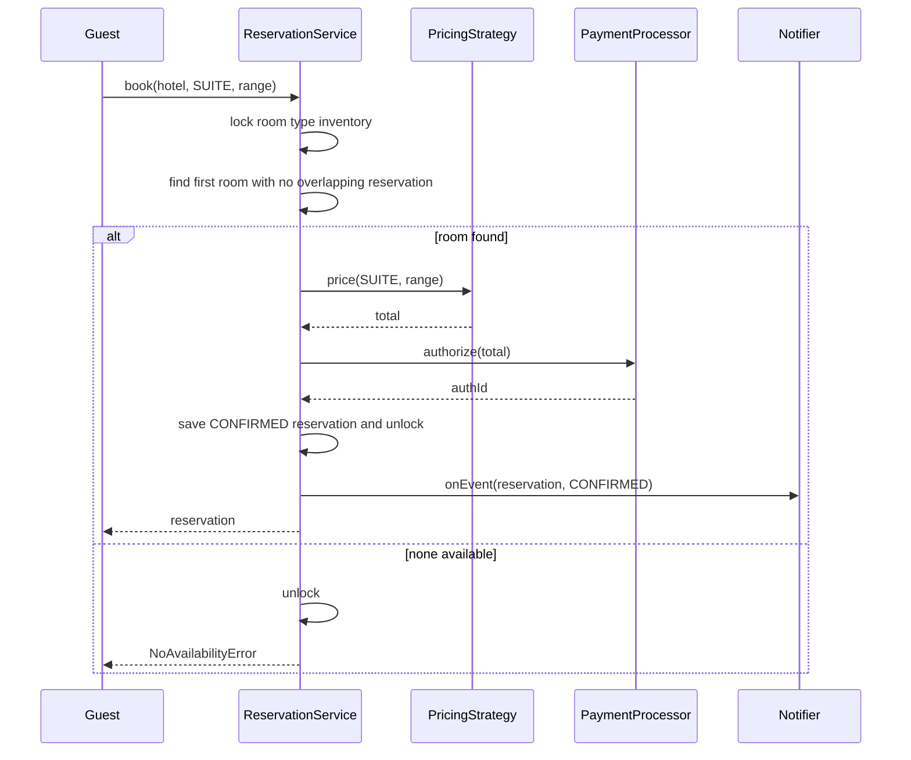
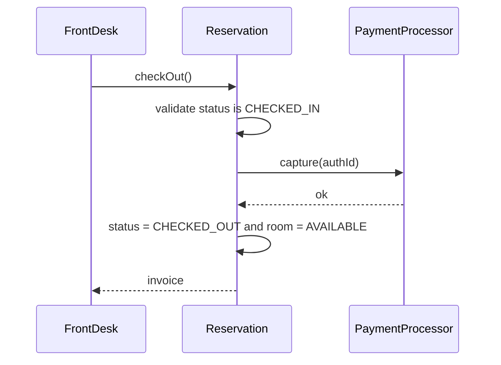

# Hotel Reservation System

**Category:** Low-Level Design
**Difficulty:** 🟡 Medium
**Seniority:** mid
**Companies:** Amazon, Booking.com, Expedia, Airbnb, Microsoft, Oracle
**Tags:** oop, booking, concurrency, strategy-pattern, state-machine, inventory
**Time:** 45 min

---

## Problem Statement

Design the object model for a hotel reservation system. Guests search for available rooms in a hotel for a date range, reserve a room, pay, check in and check out. Front-desk staff can also create, modify and cancel reservations on behalf of guests.

The interviewer is looking for clean entities (Hotel, Room, Reservation, Guest, Payment), a correct availability check over date ranges, a reservation lifecycle, pluggable pricing, and protection against double-booking when two guests try to book the same room at the same time.

## Clarifying Questions

- Single hotel or a chain of hotels? *A chain; each hotel has its own rooms, but the core logic is per hotel.*
- Do guests book a specific room or a room type? *They book a room type; a concrete room is assigned at booking time.*
- How is pricing determined? *Base rate per room type, adjusted by season/weekend/occupancy strategies.*
- Is payment taken at booking or at check-in? *Authorize at booking, capture at check-out; we model a Payment abstraction only.*
- What is the cancellation policy? *Free cancellation up to 24h before check-in, otherwise one night is charged.*
- Can one reservation contain multiple rooms? *Keep one room per reservation; a booking group can be added later.*
- Do we need overbooking? *No — strictly no double-booking.*

## Requirements

### Functional

- Search available rooms by hotel, room type and date range `[checkIn, checkOut)`.
- Create a reservation that holds a room for the date range and computes the price.
- Cancel and modify reservations according to a cancellation policy.
- Check in (assign key, mark room occupied) and check out (generate invoice, capture payment).
- Support multiple payment methods (card, cash, wallet).
- Notify guests on confirmation, cancellation and check-in reminders.

### Non-Functional

- No double-booking of a room for overlapping nights, even under concurrent requests.
- Availability check should be O(reservations of that room) or better.
- Easy to add new room types, pricing rules and payment methods without modifying core classes.

### Out of Scope

- Distributed inventory across OTAs (channel manager), loyalty programs, housekeeping scheduling.

## Core Entities

- **Hotel** → owns rooms, holds the reservation book, entry point for search.
- **Room** → number, type, floor, status (AVAILABLE, OCCUPIED, MAINTENANCE).
- **RoomType** → enum (SINGLE, DOUBLE, SUITE) with capacity and base rate.
- **Guest** → identity and contact info.
- **Reservation** → guest, room, date range, price, status (PENDING, CONFIRMED, CHECKED_IN, CHECKED_OUT, CANCELLED).
- **DateRange** → value object with half-open interval and `overlaps()`.
- **ReservationService** → orchestrates search, booking, cancellation; enforces no double-booking.
- **PricingStrategy** → computes the price for a room type and range.
- **PaymentProcessor** → abstraction over card/cash/wallet payments.
- **CancellationPolicy** → computes refund/penalty.
- **NotificationService** → observer that sends email/SMS on reservation events.

## Class Diagram



## Design Patterns

| Pattern | Where | Why |
|---|---|---|
| Strategy | `PricingStrategy`, `CancellationPolicy` | Swap seasonal/weekend/dynamic pricing and policies without touching the service. |
| State | `Reservation.status` transitions | Only legal transitions (PENDING → CONFIRMED → CHECKED_IN → CHECKED_OUT, or → CANCELLED). |
| Observer | `ReservationObserver` | Decouple email/SMS/analytics from booking logic. |
| Factory | `PaymentProcessorFactory` | Create the right processor from the payment method chosen by the guest. |
| Decorator | Pricing modifiers (tax, discount) | Stack adjustments on top of a base price. |

## Key Workflows

### Book a room



The lock is held only around the availability check and insert, so two guests cannot grab the same room for overlapping nights. If authorization fails, the reservation is rolled back.

### Check out



## Implementation

```text
CLASS DateRange                         // half-open [start, end)
    FIELDS start, end
    FUNCTION overlaps(other)
        RETURN start < other.end AND other.start < end
    FUNCTION nights()
        RETURN daysBetween(start, end)

CLASS Reservation
    FIELDS id, guest, room, range, price, status, authId

    FUNCTION transition(to)
        SET allowed ← {
            PENDING:    [CONFIRMED, CANCELLED],
            CONFIRMED:  [CHECKED_IN, CANCELLED],
            CHECKED_IN: [CHECKED_OUT]
        }
        IF to NOT IN allowed[status] THEN THROW IllegalStateError
        SET status ← to

CLASS ReservationService
    FIELDS reservationsByRoom : Map<roomId, List<Reservation>>
           locks : Map<(hotelId, roomType), Lock>
           pricing, paymentFactory, cancellationPolicy, observers

    FUNCTION isFree(room, range)
        FOR r IN reservationsByRoom[room.id]
            IF r.status != CANCELLED AND r.range.overlaps(range) THEN RETURN false
        RETURN true

    FUNCTION search(hotel, type, range)
        RETURN [room FOR room IN hotel.findRooms(type)
                IF room.status != MAINTENANCE AND isFree(room, range)]

    FUNCTION book(guest, hotel, type, range, paymentMethod)
        IF range.nights() < 1 THEN THROW InvalidRangeError
        SET lock ← locks[(hotel.id, type)]
        lock.acquire()
        TRY
            SET candidates ← search(hotel, type, range)
            IF candidates IS EMPTY THEN THROW NoAvailabilityError
            SET room ← candidates[0]
            SET price ← pricing.price(type, range)
            SET res ← NEW Reservation(newId(), guest, room, range, price, PENDING)
            APPEND res TO reservationsByRoom[room.id]      // hold the room
        FINALLY
            lock.release()

        SET processor ← paymentFactory.create(paymentMethod)
        SET authId ← processor.authorize(price)
        IF authId IS NULL THEN
            res.transition(CANCELLED)                      // releases the hold
            THROW PaymentFailedError
        SET res.authId ← authId
        res.transition(CONFIRMED)
        notify(res, "CONFIRMED")
        RETURN res

    FUNCTION cancel(resId, now)
        SET res ← findReservation(resId)
        SET penalty ← cancellationPolicy.penalty(res, now)
        res.transition(CANCELLED)
        paymentFactory.forAuth(res.authId).refund(res.authId, res.price - penalty)
        notify(res, "CANCELLED")
        RETURN penalty

CLASS SeasonalPricing IMPLEMENTS PricingStrategy
    FUNCTION price(type, range)
        SET total ← 0
        FOR night IN range
            SET total ← total + type.baseRate * seasonMultiplier(night)
        RETURN total

CLASS FreeUntil24hPolicy IMPLEMENTS CancellationPolicy
    FUNCTION penalty(res, now)
        IF hoursBetween(now, res.range.start) >= 24 THEN RETURN 0
        RETURN res.price / res.range.nights()                // one night
```

## Concurrency & Extensibility

- **Double-booking prevention:** a lock per `(hotel, roomType)` serializes the check-then-insert. The PENDING reservation acts as a hold, so the slow payment call happens outside the lock.
- **Database version:** in production, enforce with a unique constraint on `(room_id, night)` in a `room_nights` table, or a PostgreSQL exclusion constraint on `daterange` (`EXCLUDE USING gist (room_id WITH =, stay WITH &&)`), so correctness does not rely on in-process locks.
- **Pending timeout:** a scheduled job cancels PENDING reservations older than N minutes to release holds when payment hangs.
- **Faster availability:** keep an interval tree or sorted list per room for O(log n) overlap checks when reservation counts are large.
- **Open/Closed:** new pricing rules implement `PricingStrategy` (or decorate one); new payment methods implement `PaymentProcessor` and register in the factory; new room types are enum/config entries.

## Trade-offs

| Decision | Option A | Option B | Choice & Why |
|---|---|---|---|
| Booking granularity | Book a specific room | Book a room type, assign room | Room type — maximizes utilization and matches how hotels sell inventory. |
| Locking | Global lock | Lock per (hotel, room type) | Per room type — contention is local; unrelated bookings proceed in parallel. |
| Payment timing | Charge at booking | Authorize then capture at check-out | Authorize/capture — supports cancellation and incidentals without refunds. |
| Availability storage | List of reservations per room | Per-night inventory counters | Per-room list for LLD clarity; per-night counters scale better for search. |
| Hold during payment | Lock across payment call | PENDING hold + timeout | PENDING hold — never hold locks across network calls. |

## Follow-up Questions

1. **How do you support overbooking?** Track per-night sold count per room type and allow up to `capacity * (1 + overbookRate)`; assign concrete rooms at check-in rather than at booking.
2. **How would you handle a chain with millions of searches?** Precompute per-night availability counters per (hotel, room type) in Redis/Elasticsearch for search, and validate against the source-of-truth DB at booking.
3. **How do you modify a reservation's dates?** Treat as atomic cancel-and-rebook under the same lock, keeping the original if the new range is unavailable.
4. **How would you add group bookings?** Introduce a `Booking` aggregate containing multiple `Reservation`s, booked all-or-nothing within one transaction.
5. **What about time zones?** Store dates as hotel-local calendar dates (not timestamps); cancellation deadlines are computed in the hotel's time zone.

## Common Mistakes

- Using closed intervals, so a checkout on day X conflicts with a check-in on day X.
- Checking availability and inserting without atomicity, causing double-booking under concurrency.
- Holding a lock while calling the payment gateway.
- Hard-coding pricing logic inside `Reservation` or `Room` with if/else chains.
- Modeling room status as the only source of availability (a room is "available" today but booked next week).

## Key Takeaways

- The heart of the problem is the date-range overlap check `start < other.end AND other.start < end` done atomically with the insert.
- Make Reservation a state machine with explicit allowed transitions.
- Use Strategy for pricing and cancellation, Observer for notifications, Factory for payments.
- Back in-memory locks with database constraints for real correctness.
