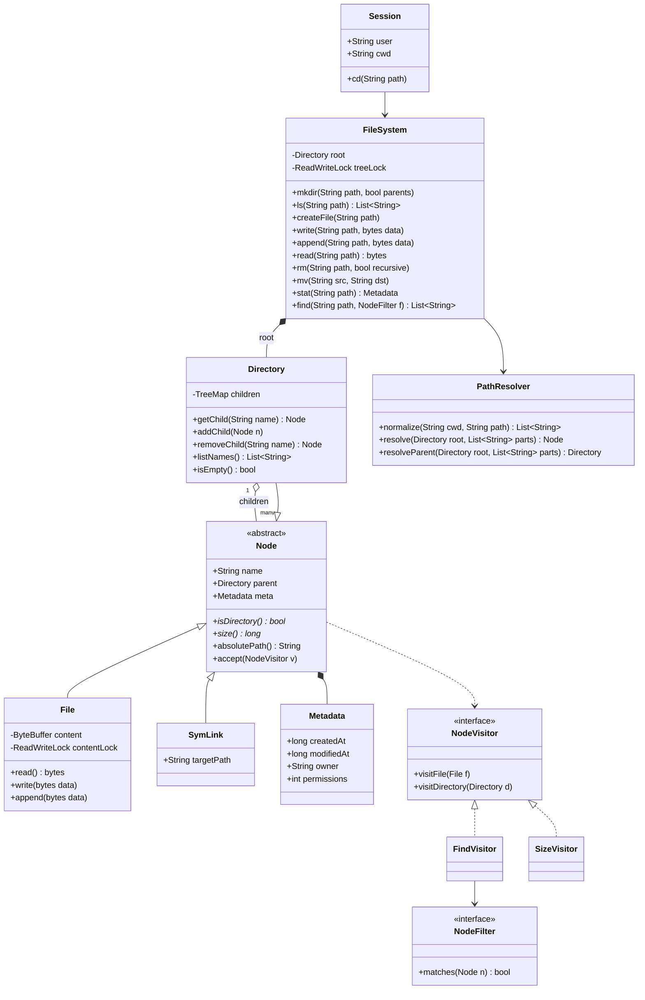
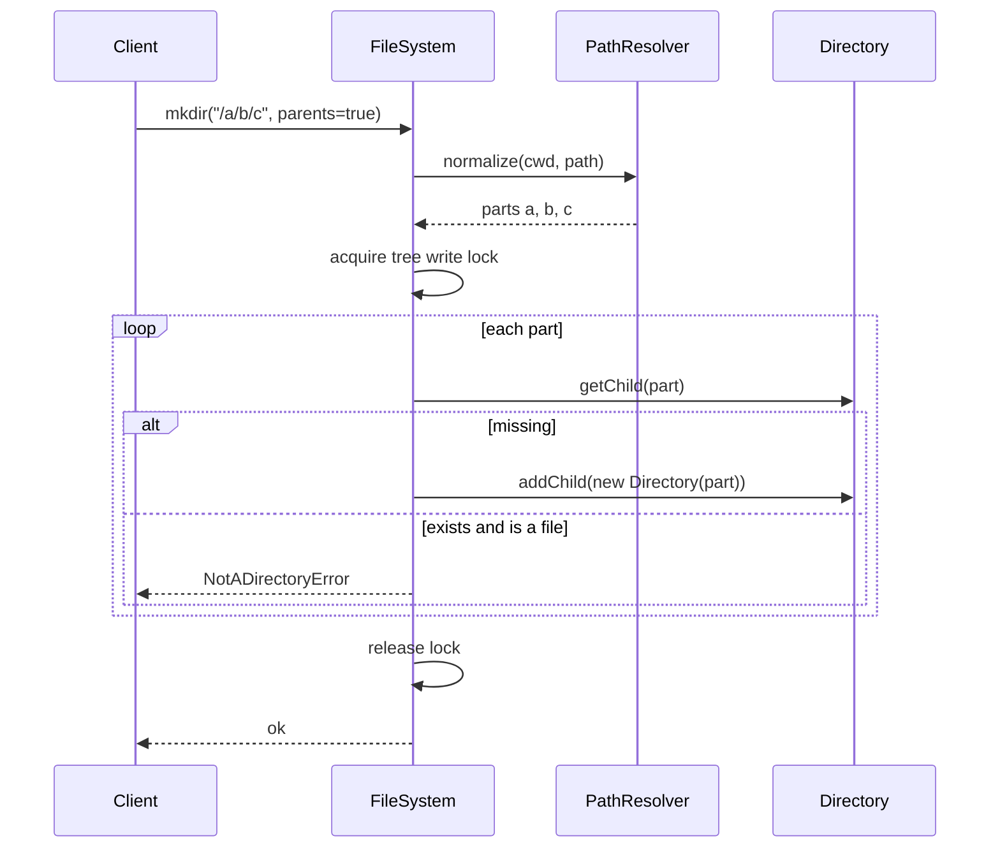
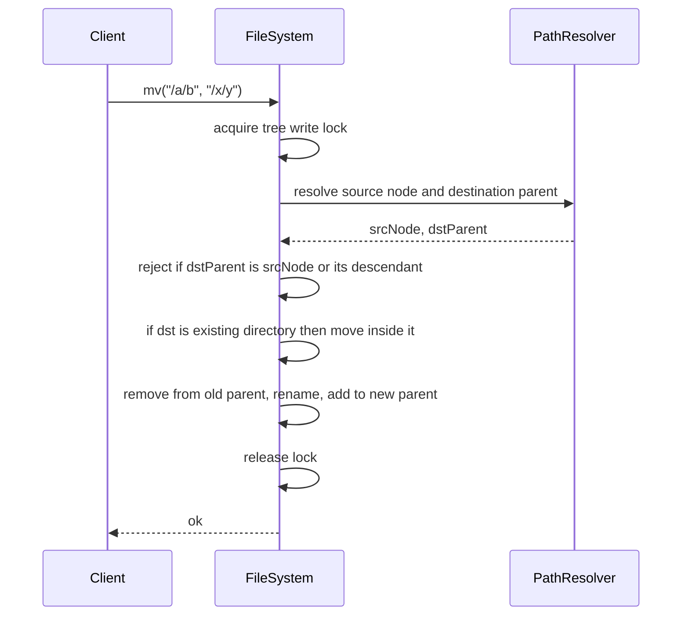

# In-Memory File System

**Category:** Low-Level Design
**Difficulty:** 🔴 Hard
**Seniority:** senior
**Companies:** Google, Amazon, Microsoft, Dropbox, Apple, Databricks
**Tags:** oop, composite-pattern, tree, path-resolution, read-write-locks, trie
**Time:** 60 min

---

## Problem Statement

Design an in-memory hierarchical file system that supports Unix-like operations: `mkdir -p`, `ls`, create/read/write/append files, `rm` (recursive), `mv`, and path resolution with absolute and relative paths (including `.` and `..`). Files hold byte content; directories hold children.

The interviewer is looking for a Composite-based model of files and directories, robust path parsing and resolution, correct semantics for edge cases (moving a directory into itself, name collisions, root deletion), metadata (size, timestamps, permissions), and a sound concurrency strategy for concurrent readers and writers.

## Clarifying Questions

- Which operations? *mkdir (with parents), ls, createFile, read, write (overwrite), append, rm (recursive flag), mv, stat, find by name pattern.*
- Do we need relative paths and a current working directory? *Yes, per session; resolve `.` and `..`.*
- Symbolic or hard links? *Symlinks as a follow-up; no hard links.*
- Permissions/ownership? *Basic owner and rwx bits; enforcement is a follow-up.*
- `ls` output ordering? *Lexicographic order of names.*
- Concurrency? *Multiple threads may operate concurrently; operations must be atomic and consistent.*
- Size limits? *No quotas initially; track size per file and aggregate directory size lazily.*

## Requirements

### Functional

- `mkdir(path, parents)` creates directories; error if exists (unless parents mode) or parent missing.
- `ls(path)`: for a directory, sorted child names; for a file, the file name.
- `createFile(path)`, `write(path, bytes)`, `append(path, bytes)`, `read(path)`.
- `rm(path, recursive)`: removing a non-empty directory requires recursive; root cannot be removed.
- `mv(src, dst)`: rename or move; fails if `dst` is inside `src`.
- `stat(path)`: type, size, created/modified time, permissions.
- `find(path, predicate)`: recursive search by name/size.
- Sessions with `cd` and relative path resolution.

### Non-Functional

- Path resolution O(depth) with O(1) or O(log k) child lookup.
- Thread-safe; readers do not block each other.
- Extensible to new node types (symlink) and operations without rewriting the tree.

### Out of Scope

- Persistence to disk, journaling, block allocation, POSIX file descriptors.

## Core Entities

- **FileSystem** → facade exposing operations; owns root and the locking strategy.
- **Node** (abstract) → name, parent, metadata; common for files and directories.
- **Directory** → sorted map of child name to Node.
- **File** → byte content (buffer), size.
- **SymLink** → stores target path (extension).
- **Metadata** → created, modified, owner, permissions.
- **Path / PathResolver** → parse and normalize paths; walk the tree.
- **Session** → current working directory and user.
- **NodeVisitor** → operations over the tree (size, find, print tree).

## Class Diagram



## Design Patterns

| Pattern | Where | Why |
|---|---|---|
| Composite | `Node` / `Directory` / `File` | Treat files and directories uniformly (size, path, delete), directories contain nodes. |
| Visitor | `SizeVisitor`, `FindVisitor`, tree printer | Add new tree-wide operations without changing node classes. |
| Facade | `FileSystem` | One API hiding resolution, locking and node manipulation. |
| Strategy | `NodeFilter` for find (name glob, size, modified time) | Composable search predicates. |
| Factory | `NodeFactory.create(type, name)` | Central creation incl. default metadata/permissions. |

## Key Workflows

### mkdir -p /a/b/c



### mv /a/b /x/y



## Implementation

```text
CLASS PathResolver
    FUNCTION normalize(cwd, path)
        SET full ← path IF path STARTS WITH "/" ELSE cwd + "/" + path
        SET stack ← []
        FOR part IN split(full, "/")
            IF part == "" OR part == "." THEN CONTINUE
            ELSE IF part == ".." THEN
                IF stack NOT EMPTY THEN stack.pop()          // ".." at root stays at root
            ELSE
                validateName(part)                            // no "/", no NUL, length <= 255
                stack.push(part)
        RETURN stack                                          // [] means root

    FUNCTION resolve(root, parts)
        SET node ← root
        FOR part IN parts
            IF NOT node.isDirectory() THEN THROW NotADirectoryError
            SET node ← node.getChild(part)
            IF node IS NULL THEN THROW NotFoundError(part)
        RETURN node

    FUNCTION resolveParent(root, parts)
        IF parts IS EMPTY THEN THROW InvalidPathError        // root has no parent
        SET parent ← resolve(root, parts[0 .. n-2])
        IF NOT parent.isDirectory() THEN THROW NotADirectoryError
        RETURN parent

CLASS Directory EXTENDS Node
    FIELDS children : TreeMap<String, Node>                  // sorted for ls

    FUNCTION addChild(n)
        IF children CONTAINS n.name THEN THROW AlreadyExistsError
        SET children[n.name] ← n
        SET n.parent ← this
        SET meta.modifiedAt ← now()

    FUNCTION size()
        RETURN sum(child.size() FOR child IN children.values())

CLASS File EXTENDS Node
    FIELDS content : growable byte buffer, contentLock : ReadWriteLock
    FUNCTION read()   WITH contentLock.read:  RETURN copy(content)
    FUNCTION write(d) WITH contentLock.write: SET content ← copy(d); touch()
    FUNCTION append(d) WITH contentLock.write: content.extend(d); touch()
    FUNCTION size()   RETURN content.length

CLASS FileSystem
    FIELDS root ← NEW Directory(""), treeLock : ReadWriteLock, resolver

    FUNCTION mkdir(path, parents)
        SET parts ← resolver.normalize(session.cwd, path)
        WITH treeLock.write
            SET cur ← root
            FOR i FROM 0 TO size(parts) - 1
                SET child ← cur.getChild(parts[i])
                IF child IS NULL THEN
                    IF NOT parents AND i < size(parts) - 1 THEN THROW NotFoundError
                    SET child ← NEW Directory(parts[i])
                    cur.addChild(child)
                ELSE IF NOT child.isDirectory() THEN THROW NotADirectoryError
                ELSE IF i == size(parts) - 1 AND NOT parents THEN THROW AlreadyExistsError
                SET cur ← child

    FUNCTION ls(path)
        WITH treeLock.read
            SET node ← resolver.resolve(root, resolver.normalize(session.cwd, path))
            IF node.isDirectory() THEN RETURN node.listNames()
            RETURN [node.name]

    FUNCTION write(path, data)                               // create if missing
        SET parts ← resolver.normalize(session.cwd, path)
        WITH treeLock.write
            SET parent ← resolver.resolveParent(root, parts)
            SET node ← parent.getChild(last(parts))
            IF node IS NULL THEN
                SET node ← NEW File(last(parts))
                parent.addChild(node)
            IF node.isDirectory() THEN THROW IsADirectoryError
        node.write(data)                                     // file-level lock only

    FUNCTION rm(path, recursive)
        SET parts ← resolver.normalize(session.cwd, path)
        IF parts IS EMPTY THEN THROW PermissionError("cannot remove root")
        WITH treeLock.write
            SET node ← resolver.resolve(root, parts)
            IF node.isDirectory() AND NOT node.isEmpty() AND NOT recursive
                THEN THROW DirectoryNotEmptyError
            node.parent.removeChild(node.name)              // subtree is garbage collected

    FUNCTION mv(src, dst)
        SET s ← resolver.normalize(session.cwd, src)
        SET d ← resolver.normalize(session.cwd, dst)
        IF s IS EMPTY THEN THROW PermissionError
        WITH treeLock.write
            SET node ← resolver.resolve(root, s)
            SET target ← tryResolve(root, d)
            IF target IS NOT NULL AND target.isDirectory() THEN
                SET newParent ← target; SET newName ← node.name
            ELSE
                SET newParent ← resolver.resolveParent(root, d); SET newName ← last(d)
            IF isAncestorOrSelf(node, newParent) THEN THROW InvalidMoveError
            IF newParent.getChild(newName) IS NOT NULL THEN THROW AlreadyExistsError
            node.parent.removeChild(node.name)
            SET node.name ← newName
            newParent.addChild(node)

    FUNCTION isAncestorOrSelf(a, b)
        SET cur ← b
        WHILE cur IS NOT NULL
            IF cur == a THEN RETURN true
            SET cur ← cur.parent
        RETURN false

CLASS FindVisitor IMPLEMENTS NodeVisitor
    FIELDS filter, results
    FUNCTION visitFile(f)      IF filter.matches(f) THEN APPEND f.absolutePath() TO results
    FUNCTION visitDirectory(d)
        IF filter.matches(d) THEN APPEND d.absolutePath() TO results
        FOR child IN d.children.values(): child.accept(this)
```

## Concurrency & Extensibility

- **Two-level locking:** a tree-wide `ReadWriteLock` protects structure (resolve, add, remove, move); each `File` has its own `ReadWriteLock` for content. Many readers proceed in parallel; content writes to different files don't contend; structure changes are serialized, which makes `mv` trivially atomic and deadlock-free.
- **Finer-grained option:** per-directory locks with lock coupling (hand-over-hand) during traversal. `mv` then must lock both parents in a global order (e.g. by node ID) to avoid deadlock, and still check the ancestor relation under lock — more concurrency, more complexity.
- **Read-mostly alternative:** copy-on-write directories with atomic pointer swaps give lock-free reads (like a persistent tree).
- **Directory size:** computing on demand is O(subtree); for frequent `du`, maintain cached sizes and propagate deltas up the parent chain on write.
- **Open/Closed:** new node types (SymLink, Device) extend `Node`; the resolver follows symlinks with a hop limit (40, like Linux) to prevent loops. New operations (du, tree, chmod -R) are Visitors. Permission checks are a `PermissionChecker` strategy invoked during resolution.

## Trade-offs

| Decision | Option A | Option B | Choice & Why |
|---|---|---|---|
| Children storage | HashMap (O(1) lookup) | TreeMap (O(log k), sorted) | TreeMap — `ls` needs sorted output; lookups stay fast. HashMap + sort on ls if ls is rare. |
| Locking | Global RW lock | Per-directory locks with coupling | Global structure lock + per-file content locks — simple, correct; refine only if contention shows. |
| Path storage | Store full path in each node | Store name + parent pointer | Name + parent — `mv` of a directory is O(1) instead of rewriting all descendant paths. |
| File content | Single byte array | Chunked blocks | Single array for simplicity; chunks (e.g. 4 KB) make large appends and random writes cheaper. |
| Tree-wide ops | Methods on each node class | Visitor | Visitor — add find/du/print without touching node classes. |

## Follow-up Questions

1. **How would you add symbolic links?** A `SymLink` node storing a target path; the resolver substitutes the target and continues, with a max hop count to detect cycles; `rm` removes the link, not the target.
2. **How would you persist this file system?** Write-ahead log of operations plus periodic snapshots of the tree; on restart, load the snapshot and replay the log.
3. **How would you implement `find -name "*.log"` efficiently at scale?** Maintain a secondary index (name to set of nodes, or a trie/suffix index) updated on create/rename/delete.
4. **How do you support file handles with concurrent readers and a writer?** Open returns a handle with an offset; use per-file RW locks or MVCC snapshots so readers see a consistent version.
5. **How would you enforce quotas?** Maintain cached directory sizes with delta propagation and reject writes that would exceed the quota on any ancestor.

## Common Mistakes

- Allowing `mv /a /a/b` (moving a directory into its own subtree), creating a cycle.
- Not normalizing `.`/`..` and repeated slashes, or letting `..` escape above root.
- Storing absolute paths in nodes so renames require rewriting the whole subtree.
- Forgetting to distinguish file vs directory errors (NotADirectory, IsADirectory).
- Locking parents in inconsistent order during `mv`, risking deadlock.

## Key Takeaways

- Composite pattern: `Node` base with `File` and `Directory`, directories hold a sorted child map.
- Path handling = normalize (stack for `..`) + walk from root, with clear error types.
- Name + parent pointer makes rename and move O(1); always check for ancestor cycles.
- Separate structure locking from content locking for safe, parallel access.
