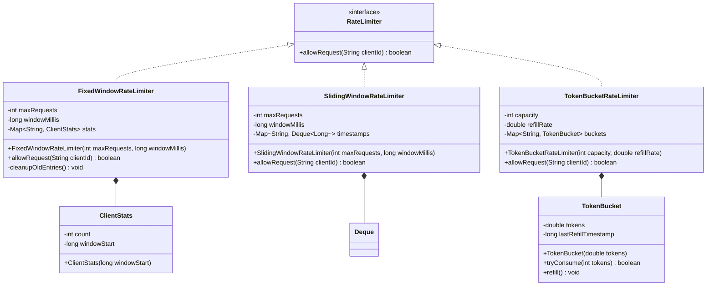
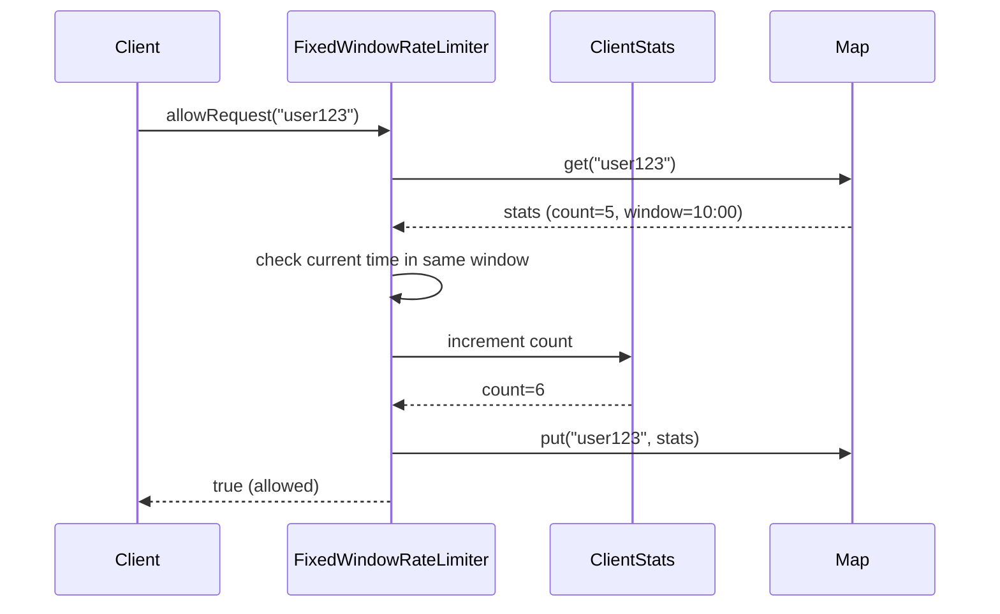
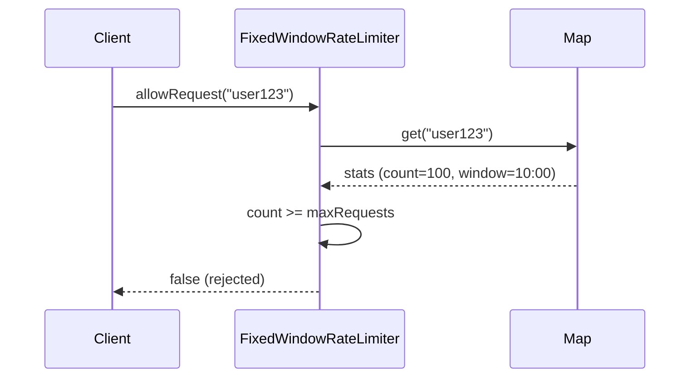
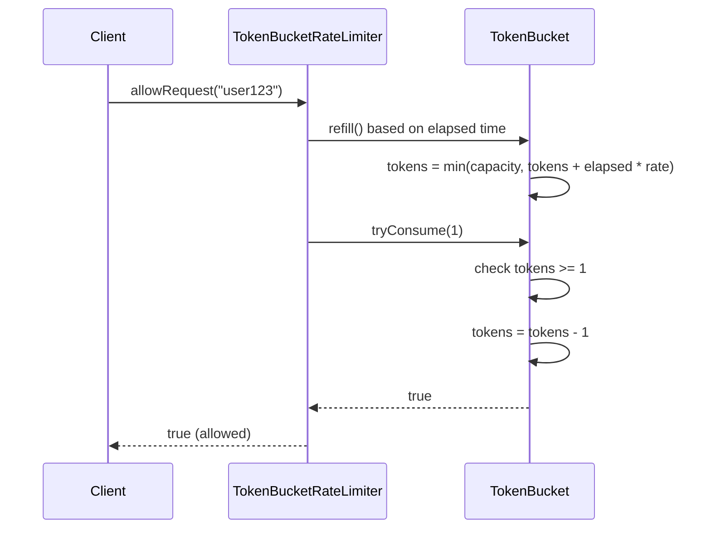

# In-Process Rate Limiter

**Category:** Low-Level Design
**Difficulty:** 🟢 Easy
**Seniority:** junior
**Companies:** Common interview question
**Tags:** rate limiting, algorithms
**Time:** 30-45 min

---

## Problem Statement

Design an in-process rate limiter that limits the number of requests from a given user or IP address within a time window. The rate limiter should support different rate limiting strategies (fixed window, sliding window, token bucket) and be thread-safe for concurrent access.

The interviewer is looking for understanding of rate limiting algorithms, thread-safety, and clean API design.

## Clarifying Questions

- What is the rate limit? *Configurable, e.g., 100 requests per minute.*
- What identifies a client? *User ID, IP address, or API key.*
- Which algorithms to implement? *Start with fixed window, discuss sliding window and token bucket.*
- Is thread-safety required? *Yes, for concurrent request handling.*
- What happens when limit is exceeded? *Return false or throw exception.*
- Should we support multiple rate limits per client? *Yes, different endpoints may have different limits.*
- Do we need to track metrics? *Optional, for monitoring.*

## Requirements

### Functional
- Allow a request if within rate limit, reject otherwise.
- Support different rate limiting algorithms.
- Track requests per client identifier.
- Configurable rate (requests per time window).
- Thread-safe for concurrent access.

### Non-Functional
- Low overhead per request check.
- Memory efficient (bounded memory growth).
- Accurate rate limiting (minimal false positives/negatives).
- Easy to configure and extend.

### Out of Scope
- Distributed rate limiting across multiple servers, persistence, dynamic configuration updates.

## Class Design

- **RateLimiter** → main interface with `allowRequest(clientId)` method.
- **FixedWindowRateLimiter** → implementation using fixed time windows.
- **SlidingWindowRateLimiter** → implementation using sliding time windows.
- **TokenBucketRateLimiter** → implementation using token bucket algorithm.
- **ClientStats** → per-client request tracking data.
- **RateLimit** → configuration object (maxRequests, windowSize).

## Class Diagram



## Key Classes and Relationships

- **RateLimiter** is the interface that defines the contract for all rate limiting implementations.
- **FixedWindowRateLimiter** uses a map of client IDs to window start times and counts; simple but allows bursts at boundaries.
- **SlidingWindowRateLimiter** uses a deque of timestamps per client for more accurate rate limiting with higher memory overhead.
- **TokenBucketRateLimiter** uses a token bucket per client with refill rate; naturally handles bursts and provides smooth throttling.
- **ClientStats** tracks the count and window start for fixed window implementation.
- **TokenBucket** tracks current tokens and last refill timestamp for token bucket algorithm.

## Design Patterns

| Pattern | Where | Why |
|---|---|---|
| Strategy | `RateLimiter` interface with multiple implementations | Allows switching between algorithms without changing client code. |
| Factory | `RateLimiterFactory.create(type, config)` | Centralizes creation of different rate limiter types. |
| Singleton | (Optional) Shared rate limiter instance | Single rate limiter per application for consistent limits. |
| Observer | (Optional) For metrics/events on rate limit hits | Decouples monitoring from rate limiting logic. |

## Key Workflows

### Fixed window rate limiting - request allowed



### Fixed window rate limiting - request rejected



### Token bucket algorithm



## Implementation

```text
INTERFACE RateLimiter
    FUNCTION allowRequest(clientId) boolean

CLASS FixedWindowRateLimiter IMPLEMENTS RateLimiter
    FIELDS maxRequests, windowMillis, stats ← ConcurrentHashMap()

    CONSTRUCTOR FixedWindowRateLimiter(maxRequests, windowMillis)
        THIS.maxRequests ← maxRequests
        THIS.windowMillis ← windowMillis

    FUNCTION allowRequest(clientId)
        SET currentTime ← System.currentTimeMillis()
        SET windowStart ← (currentTime / windowMillis) * windowMillis
        SET clientStats ← stats.computeIfAbsent(clientId, k → NEW ClientStats(windowStart))

        SYNCHRONIZED (clientStats)
            IF clientStats.windowStart ≠ windowStart
                clientStats.count ← 0
                clientStats.windowStart ← windowStart
            IF clientStats.count < maxRequests
                clientStats.count ← clientStats.count + 1
                RETURN true
            RETURN false

CLASS SlidingWindowRateLimiter IMPLEMENTS RateLimiter
    FIELDS maxRequests, windowMillis, timestamps ← ConcurrentHashMap()

    CONSTRUCTOR SlidingWindowRateLimiter(maxRequests, windowMillis)
        THIS.maxRequests ← maxRequests
        THIS.windowMillis ← windowMillis

    FUNCTION allowRequest(clientId)
        SET currentTime ← System.currentTimeMillis()
        SET windowStart ← currentTime - windowMillis
        SET queue ← timestamps.computeIfAbsent(clientId, k → NEW ConcurrentLinkedDeque())

        SYNCHRONIZED (queue)
            // Remove timestamps outside the window
            WHILE NOT queue.isEmpty() AND queue.peekFirst() < windowStart
                queue.removeFirst()
            IF queue.size() < maxRequests
                queue.addLast(currentTime)
                RETURN true
            RETURN false

CLASS TokenBucketRateLimiter IMPLEMENTS RateLimiter
    FIELDS capacity, refillRate, buckets ← ConcurrentHashMap()

    CONSTRUCTOR TokenBucketRateLimiter(capacity, refillRate)
        THIS.capacity ← capacity
        THIS.refillRate ← refillRate  // tokens per millisecond

    FUNCTION allowRequest(clientId)
        SET bucket ← buckets.computeIfAbsent(clientId, k → NEW TokenBucket(capacity))
        RETURN bucket.tryConsume(1)

CLASS TokenBucket
    FIELDS tokens, lastRefillTimestamp, capacity, refillRate

    CONSTRUCTOR TokenBucket(capacity)
        THIS.capacity ← capacity
        THIS.tokens ← capacity
        THIS.lastRefillTimestamp ← System.currentTimeMillis()

    FUNCTION tryConsume(requestedTokens)
        refill()
        IF tokens >= requestedTokens
            tokens ← tokens - requestedTokens
            RETURN true
        RETURN false

    FUNCTION refill()
        SET currentTime ← System.currentTimeMillis()
        SET elapsed ← currentTime - lastRefillTimestamp
        SET newTokens ← elapsed * refillRate
        tokens ← min(capacity, tokens + newTokens)
        lastRefillTimestamp ← currentTime

CLASS ClientStats
    FIELDS count, windowStart

    CONSTRUCTOR ClientStats(windowStart)
        THIS.count ← 0
        THIS.windowStart ← windowStart
```

## Scalability

- **Thread-safety:** Use `ConcurrentHashMap` for client data; synchronize per-client operations for fine-grained locking. For sliding window, `ConcurrentLinkedDeque` with per-client synchronization.
- **Memory cleanup:** Fixed window and sliding window can grow unbounded. Add background cleanup task to remove inactive clients, or use LRU eviction for the client map.
- **Multiple rate limits:** Create a `MultiRateLimiter` that holds multiple `RateLimiter` instances per client (e.g., 100/min, 1000/hour).
- **Distributed extension:** Replace in-memory map with Redis or memcached for distributed rate limiting.
- **Metrics:** Add `RateLimitMetrics` to track allowed/rejected counts per client, overall hit rate.
- **Dynamic configuration:** Add ability to update rate limits at runtime with thread-safe updates.

## Error Handling

- **Invalid client ID:** Handle null or empty client IDs gracefully; return false or throw exception.
- **Invalid rate limits:** Validate maxRequests > 0 and windowMillis > 0 in constructors.
- **Concurrent modification:** Use proper synchronization to prevent race conditions in per-client data structures.
- **Memory exhaustion:** Implement client eviction or cleanup to prevent unbounded growth.
- **Clock skew:** For distributed systems, use NTP-synchronized clocks or logical timestamps.

## Trade-offs

| Decision | Option A | Option B | Choice & Why |
|---|---|---|---|
| Algorithm | Fixed window | Sliding window | Fixed window: simpler, less memory. Sliding window: more accurate, smoother. |
| Synchronization | Global lock | Per-client lock | Per-client: better concurrency, less contention. |
| Data structure | HashMap | ConcurrentHashMap | ConcurrentHashMap: thread-safe without explicit locking for map operations. |
| Token precision | Double | Long (tokens in micro-units) | Long: avoids floating-point precision issues, more predictable. |

## Follow-up Questions

1. **How would you handle burst traffic?** Token bucket naturally handles bursts (up to capacity). Fixed window can allow 2x limit at window boundary.
2. **How would you implement distributed rate limiting?** Use Redis with INCR or Lua scripts for atomic operations; use consistent hashing for scaling.
3. **How would you add hierarchical limits (per-user, per-IP, per-API)?** Chain multiple rate limiters; all must allow for request to proceed.
4. **How would you handle rate limit exemptions?** Add whitelist of exempt client IDs; check whitelist before rate limiting.
5. **How would you implement graceful degradation?** Return HTTP 429 with Retry-After header; implement exponential backoff on client side.

## Common Mistakes

- Using global lock instead of per-client lock (poor concurrency).
- Fixed window allowing burst at boundaries (2x limit).
- Not cleaning up old client data (memory leak).
- Race conditions in sliding window without proper synchronization.
- Token bucket refill not being thread-safe.
- Not handling negative or zero rate limits.

## Key Takeaways

- Rate limiting prevents abuse and ensures fair resource allocation.
- Fixed window: simple but allows bursts at boundaries.
- Sliding window: more accurate, uses deque of timestamps.
- Token bucket: handles bursts naturally, good for API rate limiting.
- Per-client synchronization provides better concurrency than global locks.
- Choose algorithm based on accuracy vs. simplicity trade-off.
