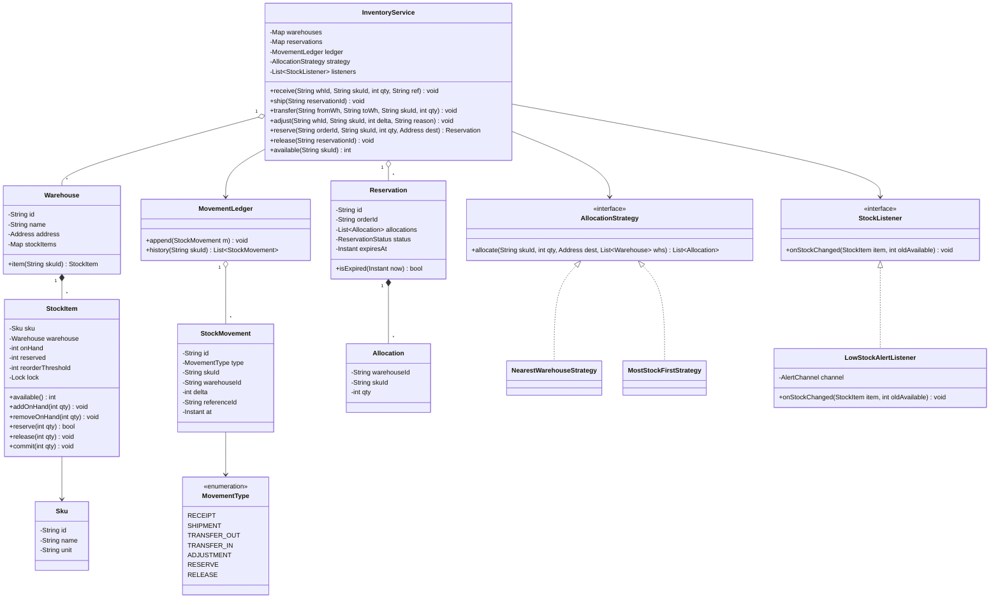
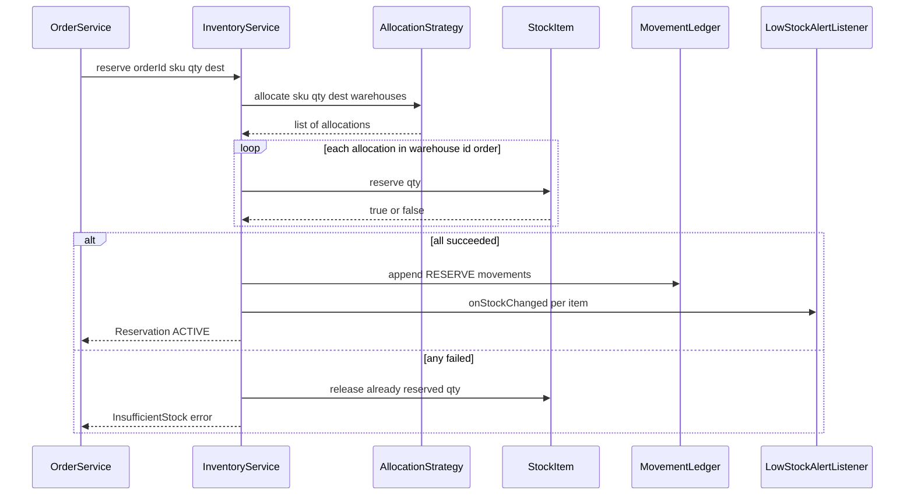
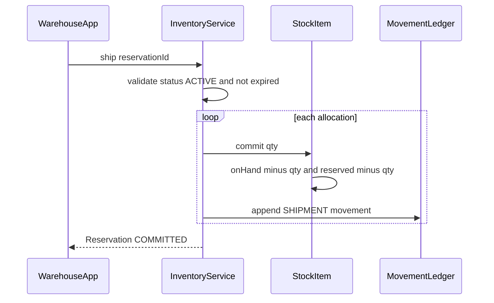

# Inventory Management System

**Category:** Low-Level Design
**Difficulty:** 🟡 Medium
**Seniority:** mid
**Companies:** Amazon, Walmart, Flipkart, Shopify, Target, Ocado
**Tags:** oop, inventory, reservations, observer-pattern, strategy-pattern, concurrency, ledger
**Time:** 45 min

---

## Problem Statement

Design the core object model for an inventory management system used by a retailer with multiple warehouses. The system tracks stock of each SKU per warehouse, records every stock movement (receipt, shipment, transfer, adjustment), lets the order system reserve stock at checkout and later commit or release the reservation, and raises low-stock alerts when available quantity drops below a reorder threshold.

The interviewer wants a clean domain model (SKU, Warehouse, StockItem, StockMovement, Reservation), correct quantity semantics (on-hand vs reserved vs available), an auditable movement ledger, a pluggable warehouse-selection strategy for allocation, and thread-safe updates when many orders hit the same SKU.

## Clarifying Questions

- Single or multiple warehouses? *Multiple warehouses; each SKU can be stocked in many of them.*
- Do we need reservations, or decrement on order placement? *Reserve at checkout, commit on shipment, release on cancel or timeout.*
- Should reservations expire? *Yes, a configurable TTL (default 15 minutes) for unpaid carts.*
- Are lot numbers, serial numbers, or expiry dates tracked? *Out of scope; quantities only, but design should allow batches later.*
- Who gets low-stock alerts and how? *Pluggable listeners: email the buyer, create a purchase-order suggestion.*
- Can one order be split across warehouses? *Yes, if a single warehouse cannot fulfil the whole line.*
- Is the ledger required to be immutable? *Yes; corrections are new adjustment movements, never edits.*

## Requirements

### Functional
- Add/remove SKUs and warehouses; configure per-(SKU, warehouse) reorder threshold.
- Receive stock (inbound), ship stock (outbound), transfer between warehouses, manual adjustments (damage, cycle count).
- Reserve quantity for an order, commit the reservation on shipment, release on cancellation or expiry.
- Query on-hand, reserved, and available quantity per SKU per warehouse and in total.
- Emit low-stock alerts when available quantity crosses below the threshold.
- Full movement history per SKU for audit.

### Non-Functional
- Never oversell: available = onHand - reserved must never go negative.
- Thread-safe under concurrent reservations for hot SKUs.
- Every quantity change is traceable to exactly one StockMovement.
- Extensible: new movement types, allocation strategies, and alert channels without modifying core classes.

### Out of Scope
- Pricing, purchasing workflow, physical bin/location management, distributed multi-node deployment.

## Core Entities

- **InventoryService** → facade; orchestrates receive, ship, transfer, reserve, commit, release.
- **Sku** → id, name, unit of measure, attributes.
- **Warehouse** → id, name, address; owns a map of StockItem by SKU id.
- **StockItem** → (SKU, warehouse) quantities: onHand, reserved, reorderThreshold; enforces invariants; has its own lock.
- **StockMovement** → immutable ledger entry: type, SKU, warehouse, delta, reference id, timestamp.
- **MovementType** → enum: RECEIPT, SHIPMENT, TRANSFER_OUT, TRANSFER_IN, ADJUSTMENT, RESERVE, RELEASE.
- **Reservation** → order id, list of allocations (warehouse, SKU, qty), status, expiresAt.
- **AllocationStrategy** → chooses warehouses to satisfy a requested quantity (nearest, most stock, priority).
- **StockListener** → observer notified on stock changes; LowStockAlertListener is one implementation.
- **MovementLedger** → append-only store of movements; queries by SKU.

## Class Diagram



## Design Patterns

| Pattern | Where | Why |
|---|---|---|
| Facade | `InventoryService` | Single entry point hides warehouses, ledger, and locking from callers (order service, WMS). |
| Strategy | `AllocationStrategy` | Swap warehouse-selection policy (nearest, most stock, cost-based) without touching reservation logic. |
| Observer | `StockListener` / `LowStockAlertListener` | Decouple alerting, replenishment suggestions, and search-index updates from stock mutations. |
| Event Sourcing (light) | `MovementLedger` | Immutable movements give an audit trail and allow rebuilding quantities by replay. |
| Value Object | `StockMovement`, `Allocation` | Immutable, safe to share and log. |

## Key Workflows

### Reserve stock at checkout



The strategy proposes allocations based on a snapshot; each `StockItem.reserve` re-checks availability under its own lock, so a stale snapshot can only cause a clean failure, never an oversell. Locks are acquired in a deterministic order (warehouse id) to prevent deadlocks when an order spans warehouses.

### Ship (commit) a reservation



Commit decreases both onHand and reserved, so available is unchanged — the stock was already unavailable since reservation time.

## Implementation

```text
CLASS StockItem
    FIELDS sku, warehouse, onHand ← 0, reserved ← 0, reorderThreshold, lock

    FUNCTION available()
        RETURN onHand - reserved

    FUNCTION reserve(qty)
        WITH lock
            IF qty <= 0 THEN THROW InvalidQuantity
            IF available() < qty THEN RETURN false
            SET reserved ← reserved + qty
            RETURN true

    FUNCTION release(qty)
        WITH lock
            IF qty > reserved THEN THROW IllegalState
            SET reserved ← reserved - qty

    FUNCTION commit(qty)
        WITH lock
            IF qty > reserved OR qty > onHand THEN THROW IllegalState
            SET reserved ← reserved - qty
            SET onHand ← onHand - qty

    FUNCTION addOnHand(qty)
        WITH lock
            SET onHand ← onHand + qty

    FUNCTION removeOnHand(qty)          // adjustments, transfer-out
        WITH lock
            IF available() < qty THEN THROW InsufficientStock
            SET onHand ← onHand - qty
```

```text
CLASS InventoryService
    FIELDS warehouses: Map<id, Warehouse>, reservations: Map<id, Reservation>,
           ledger, strategy, listeners

    FUNCTION receive(whId, skuId, qty, ref)
        SET item ← warehouses[whId].item(skuId)
        SET before ← item.available()
        item.addOnHand(qty)
        ledger.append(StockMovement(RECEIPT, skuId, whId, +qty, ref))
        notify(item, before)

    FUNCTION reserve(orderId, skuId, qty, dest)
        SET allocations ← strategy.allocate(skuId, qty, dest, warehouses.values())
        IF sum(allocations.qty) < qty THEN THROW InsufficientStock
        SORT allocations BY warehouseId          // deterministic order
        SET done ← empty list
        FOR a IN allocations
            SET item ← warehouses[a.warehouseId].item(skuId)
            SET before ← item.available()
            IF NOT item.reserve(a.qty) THEN
                FOR d IN done                     // compensate
                    warehouses[d.warehouseId].item(skuId).release(d.qty)
                THROW InsufficientStock
            done.add(a)
            notify(item, before)
        SET r ← Reservation(newId(), orderId, allocations, ACTIVE, now() + TTL)
        reservations[r.id] ← r
        FOR a IN allocations
            ledger.append(StockMovement(RESERVE, skuId, a.warehouseId, 0, r.id))
        RETURN r

    FUNCTION release(reservationId)
        SET r ← reservations[reservationId]
        WITH r.lock
            IF r.status != ACTIVE THEN RETURN           // idempotent
            FOR a IN r.allocations
                SET item ← warehouses[a.warehouseId].item(a.skuId)
                SET before ← item.available()
                item.release(a.qty)
                ledger.append(StockMovement(RELEASE, a.skuId, a.warehouseId, 0, r.id))
                notify(item, before)
            SET r.status ← RELEASED

    FUNCTION ship(reservationId)
        SET r ← reservations[reservationId]
        WITH r.lock
            IF r.status != ACTIVE THEN THROW IllegalState
            FOR a IN r.allocations
                warehouses[a.warehouseId].item(a.skuId).commit(a.qty)
                ledger.append(StockMovement(SHIPMENT, a.skuId, a.warehouseId, -a.qty, r.id))
            SET r.status ← COMMITTED

    FUNCTION transfer(fromWh, toWh, skuId, qty)
        SET src ← warehouses[fromWh].item(skuId)
        src.removeOnHand(qty)
        ledger.append(StockMovement(TRANSFER_OUT, skuId, fromWh, -qty, transferId))
        // goods are in transit; TRANSFER_IN is recorded when received at toWh
        warehouses[toWh].item(skuId).addOnHand(qty)   // simplified: instant transfer
        ledger.append(StockMovement(TRANSFER_IN, skuId, toWh, +qty, transferId))

    FUNCTION expireReservations()      // scheduled every 30 seconds
        FOR r IN reservations.values()
            IF r.status = ACTIVE AND r.isExpired(now()) THEN release(r.id)

    FUNCTION notify(item, before)
        FOR l IN listeners
            l.onStockChanged(item, before)
```

```text
CLASS LowStockAlertListener IMPLEMENTS StockListener
    FUNCTION onStockChanged(item, oldAvailable)
        SET now ← item.available()
        // fire only on the downward crossing to avoid alert storms
        IF oldAvailable >= item.reorderThreshold AND now < item.reorderThreshold THEN
            channel.send(LowStockAlert(item.sku.id, item.warehouse.id, now))

CLASS NearestWarehouseStrategy IMPLEMENTS AllocationStrategy
    FUNCTION allocate(skuId, qty, dest, whs)
        SET remaining ← qty, result ← empty list
        FOR wh IN whs SORTED BY distance(wh.address, dest)
            SET take ← min(remaining, wh.item(skuId).available())
            IF take > 0 THEN result.add(Allocation(wh.id, skuId, take))
            SET remaining ← remaining - take
            IF remaining = 0 THEN BREAK
        RETURN result
```

## Concurrency & Extensibility

- **Per-StockItem lock**: contention is scoped to one (SKU, warehouse) pair, so unrelated SKUs never block each other. For very hot SKUs, a lock-free compare-and-set on a packed (onHand, reserved) value, or a database `UPDATE stock SET reserved = reserved + :q WHERE available >= :q` conditional update, gives the same guarantee.
- **Deadlock avoidance**: multi-warehouse reservations lock items in sorted warehouse-id order; each lock is held only for a single item's check-and-update.
- **Idempotency**: `release` and `ship` check reservation status under the reservation lock, so duplicate cancel messages or retries are harmless. Callers pass an idempotency key (order id) to `reserve`.
- **Listeners outside locks**: notifications run after the item lock is released (or via an async queue) so slow alert channels never extend critical sections.
- **Open/Closed**: add a new allocation policy by implementing `AllocationStrategy`; add Slack or purchase-order listeners by implementing `StockListener`; add a new `MovementType` (e.g. RETURN) without changing `StockItem`.
- **Batches/lots later**: replace the scalar `onHand` with a list of `StockLot` (lotId, expiry, qty) and allocate FEFO (first-expiry-first-out) via another strategy.

## Trade-offs

| Decision | Option A | Option B | Choice & Why |
|---|---|---|---|
| When to decrement stock | At order placement | Reserve then commit on shipment | **Reserve/commit** — avoids overselling while allowing cancellations without fake "returns". |
| Quantity storage | Derive from ledger replay every time | Materialized counters + ledger | **Materialized + ledger** — O(1) reads, ledger kept for audit and reconciliation. |
| Lock granularity | Global inventory lock | Per-StockItem lock | **Per-item** — high parallelism; global lock serializes every order. |
| Reservation expiry | Background sweeper | Lazy check on access | **Both** — sweeper frees stock promptly; lazy check guarantees correctness if sweeper lags. |
| Split shipments | Single-warehouse only | Allow splits | **Allow, but prefer single** — strategy tries one warehouse first to minimize shipping cost. |

## Follow-up Questions

1. **How do you prevent oversell across multiple app instances?** Move the check-and-reserve into the database with a conditional atomic update (or Redis Lua script) keyed by (SKU, warehouse); the in-memory lock only works on a single node.
2. **How would you handle a cycle count that finds fewer units than recorded?** Record an ADJUSTMENT movement with the negative delta and reason; if available would go negative, flag the affected reservations for re-allocation.
3. **How do you support bundles/kits (one SKU made of several)?** Model a `BundleSku` with component SKUs and quantities; reserving a bundle reserves all components atomically with the same compensate-on-failure logic.
4. **How do you avoid alert storms when stock oscillates around the threshold?** Fire only on downward crossing and add hysteresis (re-arm only after rising above threshold + margin) or a per-item cooldown.
5. **How would you support flash sales on a single hot SKU?** Pre-shard the stock into N buckets (sub-counters) and reserve from a random bucket, or queue reservations and process them serially in one worker.

## Common Mistakes

- Tracking a single `quantity` field and conflating on-hand with available, which makes cancellations and oversell protection impossible to reason about.
- Check-then-act without a lock: reading `available()` and then decrementing in a separate step causes races.
- Mutating or deleting ledger entries instead of appending corrective movements.
- Locking multiple items in arbitrary order, causing deadlocks on multi-warehouse orders.
- Forgetting reservation expiry, so abandoned carts permanently hold stock.
- Firing alerts synchronously inside the critical section.

## Key Takeaways

- Separate **onHand**, **reserved**, and **available = onHand - reserved**; reserve/commit/release is the heart of the design.
- Every mutation is a typed, immutable `StockMovement` — the ledger is your audit trail and reconciliation source.
- Use Strategy for allocation and Observer for alerts to keep the core small and open for extension.
- Concurrency correctness comes from atomic check-and-update per (SKU, warehouse) plus ordered locking and idempotent state transitions.
