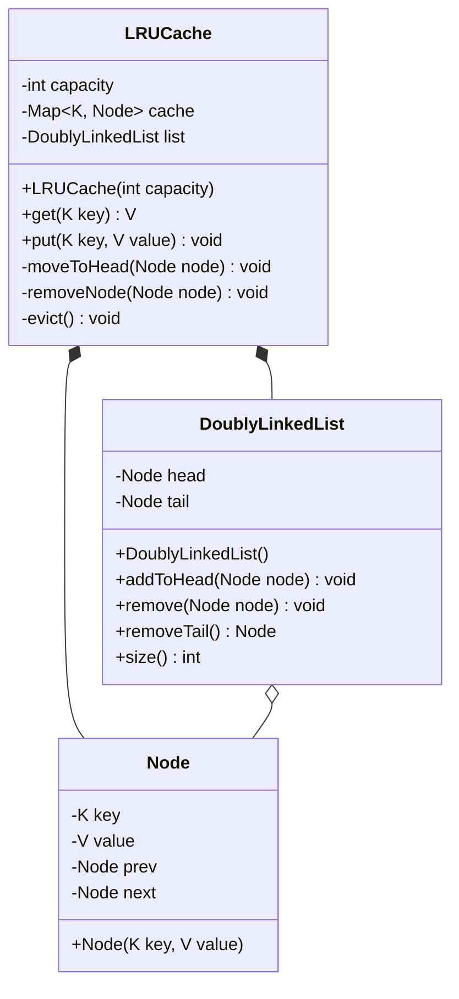
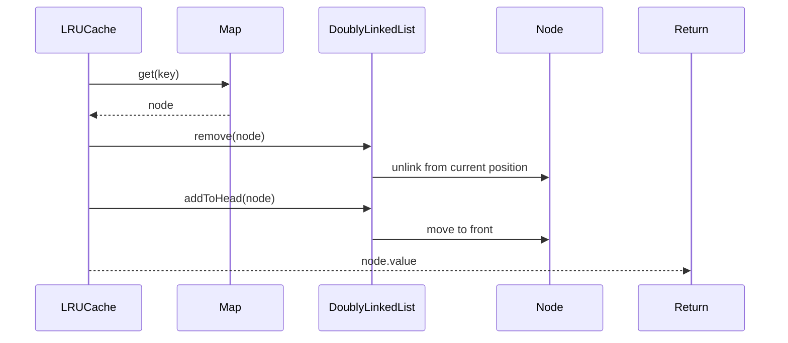
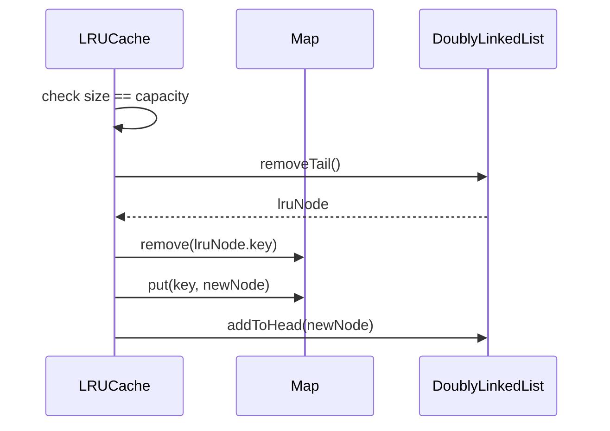

# LRU Cache OOP

**Category:** Low-Level Design
**Difficulty:** 🟢 Easy
**Seniority:** junior
**Companies:** LeetCode, HackerRank
**Tags:** caching, data structures
**Time:** 30-45 min

---

## Problem Statement

Design an LRU (Least Recently Used) cache with O(1) get and put operations. The cache has a fixed capacity; when it reaches capacity, the least recently used item should be evicted before inserting a new item. The cache should support get(key) to retrieve a value and put(key, value) to insert or update a key-value pair.

The interviewer is looking for understanding of the LRU eviction policy, efficient data structure selection (hash map + doubly linked list), and clean OOP design.

## Clarifying Questions

- What is the cache capacity? *Configurable, passed to constructor.*
- What happens on get of non-existent key? *Return null or -1.*
- What happens on put of existing key? *Update the value and mark as recently used.*
- What are the key and value types? *Generic types, or integers for simplicity.*
- Is thread-safety required? *Not for the basic version, but can discuss as follow-up.*
- Should we track statistics (hits, misses, evictions)? *Optional, good for monitoring.*

## Requirements

### Functional
- Initialize cache with given capacity.
- get(key): return value if exists and mark as recently used; otherwise return null.
- put(key, value): insert if key doesn't exist, update if it does; evict LRU if at capacity.
- Evict the least recently used item when capacity is exceeded.

### Non-Functional
- O(1) time complexity for both get and put operations.
- Memory efficient: O(capacity) space.
- Clean, testable OOP design with proper encapsulation.

### Out of Scope
- Thread-safety, persistence, distributed caching, TTL (time-to-live).

## Class Design

- **LRUCache** → main cache class with capacity, hash map, and doubly linked list.
- **Node** → doubly linked list node containing key, value, prev, next pointers.
- **DoublyLinkedList** → wrapper for list operations (add to head, remove, remove tail).
- **CacheEntry** → (optional) value object for key-value pair with metadata.

## Class Diagram



## Key Classes and Relationships

- **LRUCache** is the main class that coordinates the hash map and doubly linked list to provide O(1) operations.
- **Node** represents a cache entry with key, value, and pointers to maintain the doubly linked list structure.
- **DoublyLinkedList** encapsulates list operations (add to head, remove arbitrary node, remove tail) for clean separation of concerns.
- The hash map provides O(1) key lookup; the doubly linked list maintains recency order with head = most recently used, tail = least recently used.

## Design Patterns

| Pattern | Where | Why |
|---|---|---|
| Composite | `DoublyLinkedList` composed of `Node` objects | Encapsulates list operations behind a clean interface. |
| Template Method | (Optional) Base `Cache` class with abstract eviction policy | Allows extending to LFU, FIFO eviction policies. |
| Strategy | (Optional) `EvictionPolicy` interface | Makes eviction policy pluggable (LRU, LFU, FIFO). |

## Key Workflows

### Get operation - cache hit



### Put operation - capacity exceeded, eviction needed



## Implementation

```text
CLASS LRUCache~K, V~
    FIELDS capacity, cache ← HashMap~K, Node~, list ← DoublyLinkedList()

    CONSTRUCTOR LRUCache(capacity)
        THIS.capacity ← capacity

    FUNCTION get(key)
        IF NOT cache.containsKey(key)
            RETURN null
        SET node ← cache.get(key)
        list.remove(node)
        list.addToHead(node)
        RETURN node.value

    FUNCTION put(key, value)
        IF cache.containsKey(key)
            SET node ← cache.get(key)
            node.value ← value
            list.remove(node)
            list.addToHead(node)
            RETURN
        SET newNode ← NEW Node(key, value)
        cache.put(key, newNode)
        list.addToHead(newNode)
        IF list.size() > capacity
            evict()

    FUNCTION evict()
        SET lruNode ← list.removeTail()
        IF lruNode ≠ NULL
            cache.remove(lruNode.key)

CLASS Node~K, V~
    FIELDS key, value, prev ← NULL, next ← NULL

    CONSTRUCTOR Node(key, value)
        THIS.key ← key
        THIS.value ← value

CLASS DoublyLinkedList~K, V~
    FIELDS head ← NULL, tail ← NULL, size ← 0

    FUNCTION addToHead(node)
        node.prev ← NULL
        node.next ← head
        IF head ≠ NULL
            head.prev ← node
        SET head ← node
        IF tail = NULL
            SET tail ← node
        size ← size + 1

    FUNCTION remove(node)
        IF node.prev ≠ NULL
            node.prev.next ← node.next
        ELSE
            SET head ← node.next
        IF node.next ≠ NULL
            node.next.prev ← node.prev
        ELSE
            SET tail ← node.prev
        size ← size - 1

    FUNCTION removeTail()
        IF tail = NULL
            RETURN NULL
        SET node ← tail
        remove(node)
        RETURN node

    FUNCTION size()
        RETURN size
```

## Scalability

- **Thread-safety:** Add `ReentrantLock` or `synchronized` blocks around get/put for concurrent access. Consider read-write locks for better read concurrency.
- **Generic types:** Use Java generics or C++ templates for type flexibility.
- **Statistics tracking:** Add `hitCount`, `missCount`, `evictionCount` fields; increment in get/put/evict; add `getStats()` method.
- **Eviction policy extensibility:** Extract eviction logic into `EvictionPolicy` interface; LRU, LFU, FIFO as implementations.
- **Persistence:** Add `save()` and `load()` methods to serialize cache to disk.
- **Max size in bytes:** Track entry sizes instead of count; evict when total size exceeds limit.

## Error Handling

- **Null keys/values:** Validate inputs; throw `IllegalArgumentException` for null keys or values.
- **Invalid capacity:** Reject zero or negative capacity in constructor; throw `IllegalArgumentException`.
- **Concurrent modification:** Use proper synchronization to prevent race conditions during get/put operations.
- **Memory pressure:** If cache grows too large, consider soft references or explicit eviction policies.
- **Serialization errors:** Handle I/O exceptions gracefully during save/load operations.

## Trade-offs

| Decision | Option A | Option B | Choice & Why |
|---|---|---|---|
| List implementation | Doubly linked list | Singly linked list | Doubly linked: O(1) removal from any position; singly linked requires O(n) to find prev. |
| Map storage | HashMap | LinkedHashMap | HashMap + custom list: more control, educational. LinkedHashMap: built-in LRU support but less flexible. |
| Node structure | Separate Node class | Inline in map | Separate class: cleaner, reusable, easier to extend with metadata. |
| Eviction timing | Before insert | After insert | Before insert: ensures capacity constraint is never violated. |

## Follow-up Questions

1. **How would you make this thread-safe?** Use `ReentrantReadWriteLock` for concurrent reads; `synchronized` for simplicity; consider `ConcurrentHashMap` with careful list coordination.
2. **How would you implement LFU (Least Frequently Used) cache?** Use a HashMap + frequency map + min-heap or TreeMap of frequencies; each access increments frequency.
3. **How would you add TTL (time-to-live) support?** Add timestamp to Node; use a background thread or lazy expiration check on get; use a priority queue ordered by expiration time.
4. **How would you handle very large values (cache by size, not count)?** Track byte size of each entry; evict when total size exceeds capacity; use approximate size for efficiency.
5. **How would you add cache statistics?** Add counters for hits, misses, evictions; provide `getHitRate()` method; expose via JMX or HTTP endpoint.

## Common Mistakes

- Using singly linked list instead of doubly linked (can't remove arbitrary node in O(1)).
- Forgetting to move node to head on get operation (doesn't mark as recently used).
- Evicting after insert instead of before (can temporarily exceed capacity).
- Not handling the case where cache capacity is 0.
- Using ArrayList instead of linked list (O(n) removal).
- Not updating the value when putting an existing key.

## Key Takeaways

- LRU cache requires O(1) access and O(1) eviction → HashMap + doubly linked list.
- The hash map provides O(1) lookup; the doubly linked list maintains recency order.
- Most recently used = head of list; least recently used = tail of list.
- On get: move to head. On put: if exists, update and move to head; if new, add to head and evict tail if needed.
- Clean separation between cache logic and list operations improves testability.
