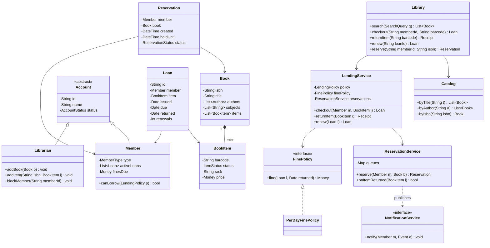
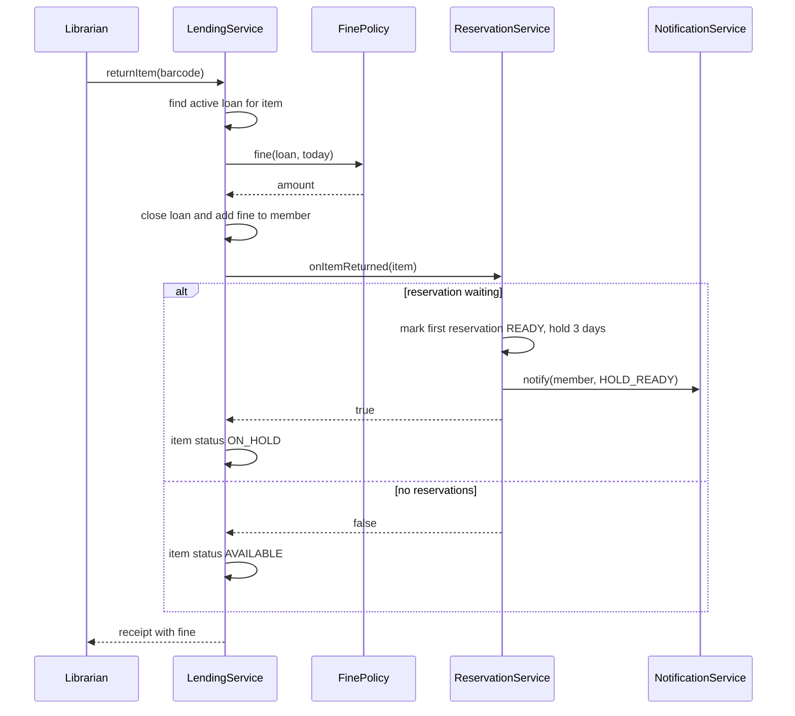

# Library Management System

**Category:** Low-Level Design
**Difficulty:** 🟢 Easy
**Seniority:** mid
**Companies:** Amazon, Microsoft, Oracle, Adobe, Salesforce, Atlassian
**Tags:** oop, observer-pattern, strategy-pattern, search, reservations, solid
**Time:** 45 min

---

## Problem Statement

Design a library management system. Members search the catalog, borrow and return physical copies, renew loans, and place holds on books that are currently checked out. Librarians add books and copies, manage members, and the system charges fines for overdue returns and notifies members when holds become available.

The key modeling insight is separating the abstract **Book** (title, ISBN) from the physical **BookItem** (a specific copy with a barcode), and modeling loans and reservations as first-class entities with lifecycles.

## Clarifying Questions

- Do we distinguish a title from its copies? *Yes — one Book (ISBN) has many BookItems (barcodes).*
- Borrowing limits? *Max 5 active loans per member; loan period 14 days.*
- Renewals? *Up to 2 renewals, only if no one else holds a reservation.*
- Fines? *0.25 dollars per day overdue, capped at the item's price; members with fines over 10 dollars can't borrow.*
- Reservations? *FIFO queue per Book; when a copy is returned it's held for the first member for 3 days.*
- Search by? *Title, author, subject, ISBN.*
- Notifications? *Email/SMS for due-soon, overdue, and hold-available.*
- Multiple branches? *Single branch initially.*

## Requirements

### Functional
- Librarian: add/remove books and copies, register/block members.
- Member: search catalog, check out, return, renew, reserve, cancel reservation.
- Compute and collect fines for overdue items.
- Notify members of due dates, overdue items, and available holds.

### Non-Functional
- A copy can never be lent to two members (consistency on checkout).
- Search should be fast over ~1M titles (indexed lookups).
- Policies (loan period, fine rate, limits) configurable per member type.

### Out of Scope
- Inter-library loans, e-books/DRM, acquisitions/purchasing.

## Core Entities

- **Library** → facade exposing catalog, lending, and reservation services.
- **Book** → ISBN, title, authors, subjects; has many BookItems.
- **BookItem** → barcode, status (AVAILABLE, LOANED, ON_HOLD, LOST), rack location.
- **Account** (abstract) → Member and Librarian with different permissions.
- **Member** → active loans, outstanding fines, membership type.
- **Loan** → member, book item, issue date, due date, return date, renewals.
- **Reservation** → member, book, created time, status (WAITING, READY, FULFILLED, EXPIRED, CANCELLED).
- **Catalog** → search indexes by title, author, subject, ISBN.
- **LendingService** → checkout/return/renew rules.
- **FinePolicy** → computes fine for a loan.
- **NotificationService** → observer that sends emails/SMS.

## Class Diagram



## Design Patterns

| Pattern | Where | Why |
|---|---|---|
| Strategy | `FinePolicy`, `LendingPolicy` per `MemberType` | Students, faculty, and staff get different loan periods, limits, and fine rates without branching. |
| Observer | Loan/Reservation events → `NotificationService` | Email/SMS/push channels subscribe independently; lending logic doesn't know about channels. |
| Facade | `Library` | Single entry point hides catalog, lending, and reservation services. |
| State (light) | `ItemStatus` / `ReservationStatus` transitions | Explicit allowed transitions prevent e.g. lending a LOST item. |
| Factory | `AccountFactory` | Create Member/Librarian with correct permissions. |

## Key Workflows

### Return a book that has a waiting reservation



### Checkout

A member brings a copy to the desk: the system checks the member is active, below the loan limit, under the fine threshold, and that the item is AVAILABLE (or ON_HOLD for this same member). It then atomically flips the item to LOANED and creates a `Loan` with due date = today + policy period.

## Implementation

```text
CLASS LendingService
    FIELDS policyFor (MemberType -> LendingPolicy), finePolicy, reservations, loansByItem, events

    FUNCTION checkout(member, item)
        SET policy ← policyFor[member.type]
        IF member.status ≠ ACTIVE                         THROW AccountBlocked
        IF member.activeLoans.size() ≥ policy.maxLoans    THROW LoanLimitReached
        IF member.finesDue > policy.maxFineToBorrow       THROW OutstandingFines
        LOCK item
            IF item.status = ON_HOLD AND NOT reservations.isHeldFor(item, member)
                THROW ItemReservedForAnother
            IF item.status NOT IN {AVAILABLE, ON_HOLD}
                THROW ItemUnavailable
            SET item.status ← LOANED
        UNLOCK item
        reservations.fulfillIfHeld(item, member)
        SET loan ← NEW Loan(uuid(), member, item, today(), today() + policy.loanDays, renewals ← 0)
        member.activeLoans.add(loan)
        loansByItem[item.barcode] ← loan
        RETURN loan

    FUNCTION returnItem(item)
        SET loan ← loansByItem.remove(item.barcode)
        IF loan = NULL  THROW NoActiveLoan
        SET loan.returned ← today()
        SET fine ← finePolicy.fine(loan, loan.returned)
        SET loan.member.finesDue ← loan.member.finesDue + fine
        loan.member.activeLoans.remove(loan)
        IF reservations.onItemReturned(item)
            SET item.status ← ON_HOLD
        ELSE
            SET item.status ← AVAILABLE
        RETURN NEW Receipt(loan, fine)

    FUNCTION renew(loan)
        SET policy ← policyFor[loan.member.type]
        IF loan.renewals ≥ policy.maxRenewals          THROW RenewalLimit
        IF today() > loan.due                          THROW OverdueCannotRenew
        IF reservations.hasWaiting(loan.item.book)     THROW ReservedByOthers
        SET loan.due ← loan.due + policy.loanDays
        SET loan.renewals ← loan.renewals + 1
        RETURN loan

CLASS PerDayFinePolicy IMPLEMENTS FinePolicy
    FIELDS ratePerDay
    FUNCTION fine(loan, returned)
        SET days ← max(0, daysBetween(loan.due, returned))
        RETURN min(days * ratePerDay, loan.item.price)

CLASS ReservationService
    FIELDS queues (isbn -> FIFO queue of Reservation), heldItems (barcode -> Reservation)

    FUNCTION reserve(member, book)
        IF book has an AVAILABLE item  THROW JustBorrowIt
        SET r ← NEW Reservation(member, book, now(), WAITING)
        queues[book.isbn].enqueue(r)
        RETURN r

    FUNCTION onItemReturned(item)
        SET q ← queues[item.book.isbn]
        WHILE q NOT empty
            SET r ← q.dequeue()
            IF r.status = WAITING
                SET r.status ← READY
                SET r.holdUntil ← now() + 3 days
                heldItems[item.barcode] ← r
                events.publish(HOLD_READY, r.member, item)
                RETURN true
        RETURN false

    // Scheduled daily job
    FUNCTION expireHolds()
        FOR (barcode, r) IN heldItems
            IF now() > r.holdUntil
                SET r.status ← EXPIRED
                heldItems.remove(barcode)
                IF NOT onItemReturned(item(barcode))   // pass to next in line
                    SET item(barcode).status ← AVAILABLE
```

## Concurrency & Extensibility

- **Double checkout:** two desks scanning the same barcode is unlikely physically, but online "click to reserve" can race. Guard the item's status transition with a per-item lock or, in a DB, a conditional update: `UPDATE item SET status='LOANED' WHERE barcode=? AND status='AVAILABLE'` and check affected rows.
- **Reservation queue:** per-ISBN queue protected by a lock; return processing and reservation creation for the same book serialize on it.
- **Member limits:** check-then-act on `activeLoans.size()` must happen under a per-member lock (or DB transaction) to prevent exceeding the limit with concurrent checkouts.
- **New member types:** add a `LendingPolicy` entry; no code changes in `LendingService`.
- **New media types (DVDs, magazines):** generalize `Book` to `CatalogItem` with subclasses; `BookItem` becomes `CopyItem`. Non-lendable reference items get a policy with `maxLoans = 0`.
- **Search at scale:** back `Catalog` with a relational DB for ISBN lookups and Elasticsearch for full-text title/author/subject search.

## Trade-offs

| Decision | Option A | Option B | Choice & Why |
|---|---|---|---|
| Book vs copy | One `Book` class with a count | `Book` + `BookItem` per copy | Separate: each copy has its own status, location, loan history, and condition. |
| Reservation target | Reserve a specific copy | Reserve the title (ISBN) | Title: member wants any copy; the first returned copy satisfies the queue. |
| Fine computation | Daily batch job accrues fines | Compute on return | On return (plus display-time estimate): simpler, no batch drift; batch only for reports and overdue notices. |
| Policies | Constants in code | Strategy per member type | Strategy: policies differ per member type and change over time. |
| Notifications | Synchronous in return flow | Async events via queue | Async: a failing email provider must not block returns. |

## Follow-up Questions

1. **How do you support multiple branches?** Add `Branch` to `BookItem`; reservations specify a pickup branch; transfers become a new item status IN_TRANSIT.
2. **How do you handle lost books?** Mark the item LOST after N days overdue, charge replacement cost, close the loan, and remove it from availability.
3. **How would you send due-date reminders?** Daily scheduler queries loans with `due = today + 2` and publishes DUE_SOON events to the notification service.
4. **How do you prevent a member from hoarding holds?** Cap active reservations per member in `LendingPolicy`.
5. **How do you model fine payments?** A `Payment` entity linked to member with a ledger of charges and payments; `finesDue` is derived from the ledger for auditability.

## Common Mistakes

- Conflating Book and BookItem, making per-copy status impossible.
- Putting checkout logic in `Member` or `BookItem` instead of a service that sees both.
- Allowing renewal when others are waiting in the reservation queue.
- Forgetting hold expiration so a returned copy is stuck ON_HOLD forever.
- Hard-coding loan periods and fine rates.
- Ignoring the check-then-act race on item status.

## Key Takeaways

- Distinguish abstract catalog entries from physical copies.
- Model Loan and Reservation as entities with explicit lifecycles.
- Put rules in services and policies (Strategy); keep entities mostly data.
- Use events (Observer) to decouple notifications from core lending logic.
