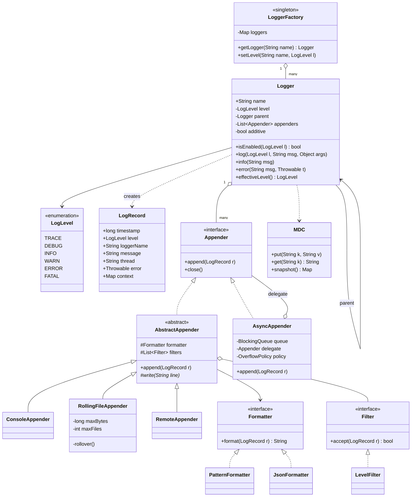
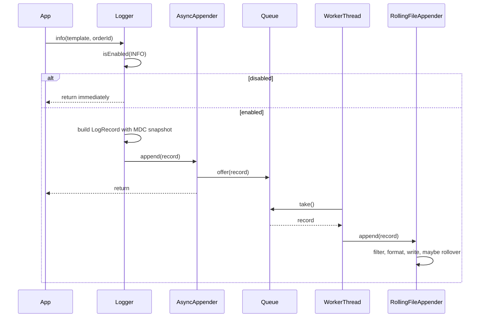
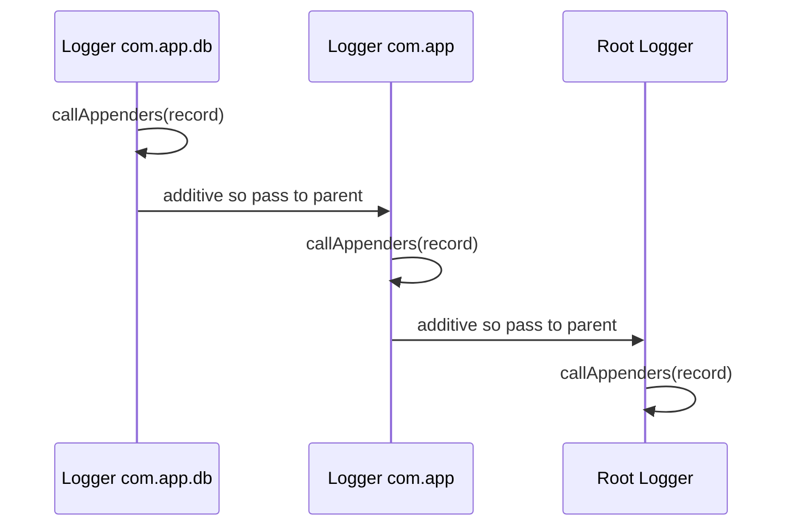

# Logging Framework

**Category:** Low-Level Design
**Difficulty:** 🟡 Medium
**Seniority:** mid
**Companies:** Amazon, Microsoft, Google, Uber, Salesforce, Atlassian
**Tags:** oop, chain-of-responsibility, singleton, strategy-pattern, async-io, thread-safety
**Time:** 45 min

---

## Problem Statement

Design a reusable logging library similar to Log4j, SLF4J/Logback or Python's `logging` module. Application code obtains a named logger and calls `debug`, `info`, `warn`, `error` and `fatal`. Messages below the configured level are dropped; others are formatted and written to one or more destinations (console, file, remote service).

The interviewer wants to see a clear separation between loggers, levels, formatters and appenders (sinks), a hierarchical logger configuration, thread safety, and an asynchronous mode that keeps logging off the hot path.

## Clarifying Questions

- Which log levels? *TRACE, DEBUG, INFO, WARN, ERROR, FATAL, ordered by severity.*
- Multiple destinations per logger? *Yes — console, rolling file, and remote (e.g. HTTP/Kafka) at once.*
- Hierarchical loggers like `com.app.db` inheriting from `com.app`? *Yes, with level and appender inheritance.*
- Configurable at runtime? *Yes, levels can change without restart; config from file or code.*
- Sync or async? *Both; async with a bounded queue is the default for production.*
- What if the queue is full? *Configurable: block, drop lowest-level messages, or drop and count.*
- Structured logging? *Support key-value context (MDC) and JSON formatting.*

## Requirements

### Functional

- `LoggerFactory.getLogger(name)` returns a cached logger for a dotted name.
- Log at levels TRACE to FATAL; filter by effective level.
- Multiple appenders per logger, each with its own formatter and optional minimum level.
- Formatters: pattern (`%d %level [%thread] %logger - %msg`) and JSON.
- Rolling file appender by size/time.
- Mapped Diagnostic Context (MDC) for per-thread context such as request ID.
- Runtime reconfiguration of levels.

### Non-Functional

- Very low overhead when a level is disabled (a single comparison, no string building).
- Thread-safe; log lines from different threads must not interleave mid-line.
- Async mode must not block the caller under normal load.
- A failing appender must not crash the application.

### Out of Scope

- Log aggregation backend (ELK/Loki), log search, distributed tracing.

## Core Entities

- **LogLevel** → ordered enum with numeric severity.
- **LogRecord** → immutable event: timestamp, level, logger name, message, thread, exception, MDC snapshot.
- **Logger** → named; checks effective level, builds `LogRecord`, dispatches to appenders up the hierarchy.
- **LoggerFactory / LoggerRegistry** → singleton cache of loggers, builds the name hierarchy.
- **Appender** → destination (Console, File, RollingFile, Remote); has a `Formatter` and `Filter`s.
- **AsyncAppender** → decorator that queues records and drains them on a background thread.
- **Formatter** → converts `LogRecord` to string/bytes (Pattern, JSON).
- **Filter** → accepts/rejects records (level threshold, regex, marker).
- **MDC** → thread-local map of context key-values.
- **Configuration** → loads config and wires levels/appenders.

## Class Diagram



## Design Patterns

| Pattern | Where | Why |
|---|---|---|
| Singleton | `LoggerFactory` / registry | One global registry so the same name returns the same logger instance. |
| Chain of Responsibility | Logger hierarchy (child → parent appenders) and filter chain | Records propagate up the hierarchy; each filter can reject. |
| Strategy | `Formatter`, overflow policy | Swap pattern vs JSON format, block vs drop policy. |
| Decorator | `AsyncAppender` wrapping any appender | Adds async buffering without changing concrete appenders. |
| Template Method | `AbstractAppender.append` → `write` | Common filter/format flow; subclasses implement only the I/O. |
| Observer | Appenders subscribed to a logger | Fan out one event to many sinks. |

## Key Workflows

### Log call in async mode



The caller only pays for the level check, record creation and a queue offer. Formatting and I/O happen on the worker thread.

### Hierarchical dispatch



## Implementation

```text
ENUM LogLevel { TRACE=0, DEBUG=1, INFO=2, WARN=3, ERROR=4, FATAL=5 }

CLASS LoggerFactory                              // Singleton
    FIELDS loggers : ConcurrentMap<String, Logger>, root : Logger

    FUNCTION getLogger(name)
        RETURN loggers.computeIfAbsent(name, n -> createWithParent(n))

    FUNCTION createWithParent(name)
        SET parentName ← substringBeforeLast(name, ".")
        SET parent ← root IF parentName IS EMPTY ELSE getLogger(parentName)
        RETURN NEW Logger(name, parent)

    FUNCTION setLevel(name, level)
        getLogger(name).level ← level
        invalidateEffectiveLevelCache()          // children recompute lazily

CLASS Logger
    FIELDS name, level (nullable, volatile), parent, appenders (copy-on-write list),
           additive ← true, cachedEffective (volatile)

    FUNCTION effectiveLevel()
        IF cachedEffective IS NOT NULL THEN RETURN cachedEffective
        SET node ← this
        WHILE node.level IS NULL
            SET node ← node.parent
        SET cachedEffective ← node.level
        RETURN cachedEffective

    FUNCTION isEnabled(lvl)
        RETURN lvl >= effectiveLevel()

    FUNCTION log(lvl, template, args, error)
        IF NOT isEnabled(lvl) THEN RETURN        // cheap fast path
        SET rec ← NEW LogRecord(now(), lvl, name, template, args,
                                currentThread().name, error, MDC.snapshot())
        SET node ← this
        WHILE node IS NOT NULL
            FOR a IN node.appenders
                TRY a.append(rec)
                CATCH e: reportInternalError(e)  // never crash the app
            IF NOT node.additive THEN BREAK
            SET node ← node.parent

ABSTRACT CLASS AbstractAppender IMPLEMENTS Appender
    FIELDS formatter, filters, lock

    FUNCTION append(rec)
        FOR f IN filters
            IF NOT f.accept(rec) THEN RETURN
        SET line ← formatter.format(rec)         // message args resolved lazily here
        WITH lock                                 // whole line written atomically
            write(line)

    ABSTRACT FUNCTION write(line)

CLASS RollingFileAppender EXTENDS AbstractAppender
    FIELDS path, maxBytes, maxFiles, out, bytesWritten

    FUNCTION write(line)
        IF bytesWritten + len(line) > maxBytes THEN rollover()
        out.write(line + "\n")
        SET bytesWritten ← bytesWritten + len(line) + 1

    FUNCTION rollover()
        out.close()
        FOR i FROM maxFiles-1 DOWN TO 1
            rename(path + "." + i, path + "." + (i+1))   // oldest overwritten
        rename(path, path + ".1")
        SET out ← open(path)
        SET bytesWritten ← 0

CLASS AsyncAppender IMPLEMENTS Appender
    FIELDS queue : BoundedBlockingQueue(capacity 8192), delegate, policy, dropped : AtomicLong

    FUNCTION append(rec)
        IF queue.offer(rec) THEN RETURN
        IF policy == BLOCK THEN queue.put(rec)
        ELSE IF policy == DROP_BELOW_WARN AND rec.level < WARN THEN dropped.increment()
        ELSE queue.put(rec)                      // never drop errors

    FUNCTION workerLoop()                        // background daemon thread
        WHILE running OR queue NOT EMPTY
            SET rec ← queue.poll(timeout 100ms)
            IF rec IS NOT NULL THEN delegate.append(rec)

    FUNCTION close()
        SET running ← false
        join worker; delegate.close()            // flush on shutdown
```

## Concurrency & Extensibility

- **Lock-free reads:** levels are `volatile`; appender lists are copy-on-write, so the hot path never locks. Only the actual write is serialized per appender to avoid interleaved lines.
- **MDC:** a thread-local map; the record captures a snapshot so async workers see the caller's context. Thread pools must propagate/clear MDC per task.
- **Async back-pressure:** a bounded queue prevents OOM; drop policies keep WARN/ERROR while shedding DEBUG. Expose `dropped` as a metric.
- **Shutdown:** register a shutdown hook to drain queues and flush file buffers; otherwise the last logs before a crash are lost.
- **Lazy formatting:** pass templates with args (`"user {}"`) instead of concatenated strings so disabled logs cost nothing.
- **Open/Closed:** new sinks extend `AbstractAppender` and implement only `write`; new formats implement `Formatter`; new filters implement `Filter`; all wired via configuration without touching `Logger`.

## Trade-offs

| Decision | Option A | Option B | Choice & Why |
|---|---|---|---|
| Delivery mode | Synchronous writes | Async queue + worker | Async by default — removes I/O latency from requests; sync for tests/crash-critical logs. |
| Queue full | Block caller | Drop low-level records | Drop DEBUG/INFO, block on ERROR — protects latency without losing important logs. |
| Level lookup | Walk hierarchy every call | Cache effective level | Cache with invalidation on config change — hot path is one comparison. |
| Message building | Eager string concat | Parameterized lazy format | Lazy — zero cost when disabled. |
| Thread safety | Global lock | Per-appender lock + immutable records | Per-appender — independent sinks do not contend. |

## Follow-up Questions

1. **How do you guarantee logs survive a crash?** Use sync mode or flush on ERROR/FATAL, and a shutdown hook that drains the async queue; for strict needs, write to a local file and ship with an agent (Fluent Bit).
2. **How would you implement time-based rollover?** Compute the next rollover boundary (e.g. midnight) and check on each write; rename with a date suffix and delete files older than the retention.
3. **How would you send logs to a remote service efficiently?** Batch records (by count or 1s interval), compress, send asynchronously with retries and a local spill-to-disk buffer.
4. **How do you avoid blocking with a slow disk?** The async appender isolates callers; consider a lock-free ring buffer (LMAX Disruptor, as in Log4j2) for higher throughput.
5. **How do you change levels at runtime?** Watch the config file or expose an admin endpoint that calls `setLevel` and invalidates cached effective levels.

## Common Mistakes

- Building the log message string before checking whether the level is enabled.
- Making `Logger` responsible for formatting and writing to files (no separation of concerns).
- Using an unbounded async queue, which can exhaust memory under load.
- Letting an appender exception propagate into application code.
- Forgetting to flush/drain on shutdown.

## Key Takeaways

- Separate Logger (filtering, hierarchy), Appender (destination), Formatter (layout) and Filter.
- The disabled-level fast path must be a single comparison.
- Async appender as a Decorator with a bounded queue and an explicit overflow policy.
- Thread safety comes from immutable records, volatile config and per-appender write locks.
