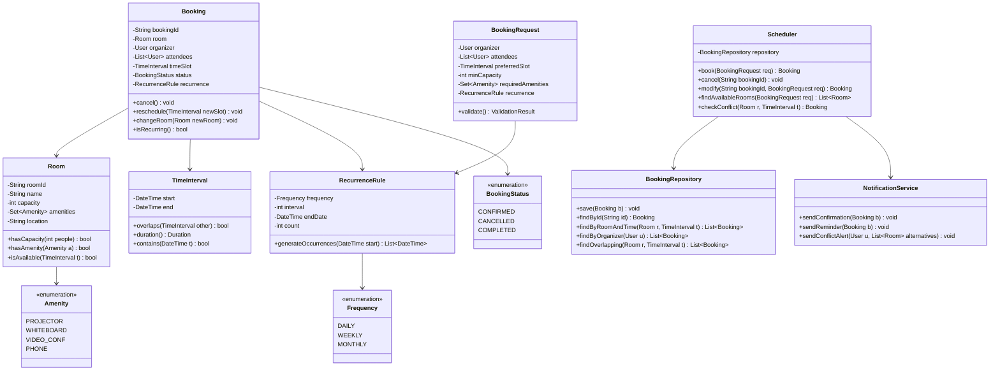
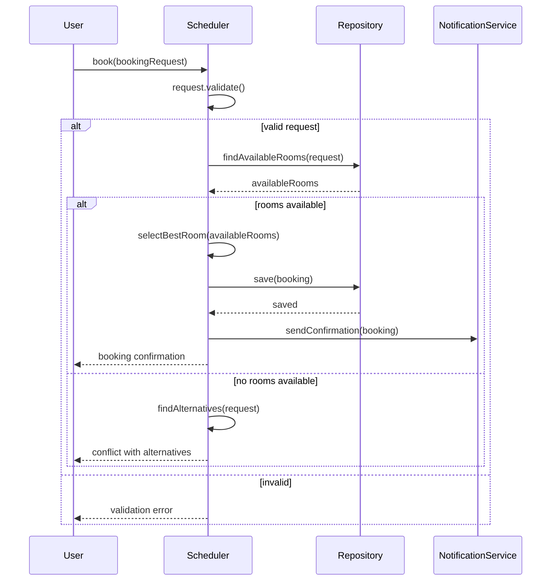
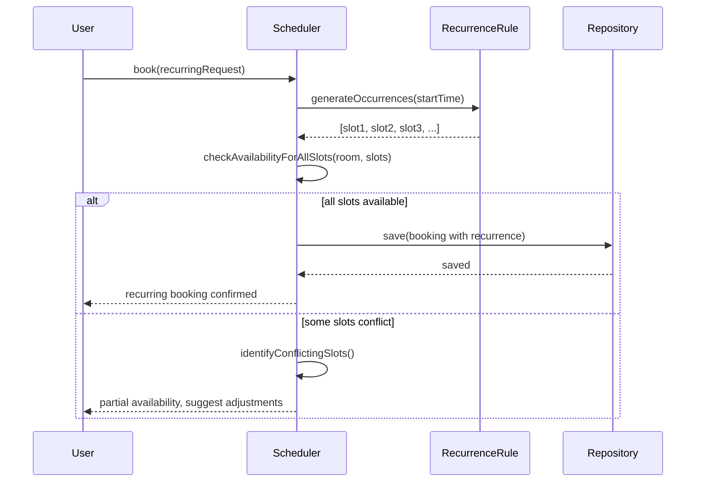
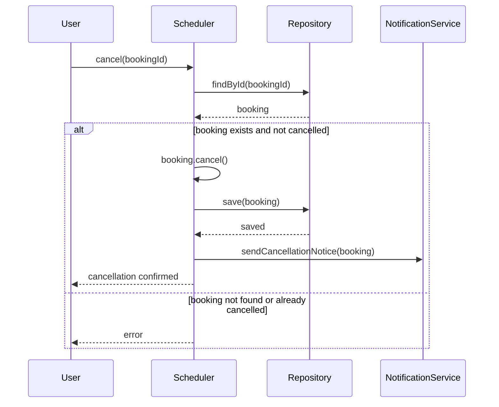

# Meeting Room Scheduler

**Category:** Low-Level Design
**Difficulty:** 🟡 Medium
**Seniority:** mid
**Companies:** Common interview question
**Tags:** scheduling, validation, patterns
**Time:** 45-60 min

---

## Problem Statement

Design a meeting room scheduler system. Employees can book meeting rooms for specific time slots, view availability, cancel bookings, and get conflict notifications. The system must handle multiple rooms with different capacities and amenities, prevent double bookings, and support recurring meetings.

The interviewer is looking for clean time interval handling, conflict detection logic, support for recurring meetings, and proper handling of edge cases like overlapping bookings, cancellations, and room capacity constraints.

## Clarifying Questions

- How many rooms and what types? *Multiple rooms with different capacities (small: 2-4, medium: 5-10, large: 10+) and amenities (projector, whiteboard, video conferencing).*
- What time granularity? *30-minute slots; bookings can start and end at any time.*
- How are conflicts handled? *Prevent double bookings; show available alternatives on conflict.*
- What meeting types? *One-time and recurring (daily, weekly, monthly).*
- Can bookings be modified? *Yes, reschedule time, change room, cancel.*
- Who can book? *Any employee; no approval workflow required.*
- Do we need notifications? *Yes, email reminders and conflict alerts.*
- What about time zones? *All times in a single time zone for simplicity.*

## Requirements

### Functional
- Book a room for a specific time slot.
- Check room availability for a given time range.
- Cancel a booking.
- Modify booking (time, room).
- Support recurring meetings (daily, weekly, monthly).
- Find available rooms given capacity and amenity requirements.
- View calendar of bookings per room.
- Handle booking conflicts with alternative suggestions.

### Non-Functional
- Fast conflict detection (should not scan all bookings).
- No double bookings allowed.
- Support concurrent booking requests.
- Recurring meeting expansion should be efficient.
- Clean time interval handling (no overlapping edge cases).

### Out of Scope
- User authentication, calendar integration (Outlook/Google), room maintenance scheduling, attendance tracking.

## Core Entities

- **Room** → id, name, capacity, amenities, location.
- **Booking** → id, room, organizer, attendees, startTime, endTime, status, recurrence rule.
- **RecurrenceRule** → frequency, interval, endDate, count.
- **BookingRequest** → room preferences, time range, attendees, recurrence.
- **Scheduler** → manages bookings, checks conflicts, finds available rooms.
- **BookingRepository** → persists bookings.
- **NotificationService** → sends reminders and conflict alerts.

## Class Diagram



## Design Patterns

| Pattern | Where | Why |
|---|---|---|
| Strategy | RecurrenceRule frequency strategies | Different recurrence algorithms (daily, weekly, monthly) without changing Booking. |
| Repository | BookingRepository | Abstract persistence; easy to swap DB implementations. |
| Factory | BookingFactory.create(request) | Create Booking with proper validation from request. |
| Observer | NotificationService on booking changes | Decouple booking logic from notification logic. |
| Iterator | RecurrenceRule.generateOccurrences() | Generate recurring slots lazily or on-demand. |
| Command | Booking actions (book, cancel, modify) | Undo/redo support, audit logging. |

## Key Workflows

### Book a room with conflict detection



### Recurring meeting booking



### Cancel booking



## Implementation

```text
ENUM Amenity { PROJECTOR, WHITEBOARD, VIDEO_CONF, PHONE }
ENUM BookingStatus { CONFIRMED, CANCELLED, COMPLETED }
ENUM Frequency { DAILY, WEEKLY, MONTHLY }

CLASS TimeInterval
    FIELDS start, end

    FUNCTION overlaps(other)
        RETURN start < other.end AND end > other.start

    FUNCTION contains(timestamp)
        RETURN start ≤ timestamp AND timestamp < end

    FUNCTION duration()
        RETURN end - start

    FUNCTION isValid()
        RETURN end > start

CLASS Room
    FIELDS roomId, name, capacity, amenities, location

    FUNCTION hasCapacity(people)
        RETURN capacity ≥ people

    FUNCTION hasAmenity(amenity)
        RETURN amenities.contains(amenity)

    FUNCTION hasAllAmenities(required)
        RETURN required.isSubsetOf(amenities)

CLASS RecurrenceRule
    FIELDS frequency, interval ← 1, endDate ← NULL, count ← NULL

    FUNCTION generateOccurrences(start)
        SET occurrences ← []
        SET current ← start
        WHILE shouldContinue(current, occurrences.size())
            occurrences.add(current)
            current ← nextOccurrence(current)
        RETURN occurrences

    FUNCTION shouldContinue(current, generatedCount)
        IF endDate ≠ NULL AND current ≥ endDate
            RETURN false
        IF count ≠ NULL AND generatedCount ≥ count
            RETURN false
        RETURN true

    FUNCTION nextOccurrence(current)
        SWITCH frequency
            CASE DAILY
                RETURN current + interval DAYS
            CASE WEEKLY
                RETURN current + interval * 7 DAYS
            CASE MONTHLY
                RETURN current + interval MONTHS

CLASS Booking
    FIELDS bookingId, room, organizer, attendees, timeSlot, status ← CONFIRMED
    FIELDS recurrence ← NULL

    FUNCTION cancel()
        SET status ← CANCELLED

    FUNCTION reschedule(newSlot)
        SET timeSlot ← newSlot

    FUNCTION changeRoom(newRoom)
        SET room ← newRoom

    FUNCTION isRecurring()
        RETURN recurrence ≠ NULL

CLASS BookingRequest
    FIELDS organizer, attendees, preferredSlot, minCapacity, requiredAmenities
    FIELDS recurrence ← NULL

    FUNCTION validate()
        IF NOT preferredSlot.isValid()
            RETURN ValidationResult.fail("Invalid time slot")
        IF attendees.size() > minCapacity
            RETURN ValidationResult.fail("Capacity mismatch")
        IF recurrence ≠ NULL AND NOT recurrence.isValid()
            RETURN ValidationResult.fail("Invalid recurrence rule")
        RETURN ValidationResult.ok()

CLASS Scheduler
    FIELDS repository, notificationService

    FUNCTION book(request)
        SET validation ← request.validate()
        IF NOT validation.ok
            THROW ValidationException(validation.message)

        SET availableRooms ← findAvailableRooms(request)
        IF availableRooms.isEmpty()
            SET alternatives ← findAlternativeRooms(request)
            THROW NoAvailableRoomException(alternatives)

        SET room ← selectBestRoom(availableRooms, request)
        SET booking ← NEW Booking(uuid(), room, request.organizer, request.attendees, request.preferredSlot, request.recurrence)

        // Handle recurring meetings
        IF booking.isRecurring()
            SET slots ← booking.recurrence.generateOccurrences(request.preferredSlot.start)
            FOR slot IN slots
                SET slotInterval ← NEW TimeInterval(slot, slot + request.preferredSlot.duration())
                IF NOT isRoomAvailable(room, slotInterval)
                    THROW PartialAvailabilityException(slots, slotInterval)
            // Create individual bookings for each occurrence
            FOR slot IN slots
                SET slotInterval ← NEW TimeInterval(slot, slot + request.preferredSlot.duration())
                SET occurrenceBooking ← NEW Booking(uuid(), room, request.organizer, request.attendees, slotInterval, NULL)
                repository.save(occurrenceBooking)
        ELSE
            repository.save(booking)

        notificationService.sendConfirmation(booking)
        RETURN booking

    FUNCTION findAvailableRooms(request)
        SET allRooms ← repository.findAllRooms()
        SET available ← []
        FOR room IN allRooms
            IF room.hasCapacity(request.minCapacity) AND room.hasAllAmenities(request.requiredAmenities)
                IF isRoomAvailable(room, request.preferredSlot)
                    available.add(room)
        RETURN available

    FUNCTION isRoomAvailable(room, timeSlot)
        SET existing ← repository.findOverlapping(room, timeSlot)
        FOR booking IN existing
            IF booking.status = CONFIRMED
                RETURN false
        RETURN true

    FUNCTION checkConflict(room, timeSlot)
        SET overlapping ← repository.findOverlapping(room, timeSlot)
        FOR booking IN overlapping
            IF booking.status = CONFIRMED
                RETURN booking
        RETURN NULL

    FUNCTION cancel(bookingId)
        SET booking ← repository.findById(bookingId)
        IF booking = NULL
            THROW BookingNotFoundException
        IF booking.status = CANCELLED
            THROW AlreadyCancelledException
        booking.cancel()
        repository.save(booking)
        notificationService.sendCancellationNotice(booking)

    FUNCTION modify(bookingId, request)
        SET booking ← repository.findById(bookingId)
        IF booking = NULL
            THROW BookingNotFoundException

        // Check availability for new time/room
        IF request.preferredSlot ≠ booking.timeSlot OR request.minCapacity ≠ booking.room.capacity
            SET available ← findAvailableRooms(request)
            IF available.isEmpty()
                THROW NoAvailableRoomException(findAlternativeRooms(request))
            SET booking.room ← selectBestRoom(available, request)
            SET booking.timeSlot ← request.preferredSlot

        repository.save(booking)
        notificationService.sendModificationNotice(booking)
        RETURN booking

    FUNCTION findAlternativeRooms(request)
        // Try nearby time slots or different rooms
        SET alternatives ← []
        // Try ±30 minutes, ±1 hour
        FOR offset IN [-60, -30, 30, 60] MINUTES
            SET adjustedSlot ← NEW TimeInterval(request.preferredSlot.start + offset, request.preferredSlot.end + offset)
            SET altRequest ← request.withTimeSlot(adjustedSlot)
            SET rooms ← findAvailableRooms(altRequest)
            IF NOT rooms.isEmpty()
                alternatives.add(NEW Alternative(adjustedSlot, rooms))
        RETURN alternatives

CLASS BookingRepository
    // Implementation depends on storage choice
    // For efficiency, use interval tree or time-indexed queries

    FUNCTION findOverlapping(room, timeSlot)
        // SQL: WHERE room_id = ? AND status = 'CONFIRMED'
        // AND (start_time < ? AND end_time > ?)
        RETURN query(room.id, timeSlot.end, timeSlot.start)

    FUNCTION save(booking)
        // Insert or update with optimistic locking
```

## Concurrency & Extensibility

- **Concurrent bookings:** Use optimistic locking with a version field on Booking. On save, check version; if changed, reload and retry conflict check.
- **Database indexing:** Index on (room_id, start_time, end_time, status) for fast overlap queries. Consider interval tree (R-tree) for large-scale systems.
- **Recurring meeting expansion:** Store recurrence rule and expand on-demand for queries, or pre-expand with a limit (e.g., 1 year). Trade-off between storage and query performance.
- **Time zone handling:** Store all times in UTC, convert to user's time zone for display. Add timeZone field to Booking if needed.
- **Booking conflicts:** Use interval overlap formula: two intervals [s1, e1) and [s2, e2) overlap if s1 < e2 AND e1 > s2. Note half-open interval to avoid edge cases.
- **Room amenities:** Use set operations for amenity matching. Add new amenities by extending enum without changing logic.
- **New recurrence types:** Add Frequency enum value and implement logic in RecurrenceRule.nextOccurrence().
- **Booking approval workflow:** Add BookingStatus PENDING and APPROVED, with approval chain. Extend validation logic.
- **Calendar integration:** Add sync adapters that translate Booking to external calendar formats (iCal, Google Calendar API).

## Trade-offs

| Decision | Option A | Option B | Choice & Why |
|---|---|---|---|
| Recurring storage | Store each occurrence | Store rule + expand on query | Store rule: less storage, flexible; expand on query for display. |
| Conflict detection | Scan all bookings | Interval tree / indexed query | Indexed query: simpler for moderate scale; interval tree for large scale. |
| Time interval | Closed [start, end] | Half-open [start, end) | Half-open: avoids edge case where back-to-back bookings conflict. |
| Concurrency control | Optimistic locking | Pessimistic locking | Optimistic: better performance for low-conflict booking operations. |
| Amenities | Boolean flags per room | Set of enum values | Set: extensible, clean matching with subset operations. |
| Notification | Synchronous | Async queue | Async: faster booking response, reliable delivery. |

## Follow-up Questions

1. **How do you handle back-to-back bookings?** Use half-open intervals [start, end). A booking ending at 10:00 and another starting at 10:00 don't overlap.
2. **How do you support booking buffers (cleanup time)?** Add bufferMinutes to Room; when checking availability, expand the query interval by buffer on both ends.
3. **How do you handle recurring meetings with exceptions?** Add Exception list to RecurrenceRule (dates to skip). When generating occurrences, filter out exceptions.
4. **How do you implement waitlists?** When no room available, add to Waitlist. On cancellation, check waitlist and auto-book if slot matches.
5. **How do you support multi-day bookings?** Allow TimeInterval to span multiple days; validate against room's daily operating hours.
6. **How do you handle timezone-aware scheduling?** Store all times in UTC, convert to user's timezone for display. Show local time in confirmation.

## Common Mistakes

- Using closed intervals [start, end] causing back-to-back bookings to conflict.
- Not handling the edge case where start == end (invalid interval).
- Expanding all recurring meetings upfront causing storage bloat.
- Not checking capacity when finding available rooms.
- Forgetting to check booking status when detecting conflicts (ignore cancelled bookings).
- Not handling concurrent bookings leading to double bookings.
- Complex recurrence logic that's hard to test and maintain.

## Key Takeaways

- Use half-open intervals [start, end) for clean overlap detection.
- Separate recurrence rule from individual bookings for flexibility.
- Index by room and time for efficient conflict queries.
- Optimistic locking works well for booking concurrency.
- Design for extensibility: new amenities, recurrence types, approval workflows.
- Validate booking requests before checking availability.
- Provide alternatives when conflicts occur for better UX.
