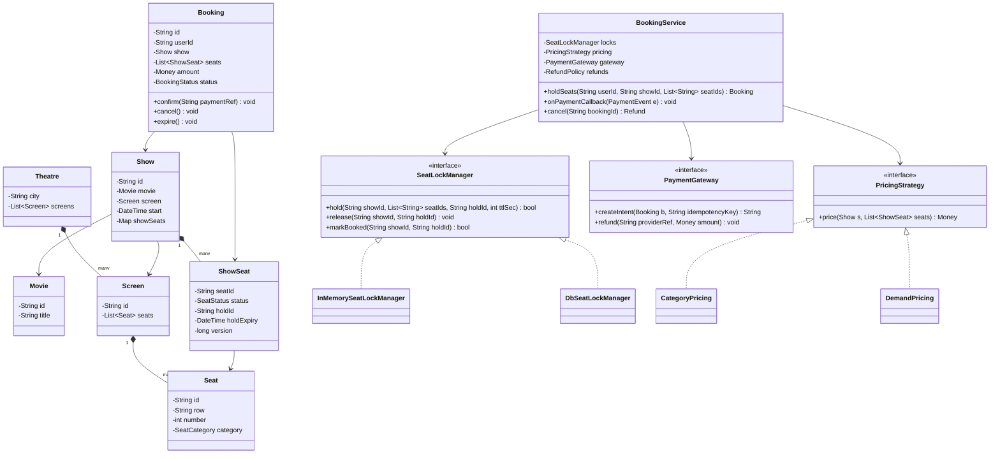
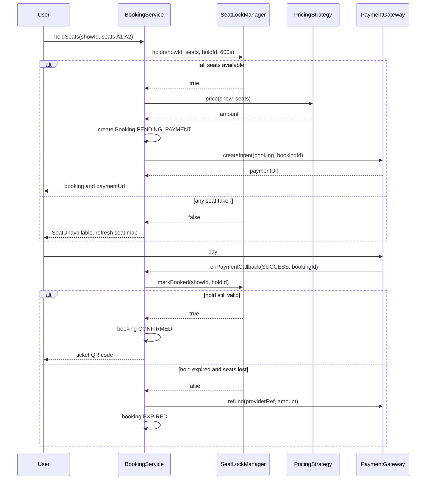

# Movie Ticket Booking

**Category:** Low-Level Design
**Difficulty:** 🟡 Medium
**Seniority:** senior
**Companies:** Amazon, Microsoft, Uber, Flipkart, Atlassian, Booking.com, Walmart
**Tags:** oop, concurrency, seat-locking, state-machine, strategy-pattern, idempotency, payments
**Time:** 60 min

---

## Problem Statement

Design the core booking engine for a movie ticketing platform (like BookMyShow or Fandango). Users browse movies by city, pick a theatre and show, view a live seat map, select seats, hold them for a few minutes while paying, and receive a confirmed booking. Shows for blockbuster releases can see thousands of users competing for the same seats in the first minutes.

The interviewer expects a clean domain model (Movie, Theatre, Screen, Show, Seat, Booking), a correct seat-hold mechanism that prevents double booking under heavy concurrency, a booking state machine integrated with payments, and extensible pricing.

## Clarifying Questions

- Scope — full platform or booking engine? *Focus on the booking engine LLD; search and catalog are simple lookups.*
- Seat selection model? *Users pick specific seats on a seat map; seat categories (Regular, Premium, Recliner) have different prices.*
- How long are seats held during payment? *10 minutes, then released automatically.*
- Max seats per booking? *10.*
- Payment? *External gateway (Stripe/Razorpay) with async callbacks; may be slow or duplicated.*
- Cancellations and refunds? *Allowed up to 2 hours before showtime with a fee.*
- Dynamic pricing / offers? *Pricing must be pluggable (weekday/weekend, demand-based, coupons).*
- Scale? *Thousands of concurrent users per hot show; correctness over availability for seat assignment.*

## Requirements

### Functional
- List movies by city; list shows by movie/theatre/date.
- Show live seat map with seat status (available, held, booked).
- Hold selected seats atomically (all or nothing) for 10 minutes.
- Pay and confirm the booking; issue ticket (QR code).
- Auto-release holds on timeout or payment failure.
- Cancel booking with refund per policy.

### Non-Functional
- No double booking under any concurrency or retry scenario.
- Hold operation p99 under 200 ms during peak.
- Idempotent payment callbacks and booking confirmation.
- Pricing, refund policy, and payment providers pluggable.

### Out of Scope
- Recommendation, reviews, food & beverage add-ons, theatre-side admin UI.

## Core Entities

- **Movie** → id, title, duration, language, rating.
- **Theatre** → id, name, city, list of Screens.
- **Screen** → id, seat layout (rows and seats with category).
- **Seat** → physical seat: row, number, category.
- **Show** → movie, screen, start time, base prices; owns the per-show seat inventory.
- **ShowSeat** → seat status for a specific show: AVAILABLE, HELD, BOOKED; holdId, holdExpiry, version.
- **SeatHold** → holdId, user, show, seats, expiresAt.
- **Booking** → id, user, show, seats, amount, status (PENDING_PAYMENT, CONFIRMED, CANCELLED, EXPIRED).
- **Payment** → bookingId, provider reference, amount, status.
- **BookingService** → orchestrates hold → pay → confirm.
- **SeatLockManager** → atomically holds/releases seats.
- **PricingStrategy** / **RefundPolicy** → pluggable rules.

## Class Diagram



## Design Patterns

| Pattern | Where | Why |
|---|---|---|
| Strategy | `PricingStrategy`, `RefundPolicy`, `SeatLockManager` | Pricing and refund rules vary by theatre/region; lock backend differs between single node (in-memory) and distributed (DB/Redis). |
| State | `Booking` status transitions | Only legal transitions allowed: PENDING_PAYMENT → CONFIRMED/EXPIRED/CANCELLED, CONFIRMED → CANCELLED. Guards against late callbacks confirming expired bookings. |
| Decorator | `CouponDecorator(PricingStrategy)` | Stack discounts and convenience fees on top of base pricing. |
| Observer | Booking events → notifications, analytics, seat-map push | Confirmed/expired events update live seat maps via WebSocket and send tickets by email/SMS. |
| Adapter | `StripeGateway`, `RazorpayGateway` implementing `PaymentGateway` | Swap or add payment providers. |

## Key Workflows

### Hold seats and confirm via payment



### Hold expiry

A scheduler (or Redis key expiry / delay queue) fires at `expiresAt`: if the booking is still PENDING_PAYMENT, it transitions to EXPIRED and calls `release(showId, holdId)`, which flips only seats still carrying that `holdId` back to AVAILABLE. Release is conditional on `holdId` so it can never free seats someone else has since held or booked.

## Implementation

```text
ENUM SeatStatus { AVAILABLE, HELD, BOOKED }

CLASS InMemorySeatLockManager IMPLEMENTS SeatLockManager
    // One lock per show: contention is per show, not global
    FIELDS showSeats (showId -> map seatId -> ShowSeat), showLocks (showId -> mutex)

    FUNCTION hold(showId, seatIds, holdId, ttl)
        SET seats ← showSeats[showId]
        LOCK showLocks[showId]
            // all-or-nothing: verify every seat first
            FOR id IN seatIds
                SET s ← seats[id]
                IF s.status = BOOKED                                   RETURN false
                IF s.status = HELD AND s.holdExpiry > now()            RETURN false
            FOR id IN seatIds
                SET seats[id].status ← HELD
                SET seats[id].holdId ← holdId
                SET seats[id].holdExpiry ← now() + ttl
        UNLOCK
        RETURN true

    FUNCTION markBooked(showId, holdId)
        LOCK showLocks[showId]
            SET mine ← seats with holdId = holdId
            IF mine is empty OR any s IN mine has s.holdExpiry < now() AND s.status = HELD
                RETURN false       // hold lost; caller refunds
            FOR s IN mine  SET s.status ← BOOKED
        UNLOCK
        RETURN true

    FUNCTION release(showId, holdId)
        LOCK showLocks[showId]
            FOR s IN seats WHERE s.holdId = holdId AND s.status = HELD
                SET s.status ← AVAILABLE
                SET s.holdId ← NULL
        UNLOCK

CLASS DbSeatLockManager IMPLEMENTS SeatLockManager
    // Distributed version: the database row is the source of truth.
    FUNCTION hold(showId, seatIds, holdId, ttl)
        BEGIN TRANSACTION
            SET n ← EXECUTE
                "UPDATE show_seat SET status='HELD', hold_id=?, hold_expiry=now()+ttl
                 WHERE show_id=? AND seat_id IN (?)
                   AND (status='AVAILABLE' OR (status='HELD' AND hold_expiry < now()))"
            IF n ≠ seatIds.size()
                ROLLBACK            // all-or-nothing
                RETURN false
        COMMIT
        RETURN true

    FUNCTION markBooked(showId, holdId)
        SET n ← EXECUTE
            "UPDATE show_seat SET status='BOOKED'
             WHERE show_id=? AND hold_id=? AND status='HELD'"
        RETURN n = expected seat count     // run inside the booking-confirm transaction

CLASS BookingService
    FIELDS locks, pricing, gateway, refunds, bookings, scheduler, events
    CONST HOLD_TTL ← 600 seconds, MAX_SEATS ← 10

    FUNCTION holdSeats(userId, showId, seatIds)
        IF seatIds.size() > MAX_SEATS OR seatIds is empty  THROW InvalidRequest
        SET holdId ← uuid()
        IF NOT locks.hold(showId, sorted(seatIds), holdId, HOLD_TTL)
            THROW SeatUnavailable
        SET amount ← pricing.price(show(showId), seatIds)
        SET b ← NEW Booking(id ← holdId, userId, showId, seatIds, amount, PENDING_PAYMENT)
        bookings.save(b)
        scheduler.at(now() + HOLD_TTL, expire, b.id)
        SET b.paymentUrl ← gateway.createIntent(b, idempotencyKey ← b.id)
        RETURN b

    FUNCTION onPaymentCallback(evt)               // may arrive late, twice, or out of order
        IF NOT gateway.verifySignature(evt)  THROW Unauthorized
        LOCK booking evt.bookingId
            SET b ← bookings.get(evt.bookingId)
            IF b.status = CONFIRMED                    RETURN   // duplicate callback
            IF evt.status ≠ SUCCESS
                IF b.status = PENDING_PAYMENT
                    locks.release(b.showId, b.id)
                    SET b.status ← CANCELLED
                RETURN
            IF b.status = PENDING_PAYMENT AND locks.markBooked(b.showId, b.id)
                SET b.status ← CONFIRMED
                SET b.paymentRef ← evt.providerRef
                events.publish(BOOKING_CONFIRMED, b)
            ELSE
                // paid after expiry and seats lost: refund automatically
                gateway.refund(evt.providerRef, b.amount)
                SET b.status ← EXPIRED
        UNLOCK

    FUNCTION expire(bookingId)
        LOCK booking bookingId
            SET b ← bookings.get(bookingId)
            IF b.status ≠ PENDING_PAYMENT  RETURN
            locks.release(b.showId, b.id)
            SET b.status ← EXPIRED
            events.publish(SEATS_RELEASED, b)
        UNLOCK

    FUNCTION cancel(bookingId)
        SET b ← bookings.get(bookingId)
        IF b.status ≠ CONFIRMED OR now() > b.show.start - 2 hours  THROW CancellationClosed
        gateway.refund(b.paymentRef, refunds.compute(b, now()))   // amount minus fee
        locks.releaseBooked(b.showId, b.id)      // BOOKED -> AVAILABLE for this booking
        SET b.status ← CANCELLED
```

## Concurrency & Extensibility

- **Core invariant:** a seat transitions AVAILABLE → HELD → BOOKED only via a single atomic, conditional operation. In-memory: per-show mutex. Distributed: conditional `UPDATE ... WHERE status='AVAILABLE'` with affected-row check (optimistic), or `SELECT ... FOR UPDATE` on the seat rows (pessimistic). Redis alternative: a Lua script that checks and sets all seat keys with TTL atomically.
- **All-or-nothing holds:** verify all seats then set all, within one critical section/transaction. Sorting seat ids before locking avoids deadlocks when using row locks.
- **Lazy expiry:** holds carry `holdExpiry`, so an expired hold is treated as available even if the cleanup job hasn't run — the scheduler is an optimization, not a correctness dependency.
- **Payment races:** callbacks are verified, idempotent (keyed by bookingId), and serialized per booking. A payment that succeeds after expiry triggers an automatic refund rather than overbooking.
- **Hot shows:** per-show locking means one blockbuster doesn't slow other shows; for extreme spikes, add a virtual waiting room that admits users at a controlled rate.
- **Extensibility:** new seat categories → enum + pricing table; new pricing (demand-based, surge, coupons) → strategies/decorators; new payment providers → adapters; general admission events → a `CapacityLockManager` that decrements a counter instead of specific seats.

## Trade-offs

| Decision | Option A | Option B | Choice & Why |
|---|---|---|---|
| Seat locking | Pessimistic `SELECT FOR UPDATE` | Optimistic conditional update | Optimistic conditional update: one round trip, no lock held across user think-time; conflicts simply fail fast. |
| Hold storage | Database rows with expiry | Redis keys with TTL | DB if single source of truth is required; Redis for high-throughput holds, but then booking confirm must still be persisted transactionally. |
| Hold expiry | Background job only | Expiry timestamp checked on read + background cleanup | Timestamp: correct even if the job lags. |
| Lock granularity | Global lock | Per-show lock / per-seat rows | Per-show/seat: hot show contention doesn't affect others. |
| Payment timing | Charge before hold | Hold, then charge | Hold first: users shouldn't pay for seats they can't get; late payments are refunded. |
| Seat map freshness | Poll every few seconds | Push updates via WebSocket | Push for hot shows; the hold API remains the authority anyway. |

## Follow-up Questions

1. **What happens if the user pays at minute 11?** The hold has expired; `markBooked` fails if seats were re-held by someone else, and we auto-refund. If seats are still free, we can optionally re-acquire them and confirm.
2. **How do you prevent a bot from holding all seats?** Per-user active hold limits, rate limiting, CAPTCHA at hold time, and a waiting-room queue for hot shows.
3. **How do you scale beyond one database?** Shard `show_seat` by `showId` — all seats for a show live on one shard, so holds remain single-shard transactions.
4. **How would you avoid leaving single isolated seats?** Add a seat-selection validation rule (strategy) that rejects selections leaving a single empty seat between booked ones.
5. **How do you guarantee the confirmation email/ticket is sent exactly once?** Use the transactional outbox pattern: write the BOOKING_CONFIRMED event in the same transaction as the status change; a relay publishes it, and consumers dedupe by bookingId.
6. **How do you handle a theatre cancelling a show?** Mark the show cancelled, bulk-transition bookings to CANCELLED, and enqueue full refunds through the payment adapter.

## Common Mistakes

- Check-then-set on seat availability without atomicity, leading to double booking.
- Relying solely on a cron job to release holds (correctness depends on job timing).
- Releasing seats unconditionally instead of only those belonging to the expiring hold.
- Non-idempotent payment callbacks that confirm twice or confirm an expired booking.
- Charging the user before seats are secured.
- Putting seat status on the physical `Seat` instead of a per-show `ShowSeat`.

## Key Takeaways

- Separate physical layout (Screen, Seat) from per-show inventory (ShowSeat).
- Seat holds must be atomic, all-or-nothing, time-bounded, and tagged with a hold id.
- Model Booking as a state machine and make payment handling idempotent with automatic refunds on lost races.
- Use strategies and adapters for pricing, refund policy, lock backend, and payment providers.
