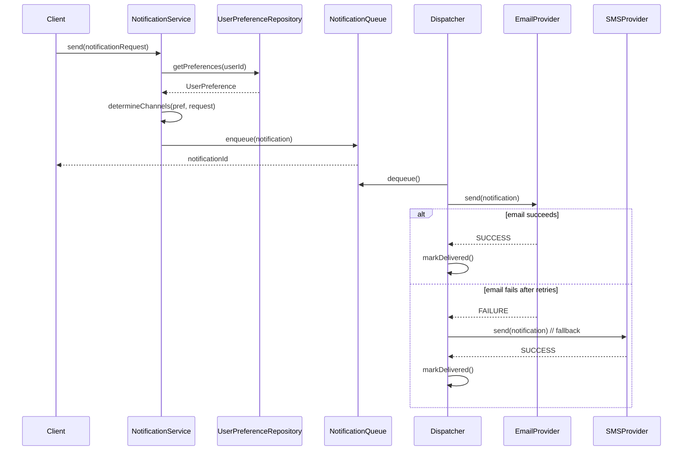
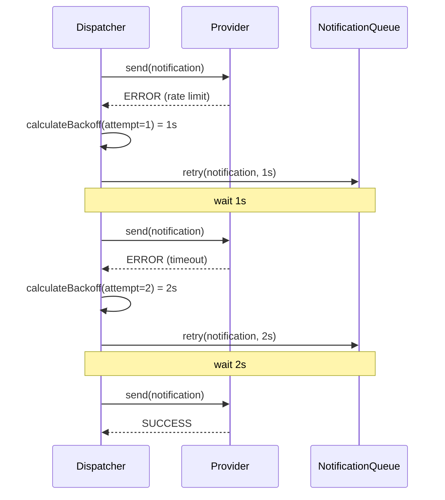

# Notification Service

**Category:** Low-Level Design
**Difficulty:** 🟡 Medium
**Seniority:** mid
**Companies:** Twilio, SendGrid
**Tags:** patterns, strategy, observers
**Time:** 45-60 min

---

## Problem Statement

Design a notification service that sends messages to users through multiple channels: email, SMS, push notifications, and in-app notifications. Users can have preferences for which channels they want to receive notifications on, and the system should handle failures gracefully with retry logic and fallback mechanisms.

The interviewer is looking for a clean separation between notification creation and delivery, support for multiple channels with pluggable providers, user preference management, and robust error handling with retries and fallbacks.

## Clarifying Questions

- Which notification channels? *Email, SMS, push (APNS/FCM), in-app.*
- User preferences? *Per-channel opt-in/out, quiet hours, priority-based routing.*
- Delivery guarantee? *At-least-once with retries; some channels have idempotency keys.*
- Rate limiting? *Per-user and per-provider limits to avoid spam and API throttling.*
- Templates? *Yes, support for templated messages with variable substitution.*
- Batching? *Batch SMS and push for efficiency; emails are individual.*
- Fallback behavior? *If primary channel fails, try secondary based on priority.*
- Async vs sync? *Async delivery with status tracking; immediate response for API calls.*

## Requirements

### Functional

- Send notifications through multiple channels (email, SMS, push, in-app).
- User preference management per channel and notification type.
- Template support with variable substitution.
- Retry logic with exponential backoff for failed deliveries.
- Fallback to alternative channels on failure.
- Delivery status tracking and history.
- Rate limiting per user and per provider.
- Batching for SMS and push notifications.

### Non-Functional

- High availability: notification queue survives service restarts.
- Scalability: handle millions of notifications per day.
- Low latency: enqueue notifications quickly, deliver asynchronously.
- Extensibility: easy to add new channels and providers.
- Observability: metrics on delivery rates, failures, latency.

### Out of Scope

- Multi-region deployment, complex user authentication, notification content moderation.

## Core Entities

- **Notification** → id, recipient, type, content (template + variables), priority, channels, status.
- **Channel** → enum: EMAIL, SMS, PUSH, IN_APP.
- **NotificationProvider** → interface for each channel (SendGrid for email, Twilio for SMS, etc.).
- **UserPreference** → userId, channel preferences, quiet hours, priority rules.
- **Template** → id, subject/body template, variable placeholders.
- **NotificationQueue** → persistent queue for async processing.
- **DeliveryStatus** → notificationId, channel, provider, status, timestamp, retryCount.
- **RateLimiter** → per-user and per-provider rate limiting.
- **NotificationService** → facade: send, track, manage preferences.

## Class Diagram

```mermaid
classDiagram
    class NotificationService {
        -Map~Channel, NotificationProvider~ providers
        -UserPreferenceRepository preferenceRepo
        -NotificationQueue queue
        -RateLimiter rateLimiter
        -TemplateEngine templateEngine
        +send(NotificationRequest req) String
        +sendBatch(List~NotificationRequest~ reqs) List~String~
        +getDeliveryStatus(String notificationId) List~DeliveryStatus~
        +updatePreferences(String userId, UserPreference pref) void
    }
    class NotificationRequest {
        +String userId
        +String type
        +Map~String, String~ variables
        +Priority priority
        +List~Channel~ preferredChannels
    }
    class Notification {
        +String id
        +String userId
        +String type
        +String renderedContent
        +Priority priority
        +List~Channel~ channels
        +NotificationStatus status
    }
    class NotificationStatus {
        <<enumeration>>
        PENDING
        SENDING
        DELIVERED
        FAILED
        RETRYING
    }
    class Priority {
        <<enumeration>>
        LOW
        NORMAL
        HIGH
        URGENT
    }
    class Channel {
        <<enumeration>>
        EMAIL
        SMS
        PUSH
        IN_APP
    }
    class NotificationProvider {
        <<interface>>
        +Channel getChannel()
        +send(Notification n) DeliveryResult
        +batchSend(List~Notification~ notifications) List~DeliveryResult~
    }
    class EmailProvider
    class SMSProvider
    class PushProvider
    class InAppProvider
    class UserPreference {
        +String userId
        +Map~Channel, Boolean~ channelEnabled
        +Time quietHoursStart
        +Time quietHoursEnd
        +Map~String, List~Channel~~ typeToChannels
    }
    class Template {
        +String id
        +String subjectTemplate
        +String bodyTemplate
        +List~String~ variableNames
    }
    class TemplateEngine {
        +render(Template t, Map~String, String~ vars) RenderedContent
    }
    class NotificationQueue {
        +enqueue(Notification n) void
        +dequeue() Notification
        +retry(Notification n, long delayMs) void
    }
    class DeliveryStatus {
        +String notificationId
        +Channel channel
        +String provider
        +NotificationStatus status
        +int retryCount
        +String errorMessage
        +Instant timestamp
    }
    class RateLimiter {
        +checkUserLimit(String userId, Channel channel) boolean
        +checkProviderLimit(Channel channel) boolean
        +recordAttempt(String userId, Channel channel) void
    }

    NotificationService --> NotificationProvider
    NotificationProvider <|.. EmailProvider
    NotificationProvider <|.. SMSProvider
    NotificationProvider <|.. PushProvider
    NotificationProvider <|.. InAppProvider
    NotificationService --> UserPreference
    NotificationService --> NotificationQueue
    NotificationService --> TemplateEngine
    NotificationService --> RateLimiter
    NotificationService --> Notification : creates
    NotificationRequest --> Notification : maps to
    Notification --> Channel
    Notification --> Priority
    Notification --> NotificationStatus
    TemplateEngine --> Template
    Notification --> DeliveryStatus : has many
```



## Key Workflows

### Send notification with fallback



### Retry with exponential backoff



## Implementation

```text
CLASS NotificationService
    FIELDS providers : Map~Channel, NotificationProvider~
    FIELDS preferenceRepo : UserPreferenceRepository
    FIELDS queue : NotificationQueue
    FIELDS rateLimiter : RateLimiter
    FIELDS templateEngine : TemplateEngine

    FUNCTION send(request)
        SET pref ← preferenceRepo.findByUserId(request.userId)
        SET channels ← determineChannels(pref, request)
        IF channels IS EMPTY THEN THROW NoEnabledChannels
        IF NOT rateLimiter.checkUserLimit(request.userId, channels[0]) THEN
            THROW RateLimitExceeded
        SET content ← templateEngine.render(request.type, request.variables)
        SET notification ← NEW Notification(request.userId, content, request.priority, channels)
        queue.enqueue(notification)
        RETURN notification.id

    FUNCTION determineChannels(pref, request)
        SET result ← []
        FOR channel IN request.preferredChannels
            IF pref.channelEnabled[channel] AND NOT isQuietHours(pref, channel)
                result.add(channel)
        RETURN result OR pref.defaultChannels

CLASS EmailProvider IMPLEMENTS NotificationProvider
    FIELDS client : SendGridClient
    FIELDS maxRetries ← 5

    FUNCTION send(notification)
        SET email ← buildEmail(notification)
        FOR attempt FROM 1 TO maxRetries
            TRY
                SET response ← client.send(email)
                IF response.statusCode = 202 RETURN DeliveryResult.SUCCESS
                IF response.statusCode = 429
                    sleep(calculateBackoff(attempt))
                    CONTINUE
                THROW ProviderError(response.body)
            CATCH NetworkException e
                IF attempt = maxRetries THEN THROW
                sleep(calculateBackoff(attempt))
        RETURN DeliveryResult.FAILURE

CLASS NotificationQueue
    FIELDS queue : MessageQueue (RabbitMQ/Kafka)
    FIELDS retryQueue : DelayQueue

    FUNCTION enqueue(notification)
        queue.publish(notification.toJson())

    FUNCTION retry(notification, delayMs)
        retryQueue.offer(notification, delayMs, MILLISECONDS)

CLASS RateLimiter
    FIELDS userLimits : Map~String, TokenBucket~
    FIELDS providerLimits : Map~Channel, TokenBucket~

    FUNCTION checkUserLimit(userId, channel)
        SET bucket ← userLimits.computeIfAbsent(userId + ":" + channel, k -> NEW TokenBucket(10, MINUTE))
        RETURN bucket.tryConsume(1)

    FUNCTION checkProviderLimit(channel)
        SET bucket ← providerLimits.computeIfAbsent(channel, k -> NEW TokenBucket(1000, MINUTE))
        RETURN bucket.tryConsume(1)
```

## Design Patterns

| Pattern | Where | Why |
|---|---|---|
| Strategy | `NotificationProvider` implementations per channel | Each channel has different delivery logic; easy to add new providers. |
| Observer | `DeliveryStatus` updates and event publishing | Components can react to delivery events (metrics, webhooks). |
| Factory | Provider selection based on channel | Centralizes provider instantiation and configuration. |
| Template Method | Base `NotificationProvider` with common retry logic | Shared retry/fallback behavior, subclasses implement actual send. |
| Chain of Responsibility | Channel fallback (email → SMS → push) | Try primary channel, fall through to alternatives on failure. |
| Builder | `NotificationRequest` construction | Clean API for creating complex notification requests. |

## Scalability

- **Horizontal scaling:** Multiple worker instances consume from the notification queue. Use a message broker (RabbitMQ, Kafka, SQS) for the queue to distribute load.
- **Channel-specific scaling:** SMS and push providers may have different rate limits. Workers can be partitioned by channel to optimize batching and respect limits.
- **Batching:** SMS and push notifications support batch operations to reduce API calls. Group notifications by provider and send in batches up to provider limits.
- **Database sharding:** Delivery status and user preferences can be sharded by userId for large-scale deployments.
- **Caching:** User preferences and templates are cached to reduce database load. Cache invalidation on preference updates.
- **Rate limiting:** Distributed rate limiting using Redis with token bucket or sliding window algorithms.

## Error Handling

- **Transient failures:** Network timeouts, rate limit errors (429), temporary provider outages. Retry with exponential backoff (1s, 2s, 4s, 8s, 16s, max 5 attempts).
- **Permanent failures:** Invalid email/phone number, blocked user, account suspended. Mark as failed, no retry.
- **Idempotency:** Include a unique notification ID in provider calls to prevent duplicate delivery on retries.
- **Fallback channels:** If primary channel fails after retries, try secondary channels based on user preferences and notification priority.
- **Dead letter queue:** Notifications that fail all channels are moved to a DLQ for manual inspection and reprocessing.
- **Circuit breaker:** If a provider has high failure rate, stop sending to it temporarily and route to backup providers.

## Trade-offs

| Decision | Option A | Option B | Choice & Why |
|---|---|---|
| Delivery model | Synchronous send | Async queue | Async queue — better API latency, handles retries in background. |
| Retry strategy | Immediate retry | Exponential backoff | Exponential backoff — gives providers time to recover, reduces thundering herd. |
| Fallback behavior | Always try all channels | Fallback only on failure | Fallback on failure — respects user preferences, avoids unnecessary sends. |
| Batching | Batch everything | Batch only SMS/push | Selective batching — emails are individual, SMS/push benefit from batching. |
| Rate limiting | Per-user only | Per-user + per-provider | Both — prevents spam and respects API quotas. |
| Storage | SQL database | NoSQL document store | SQL for preferences/status (relational), NoSQL option for delivery history at scale. |

## Follow-up Questions

1. **How do you handle quiet hours?** Check user's quiet hours before sending. For urgent notifications, bypass quiet hours or send to in-app only. Queue non-urgent notifications for after quiet hours.
2. **How do you ensure idempotency?** Generate a unique ID for each notification. Include it in provider calls (Twilio messagingSid, SendGrid message ID). Store delivery status keyed by notification ID + channel.
3. **How do you handle provider-specific rate limits?** Each provider knows its own limits. Implement a token bucket per provider. When limit is reached, queue notifications and retry after the reset window.
4. **How do you support multi-tenant deployments?** Add tenantId to all entities. Isolate queues and rate limits per tenant. Provider configurations can be tenant-specific.
5. **How do you handle template versioning?** Store templates with version numbers. Notifications reference a specific template version. New versions don't affect in-flight notifications.

## Common Mistakes

- Sending notifications synchronously, causing API timeouts on provider failures.
- Not implementing retry logic for transient failures.
- Ignoring rate limits and getting blocked by providers.
- Not handling user preferences, sending to disabled channels.
- Missing idempotency, causing duplicate notifications on retries.
- Not batching SMS/push, wasting API quota and increasing costs.
- Not tracking delivery status, making debugging impossible.

## Key Takeaways

- Separate notification creation from delivery using a queue for async processing.
- Use the Strategy pattern for pluggable channel providers.
- Implement robust retry logic with exponential backoff and fallback channels.
- Respect user preferences and rate limits to avoid spam and provider throttling.
- Track delivery status for observability and debugging.
- Batch where possible (SMS, push) to optimize costs and API usage.
