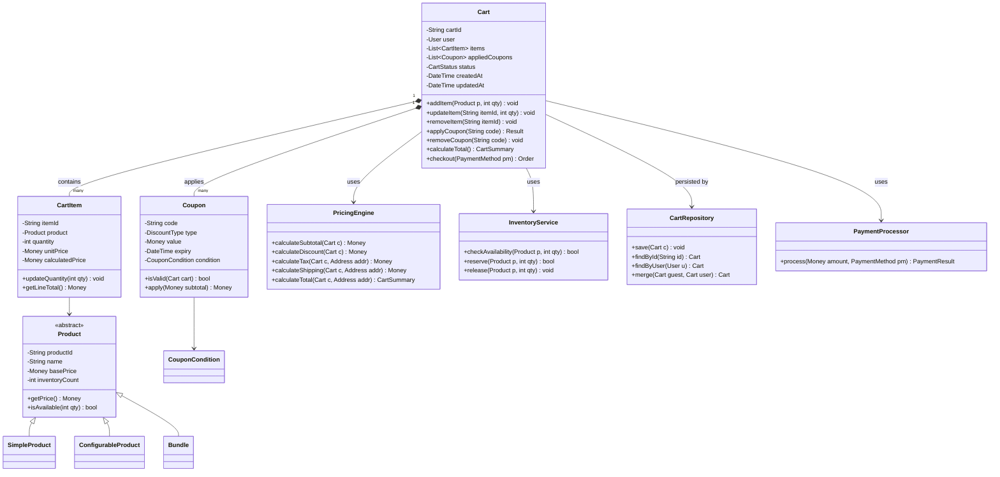
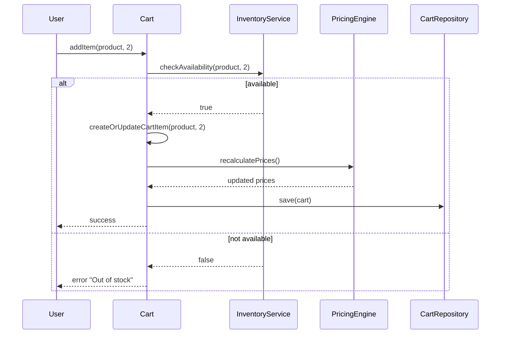
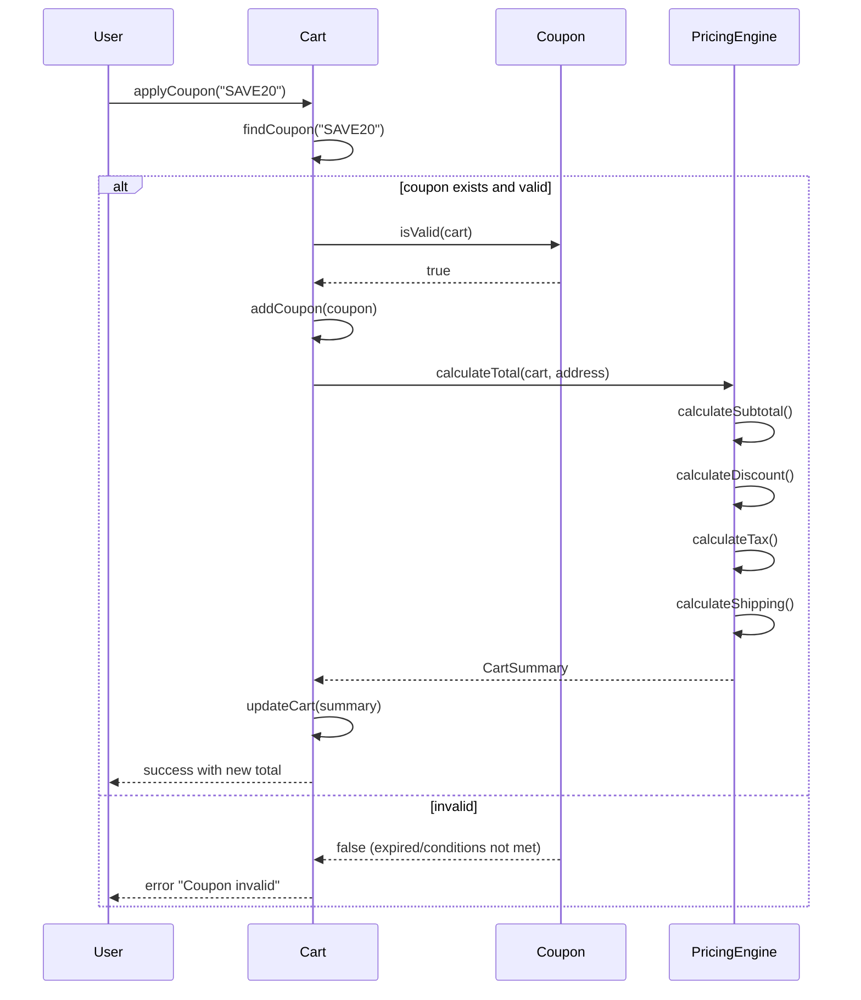
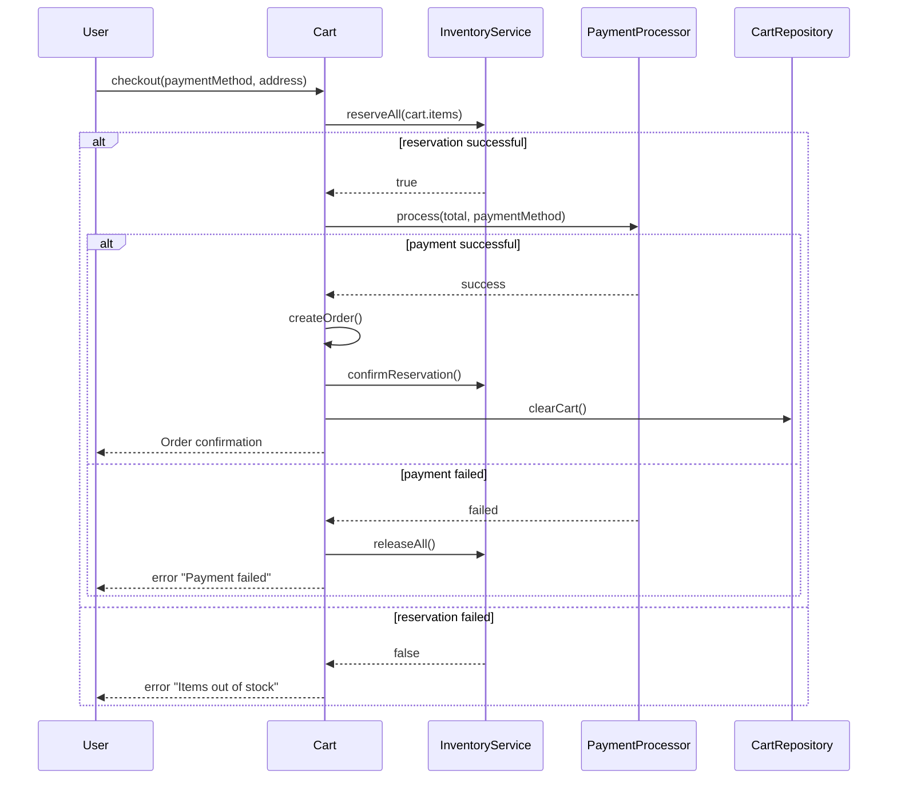

# Online Shopping Cart

**Category:** Low-Level Design
**Difficulty:** 🟡 Medium
**Seniority:** mid
**Companies:** Amazon, Shopify
**Tags:** patterns, pricing, validation
**Time:** 45-60 min

---

## Problem Statement

Design the software for an online shopping cart system. Users browse products, add items to their cart, apply coupons, and proceed to checkout. The system must handle product availability, price calculations, discounts, and inventory updates. The cart persists across sessions and supports multiple payment methods.

The interviewer is looking for clean separation between cart management, pricing logic, and inventory validation, along with proper handling of edge cases like out-of-stock items, expired coupons, and concurrent modifications.

## Clarifying Questions

- What types of products? *Simple products, configurable products (size/color), bundles.*
- How is inventory managed? *Real-time inventory checks; items can go out of stock after being added to cart.*
- What discount types? *Percentage discounts, fixed amount, buy-one-get-one, category-based coupons.*
- Can users save carts for later? *Yes, carts persist across sessions; guest carts merge with user carts on login.*
- How are taxes calculated? *Based on shipping address; different rates per jurisdiction.*
- What payment methods? *Credit card, PayPal, gift cards.*
- Can items be removed or quantities changed? *Yes, full CRUD on cart items.*
- What happens when an item goes out of stock? *Show warning, disable checkout, or auto-remove.*

## Requirements

### Functional
- Add, update, remove items from cart.
- Apply and remove coupons (single or multiple).
- Calculate subtotal, discounts, tax, shipping, and total.
- Validate inventory before checkout.
- Persist cart state (guest and authenticated users).
- Merge guest cart with user cart on login.
- Support multiple product types (simple, configurable, bundle).
- Handle payment processing.

### Non-Functional
- Consistent pricing calculations (no floating-point errors).
- Concurrent cart modifications handled correctly.
- Cart operations should be fast (sub-second response).
- Extensible for new discount types and product types.
- Audit trail for price changes.

### Out of Scope
- Product catalog management, user authentication, recommendation engine, order fulfillment after checkout.

## Core Entities

- **Cart** → id, user (optional), items, coupons, status, created/updated timestamps.
- **CartItem** → product, quantity, unit price, calculated price.
- **Product** (abstract) → id, name, base price, inventory count; subclasses SimpleProduct, ConfigurableProduct, Bundle.
- **Coupon** → code, discount type, value, conditions (min purchase, category, expiry).
- **PricingEngine** → calculates discounts, tax, shipping, total.
- **InventoryService** → checks and reserves inventory.
- **CartRepository** → persists cart state.
- **PaymentProcessor** → handles payment methods.

## Class Diagram



## Design Patterns

| Pattern | Where | Why |
|---|---|---|
| Strategy | `Coupon` discount types, `PricingEngine` tax/shipping calculations | Different discount algorithms (percentage, fixed, BOGO) and tax rules per region. |
| Factory | `ProductFactory.create(type, ...)` | Create appropriate product subclass from catalog data. |
| Builder | `CartSummary` with subtotal, discount, tax, shipping, total | Complex object construction with many calculated fields. |
| Observer | Inventory → Cart (when stock changes) | Notify carts when items go out of stock. |
| Decorator | Pricing decorators for seasonal discounts | Wrap base pricing with additional discount logic. |
| Repository | `CartRepository` | Abstract persistence layer for testability. |

## Key Workflows

### Add item to cart with inventory check



### Apply coupon and recalculate total



### Checkout flow



## Implementation

```text
ENUM DiscountType { PERCENTAGE, FIXED_AMOUNT, BOGO, BUY_X_GET_Y }
ENUM CartStatus { ACTIVE, CHECKOUT_IN_PROGRESS, ABANDONED, CONVERTED }

CLASS Cart
    FIELDS cartId, user, items ← [], appliedCoupons ← [], status ← ACTIVE
    FIELDS pricingEngine, inventoryService, repository

    FUNCTION addItem(product, quantity)
        IF quantity ≤ 0
            THROW InvalidQuantityException
        IF NOT inventoryService.checkAvailability(product, quantity)
            THROW OutOfStockException
        SET existing ← findItemByProduct(product)
        IF existing ≠ NULL
            existing.updateQuantity(existing.quantity + quantity)
        ELSE
            SET item ← NEW CartItem(product, quantity, product.getPrice())
            items.add(item)
        pricingEngine.recalculate(this)
        repository.save(this)

    FUNCTION updateItem(itemId, newQuantity)
        SET item ← findItemById(itemId)
        IF item = NULL
            THROW ItemNotFoundException
        IF newQuantity = 0
            removeItem(itemId)
            RETURN
        IF NOT inventoryService.checkAvailability(item.product, newQuantity)
            THROW OutOfStockException
        item.updateQuantity(newQuantity)
        pricingEngine.recalculate(this)
        repository.save(this)

    FUNCTION applyCoupon(code)
        SET coupon ← couponService.findByCode(code)
        IF coupon = NULL OR NOT coupon.isValid(this)
            THROW InvalidCouponException
        IF appliedCoupons.contains(coupon)
            THROW CouponAlreadyAppliedException
        appliedCoupons.add(coupon)
        pricingEngine.recalculate(this)
        repository.save(this)

    FUNCTION calculateTotal(address)
        RETURN pricingEngine.calculateTotal(this, address)

    FUNCTION checkout(paymentMethod, address)
        IF items.isEmpty()
            THROW EmptyCartException
        SET status ← CHECKOUT_IN_PROGRESS
        repository.save(this)

        // Reserve inventory
        FOR item IN items
            IF NOT inventoryService.reserve(item.product, item.quantity)
                // Rollback any previous reservations
                FOR reserved IN items[0:current_index]
                    inventoryService.release(reserved.product, reserved.quantity)
                THROW OutOfStockException
        // Process payment
        SET summary ← pricingEngine.calculateTotal(this, address)
        SET paymentResult ← paymentProcessor.process(summary.total, paymentMethod)
        IF NOT paymentResult.success
            // Release inventory
            FOR item IN items
                inventoryService.release(item.product, item.quantity)
            SET status ← ACTIVE
            repository.save(this)
            THROW PaymentFailedException

        // Create order and clear cart
        SET order ← createOrder(summary, paymentResult)
        SET status ← CONVERTED
        repository.save(this)
        RETURN order

CLASS CartItem
    FIELDS itemId, product, quantity, unitPrice, calculatedPrice

    FUNCTION updateQuantity(newQuantity)
        SET quantity ← newQuantity
        SET calculatedPrice ← unitPrice * quantity

    FUNCTION getLineTotal()
        RETURN calculatedPrice

CLASS Coupon
    FIELDS code, type, value, expiry, minPurchase, applicableCategories

    FUNCTION isValid(cart)
        IF now() > expiry
            RETURN false
        IF cart.calculateSubtotal() < minPurchase
            RETURN false
        IF applicableCategories NOT empty
            SET hasApplicableItem ← cart.items.any(
                item → applicableCategories.contains(item.product.category)
            )
            IF NOT hasApplicableItem
                RETURN false
        RETURN true

    FUNCTION apply(subtotal)
        SWITCH type
            CASE PERCENTAGE
                RETURN subtotal * (value / 100)
            CASE FIXED_AMOUNT
                RETURN min(value, subtotal)
            CASE BOGO
                // Count pairs, discount the cheaper in each pair
                RETURN calculateBogoDiscount(cart)
            CASE BUY_X_GET_Y
                RETURN calculateBuyXGetYDiscount(cart)

CLASS PricingEngine
    FIELDS taxCalculator, shippingCalculator

    FUNCTION calculateTotal(cart, address)
        SET subtotal ← calculateSubtotal(cart)
        SET discount ← calculateDiscount(cart)
        SET tax ← taxCalculator.calculate(subtotal - discount, address)
        SET shipping ← shippingCalculator.calculate(cart, address)
        SET total ← subtotal - discount + tax + shipping
        RETURN NEW CartSummary(subtotal, discount, tax, shipping, total)

    FUNCTION calculateSubtotal(cart)
        RETURN cart.items.sum(item → item.getLineTotal())

    FUNCTION calculateDiscount(cart)
        SET totalDiscount ← 0
        FOR coupon IN cart.appliedCoupons
            SET subtotal ← calculateSubtotal(cart) - totalDiscount
            SET discount ← coupon.apply(subtotal)
            totalDiscount ← totalDiscount + discount
        RETURN totalDiscount

CLASS InventoryService
    FIELDS inventoryLocks   // distributed locks for concurrent reservations

    FUNCTION checkAvailability(product, quantity)
        RETURN product.inventoryCount ≥ quantity

    FUNCTION reserve(product, quantity)
        // Use atomic compare-and-set or distributed lock
        SET lock ← acquireLock(product.productId)
        TRY
            IF product.inventoryCount ≥ quantity
                product.inventoryCount ← product.inventoryCount - quantity
                RETURN true
            RETURN false
        FINALLY
            releaseLock(lock)

    FUNCTION release(product, quantity)
        product.inventoryCount ← product.inventoryCount + quantity
```

## Concurrency & Extensibility

- **Concurrent cart modifications:** Use optimistic locking with a version field on Cart. On save, check version matches; if not, reload and reapply changes or notify user.
- **Inventory race conditions:** Use database row-level locks or distributed locks (Redis) during reservation. The reserve operation must be atomic: check-and-decrement in one transaction.
- **Price consistency:** Store unitPrice at time of adding to cart. If product price changes, existing cart items keep their original price. Show price change notification on next view.
- **Cart merging on login:** When guest logs in, merge their cart with existing user cart. Combine quantities for same products; if conflict, ask user or keep both.
- **New discount types:** Add new DiscountType enum value and implement logic in Coupon.apply(). No changes to Cart or PricingEngine needed.
- **New product types:** Add Product subclass and extend ProductFactory. Cart and CartItem work with base Product interface.
- **Multiple coupons:** Support stacking (all applicable) vs. mutual exclusion (single best). Implement in PricingEngine.calculateDiscount().
- **Tax calculation:** Strategy pattern for different jurisdictions (US state tax, EU VAT, etc.). Inject appropriate implementation based on address.

## Trade-offs

| Decision | Option A | Option B | Choice & Why |
|---|---|---|---|
| Inventory check | Check on add, reserve on checkout | Reserve on add, release on remove | Check on add: simpler, better UX; reserve on checkout prevents hoarding. |
| Price storage | Store base price only | Store unitPrice at add time | Store at add time: price changes don't affect existing carts. |
| Coupon stacking | Allow multiple coupons | Single coupon only | Multiple: more flexible for promotions; can enforce mutual exclusion per coupon. |
| Cart persistence | Database only | Database + cache (Redis) | Cache: faster reads, write-through to DB for consistency. |
| Concurrency control | Optimistic locking | Pessimistic locking | Optimistic: better performance for low-conflict cart operations. |
| Tax calculation | Real-time API call | Pre-loaded rate tables | Rate tables: faster, more reliable; update periodically. |

## Follow-up Questions

1. **How do you handle price changes after items are in the cart?** Store the price at add time; on next cart view, show "Price changed from $X to $Y" and let user decide.
2. **How do you support flash sales with limited quantity?** Use atomic decrement with a counter; when counter hits zero, show sold out immediately.
3. **How do you handle bundle pricing?** Bundle product has its own price; adding bundle adds all child products but charges bundle price. Inventory checks all children.
4. **How do you implement gift cards?** Treat as payment method with a balance; apply before other payment methods. Partial use allowed.
5. **How do you handle abandoned carts?** Scheduled job marks carts as ABANDONED after X hours; send recovery emails with cart contents.
6. **How do you support different shipping methods?** Strategy pattern for shipping calculators (standard, express, overnight); user selects at checkout.

## Common Mistakes

- Using floating-point for money calculations (use decimal/integer cents).
- Not handling inventory race conditions (two users check same item, both add).
- Forgetting to validate coupons on every cart change (expiry, conditions).
- Not storing unit price at add time, causing price changes to affect existing carts.
- Allowing negative quantities or quantities exceeding inventory.
- Not handling concurrent cart modifications (last write wins).
- Tight coupling between cart logic and specific discount/product types.

## Key Takeaways

- Separate cart management from pricing and inventory concerns.
- Use Strategy pattern for extensible discount and pricing rules.
- Store prices at add time to handle price changes gracefully.
- Inventory reservation must be atomic to prevent overselling.
- Optimistic locking works well for cart concurrency.
- Design for extensibility: new product/discount types shouldn't require core changes.
