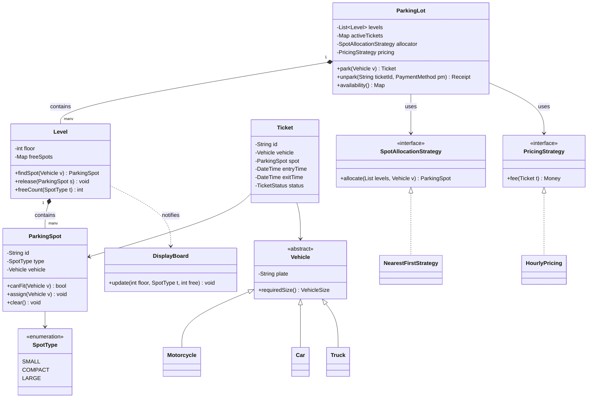
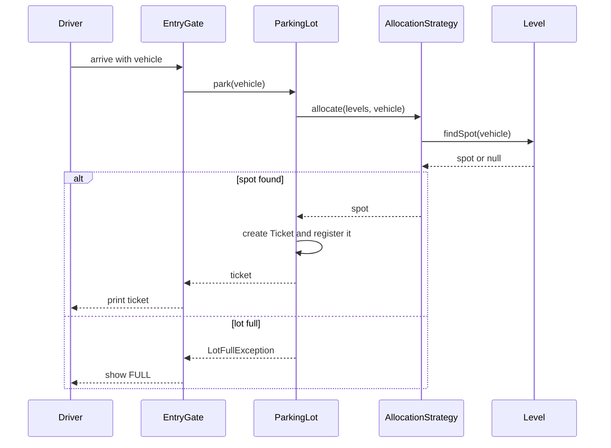
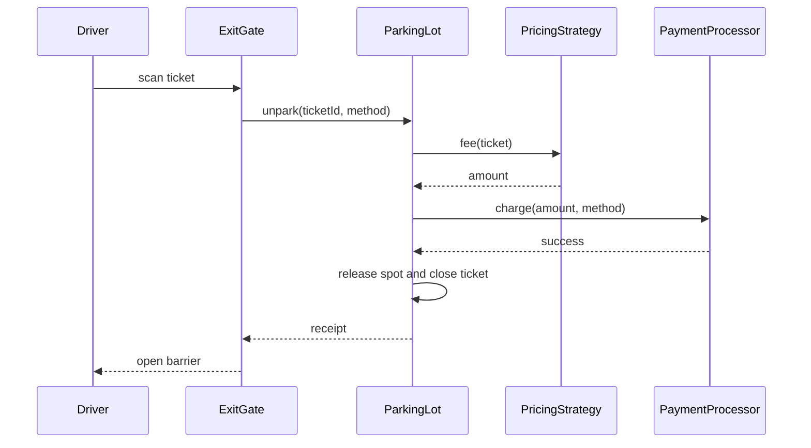

# Parking Lot

**Category:** Low-Level Design
**Difficulty:** 🟢 Easy
**Seniority:** junior
**Companies:** Amazon, Google, Microsoft, Uber, Goldman Sachs, Adobe
**Tags:** oop, strategy-pattern, factory-pattern, concurrency, enums, solid
**Time:** 45 min

---

## Problem Statement

Design the object model for a multi-level parking lot. Vehicles of different sizes (motorcycles, cars, trucks) enter through an entry gate, are assigned a compatible free spot, receive a ticket, and pay a fee at an exit gate based on how long they stayed.

The interviewer wants clean classes, clear responsibilities, extensibility for new vehicle/spot types and pricing rules, and correct behavior when several gates assign spots at the same time.

## Clarifying Questions

- How many levels and spots? *Assume up to 10 levels with ~500 spots each.*
- Which vehicle and spot types exist? *Motorcycle, Car, Truck; spots are Small, Compact, Large.*
- Can a smaller vehicle use a larger spot? *Yes — a motorcycle may use any spot, a car may use Compact or Large, a truck needs Large.*
- How is the fee computed? *Hourly rate per spot type, first hour rounded up; pricing must be swappable.*
- Multiple entry and exit gates? *Yes, several gates operating concurrently.*
- Payment methods? *Cash and card; payment processing itself is an external service.*
- Do we need a display board showing free spots? *Yes, per level and per spot type.*

## Requirements

### Functional
- Park a vehicle: find a compatible free spot, mark it occupied, issue a ticket.
- Unpark: compute fee from ticket entry time, accept payment, free the spot.
- Show free-spot counts per level and spot type.
- Support multiple levels and multiple entry/exit gates.

### Non-Functional
- No two vehicles may be assigned the same spot (thread-safe allocation).
- Spot lookup in O(1) or O(log n) amortized, not a full scan.
- Easy to add new vehicle types, spot types (EV charging), and pricing strategies.

### Out of Scope
- Reservations ahead of time, license-plate recognition hardware, multi-lot management.

## Core Entities

- **ParkingLot** → singleton-ish facade; owns levels, gates, and the active-ticket registry.
- **Level** → holds spots grouped by type; answers "give me a free spot for this vehicle".
- **ParkingSpot** → id, type, current vehicle; knows whether it can fit a vehicle.
- **Vehicle** (abstract) → license plate and required size; subclasses Motorcycle, Car, Truck.
- **Ticket** → ticket id, vehicle, spot, entry time, exit time, status.
- **SpotAllocationStrategy** → chooses a spot (nearest-first, lowest-level-first).
- **PricingStrategy** → computes fee from ticket duration and spot type.
- **EntryGate / ExitGate** → user-facing operations: issue ticket, process payment.
- **DisplayBoard** → observer that shows availability counts.

## Class Diagram



## Design Patterns

| Pattern | Where | Why |
|---|---|---|
| Strategy | `SpotAllocationStrategy`, `PricingStrategy` | Swap allocation (nearest, lowest floor) and pricing (hourly, flat, weekend) without touching `ParkingLot`. |
| Factory | `VehicleFactory.create(type, plate)` | Gate code creates vehicles from a scanned type without `if/else` scattered around. |
| Singleton | `ParkingLot` instance | One lot per process; all gates share the same state. Inject it rather than use a global for testability. |
| Observer | `Level` → `DisplayBoard` | Boards update automatically when spot counts change. |
| Facade | `ParkingLot` | Gates call `park/unpark` and never touch levels or spots directly. |

## Key Workflows

### Park a vehicle



The strategy walks levels in its preferred order; each level atomically pops a free spot of the smallest compatible type.

### Unpark and pay



## Implementation

```text
ENUM VehicleSize { SMALL, MEDIUM, LARGE }
ENUM SpotType    { SMALL, COMPACT, LARGE }

// Which spot types each vehicle size may use, smallest first
CONST COMPATIBLE ← {
    SMALL:  [SMALL, COMPACT, LARGE],
    MEDIUM: [COMPACT, LARGE],
    LARGE:  [LARGE]
}

CLASS ParkingSpot
    FIELDS id, type, vehicle ← NULL
    FUNCTION assign(v)
        SET vehicle ← v
    FUNCTION clear()
        SET vehicle ← NULL

CLASS Level
    FIELDS floor, freeSpots   // map SpotType -> concurrent queue of free spots
    FIELDS observers

    FUNCTION findSpot(vehicle)
        FOR type IN COMPATIBLE[vehicle.requiredSize()]
            SET spot ← freeSpots[type].poll()      // atomic pop, NULL if empty
            IF spot ≠ NULL
                spot.assign(vehicle)
                notify(type)
                RETURN spot
        RETURN NULL

    FUNCTION release(spot)
        spot.clear()
        freeSpots[spot.type].offer(spot)
        notify(spot.type)

    FUNCTION notify(type)
        FOR o IN observers
            o.update(floor, type, freeSpots[type].size())

CLASS NearestFirstStrategy IMPLEMENTS SpotAllocationStrategy
    FUNCTION allocate(levels, vehicle)
        FOR level IN levels                       // ordered by distance to gate
            SET spot ← level.findSpot(vehicle)
            IF spot ≠ NULL
                RETURN spot
        RETURN NULL

CLASS HourlyPricing IMPLEMENTS PricingStrategy
    FIELDS ratePerHour    // map SpotType -> Money
    FUNCTION fee(ticket)
        SET minutes ← minutesBetween(ticket.entryTime, now())
        SET hours ← max(1, ceil(minutes / 60))
        RETURN hours * ratePerHour[ticket.spot.type]

CLASS ParkingLot
    FIELDS levels, activeTickets (concurrent map), allocator, pricing, payments

    FUNCTION park(vehicle)
        SET spot ← allocator.allocate(levels, vehicle)
        IF spot = NULL
            THROW LotFullException
        SET ticket ← NEW Ticket(uuid(), vehicle, spot, now(), ACTIVE)
        activeTickets.put(ticket.id, ticket)
        RETURN ticket

    FUNCTION unpark(ticketId, method)
        SET ticket ← activeTickets.get(ticketId)
        IF ticket = NULL OR ticket.status ≠ ACTIVE
            THROW InvalidTicketException
        SET amount ← pricing.fee(ticket)
        IF NOT payments.charge(amount, method)
            THROW PaymentFailedException      // spot stays occupied
        SET ticket.exitTime ← now()
        SET ticket.status ← PAID
        levelOf(ticket.spot).release(ticket.spot)
        activeTickets.remove(ticketId)
        RETURN NEW Receipt(ticket, amount)
```

## Concurrency & Extensibility

- **Allocation race:** two gates must never get the same spot. Keeping free spots in a per-type concurrent queue makes `poll()` the atomic claim — no global lock. Alternative: a lock per level around `findSpot`, simpler but serializes gates on the same floor.
- **Ticket registry:** a concurrent hash map; `unpark` must check-and-transition status atomically (compare-and-set ACTIVE → PAID) so the same ticket cannot be paid twice from two exit gates.
- **Display counts:** derived from queue sizes, eventually consistent — acceptable for a board.
- **New vehicle type (e.g., Bus):** add a subclass and a `COMPATIBLE` entry; no changes to `Level` logic.
- **New spot type (EV charging):** add enum value plus a `ChargingSpot` subclass; allocation stays the same via the compatibility table.
- **New pricing (weekend, flat daily cap):** implement `PricingStrategy`, possibly as a decorator wrapping `HourlyPricing` to apply a cap.

## Trade-offs

| Decision | Option A | Option B | Choice & Why |
|---|---|---|---|
| Finding a free spot | Scan all spots | Free-spot queue per type per level | Queue: O(1) claim and naturally atomic; scanning is O(n) and racy. |
| Thread safety | Global lock on `park` | Per-level queues / CAS | Fine-grained: gates on different levels never block each other. |
| Vehicle-spot compatibility | `canFit` logic in each Vehicle subclass | Central compatibility table | Table: one place to change rules, easy to test. |
| Pricing | Hard-coded in `ParkingLot` | Strategy interface | Strategy: pricing changes often and varies per lot. |
| ParkingLot access | Global singleton | Single instance injected | Injected: same uniqueness, but unit tests can use fresh instances. |

## Follow-up Questions

1. **How would you support reservations?** Add a `Reservation` with a time window that removes a spot from the free queue at start time; a scheduler returns it if the driver no-shows after a grace period.
2. **How do you handle a lost ticket?** Look up the active ticket by license plate (secondary index) and charge a max-daily fee as policy.
3. **How would you add EV charging billing?** `ChargingSpot` records kWh; use a composite pricing strategy that sums parking time fee and energy fee.
4. **How would you scale to many lots?** Make `ParkingLot` per-lot with a central service; persist tickets and spot state in a DB with row-level locking or a conditional update on spot status.
5. **What if the payment fails?** Ticket stays ACTIVE and the spot stays occupied; the driver retries or pays at an attendant booth.

## Common Mistakes

- Putting all logic in one `ParkingLot` god class instead of delegating to Level/Spot/Strategy.
- Using `if vehicle is Car` chains everywhere instead of polymorphism or a compatibility table.
- Ignoring concurrency — two gates can grab the same spot with a naive "find then assign".
- Freeing the spot before payment succeeds.
- Scanning every spot on every arrival.
- Forgetting the rule that small vehicles may take larger spots (and that they should prefer the smallest fitting spot).

## Key Takeaways

- Separate structure (Lot → Level → Spot) from policies (allocation, pricing) via Strategy.
- Make the "claim a spot" step atomic; a concurrent free-list is the simplest correct approach.
- Model ticket lifecycle explicitly (ACTIVE → PAID) and guard transitions.
- Design for Open/Closed: new vehicle, spot, or pricing types should not change existing classes.
