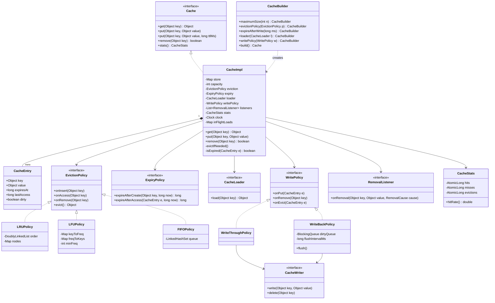
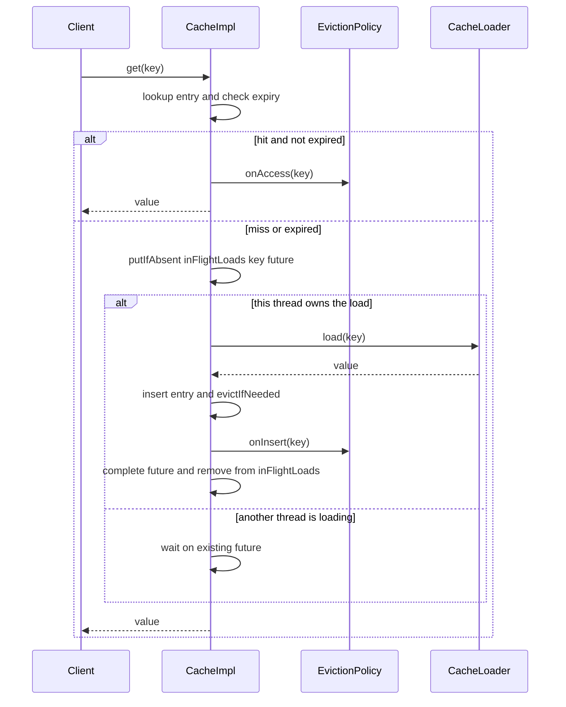
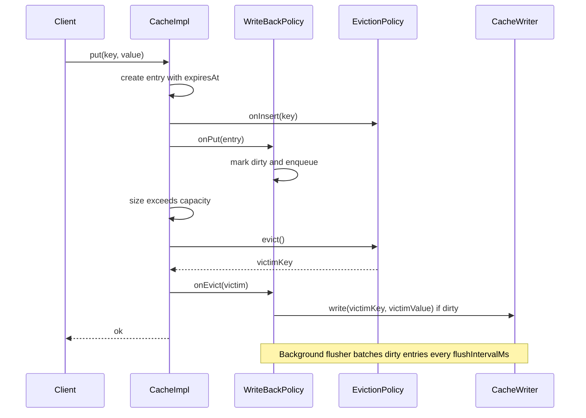

# Pluggable Cache Framework

**Category:** Low-Level Design
**Difficulty:** 🔴 Hard
**Seniority:** senior
**Companies:** Google, Amazon, Microsoft, Netflix, Uber, Salesforce
**Tags:** oop, strategy-pattern, eviction-policy, ttl, concurrency, write-behind
**Time:** 60 min

---

## Problem Statement

Design a reusable, in-process cache library (think Guava Cache, Caffeine, or Ehcache) that application teams can configure rather than re-implement. The cache must support pluggable eviction policies (LRU, LFU, FIFO, and custom ones), per-entry and default TTL, read-through loading from a backing source, write-through and write-back persistence modes, statistics (hit rate, evictions, load latency), and safe concurrent use by many threads.

The interviewer is assessing clean separation of concerns: storage vs. eviction ordering vs. expiration vs. loading vs. persistence. Strong candidates use the Strategy pattern for eviction and write policies, a Builder for configuration, keep every hot-path operation O(1), and reason carefully about thread safety and the "thundering herd" on cache misses.

## Clarifying Questions

- Is this a single-process library or a distributed cache? *Single-process library; distribution is a follow-up.*
- How is capacity bounded? *By entry count by default; optionally by weight via a user-supplied weigher.*
- Which eviction policies are required? *LRU, LFU, FIFO out of the box; users must be able to plug in their own.*
- TTL semantics? *Expire-after-write (default TTL or per-entry), optionally expire-after-access.*
- What happens on a miss? *If a Loader is configured, load from source (read-through) and ensure only one load per key runs concurrently.*
- Write semantics? *Write-through (sync write to store before returning) or write-back (async batched flush); default is cache-aside (no store).*
- Should callers be notified on eviction? *Yes, via removal listeners with a cause (SIZE, EXPIRED, EXPLICIT, REPLACED).*
- Expected concurrency? *Dozens of threads, read-heavy (~90% reads), millions of ops/sec.*

## Requirements

### Functional

- `get(key)`, `put(key, value)`, `put(key, value, ttl)`, `remove(key)`, `clear()`, `size()`.
- `get(key)` with a configured Loader performs read-through and caches the result.
- Bounded capacity; on overflow, evict a victim chosen by the configured EvictionPolicy.
- Expiration by TTL; expired entries are never returned.
- Write modes: NONE (cache-aside), WRITE_THROUGH, WRITE_BACK.
- Removal listeners and statistics (`hits`, `misses`, `loads`, `loadFailures`, `evictions`, `avgLoadTime`).
- Configuration via a fluent builder.

### Non-Functional

- O(1) average `get`, `put`, `remove` for all built-in policies (including LFU).
- Thread-safe; reads should not serialize behind each other more than necessary.
- At most one concurrent load per key (no cache stampede).
- Listener or loader exceptions must not corrupt cache state.
- Testable: injectable Clock.

### Out of Scope

- Distributed invalidation, off-heap storage, persistence of the cache itself across restarts.

## Core Entities

- **Cache** (interface) → public API: get, put, remove, stats.
- **CacheImpl** → coordinates storage map, eviction policy, expiry, loader, writer, stats, and locking.
- **CacheEntry** → key, value, writeTime, accessTime, expiresAt, dirty flag.
- **EvictionPolicy** (interface) → tracks access order and selects a victim: `onAccess`, `onInsert`, `onRemove`, `evict`.
- **LRUPolicy / LFUPolicy / FIFOPolicy** → concrete strategies (doubly linked list; frequency buckets; queue).
- **ExpiryPolicy** → computes `expiresAt` for create/update/access.
- **CacheLoader** → loads a value for a missing key from the source of truth.
- **WritePolicy** (interface) → NoWrite, WriteThrough, WriteBack; delegates to a **CacheWriter**.
- **RemovalListener** → callback on eviction/expiration/removal.
- **CacheStats** → atomic counters.
- **CacheBuilder** → fluent configuration, validates and constructs CacheImpl.
- **Clock** → time abstraction.

## Class Diagram



## Design Patterns

| Pattern | Where | Why |
|---|---|---|
| Strategy | EvictionPolicy, ExpiryPolicy, WritePolicy | Swap LRU/LFU/FIFO or write modes without touching CacheImpl (Open/Closed). |
| Builder | CacheBuilder | Many optional knobs; validates combinations (e.g. WRITE_BACK requires a writer). |
| Observer | RemovalListener | Decouple side effects (metrics, cleanup) from the cache core. |
| Template / Decorator | Optional StatsRecordingCache, LoadingCache wrappers | Layer features without bloating the core class. |
| Factory Method | `EvictionPolicies.lru()`, `.lfu()` | Hide concrete policy classes from users. |

## Key Workflows

### Read-through get with single-flight loading



On a hit the policy is notified so LRU/LFU ordering stays correct. On a miss, a per-key future in `inFlightLoads` guarantees that only one thread calls the loader; concurrent callers wait on the same future (single-flight).

### Put with write-back and eviction



## Implementation

```text
CLASS CacheImpl IMPLEMENTS Cache
    FIELDS store: HashMap<Key, CacheEntry>, capacity, eviction, expiry,
           loader, writePolicy, listeners, stats, clock,
           inFlightLoads: ConcurrentHashMap<Key, Future>, lock: ReentrantLock

    FUNCTION get(key)
        lock.acquire()
        SET entry ← store.get(key)
        IF entry ≠ NULL AND NOT isExpired(entry) THEN
            eviction.onAccess(key)
            SET entry.expiresAt ← expiry.expireAfterAccess(entry, clock.now())
            lock.release()
            stats.hits.increment()
            RETURN entry.value
        END IF
        IF entry ≠ NULL THEN                       // expired
            removeInternal(key, cause = EXPIRED)
        END IF
        lock.release()
        stats.misses.increment()
        IF loader = NULL THEN RETURN NULL
        RETURN loadSingleFlight(key)

    FUNCTION loadSingleFlight(key)
        SET newFuture ← new Future()
        SET existing ← inFlightLoads.putIfAbsent(key, newFuture)
        IF existing ≠ NULL THEN
            RETURN existing.await()                // another thread is loading
        END IF
        TRY
            SET start ← clock.now()
            SET value ← loader.load(key)           // outside the lock
            stats.recordLoad(clock.now() - start)
            put(key, value)
            newFuture.complete(value)
            RETURN value
        CATCH error
            stats.loadFailures.increment()
            newFuture.fail(error)
            THROW error
        FINALLY
            inFlightLoads.remove(key)
        END TRY

    FUNCTION put(key, value, ttl = DEFAULT)
        lock.acquire()
        SET now ← clock.now()
        SET old ← store.get(key)
        SET entry ← new CacheEntry(key, value, expiresAt = expiry.expireAfterCreate(key, now, ttl))
        store.put(key, entry)
        IF old ≠ NULL THEN
            eviction.onAccess(key)
            notifyLater(old, REPLACED)
        ELSE
            eviction.onInsert(key)
        END IF
        writePolicy.onPut(entry)                   // write-through blocks here
        evictIfNeeded()
        lock.release()
        fireQueuedNotifications()                  // listeners run outside the lock

    FUNCTION evictIfNeeded()
        WHILE store.size() > capacity
            SET victim ← eviction.evict()
            SET e ← store.remove(victim)
            writePolicy.onEvict(e)
            stats.evictions.increment()
            notifyLater(e, SIZE)
        END WHILE

    FUNCTION isExpired(entry)
        RETURN entry.expiresAt ≠ NEVER AND clock.now() ≥ entry.expiresAt
END CLASS

CLASS LRUPolicy IMPLEMENTS EvictionPolicy
    FIELDS list: DoublyLinkedList (head = most recent), nodes: HashMap<Key, Node>
    FUNCTION onInsert(key): nodes[key] ← list.addFirst(key)
    FUNCTION onAccess(key): list.moveToFront(nodes[key])
    FUNCTION onRemove(key): list.unlink(nodes.remove(key))
    FUNCTION evict()
        SET node ← list.removeLast()
        nodes.remove(node.key)
        RETURN node.key
END CLASS

CLASS LFUPolicy IMPLEMENTS EvictionPolicy
    FIELDS keyFreq: HashMap<Key, int>,
           buckets: HashMap<int, LinkedHashSet<Key>>, minFreq
    FUNCTION onInsert(key)
        SET keyFreq[key] ← 1
        buckets[1].add(key)
        SET minFreq ← 1
    FUNCTION onAccess(key)
        SET f ← keyFreq[key]
        buckets[f].remove(key)
        IF f = minFreq AND buckets[f].isEmpty() THEN SET minFreq ← f + 1
        SET keyFreq[key] ← f + 1
        buckets[f + 1].add(key)
    FUNCTION evict()
        SET key ← buckets[minFreq].removeFirst()  // LRU tie-break inside bucket
        keyFreq.remove(key)
        RETURN key
END CLASS

CLASS WriteBackPolicy IMPLEMENTS WritePolicy
    FIELDS dirty: ConcurrentHashMap<Key, Value>, writer, flusher: ScheduledThread
    FUNCTION onPut(entry): dirty.put(entry.key, entry.value)
    FUNCTION onEvict(entry)
        IF dirty.remove(entry.key) ≠ NULL THEN writer.write(entry.key, entry.value)
    FUNCTION flush()                               // runs every flushIntervalMs
        SET batch ← drain(dirty)
        writer.writeAll(batch)                     // on failure re-enqueue with backoff
END CLASS
```

## Concurrency & Extensibility

- **Locking:** a single lock is simplest and correct because LRU/LFU reads mutate ordering. To scale, use **lock striping**: N segments (e.g. 16-64), each with its own map, policy, and lock, chosen by `hash(key) % N`. Capacity is split per segment (approximate global LRU, acceptable in practice).
- **Read buffering (Caffeine style):** record accesses into a lock-free ring buffer and replay them into the policy in batches under a try-lock, so reads rarely block.
- **Single-flight loads:** `ConcurrentHashMap.putIfAbsent` of a future ensures one loader call per key; loader runs outside the lock so slow sources don't block other keys.
- **Stats:** `AtomicLong`/`LongAdder` counters, no locking.
- **Listeners:** queued under the lock, fired after release, exceptions caught and logged.
- **Expiration cleanup:** lazy on access plus a periodic sweeper (or a timer wheel keyed by `expiresAt`) to reclaim memory from untouched entries.
- **Extensibility:** new eviction policies (ARC, W-TinyLFU, random) implement `EvictionPolicy` only; new write modes implement `WritePolicy`; weight-based bounding plugs in a `Weigher`. CacheImpl never changes (Open/Closed).

## Trade-offs

| Decision | Option A | Option B | Choice & Why |
|---|---|---|---|
| Locking | Global lock | Striped segments | Start global for correctness; striping for throughput at the cost of approximate global ordering. |
| Expiration | Lazy on read only | Lazy + background sweeper | Both: lazy guarantees correctness, sweeper bounds memory from cold expired keys. |
| Write mode | Write-through | Write-back | Configurable: write-through for durability, write-back for write-heavy workloads tolerant of loss on crash. |
| LFU structure | Min-heap O(log n) | Frequency buckets O(1) | Buckets: O(1) and LRU tie-breaking within a frequency. |
| Loader call | Under the lock | Outside with per-key future | Outside: avoids blocking unrelated keys; future prevents stampede. |

## Follow-up Questions

1. **How would you support weight-based capacity (e.g. bytes)?** Add a `Weigher` strategy; track `totalWeight` and evict while `totalWeight > maxWeight`.
2. **How do you avoid LFU "cache pollution" by once-hot keys?** Use frequency aging (halve counters periodically) or W-TinyLFU with a Count-Min sketch admission filter.
3. **What if write-back flush fails?** Retry with exponential backoff, keep entries dirty, cap the dirty queue and apply backpressure or fall back to write-through; expose a metric.
4. **How do you refresh hot entries without blocking readers?** `refreshAfterWrite`: serve the stale value and trigger an async reload once past the refresh threshold.
5. **How would this become distributed?** Front it as a near-cache over Redis, with pub/sub invalidation messages and versioned entries to avoid stale overwrites.

## Common Mistakes

- Hard-coding LRU into the cache class instead of extracting an eviction strategy.
- Using a heap for LRU/LFU and getting O(log n) or O(n) operations.
- Calling the loader or listeners while holding the cache lock.
- Letting N threads load the same missing key simultaneously (stampede).
- Returning expired entries because expiry is only checked by a background thread.
- Forgetting that `get` mutates policy state, so a read-write lock with shared reads is incorrect.

## Key Takeaways

- Separate storage, eviction ordering, expiry, loading, and persistence into independent strategies.
- Every built-in policy must be O(1): hash map plus linked list (LRU) or frequency buckets (LFU).
- Single-flight loading and out-of-lock callbacks are essential for correctness under concurrency.
- Scale with lock striping and buffered access recording; keep stats lock-free.
