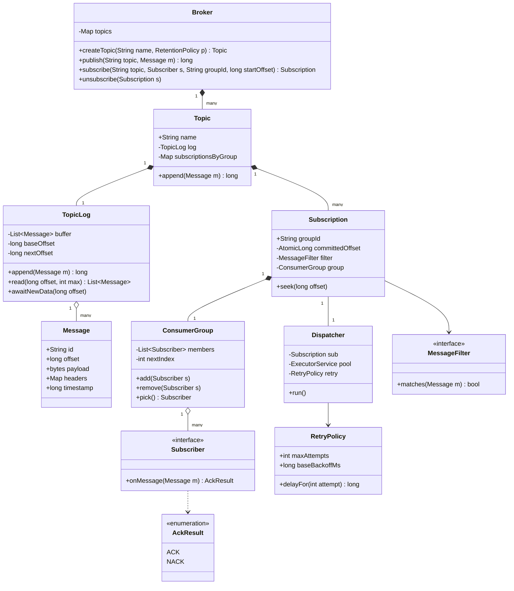
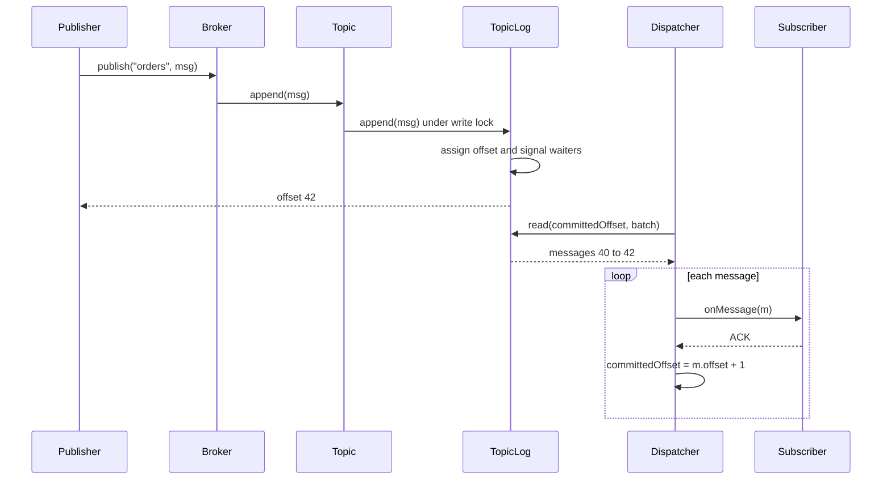
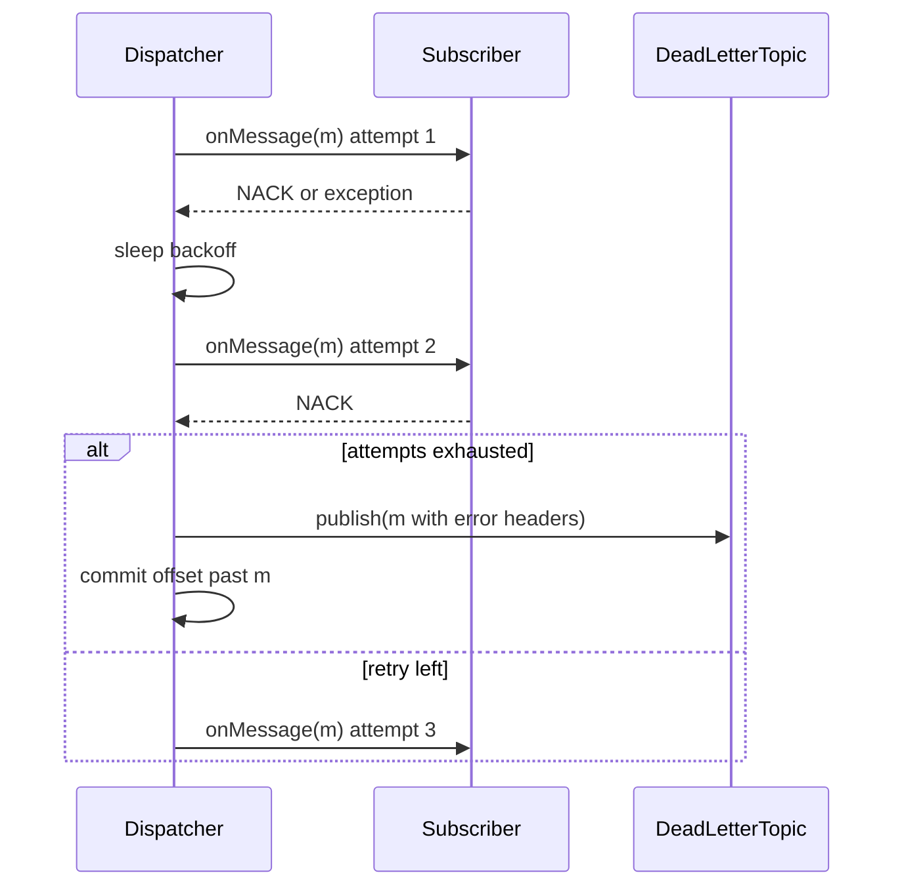

# Pub-Sub System

**Category:** Low-Level Design
**Difficulty:** 🟡 Medium
**Seniority:** senior
**Companies:** Amazon, Google, Microsoft, Uber, LinkedIn, Confluent
**Tags:** oop, observer-pattern, concurrency, message-queue, offsets, back-pressure
**Time:** 45 min

---

## Problem Statement

Design an in-process (single-node) publish-subscribe messaging system. Publishers send messages to named topics; subscribers register interest in topics and receive every message published after they subscribe. Delivery must be asynchronous so a slow subscriber does not block publishers or other subscribers.

For a senior-level discussion, the interviewer expects support for consumer groups (load-balancing messages among members), offset tracking so subscribers can replay or resume, at-least-once delivery with acknowledgements and retries, and a clear thread model.

## Clarifying Questions

- Push or pull delivery? *Push via per-subscriber dispatcher threads; internally each subscriber pulls from its offset.*
- Delivery guarantee? *At-least-once with ack; failed messages are retried and then sent to a dead-letter topic.*
- Ordering? *Ordered per topic (single partition) for each subscriber; partitions are a follow-up.*
- Message retention? *Retain the last N messages or T minutes per topic, enabling replay from an offset.*
- Consumer groups? *Yes; each message is delivered to exactly one member of a group, and to every distinct group.*
- Message filtering? *Optional predicate per subscription.*
- Persistence? *In-memory for the design; durable log is a follow-up.*

## Requirements

### Functional

- Create/delete topics.
- `publish(topic, message)` returns the message offset.
- `subscribe(topic, subscriber, group?, startOffset?)` and `unsubscribe`.
- Each subscription receives messages in order starting from its offset.
- Consumer groups share a single offset; messages are distributed among members.
- Ack/nack; retry with backoff; dead-letter after max attempts.
- Reset offset to replay.

### Non-Functional

- Publishers never block on slow subscribers.
- Thread-safe under many concurrent publishers and subscribers.
- Bounded memory via retention.
- Low latency (sub-millisecond in-process hand-off).

### Out of Scope

- Network protocol, multi-node replication, exactly-once transactions.

## Core Entities

- **Message** → id, topic, offset, payload, headers, timestamp.
- **Topic** → name, append-only bounded log of messages, list of subscriptions.
- **TopicLog** → ring buffer / list with base offset and retention; `append` and `read(offset)`.
- **Subscriber** → user callback interface `onMessage(message) → Ack`.
- **Subscription** → (topic, group id, filter); owns a committed offset and a dispatcher.
- **ConsumerGroup** → members sharing one subscription/offset, round-robin assignment.
- **Dispatcher** → worker that reads from the log at the offset and invokes subscribers.
- **RetryPolicy** → max attempts, backoff.
- **Broker** → facade: topic registry, publish, subscribe.

## Class Diagram



## Design Patterns

| Pattern | Where | Why |
|---|---|---|
| Observer | `Subscriber` registered on `Topic` | Core of pub-sub: publishers are decoupled from consumers. |
| Facade | `Broker` | Single entry point hiding topics, logs, dispatchers. |
| Strategy | `RetryPolicy`, `MessageFilter`, group assignment (round-robin vs sticky) | Pluggable behaviors per subscription. |
| Producer-Consumer | `TopicLog` + `Dispatcher` threads | Async hand-off isolates slow consumers. |
| Factory | Topic creation with retention policy | Centralizes configuration of logs. |

## Key Workflows

### Publish and deliver



The publisher returns as soon as the message is in the log. Each subscription's dispatcher advances independently, so a slow subscriber only falls behind on its own offset.

### Failure and retry



## Implementation

```text
CLASS TopicLog                                  // bounded, offset-addressed ring buffer
    FIELDS buffer[capacity], baseOffset ← 0, nextOffset ← 0, lock, notEmpty : Condition

    FUNCTION append(msg)
        WITH lock
            SET msg.offset ← nextOffset
            SET buffer[nextOffset MOD capacity] ← msg
            SET nextOffset ← nextOffset + 1
            IF nextOffset - baseOffset > capacity THEN
                SET baseOffset ← nextOffset - capacity      // oldest evicted
            notEmpty.signalAll()
            RETURN msg.offset

    FUNCTION read(offset, max)
        WITH lock
            IF offset < baseOffset THEN THROW OffsetOutOfRange(baseOffset)
            SET endOff ← min(nextOffset, offset + max)
            RETURN [buffer[o MOD capacity] FOR o FROM offset TO endOff - 1]

    FUNCTION awaitNewData(offset, timeout)
        WITH lock
            WHILE offset >= nextOffset AND NOT timedOut
                notEmpty.await(timeout)

CLASS Broker
    FIELDS topics : ConcurrentMap<String, Topic>

    FUNCTION publish(topicName, msg)
        SET topic ← topics.get(topicName) OR THROW UnknownTopic
        SET msg.timestamp ← now()
        RETURN topic.log.append(msg)

    FUNCTION subscribe(topicName, subscriber, groupId, startOffset)
        SET topic ← topics.get(topicName)
        SET sub ← topic.subscriptionsByGroup.computeIfAbsent(groupId, g ->
                    NEW Subscription(topic, g, startOffset OR topic.log.nextOffset))
        sub.group.add(subscriber)
        IF sub.dispatcher NOT running THEN sub.dispatcher.start()
        RETURN sub

CLASS Dispatcher                                // one thread per subscription (group)
    FUNCTION run()
        WHILE running
            SET off ← sub.committedOffset.get()
            TRY
                SET batch ← log.read(off, 100)
            CATCH OffsetOutOfRange e
                sub.committedOffset.set(e.baseOffset)       // fell behind retention
                CONTINUE
            IF batch IS EMPTY THEN
                log.awaitNewData(off, 500ms)
                CONTINUE
            FOR m IN batch
                IF sub.filter IS NOT NULL AND NOT sub.filter.matches(m) THEN
                    sub.committedOffset.set(m.offset + 1)
                    CONTINUE
                deliverWithRetry(m)
                sub.committedOffset.set(m.offset + 1)       // commit after ack: at-least-once

    FUNCTION deliverWithRetry(m)
        FOR attempt FROM 1 TO retry.maxAttempts
            SET target ← sub.group.pick()                   // round-robin member
            TRY
                IF target.onMessage(m) == ACK THEN RETURN
            CATCH e
                log warning
            sleep(retry.delayFor(attempt))                 // base * 2^(attempt-1) + jitter
        broker.publish(topic.name + ".DLQ", m.withHeader("error", lastError))

CLASS ConsumerGroup
    FIELDS members : CopyOnWriteList, nextIndex : AtomicInteger
    FUNCTION pick()
        SET snapshot ← members
        IF snapshot IS EMPTY THEN WAIT until member added
        RETURN snapshot[nextIndex.getAndIncrement() MOD size(snapshot)]
```

## Concurrency & Extensibility

- **Publishing:** a short critical section on the topic log (append + signal). For higher throughput, use a lock-free ring buffer with an atomic sequence (Disruptor-style) and per-reader cursors.
- **Isolation:** each subscription has its own dispatcher thread and offset, so slow consumers never block publishers or other groups. Retention bounds memory; consumers that fall behind skip to `baseOffset` (with a metric for lost messages) or the log is configured to block publishers instead.
- **Ordering vs parallelism:** one dispatcher per group preserves order. For parallelism, partition topics by key; each partition is assigned to one group member (like Kafka), keeping per-key order.
- **At-least-once:** offset commits after ack, so a crash or retry may redeliver — subscribers must be idempotent (dedupe by message ID).
- **Membership changes:** `CopyOnWriteList` makes add/remove safe while dispatching.
- **Open/Closed:** new filters, retry policies, assignment strategies (sticky, key-hash) and storage backends (durable segment files) plug in via interfaces without changing `Broker`.

## Trade-offs

| Decision | Option A | Option B | Choice & Why |
|---|---|---|---|
| Storage | Per-subscriber queue (copy message) | Shared log + per-subscriber offset | Shared log — one copy, enables replay, consumer lag is just an offset diff. |
| Delivery | Push callbacks on publisher thread | Dispatcher threads per subscription | Dispatchers — publisher latency independent of consumers. |
| Guarantee | At-most-once (commit before process) | At-least-once (commit after ack) | At-least-once — losing messages is worse; require idempotent consumers. |
| Slow consumer | Block publishers | Evict old messages, consumer skips | Evict with retention — protects the system; alert on lag. |
| Thread model | Thread per subscription | Shared pool with work-stealing | Thread per subscription for simplicity; shared pool when subscriptions number in thousands. |

## Follow-up Questions

1. **How would you make it durable?** Append messages to segment files (fsync policy configurable) with an offset index; store committed offsets in a compacted internal topic — essentially Kafka's design.
2. **How do you scale beyond one node?** Partition topics, assign partitions to brokers via a coordinator (ZooKeeper/Raft), and replicate each partition with a leader and followers.
3. **How do you support exactly-once?** Idempotent producers (sequence numbers per producer) plus transactional offset commits atomically with consumer side effects, or dedupe at the consumer.
4. **How do you implement wildcard topics like `orders.*`?** Keep a trie of topic segments; subscription to a pattern registers with every matching topic and new topics are matched on creation.
5. **How do you handle a poison message?** Bounded retries with exponential backoff, then route to a DLQ with error metadata so the subscription keeps making progress.

## Common Mistakes

- Invoking subscriber callbacks synchronously inside `publish`, so one slow subscriber stalls everything.
- Copying every message into every subscriber's queue with unbounded memory.
- Committing the offset before processing and silently losing messages on failure.
- Ignoring ordering when adding parallelism within a group.
- Modifying the subscriber list while iterating without proper concurrency control.

## Key Takeaways

- Model a topic as an append-only log; subscriptions are just offsets into it.
- Decouple publishers and consumers with dispatcher threads and bounded retention.
- Consumer groups share one offset; partitions give parallelism with per-key ordering.
- At-least-once with ack, retry with backoff, then a DLQ — consumers must be idempotent.
