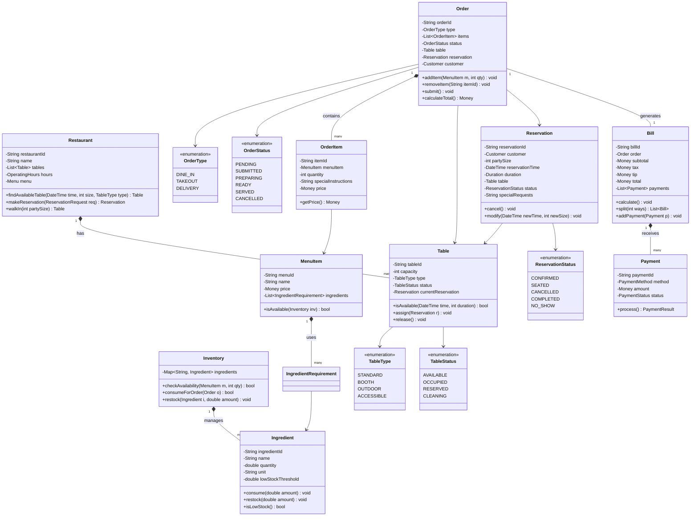
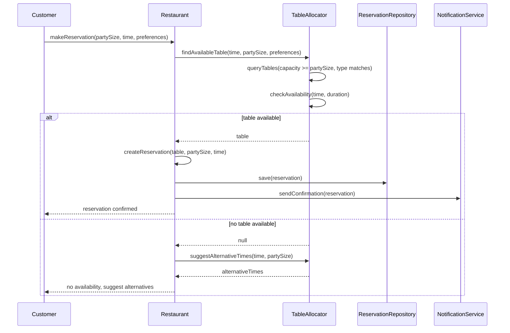
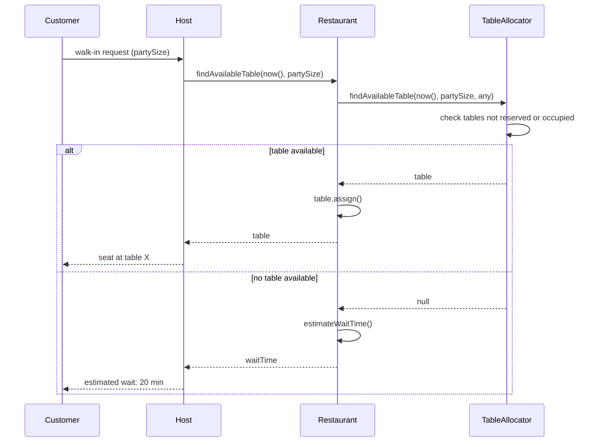
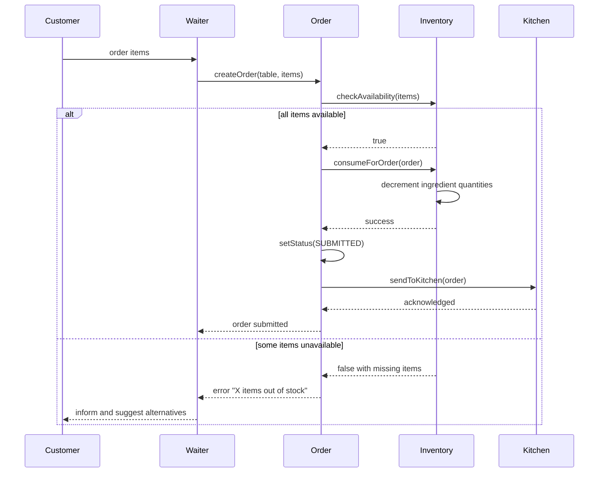
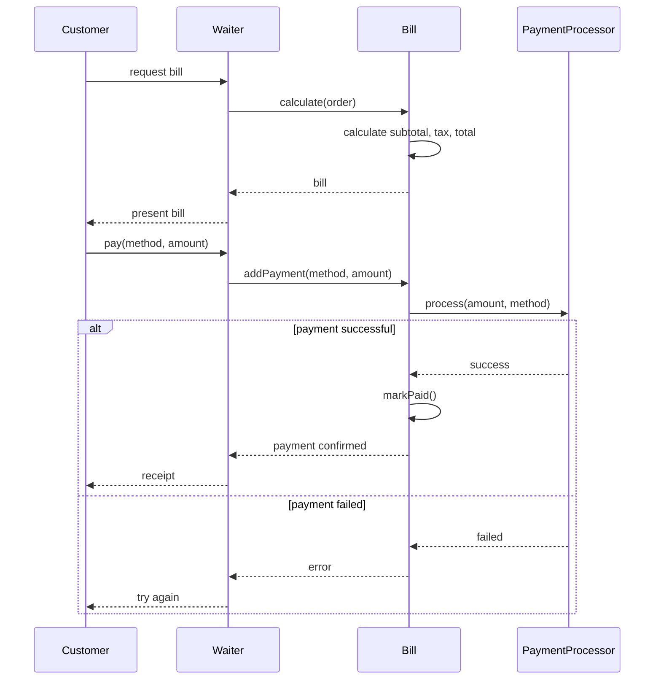

# Restaurant Management

**Category:** Low-Level Design
**Difficulty:** 🟡 Medium
**Seniority:** mid
**Companies:** OpenTable, Yelp
**Tags:** patterns, reservations, inventory
**Time:** 45-60 min

---

## Problem Statement

Design a restaurant management system that handles table reservations, order management, and inventory tracking. Customers can make reservations for specific times and party sizes, view available tables, and cancel reservations. The system tracks table availability, manages orders (food and drinks), and monitors ingredient inventory.

The interviewer is looking for clean separation between reservation management, table allocation, order processing, and inventory tracking, along with proper handling of concurrency, time-based reservations, and inventory depletion.

## Clarifying Questions

- What restaurant features? *Tables with different capacities (2-top, 4-top, 6-top, booth), reservations, walk-ins, dine-in and takeout orders.*
- How are reservations handled? *Time-based reservations with party size, duration (default 2 hours).*
- What order types? *Dine-in (linked to table/reservation), takeout, delivery.*
- How is inventory tracked? *Ingredients with quantities; orders consume inventory; low stock alerts.*
- Can customers modify orders? *Yes, add/remove items before kitchen starts preparation.*
- What about table turnover? *Tables become available after reservation duration ends or when party leaves.*
- Do we need payment processing? *Yes, split bills, multiple payment methods.*
- Any special seating requirements? *Yes, accessibility, outdoor/indoor preference.*

## Requirements

### Functional
- Make, view, modify, and cancel reservations.
- Assign tables to reservations and walk-ins.
- Create and manage orders (add/remove items, special requests).
- Track table availability in real-time.
- Manage ingredient inventory with depletion on orders.
- Handle dine-in, takeout, and delivery orders.
- Support split bills and multiple payment methods.
- Generate reports (sales, inventory, reservation analytics).

### Non-Functional
- No double bookings for the same table/time.
- Fast table availability queries.
- Concurrent order modifications handled correctly.
- Inventory updates must be consistent.
- System should handle peak hours (high concurrency).

### Out of Scope
- Menu management (assume menu exists), kitchen display system, staff scheduling, loyalty program.

## Core Entities

- **Restaurant** → id, name, tables, operating hours, menu.
- **Table** → id, capacity, type (standard, booth, outdoor), status, currentReservation.
- **Reservation** → id, customer, partySize, reservationTime, duration, table, status, specialRequests.
- **Order** → id, type (dine-in, takeout, delivery), items, status, table, reservation, total.
- **OrderItem** → menuItem, quantity, specialInstructions, price.
- **MenuItem** → id, name, price, requiredIngredients.
- **Ingredient** → id, name, quantity, unit, threshold.
- **Inventory** → tracks ingredient quantities.
- **Bill** → id, order, items, subtotal, tax, tip, total, payments.
- **Payment** → id, method, amount, status.

## Class Diagram



## Design Patterns

| Pattern | Where | Why |
|---|---|---|
| Strategy | Table allocation strategies (best fit, first available) | Different algorithms for assigning tables without changing core logic. |
| Factory | OrderFactory.create(type, ...) | Create appropriate order subtype (dine-in, takeout, delivery). |
| Observer | Inventory → Kitchen (low stock alerts) | Notify kitchen when ingredients run low. |
| State | OrderStatus, TableStatus, ReservationStatus | Clear state transitions with validation. |
| Repository | ReservationRepository, OrderRepository | Abstract persistence for testability. |
| Builder | Bill with complex calculations | Build bill with subtotal, tax, tip, split logic. |
| Command | Order actions (add item, remove item, submit) | Undo/redo support, audit logging. |

## Key Workflows

### Make a reservation



### Walk-in seating



### Place order and consume inventory



### Bill payment



## Implementation

```text
ENUM TableType { STANDARD, BOOTH, OUTDOOR, ACCESSIBLE }
ENUM TableStatus { AVAILABLE, OCCUPIED, RESERVED, CLEANING }
ENUM ReservationStatus { CONFIRMED, SEATED, CANCELLED, COMPLETED, NO_SHOW }
ENUM OrderStatus { PENDING, SUBMITTED, PREPARING, READY, SERVED, CANCELLED }
ENUM OrderType { DINE_IN, TAKEOUT, DELIVERY }
ENUM PaymentMethod { CASH, CREDIT, DEBIT, GIFT_CARD }
ENUM PaymentStatus { PENDING, PROCESSED, FAILED, REFUNDED }

CLASS Table
    FIELDS tableId, capacity, type, status ← AVAILABLE
    FIELDS currentReservation ← NULL

    FUNCTION isAvailable(time, duration)
        IF status ≠ AVAILABLE
            RETURN false
        IF currentReservation ≠ NULL
            SET resEnd ← currentReservation.reservationTime + currentReservation.duration
            // Check if requested time overlaps with existing reservation
            IF time < resEnd AND time + duration > currentReservation.reservationTime
                RETURN false
        RETURN true

    FUNCTION assign(reservation)
        SET currentReservation ← reservation
        SET status ← RESERVED

    FUNCTION release()
        SET currentReservation ← NULL
        SET status ← AVAILABLE

    FUNCTION seat()
        SET status ← OCCUPIED

CLASS Reservation
    FIELDS reservationId, customer, partySize, reservationTime, duration
    FIELDS table, status ← CONFIRMED, specialRequests

    FUNCTION cancel()
        SET status ← CANCELLED
        IF table ≠ NULL
            table.release()

    FUNCTION modify(newTime, newSize)
        SET oldTable ← table
        SET table ← NULL  // Release current table
        SET reservationTime ← newTime
        SET partySize ← newSize
        // Re-allocate table (would call restaurant.findAvailableTable)
        SET status ← CONFIRMED

CLASS Ingredient
    FIELDS ingredientId, name, quantity, unit, lowStockThreshold

    FUNCTION consume(amount)
        IF quantity < amount
            THROW InsufficientStockException
        SET quantity ← quantity - amount

    FUNCTION restock(amount)
        SET quantity ← quantity + amount

    FUNCTION isLowStock()
        RETURN quantity ≤ lowStockThreshold

CLASS Inventory
    FIELDS ingredients  // map ingredientId -> Ingredient

    FUNCTION checkAvailability(menuItem, qty)
        FOR req IN menuItem.ingredients
            SET ingredient ← ingredients.get(req.ingredientId)
            IF ingredient = NULL OR ingredient.quantity < req.amount * qty
                RETURN false
        RETURN true

    FUNCTION consumeForOrder(order)
        FOR item IN order.items
            IF NOT checkAvailability(item.menuItem, item.quantity)
                RETURN false
        // All available, consume
        FOR item IN order.items
            FOR req IN item.menuItem.ingredients
                ingredients.get(req.ingredientId).consume(req.amount * item.quantity)
        RETURN true

CLASS Order
    FIELDS orderId, type, items ← [], status ← PENDING
    FIELDS table, reservation, customer

    FUNCTION addItem(menuItem, quantity)
        IF NOT inventory.checkAvailability(menuItem, quantity)
            THROW ItemUnavailableException
        SET item ← NEW OrderItem(menuItem, quantity, menuItem.price)
        items.add(item)

    FUNCTION removeItem(itemId)
        SET item ← findItemById(itemId)
        IF item = NULL
            THROW ItemNotFoundException
        items.remove(item)

    FUNCTION submit()
        IF items.isEmpty()
            THROW EmptyOrderException
        IF NOT inventory.consumeForOrder(this)
            THROW InsufficientInventoryException
        SET status ← SUBMITTED
        // Send to kitchen (async)

    FUNCTION calculateTotal()
        RETURN items.sum(item → item.getPrice())

CLASS OrderItem
    FIELDS itemId, menuItem, quantity, specialInstructions, price

    FUNCTION getPrice()
        RETURN price * quantity

CLASS Bill
    FIELDS billId, order, subtotal, tax, tip ← 0, total, payments ← []

    FUNCTION calculate()
        SET subtotal ← order.calculateTotal()
        SET tax ← subtotal * TAX_RATE
        SET total ← subtotal + tax + tip

    FUNCTION split(ways)
        SET perPerson ← total / ways
        SET bills ← []
        FOR i FROM 1 TO ways
            SET splitBill ← NEW Bill(uuid(), order, subtotal/ways, tax/ways, 0, perPerson)
            bills.add(splitBill)
        RETURN bills

    FUNCTION addPayment(method, amount)
        SET payment ← NEW Payment(uuid(), method, amount)
        SET result ← paymentProcessor.process(payment)
        IF result.success
            payments.add(payment)
        ELSE
            THROW PaymentFailedException

CLASS Restaurant
    FIELDS tables, reservationRepository, orderRepository, inventory

    FUNCTION makeReservation(request)
        SET table ← findAvailableTable(request.time, request.partySize, request.preferences)
        IF table = NULL
            SET alternatives ← findAlternativeTimes(request.time, request.partySize)
            THROW NoTableAvailableException(alternatives)
        SET reservation ← NEW Reservation(uuid(), request.customer, request.partySize, request.time, DEFAULT_DURATION, table)
        table.assign(reservation)
        reservationRepository.save(reservation)
        notificationService.sendConfirmation(reservation)
        RETURN reservation

    FUNCTION findAvailableTable(time, partySize, preferences)
        SET candidates ← tables.filter(t → t.capacity ≥ partySize AND t.type IN preferences)
        FOR table IN candidates.sortBy(capacity ASC)  // Best fit: smallest table that fits
            IF table.isAvailable(time, DEFAULT_DURATION)
                RETURN table
        RETURN NULL

    FUNCTION walkIn(partySize)
        SET table ← findAvailableTable(now(), partySize, ALL_TYPES)
        IF table = NULL
            SET waitTime ← estimateWaitTime(partySize)
            THROW NoTableAvailableException(waitTime)
        table.seat()
        RETURN table

    FUNCTION estimateWaitTime(partySize)
        // Calculate based on reservations ending soon and average dining duration
        SET soonAvailable ← tables.count(t → t.status = OCCUPIED AND t.estimatedFreeIn() < 30 MIN)
        RETURN estimate based on queue length and soonAvailable
```

## Concurrency & Extensibility

- **Concurrent reservations:** Use optimistic locking on Table. When assigning, check version; if changed, retry availability check.
- **Inventory consistency:** Use database transactions for inventory consumption. Check-and-decrement must be atomic to prevent overselling.
- **Table availability queries:** Index tables by capacity and type. Use time-range queries for reservation overlaps.
- **Order modifications:** Allow modifications only while order is PENDING. Once SUBMITTED, only cancellation allowed.
- **Reservation no-shows:** Scheduled job marks reservations as NO_SHOW if not seated within grace period (15 min). Automatically releases table.
- **Table turnover:** Track actual dining duration vs. reservation duration. Update estimates for better walk-in predictions.
- **New order types:** Add OrderType enum value and create specific handling in OrderFactory.
- **Menu changes:** When menu item ingredients change, update existing orders only if not yet submitted.
- **Multiple payment methods:** Support split payments across different methods; track in Bill.payments.
- **Delivery integration:** Add DeliveryService interface; integrate with third-party delivery APIs.

## Trade-offs

| Decision | Option A | Option B | Choice & Why |
|---|---|---|---|
| Table allocation | First available | Best fit (smallest that fits) | Best fit: efficient use of space, better for busy restaurants. |
| Reservation duration | Fixed 2 hours | Variable by party size | Fixed: simpler; variable could optimize turnover but adds complexity. |
| Inventory check | On order submit | On each item add | On submit: better UX, but risk of unavailable items at submit. |
| Order modifications | Anytime before served | Only before submitted | Before submitted: simpler, avoids kitchen confusion. |
| Payment processing | Synchronous | Async queue | Async: faster response, handles payment gateway delays gracefully. |
| No-show handling | Manual | Auto-detect with grace period | Auto: frees tables faster, reduces manual work. |

## Follow-up Questions

1. **How do you handle overbooking?** Allow overbooking by a small percentage (e.g., 10%) based on no-show historical data. Compensate with vouchers if overbooked.
2. **How do you support combo meals?** Create ComboMenuItem that contains multiple MenuItems with special pricing. Inventory consumption sums all ingredients.
3. **How do you handle happy hour pricing?** Add time-based pricing to MenuItem; Order calculates price based on order time.
4. **How do you integrate with kitchen display system?** Use observer pattern; Order notifies KitchenSystem on status change. KitchenSystem displays orders by priority.
5. **How do you handle split bills with items assigned to specific people?** Extend OrderItem to track assignee; Bill can split by assignee or evenly.
6. **How do you manage ingredient expiry?** Add expiry date to Ingredient batches; FIFO consumption logic. Alert before expiry.

## Common Mistakes

- Not checking table availability for the entire reservation duration (only checking start time).
- Forgetting to release tables when reservations are cancelled or no-shows.
- Not handling inventory race conditions (two orders consuming same ingredient).
- Allowing order modifications after kitchen starts preparation.
- Not accounting for table cleaning time between reservations.
- Complex nested if-else for table allocation instead of strategy pattern.
- Not validating that party size fits table capacity.

## Key Takeaways

- Separate concerns: reservations, table management, orders, inventory.
- Use time intervals correctly for availability checks (consider duration, not just start time).
- Inventory consumption must be atomic to prevent overselling.
- State machines for Order, Table, and Reservation ensure valid transitions.
- Strategy pattern for table allocation makes algorithms swappable.
- Handle edge cases: no-shows, cancellations, walk-ins, overbooking.
- Design for concurrency: optimistic locking, transactions.
- Real-time availability is critical for restaurant operations.
