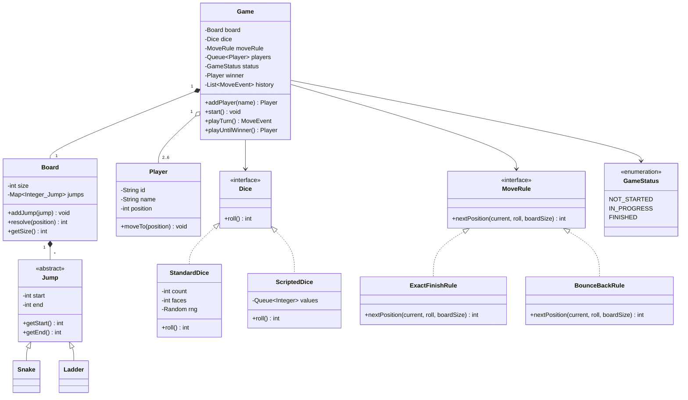
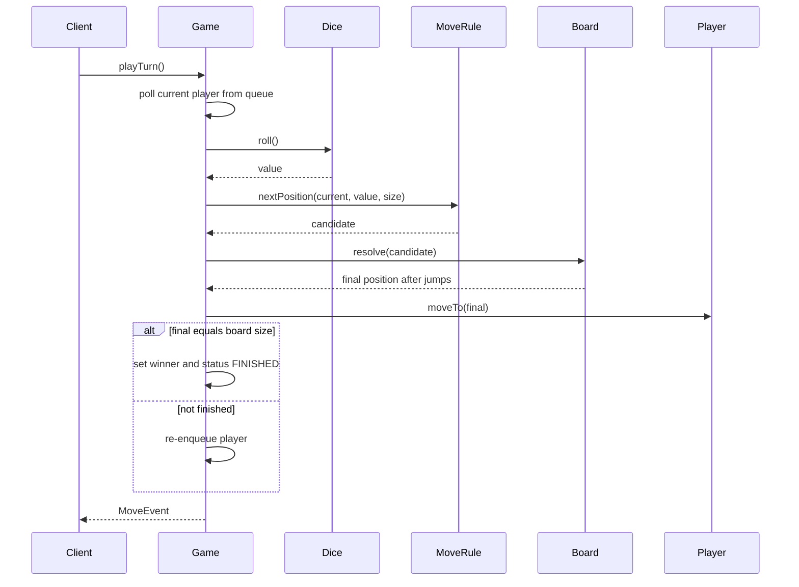
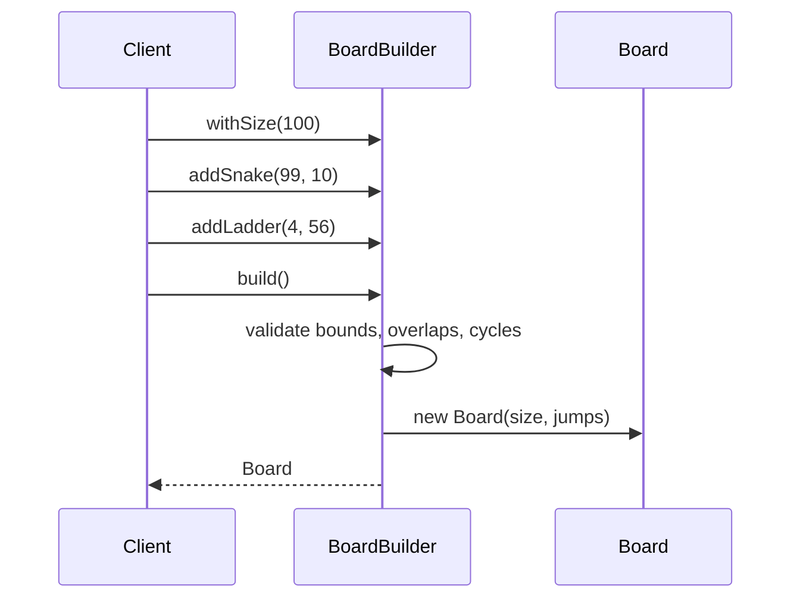

# Snake and Ladder

**Category:** Low-Level Design
**Difficulty:** 🟢 Easy
**Seniority:** junior
**Companies:** Amazon, Microsoft, Flipkart, Swiggy, Uber, Zoho
**Tags:** oop, game-design, strategy-pattern, board-modeling, turn-based, solid
**Time:** 30 min

---

## Problem Statement

Design the classic Snake and Ladder board game. Two or more players take turns rolling a die and moving their token forward on a board of N cells (typically 100). Landing on the head of a snake moves the token down to its tail; landing on the bottom of a ladder moves it up to its top. The first player to reach the final cell exactly wins.

The interviewer is looking for clean entity modeling (Board, Cell/Jump, Player, Dice, Game), a correct turn loop, configurable rules (board size, number of dice, exact-finish rule), and extensibility for variants without rewriting the core engine.

## Clarifying Questions

- What is the board size? *Default 100 cells, configurable.*
- How many players? *2 to 6 players, played in fixed round-robin order.*
- How many dice, and what faces? *One 6-sided die by default; allow multiple dice via configuration.*
- Must a player land exactly on the last cell? *Yes — if the roll overshoots, the player stays in place.*
- Does rolling a 6 give an extra turn? *Optional rule; design it as a pluggable rule, off by default.*
- Can two players share a cell? *Yes, no capturing.*
- Can a snake's tail land on a ladder's bottom (chains)? *Allow chained jumps, but validate the board has no cycles.*
- Does the game continue after the first winner to rank others? *No — stop at the first winner.*

## Requirements

### Functional
- Create a board with configurable size, snakes, and ladders.
- Add players; all start at position 0 (off the board).
- Players take turns rolling dice and moving; apply snakes and ladders.
- Enforce the exact-finish rule; declare the winner and end the game.
- Expose a move history / event log for display.

### Non-Functional
- Board validation: no snake or ladder starts at cell 1 or the last cell; no two jumps start on the same cell; no cycles.
- Deterministic and testable: dice must be injectable (seeded or scripted).
- Extensible to new rules (extra turn on 6, three 6s forfeits) and new jump types.

### Out of Scope
- UI rendering, networking/multiplayer over the internet, persistence.

## Core Entities

- **Game** → orchestrates turns, holds the players queue, board, dice, rules, and status.
- **Board** → size plus a map from start cell to Jump; resolves the final position after jumps.
- **Jump** (abstract) → start and end cell; concrete **Snake** (end < start) and **Ladder** (end > start).
- **Player** → id, name, current position.
- **Dice** (interface) → `roll()`; **StandardDice** (N dice with F faces), **ScriptedDice** for tests.
- **MoveRule** (interface) → computes the next position given current position and roll (exact-finish, bounce-back).
- **GameStatus** → enum: NOT_STARTED, IN_PROGRESS, FINISHED.
- **MoveEvent** → record of player, roll, from, to, and jumps applied.

## Class Diagram



## Design Patterns

| Pattern | Where | Why |
|---|---|---|
| Strategy | `Dice`, `MoveRule` | Swap dice behavior (crooked, multiple, scripted) and finish rules without touching `Game`. |
| Builder | `BoardBuilder` | Validates snakes/ladders (no overlap, no cycles, bounds) before producing an immutable `Board`. |
| Template / polymorphism | `Jump` → `Snake`, `Ladder` | Board treats all jumps uniformly; new jump types (e.g. teleport) plug in. |
| Observer (optional) | `GameListener` | UI or logger subscribes to `MoveEvent`s instead of `Game` printing directly. |

## Key Workflows

### Playing a turn



1. The current player is taken from the front of the queue.
2. The dice is rolled; the move rule decides whether the move is legal (overshoot → stay).
3. The board resolves any chain of snakes/ladders from the landing cell.
4. If the player reaches the last cell they win; otherwise they go to the back of the queue.

### Building a board



## Implementation

```text
ENUM GameStatus { NOT_STARTED, IN_PROGRESS, FINISHED }

ABSTRACT CLASS Jump
    FIELD start: int
    FIELD end: int

CLASS Snake EXTENDS Jump
    CONSTRUCTOR(head, tail)
        IF tail >= head THEN THROW InvalidJump("snake must go down")
        SET start ← head; SET end ← tail

CLASS Ladder EXTENDS Jump
    CONSTRUCTOR(bottom, top)
        IF top <= bottom THEN THROW InvalidJump("ladder must go up")
        SET start ← bottom; SET end ← top

CLASS Board
    FIELD size: int
    FIELD jumps: Map<int, Jump>       // start cell -> jump

    FUNCTION resolve(position)
        SET visited ← empty Set
        WHILE jumps.contains(position)
            IF visited.contains(position) THEN THROW CycleDetected
            visited.add(position)
            SET position ← jumps.get(position).end
        RETURN position
```

```text
CLASS BoardBuilder
    FIELD size ← 100
    FIELD jumps: Map<int, Jump>

    FUNCTION addJump(jump)
        IF jump.start <= 1 OR jump.start >= size THEN THROW InvalidJump
        IF jump.end < 1 OR jump.end > size THEN THROW InvalidJump
        IF jumps.contains(jump.start) THEN THROW InvalidJump("cell already has a jump")
        jumps.put(jump.start, jump)
        RETURN this

    FUNCTION build()
        FOR EACH start IN jumps.keys()
            // follow chain; detects cycles such as ladder 4->20 and snake 20->4
            detectCycleFrom(start)
        RETURN new Board(size, copyOf(jumps))
```

```text
INTERFACE MoveRule
    FUNCTION nextPosition(current, roll, boardSize) -> int

CLASS ExactFinishRule IMPLEMENTS MoveRule
    FUNCTION nextPosition(current, roll, boardSize)
        SET target ← current + roll
        IF target > boardSize THEN RETURN current     // overshoot: stay
        RETURN target

CLASS BounceBackRule IMPLEMENTS MoveRule
    FUNCTION nextPosition(current, roll, boardSize)
        SET target ← current + roll
        IF target > boardSize THEN RETURN boardSize - (target - boardSize)
        RETURN target

CLASS StandardDice IMPLEMENTS Dice
    FIELD count, faces, rng
    FUNCTION roll()
        SET total ← 0
        FOR i FROM 1 TO count
            SET total ← total + rng.nextInt(1, faces)
        RETURN total
```

```text
CLASS Game
    FIELD board, dice, moveRule
    FIELD players: Queue<Player>
    FIELD status ← NOT_STARTED
    FIELD winner ← NULL
    FIELD history: List<MoveEvent>

    FUNCTION addPlayer(name)
        IF status != NOT_STARTED THEN THROW IllegalState
        SET p ← new Player(newId(), name, position ← 0)
        players.enqueue(p)
        RETURN p

    FUNCTION start()
        IF players.size() < 2 THEN THROW IllegalState("need 2+ players")
        SET status ← IN_PROGRESS

    FUNCTION playTurn()
        IF status != IN_PROGRESS THEN THROW IllegalState
        SET player ← players.dequeue()
        SET roll ← dice.roll()
        SET from ← player.position
        SET candidate ← moveRule.nextPosition(from, roll, board.size)
        SET to ← board.resolve(candidate)
        player.moveTo(to)
        SET event ← new MoveEvent(player, roll, from, candidate, to)
        history.add(event)
        IF to = board.size THEN
            SET winner ← player
            SET status ← FINISHED
        ELSE
            players.enqueue(player)
        RETURN event

    FUNCTION playUntilWinner()
        start()
        WHILE status = IN_PROGRESS
            playTurn()
        RETURN winner
```

## Concurrency & Extensibility

- **Concurrency:** a single game is inherently sequential (one turn at a time). If many games run on one server, each `Game` instance is isolated; guard `playTurn` with a per-game lock (or confine each game to one actor/thread) so duplicate client requests cannot double-move a player. Reject a turn request whose player id is not the current player.
- **New rules (Open/Closed):** add an extra-turn-on-6 rule via a `TurnPolicy` strategy that decides whether to re-enqueue the player at the front; add "three sixes forfeits the turn" in the same policy.
- **New jump types:** subclass `Jump` (e.g. `Teleport`, `Trap` that skips a turn). If a jump needs side effects, give `Jump` an `apply(player, game)` hook.
- **New dice:** implement `Dice` (crooked dice rolling only even numbers, two dice); `ScriptedDice` makes tests deterministic.
- **Events:** publish `MoveEvent` to `GameListener`s so console UI, web UI, and analytics are decoupled from the engine.

## Trade-offs

| Decision | Option A | Option B | Choice & Why |
|---|---|---|---|
| Board representation | Array of Cell objects | Map from start cell to Jump | Map — only a few cells are special; O(1) lookup and less memory. Array is fine if cells gain more behavior. |
| Snake vs ladder modeling | Separate unrelated classes | Common `Jump` base | Common base — board resolves both identically; subclasses enforce direction invariants. |
| Turn order | Index into a list | Queue rotation | Queue — natural round-robin, easy removal of finished players in a ranking variant. |
| Rules location | Hard-coded in `Game` | Strategy objects | Strategy — variants (exact finish, bounce back, extra turn) without editing `Game`. |
| Randomness | `Random` inside Game | Injected `Dice` | Injected — testable and supports seeded replays. |

## Follow-up Questions

1. **How would you rank all players instead of stopping at the first winner?** Keep the game running, move finished players to a `rankings` list and drop them from the queue; end when one player remains.
2. **How do you test the game deterministically?** Inject `ScriptedDice` with a fixed sequence and assert positions and the winner; validate board building separately.
3. **How would you generate a random but valid board?** Randomly pick start/end pairs, reject any that violate bounds, overlap starts, or create cycles; cap counts for snakes and ladders.
4. **How would you support online multiplayer?** Put a `GameService` in front keyed by game id, validate that requests come from the current player, and broadcast `MoveEvent`s over WebSockets.
5. **How would you add a "power-up" cell that grants an extra roll?** New `Jump`-like `SpecialCell` with an `apply` hook returning a turn effect consumed by the `TurnPolicy`.

## Common Mistakes

- Putting dice randomness directly inside `Game`, making it untestable.
- Forgetting the exact-finish (overshoot) rule or applying it after jumps instead of before.
- Not validating the board: a snake at the last cell, two jumps on one cell, or ladder/snake cycles causing infinite loops.
- Modeling 100 `Cell` objects with flags when a sparse map suffices.
- A god `Game` class that also prints to the console instead of emitting events.

## Key Takeaways

- Model the board sparsely: size plus a map of jumps; snakes and ladders share one abstraction.
- Keep variable behavior (dice, finish rule, turn policy) behind strategies for Open/Closed extension.
- Validate configuration in a builder so the runtime engine can assume a correct board.
- Inject randomness for deterministic tests; emit events to decouple UI.
