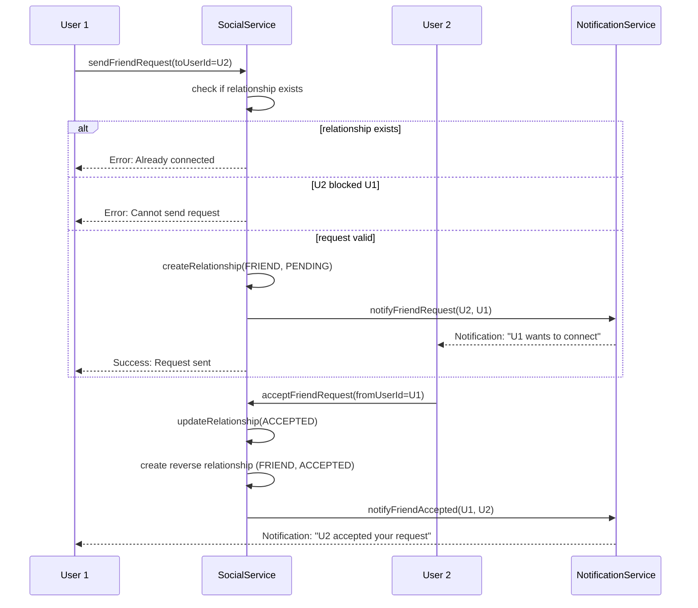
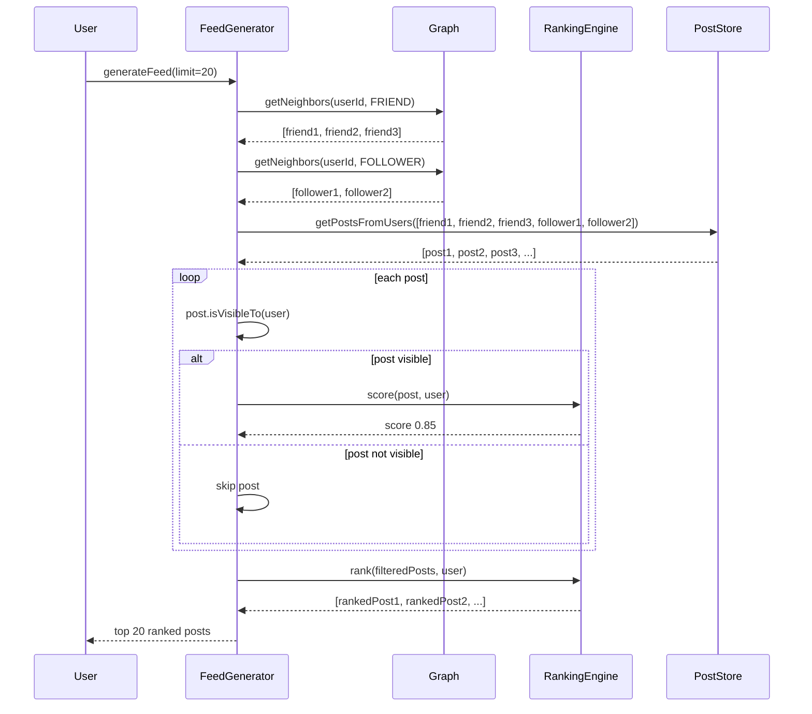
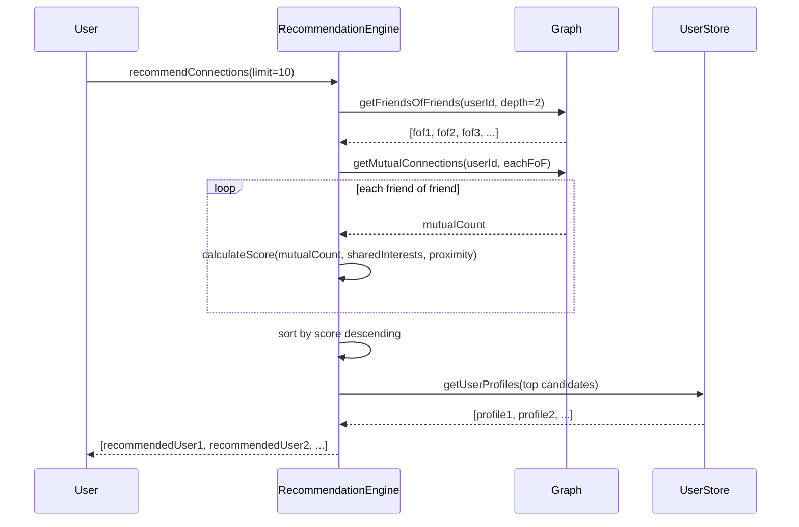
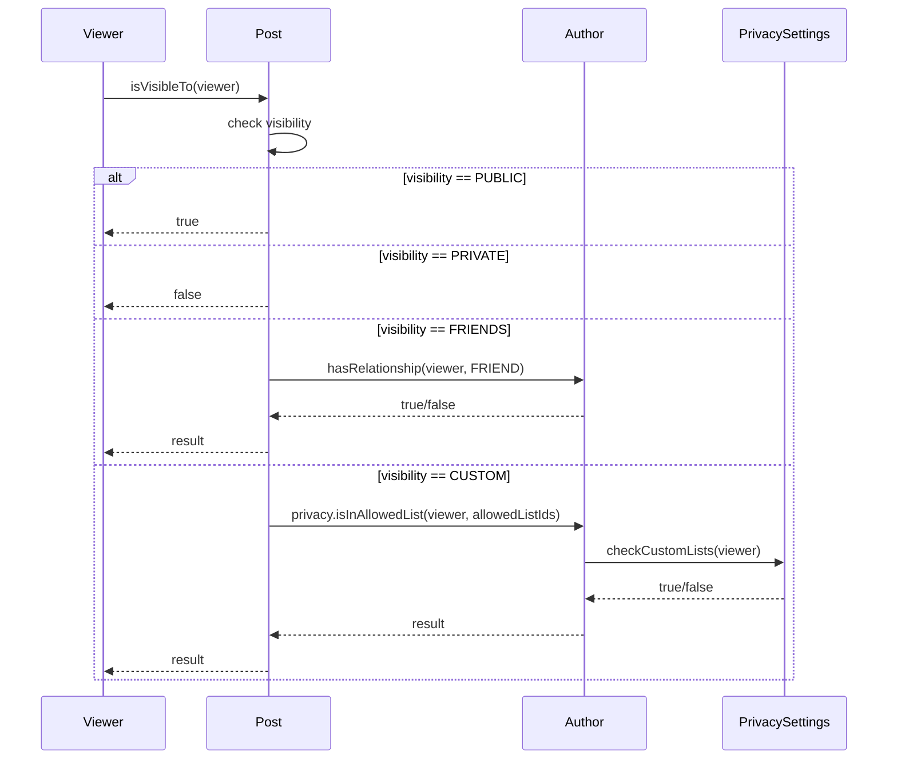

# Social Network

**Category:** Low-Level Design
**Difficulty:** 🔴 Hard
**Seniority:** Senior
**Companies:** LinkedIn, Facebook (Meta), Twitter (X), Instagram, Snapchat
**Tags:** patterns, graph, relationships, feed-generation, recommendations, privacy
**Time:** 60-90 min

---

## Problem Statement

Design a social network platform that supports user profiles, friendship connections, content posting, news feed generation, and relationship recommendations. The system must handle various relationship types (friends, followers, colleagues), privacy controls for content visibility, efficient graph traversal for feed generation and recommendations, and support for common social features like likes, comments, and shares.

The interviewer is looking for a sophisticated graph-based design that efficiently handles relationship queries, generates personalized feeds using graph traversal, implements privacy-aware content filtering, provides relationship recommendations using graph algorithms, and scales to millions of users with reasonable performance characteristics.

## Clarifying Questions

- Relationship model? *Directed graph with bidirectional friendships (Facebook-style) and unidirectional follows (Twitter-style).*
- Relationship types? *Friends (mutual), Followers (one-way), Colleagues (work-related), Family (close circle).*
- Privacy levels? *Public, Friends Only, Custom (specific lists), Private (self-only).*
- Feed generation strategy? *Rank-based: combine recent posts from connections with relevance scoring.*
- Content types? *Text, images, videos, links, polls.*
- Recommendation scope? *People you may know (graph-based), content recommendations (collaborative filtering).*
- Real-time requirements? *Feed generation can be async (eventual consistency), notifications should be near real-time.*
- Scale? *Design for the data model and algorithms; actual scaling to billions is a system design follow-up.*

## Requirements

### Functional

- User profiles: create, update, delete with privacy settings.
- Relationship management: send/accept/reject friend requests, follow/unfollow, block.
- Content posting: create posts with visibility settings, edit, delete.
- News feed: generate personalized feed based on relationships and relevance.
- Interactions: like, comment, share, save posts.
- Relationship recommendations: suggest connections based on graph analysis.
- Privacy controls: content visibility based on relationship type and custom lists.
- Activity history: view user's own posts and interactions.
- Search: find users by name, email, or mutual connections.
- Notifications: alert users for new connections, interactions, and mentions.

### Non-Functional

- Efficient graph traversal for feed generation (sub-second for typical feeds).
- Privacy enforcement: users never see content they shouldn't.
- Consistency: relationship changes reflect in feeds within reasonable time.
- Extensibility: support new relationship types and content types.
- Configurable privacy defaults per user.
- Audit logging for security-sensitive operations.

### Out of Scope

- Real-time messaging/chat (separate system).
- Media storage and CDN delivery.
- Content moderation and spam detection.
- Analytics and advertising.
- Multi-region deployment and replication.

## Core Entities

- **User** → profile data, privacy settings, relationship lists.
- **UserProfile** → name, bio, avatar, location, join date.
- **PrivacySettings** → default visibility, custom lists, blocked users.
- **Relationship** → type, status, timestamp, metadata.
- **RelationshipType** → FRIEND, FOLLOWER, COLLEAGUE, FAMILY, BLOCKED.
- **RelationshipStatus** → PENDING, ACCEPTED, REJECTED, BLOCKED.
- **Post** → content, author, timestamp, visibility, interaction counts.
- **Visibility** → PUBLIC, FRIENDS, CUSTOM, PRIVATE.
- **Comment** → post reference, author, content, timestamp, reply chain.
- **Like** → post/comment reference, user, timestamp.
- **Share** → post reference, sharer, timestamp, optional caption.
- **FeedGenerator** → generates personalized feeds using graph traversal.
- **RecommendationEngine** → suggests connections using graph algorithms.
- **Graph** → adjacency list representation of the social graph.
- **CustomList** → user-defined groups for granular privacy.
- **NotificationService** → sends alerts for social interactions.

## Class Diagram

```mermaid
classDiagram
    class User {
        -String id
        -UserProfile profile
        -PrivacySettings privacy
        -Set~Relationship~ relationships
        -Set~Post~ posts
        +updateProfile(UserProfile p) void
        +addRelationship(Relationship r) void
        +removeRelationship(String userId) void
        +canViewContent(User other, Post post) bool
        +getFeed(int limit) List~Post~
    }
    class UserProfile {
        -String firstName
        -String lastName
        -String bio
        -String avatarUrl
        -String location
        -LocalDate joinDate
    }
    class PrivacySettings {
        -Visibility defaultPostVisibility
        -Map~String, CustomList~ customLists
        -Set~String~ blockedUsers
        +setDefaultVisibility(Visibility v) void
        +addCustomList(String name, Set~String~ users) void
        +blockUser(String userId) void
        +unblockUser(String userId) void
    }
    class Relationship {
        -String fromUserId
        -String toUserId
        -RelationshipType type
        -RelationshipStatus status
        -Instant createdAt
        -Instant acceptedAt
        +accept() void
        +reject() void
        +block() void
    }
    class RelationshipType {
        <<enumeration>>
        FRIEND
        FOLLOWER
        COLLEAGUE
        FAMILY
        BLOCKED
    }
    class RelationshipStatus {
        <<enumeration>>
        PENDING
        ACCEPTED
        REJECTED
        BLOCKED
    }
    class Post {
        -String id
        -String authorId
        -String content
        -List~Media~ media
        -Visibility visibility
        -Set~String~ allowedListIds
        -Instant createdAt
        -Instant updatedAt
        -int likeCount
        -int commentCount
        -int shareCount
        +isVisibleTo(User user) bool
        +addLike(Like like) void
        +addComment(Comment c) void
    }
    class Media {
        -String type
        -String url
        -String altText
    }
    class Visibility {
        <<enumeration>>
        PUBLIC
        FRIENDS
        CUSTOM
        PRIVATE
    }
    class Comment {
        -String id
        -String postId
        -String authorId
        -String content
        -String parentCommentId
        -Instant createdAt
        +getReplies() List~Comment~
    }
    class Like {
        -String postId
        -String userId
        -Instant createdAt
    }
    class Share {
        -String originalPostId
        -String sharerId
        -String caption
        -Instant createdAt
    }
    class FeedGenerator {
        -Graph socialGraph
        -RankingEngine rankingEngine
        +generateFeed(User user, int limit) List~Post~
        +generateFeedForList(User user, String listId, int limit) List~Post~
    }
    class RankingEngine {
        +score(Post post, User user) double
        +rank(List~Post~ posts, User user) List~Post~
    }
    class RecommendationEngine {
        -Graph socialGraph
        +recommendConnections(User user, int limit) List~User~
        +recommendByMutualFriends(User user, int limit) List~User~
        +recommendByInterests(User user, int limit) List~User~
    }
    class Graph {
        -Map~String, Set~Edge~ adjacencyList
        +addEdge(String from, String to, RelationshipType type) void
        +removeEdge(String from, String to) void
        +getNeighbors(String userId, RelationshipType type) Set~String~
        +getMutualConnections(String user1, String user2) Set~String~
        +shortestPath(String from, String to) List~String~
        +getFriendsOfFriends(String userId, int depth) Set~String~
    }
    class Edge {
        -String toNodeId
        -RelationshipType type
        -double weight
    }
    class CustomList {
        -String id
        -String name
        -Set~String~ memberIds
        -Instant createdAt
        +addMember(String userId) void
        +removeMember(String userId) void
    }
    class NotificationService {
        +notifyFriendRequest(String toUserId, String fromUserId) void
        +notifyLike(String postAuthorId, String likerId, String postId) void
        +notifyComment(String postAuthorId, String commenterId, String postId) void
        +notifyMention(String userId, String mentionerId, String postId) void
    }

    User *-- UserProfile
    User *-- PrivacySettings
    User *-- Relationship
    User *-- Post
    Relationship --> RelationshipType
    Relationship --> RelationshipStatus
    Post *-- Media
    Post --> Visibility
    Post o-- Comment
    Post o-- Like
    Post o-- Share
    FeedGenerator --> Graph
    FeedGenerator --> RankingEngine
    RecommendationEngine --> Graph
    Graph *-- Edge
    PrivacySettings *-- CustomList
    User ..> FeedGenerator
    User ..> RecommendationEngine
    User ..> NotificationService
```



## Design Patterns

| Pattern | Where | Why |
|---|---|---|---|
| Graph | `Graph` with adjacency list | Natural representation of social relationships and efficient traversal. |
| Strategy | `RankingEngine` scoring algorithms | Pluggable ranking strategies (chronological, relevance, engagement). |
| Observer | `NotificationService` for events | Decouples notification logic from core social actions. |
| Factory | Post/Comment creation with validation | Centralizes object creation with consistent validation. |
| Decorator | Privacy checks on content access | Layer privacy logic without modifying core content objects. |
| Iterator | Graph traversal algorithms | Encapsulates traversal logic (BFS, DFS) for reuse. |
| Composite | Custom lists within privacy settings | Treat individual users and lists uniformly in privacy logic. |
| Proxy | Feed generation with caching | Cache expensive feed generation behind same interface. |

## Key Workflows

### Friend request flow



### Feed generation with privacy filtering



### Relationship recommendation



### Privacy-aware content access



## Implementation

```text
CLASS Graph
    FIELDS adjacencyList : ConcurrentMap~String, Set~Edge~

    FUNCTION addEdge(from, to, type)
        adjacencyList.computeIfAbsent(from, k → ConcurrentHashMap.newKeySet())
                    .add(NEW Edge(to, type, DEFAULT_WEIGHT))
        IF type == FRIEND THEN
            // Add reverse edge for mutual friendship
            adjacencyList.computeIfAbsent(to, k → ConcurrentHashMap.newKeySet())
                        .add(NEW Edge(from, type, DEFAULT_WEIGHT))

    FUNCTION removeEdge(from, to)
        SET edges ← adjacencyList.get(from)
        IF edges != NULL THEN
            edges.removeIf(e → e.toNodeId == to)
        IF edges.isEmpty() THEN
            adjacencyList.remove(from)

    FUNCTION getNeighbors(userId, type)
        SET edges ← adjacencyList.get(userId)
        IF edges == NULL THEN RETURN emptySet()
        RETURN edges.stream()
                    .filter(e → e.type == type OR type == ANY)
                    .map(e → e.toNodeId)
                    .collect(toSet())

    FUNCTION getMutualConnections(user1, user2)
        SET neighbors1 ← getNeighbors(user1, FRIEND)
        SET neighbors2 ← getNeighbors(user2, FRIEND)
        neighbors1.retainAll(neighbors2)
        RETURN neighbors1

    FUNCTION getFriendsOfFriends(userId, depth)
        SET visited ← ConcurrentHashMap.newKeySet()
        SET result ← ConcurrentHashMap.newKeySet()
        visited.add(userId)
        bfsFriendsOfFriends(userId, depth, visited, result)
        RETURN result

    FUNCTION bfsFriendsOfFriends(current, depth, visited, result)
        IF depth == 0 THEN RETURN
        FOR neighbor IN getNeighbors(current, FRIEND)
            IF NOT visited.contains(neighbor) THEN
                visited.add(neighbor)
                IF depth > 1 THEN
                    result.add(neighbor)
                bfsFriendsOfFriends(neighbor, depth - 1, visited, result)

CLASS User
    FIELDS id, profile, privacy, relationships, posts

    FUNCTION addRelationship(relationship)
        relationships.add(relationship)
        IF relationship.status == ACCEPTED THEN
            socialGraph.addEdge(relationship.fromUserId,
                                relationship.toUserId,
                                relationship.type)

    FUNCTION canViewContent(otherUser, post)
        IF post.authorId == id THEN RETURN true  // Own content
        IF post.visibility == PUBLIC THEN RETURN true
        IF post.visibility == PRIVATE THEN RETURN false
        IF privacy.blockedUsers.contains(otherUser.id) THEN RETURN false
        IF post.visibility == FRIENDS THEN
            RETURN hasRelationship(otherUser.id, FRIEND)
        IF post.visibility == CUSTOM THEN
            FOR listId IN post.allowedListIds
                IF privacy.customLists.get(listId).contains(otherUser.id) THEN
                    RETURN true
            RETURN false
        RETURN false

    FUNCTION hasRelationship(otherUserId, type)
        RETURN relationships.stream()
                .anyMatch(r → (r.toUserId == otherUserId OR r.fromUserId == otherUserId)
                           AND r.type == type
                           AND r.status == ACCEPTED)

CLASS Post
    FIELDS id, authorId, content, media, visibility, allowedListIds
    FIELDS createdAt, likeCount, commentCount, shareCount

    FUNCTION isVisibleTo(user)
        IF visibility == PUBLIC THEN RETURN true
        IF visibility == PRIVATE THEN RETURN authorId == user.id
        SET author ← userRepository.findById(authorId)
        RETURN author.canViewContent(user, this)

    FUNCTION addLike(like)
        likeCount ← likeCount + 1
        notificationService.notifyLike(authorId, like.userId, id)

    FUNCTION addComment(comment)
        commentCount ← commentCount + 1
        notificationService.notifyComment(authorId, comment.authorId, id)

CLASS FeedGenerator
    FIELDS socialGraph, rankingEngine, postCache

    FUNCTION generateFeed(user, limit)
        SET cacheKey ← "feed:" + user.id
        SET cached ← postCache.get(cacheKey)
        IF cached != NULL THEN RETURN cached

        SET connectionIds ← NEW HashSet()
        connectionIds.addAll(socialGraph.getNeighbors(user.id, FRIEND))
        connectionIds.addAll(socialGraph.getNeighbors(user.id, FOLLOWER))

        SET posts ← postRepository.findByAuthorIds(connectionIds)
        SET visiblePosts ← posts.stream()
                .filter(p → p.isVisibleTo(user))
                .collect(toList())

        SET rankedPosts ← rankingEngine.rank(visiblePosts, user)
        SET result ← rankedPosts.stream().limit(limit).collect(toList())

        postCache.put(cacheKey, result, TTL_5_MINUTES)
        RETURN result

CLASS RankingEngine
    FUNCTION score(post, user)
        SET score ← 0.0
        // Recency: more recent posts score higher
        SET hoursAgo ← (now() - post.createdAt) / 3600_000
        SET recencyScore ← 1.0 / (1.0 + hoursAgo / 24.0)  // Decay over days
        score ← score + recencyScore * 0.3

        // Engagement: likes, comments, shares
        SET engagementScore ← LOG(post.likeCount + 1) +
                              LOG(post.commentCount + 1) +
                              LOG(post.shareCount + 1)
        score ← score + MIN(engagementScore, 5.0) * 0.2

        // Relationship strength: friends > followers
        SET author ← userRepository.findById(post.authorId)
        IF user.hasRelationship(post.authorId, FRIEND) THEN
            score ← score + 0.3
        ELSE IF user.hasRelationship(post.authorId, FOLLOWER) THEN
            score ← score + 0.1

        // Content type preference (user-specific)
        SET typePreference ← user.preferences.getScore(post.type)
        score ← score + typePreference * 0.2

        RETURN score

    FUNCTION rank(posts, user)
        SET scored ← posts.stream()
                .map(p → NEW ScoredPost(p, score(p, user)))
                .sorted(DESCENDING_BY_SCORE)
                .map(sp → sp.post)
                .collect(toList())
        RETURN scored

CLASS RecommendationEngine
    FIELDS socialGraph, userInterestsGraph

    FUNCTION recommendConnections(user, limit)
        SET candidates ← NEW ArrayList()
        SET fofs ← socialGraph.getFriendsOfFriends(user.id, 2)

        FOR candidateId IN fofs
            IF NOT user.hasRelationship(candidateId, FRIEND) THEN
                SET mutuals ← socialGraph.getMutualConnections(user.id, candidateId)
                SET score ← calculateConnectionScore(user.id, candidateId, mutuals)
                candidates.add(NEW Candidate(candidateId, score))

        candidates.sort(DESCENDING_BY_SCORE)
        RETURN candidates.stream().limit(limit)
                         .map(c → userRepository.findById(c.userId))
                         .collect(toList())

    FUNCTION calculateConnectionScore(userId, candidateId, mutuals)
        SET score ← 0.0
        // Mutual friends count
        score ← score + mutuals.size() * 10.0

        // Shared interests
        SET sharedInterests ← userInterestsGraph.getSharedInterests(userId, candidateId)
        score ← score + sharedInterests.size() * 5.0

        // Geographic proximity
        SET user1 ← userRepository.findById(userId)
        SET user2 ← userRepository.findById(candidateId)
        IF user1.profile.location == user2.profile.location THEN
            score ← score + 3.0

        // Same workplace/education
        IF user1.profile.workplace == user2.profile.workplace THEN
            score ← score + 5.0

        RETURN score

CLASS PrivacySettings
    FIELDS defaultPostVisibility ← FRIENDS
    FIELDS customLists : Map~String, CustomList~
    FIELDS blockedUsers : Set~String~

    FUNCTION addCustomList(name, memberIds)
        SET list ← NEW CustomList(generateId(), name, memberIds)
        customLists.put(list.id, list)

    FUNCTION blockUser(userId)
        blockedUsers.add(userId)
        // Remove from any custom lists
        FOR list IN customLists.values()
            list.removeMember(userId)

    FUNCTION isInAllowedList(userId, listIds)
        FOR listId IN listIds
            SET list ← customLists.get(listId)
            IF list != NULL AND list.memberIds.contains(userId) THEN
                RETURN true
        RETURN false
```

## Concurrency & Extensibility

- **Graph operations:** Use concurrent maps for adjacency lists to allow parallel edge additions/removals. Read operations (getNeighbors) are lock-free.
- **Feed generation:** Cached with TTL to avoid expensive recomputation. Cache invalidation on new posts or relationship changes.
- **Privacy checks:** Fast path for public/private content. Friend/custom checks use relationship lookups which are O(1) with hash sets.
- **Notification service:** Asynchronous with a message queue to avoid blocking social operations.
- **Recommendation engine:** Pre-compute and cache recommendations, refresh periodically (e.g., daily) rather than on-demand.
- **Extensibility:** New relationship types extend the enum with corresponding graph edges. New content types add fields to Post/Media. New ranking strategies implement the RankingEngine interface.
- **Graph algorithms:** BFS/DFS implemented iteratively with explicit stacks to avoid stack overflow on deep traversals. Can be parallelized for large graphs.

## Trade-offs

| Decision | Option A | Option B | Choice & Why |
|---|---|---|---|
| Graph storage | Adjacency list (map of sets) | Adjacency matrix | Adjacency list — sparse graph, memory efficient, O(1) neighbor lookup. |
| Feed generation | Pull-based (generate on request) | Push-based (pre-compute) | Pull with caching — simpler, eventual consistency acceptable for social feeds. |
| Privacy model | Role-based (friend/follower) | Attribute-based (custom lists) | Hybrid — roles for common cases, custom lists for granular control. |
| Relationship storage | Separate relationship table | Embedded in user document | Separate table — enables efficient graph queries and indexing. |
| Notification delivery | Synchronous | Asynchronous with queue | Asynchronous — decouples notification logic, better reliability. |
| Recommendation timing | On-demand | Pre-computed batch | Pre-computed with cache — expensive graph operations, acceptable staleness. |
| Feed ranking | Chronological | Relevance-based | Relevance-based with recency bias — better user engagement. |

## Follow-up Questions

1. **How would you handle feed generation at scale (millions of users)?** Implement fan-out-on-write: pre-compute feeds for each user when connections post, store in Redis, and merge with real-time updates. Use sharding by user ID.
2. **How do you implement content moderation?** Add a `ModerationService` with ML models for spam/inappropriate content detection, flag posts for review, and automatically hide or remove violating content.
3. **How would you add real-time messaging?** Separate WebSocket-based service with message queues, presence tracking, and conversation state. Integrate with social graph for friend discovery.
4. **How do you handle graph partitioning for distributed systems?** Use vertex-cut or edge-cut partitioning strategies, replicate frequently accessed vertices, and implement cross-partition queries with aggregation.
5. **How would you implement story/disappearing content?** Add `Story` entity with expiration time, background cleanup job, and separate feed generation for ephemeral content.
6. **How do you prevent spam and fake accounts?** Implement rate limiting, CAPTCHA on signup, email verification, device fingerprinting, and graph-based detection of anomalous connection patterns.

## Common Mistakes

- Using adjacency matrix for sparse social graphs (wastes memory).
- Generating feeds by querying all posts and filtering (inefficient).
- Not considering privacy in feed generation (leaking private content).
- Implementing synchronous notifications (blocks social operations).
- Not caching expensive operations (feed generation, recommendations).
- Using recursive graph traversal (stack overflow on large graphs).
- Forgetting to handle blocked users in all visibility checks.
- Not indexing relationship tables for efficient graph queries.
- Mixing relationship types incorrectly (e.g., treating followers as friends).
- Ignoring eventual consistency in distributed scenarios.

## Key Takeaways

- Social networks are naturally modeled as graphs; use adjacency lists for efficient traversal.
- Feed generation combines graph traversal (get connections) with ranking (relevance scoring).
- Privacy is a cross-cutting concern: check visibility at every content access point.
- Relationship recommendations use graph algorithms (friends-of-friends, mutual connections).
- Cache expensive operations (feeds, recommendations) with appropriate TTLs.
- Asynchronous notifications prevent blocking core social operations.
- Hybrid privacy model (roles + custom lists) balances simplicity and flexibility.
- Graph algorithms (BFS, DFS) should be implemented iteratively to avoid stack overflow.
- Pre-computation and eventual consistency are acceptable for social features.
- Extensibility comes from interfaces (ranking strategies) and enums (relationship types).
