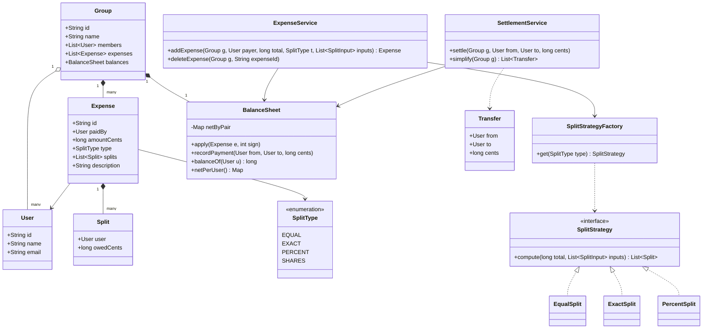
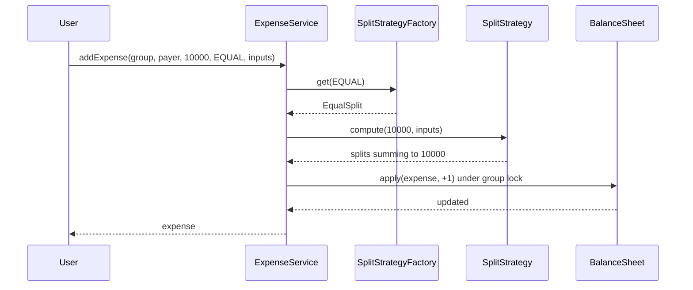
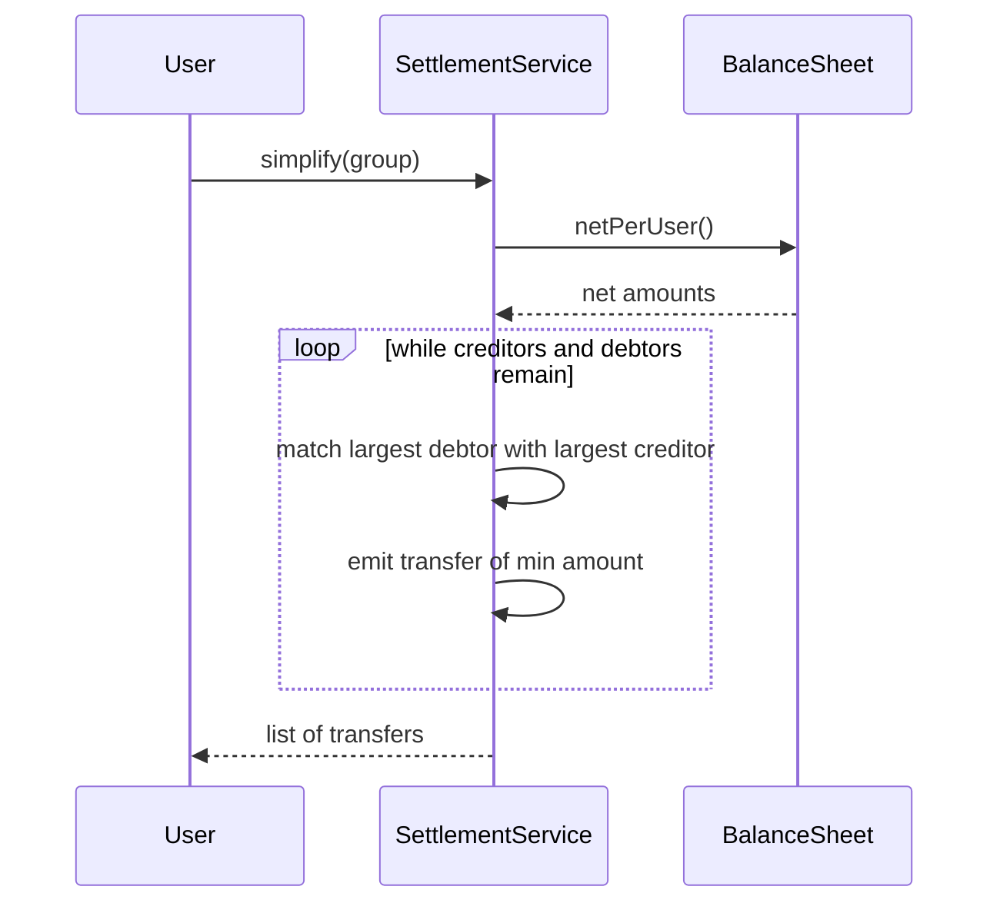

# Splitwise

**Category:** Low-Level Design
**Difficulty:** 🟡 Medium
**Seniority:** mid
**Companies:** Amazon, Flipkart, Uber, Google, Microsoft, Atlassian
**Tags:** oop, strategy-pattern, graph, greedy, ledger, money-handling
**Time:** 45 min

---

## Problem Statement

Design an expense-sharing application like Splitwise. Users add expenses paid by one person and split among several participants — equally, by exact amounts, or by percentages. The system maintains who owes whom, shows per-user balances, supports groups, and lets users settle up.

The interviewer expects a clean object model, a pluggable split mechanism with validation, a correct balance ledger, and ideally a "simplify debts" algorithm that minimizes the number of transactions within a group.

## Clarifying Questions

- What split types are needed? *EQUAL, EXACT and PERCENT; SHARES is a nice-to-have.*
- Can an expense have multiple payers? *Assume a single payer for the core design; discuss multi-payer as follow-up.*
- Do we need groups? *Yes; expenses can belong to a group or be between friends directly.*
- Which currencies? *Single currency; amounts stored in minor units (cents).*
- How do we handle rounding with equal splits? *Distribute the leftover cents deterministically (e.g. to the first participants).*
- Is debt simplification required? *Yes, as an option per group.*
- Can expenses be edited or deleted? *Yes; balances must be updated consistently.*

## Requirements

### Functional

- Create users and groups; add members to groups.
- Add an expense: payer, total amount, participants, split type and split details.
- Validate splits (exact amounts sum to total, percentages sum to 100).
- Show balances: what a user owes / is owed, overall and per group.
- Settle up: record a payment from one user to another.
- Simplify debts in a group to the minimum practical number of transfers.
- Edit/delete an expense, reversing its effects.

### Non-Functional

- Money is exact — no floating point; use integer cents.
- Balances must always sum to zero across a group.
- Concurrent expense additions must not corrupt balances.
- Easily extensible to new split types.

### Out of Scope

- Real payment integration, multi-currency FX, receipts/OCR.

## Core Entities

- **User** → id, name, email.
- **Group** → members, list of expenses, its own balance sheet.
- **Expense** → payer, amount, list of splits, split type, description, timestamp.
- **Split** → (user, amount owed); subclasses carry input data (percent, exact value, shares).
- **SplitStrategy** → validates input and computes each participant's owed amount.
- **BalanceSheet** → net balances `Map<(debtor, creditor), amount>` or per-user net.
- **ExpenseService** → creates expenses, updates balance sheets, handles edits.
- **SettlementService** → records payments and computes simplified debts.

## Class Diagram



## Design Patterns

| Pattern | Where | Why |
|---|---|---|
| Strategy | `SplitStrategy` implementations | Each split type has its own validation and computation; add SHARES without changing services. |
| Factory | `SplitStrategyFactory` | Map a `SplitType` to the right strategy at runtime. |
| Observer | Expense events → notification / activity feed | Decouple notifying participants from ledger updates. |
| Command (optional) | Expense add/delete as reversible operations | `apply(e, +1)` / `apply(e, -1)` gives clean undo/edit. |

## Key Workflows

### Add an expense



### Simplify debts



## Implementation

```text
CLASS EqualSplit IMPLEMENTS SplitStrategy
    FUNCTION compute(total, inputs)
        SET n ← size(inputs)
        SET base ← total DIV n
        SET remainder ← total MOD n
        SET result ← []
        FOR i FROM 0 TO n-1
            SET extra ← 1 IF i < remainder ELSE 0       // spread leftover cents
            APPEND Split(inputs[i].user, base + extra) TO result
        RETURN result

CLASS ExactSplit IMPLEMENTS SplitStrategy
    FUNCTION compute(total, inputs)
        IF sum(inputs.value) != total THEN THROW InvalidSplitError
        RETURN [Split(in.user, in.value) FOR in IN inputs]

CLASS PercentSplit IMPLEMENTS SplitStrategy
    FUNCTION compute(total, inputs)            // percents in basis points
        IF sum(inputs.value) != 10000 THEN THROW InvalidSplitError
        SET result ← [Split(in.user, total * in.value DIV 10000) FOR in IN inputs]
        SET diff ← total - sum(result.owedCents)
        SET result[0].owedCents ← result[0].owedCents + diff   // fix rounding
        RETURN result

CLASS BalanceSheet
    FIELDS net : Map<userId, long>       // +ve = is owed, -ve = owes
           pair : Map<(debtorId, creditorId), long>

    FUNCTION apply(expense, sign)        // sign = +1 add, -1 reverse
        FOR s IN expense.splits
            IF s.user == expense.paidBy THEN CONTINUE
            SET amt ← sign * s.owedCents
            addPair(s.user, expense.paidBy, amt)
            SET net[expense.paidBy] ← net[expense.paidBy] + amt
            SET net[s.user] ← net[s.user] - amt

    FUNCTION addPair(debtor, creditor, amt)
        // keep only one direction per pair
        SET reverse ← pair[(creditor, debtor)]
        IF reverse > 0 THEN
            SET offset ← min(reverse, amt)
            SET pair[(creditor, debtor)] ← reverse - offset
            SET amt ← amt - offset
        SET pair[(debtor, creditor)] ← pair[(debtor, creditor)] + amt

    FUNCTION recordPayment(from, to, cents)
        addPair(to, from, cents)         // payment offsets debt
        SET net[from] ← net[from] + cents
        SET net[to] ← net[to] - cents

CLASS ExpenseService
    FUNCTION addExpense(group, payer, total, type, inputs)
        IF total <= 0 THEN THROW InvalidAmountError
        IF any participant NOT IN group.members THEN THROW NotMemberError
        SET splits ← factory.get(type).compute(total, inputs)
        SET e ← NEW Expense(newId(), payer, total, type, splits)
        WITH group.lock
            APPEND e TO group.expenses
            group.balances.apply(e, +1)
        publish(ExpenseAdded(e))
        RETURN e

    FUNCTION editExpense(group, expenseId, newData)
        WITH group.lock
            SET old ← group.find(expenseId)
            group.balances.apply(old, -1)
            SET updated ← build(newData)
            group.balances.apply(updated, +1)
            replace old WITH updated

CLASS SettlementService
    FUNCTION simplify(group)
        SET net ← group.balances.netPerUser()
        SET creditors ← MaxHeap of (amount, user) WHERE amount > 0
        SET debtors ← MaxHeap of (-amount, user) WHERE amount < 0
        SET transfers ← []
        WHILE creditors NOT EMPTY AND debtors NOT EMPTY
            SET (c, cu) ← creditors.pop()
            SET (d, du) ← debtors.pop()
            SET x ← min(c, d)
            APPEND Transfer(du, cu, x) TO transfers
            IF c - x > 0 THEN creditors.push((c - x, cu))
            IF d - x > 0 THEN debtors.push((d - x, du))
        RETURN transfers                 // at most n-1 transfers
```

## Concurrency & Extensibility

- **Per-group lock:** all mutations of a group's balance sheet (add/edit/delete/settle) are serialized with a lock per group; different groups proceed in parallel.
- **Persistence:** in a DB, store the immutable expense ledger as the source of truth and derive balances; update a `balances` table in the same transaction as the expense insert to keep invariants (sum of nets = 0).
- **Idempotency:** client-generated expense IDs prevent double-adds on retries.
- **Invariants:** assert `sum(net) == 0` after each operation in tests.
- **Open/Closed:** new split types (SHARES, ADJUSTMENT) implement `SplitStrategy` and register in the factory; multi-payer support is a change from `paidBy` to a list of `Payment` contributions, with `apply()` netting contributions against owed amounts.

## Trade-offs

| Decision | Option A | Option B | Choice & Why |
|---|---|---|---|
| Money type | double | integer minor units | Integer cents — floats cause rounding drift and non-zero sums. |
| Balance storage | Recompute from all expenses | Incrementally maintained ledger | Incremental with ledger as source of truth — fast reads, rebuildable. |
| Balance shape | Pairwise debts | Net per user | Keep both: pairwise for "you owe Bob", net for simplification. |
| Simplification | Exact minimum (NP-hard) | Greedy max-debtor/max-creditor | Greedy — at most n-1 transfers, O(n log n), good enough in practice. |
| Split validation | In service with if/else | Inside each strategy | In strategy — cohesive, testable per type. |

## Follow-up Questions

1. **Why is the minimum number of transactions hard?** It reduces to partitioning users into the maximum number of zero-sum subsets, which is NP-hard; greedy guarantees at most n-1 transfers.
2. **How would you support multiple currencies?** Store each expense in its original currency and keep balances per currency; convert only for display or on explicit settlement.
3. **How do you handle an expense edit after debts were simplified?** Simplification is a view, not stored state; recompute from net balances after the edit.
4. **How would you scale to millions of users?** Shard by group ID; friend-to-friend expenses use a synthetic two-person group so all writes stay within one shard.
5. **How do you show an activity feed?** Publish expense/settlement events to a queue (Kafka) and fan out to per-user feeds.

## Common Mistakes

- Using floating point for money and ending up with balances that do not sum to zero.
- Not handling leftover cents in equal or percent splits.
- Forgetting the payer may also be a participant (owes themselves nothing).
- Putting split logic in a big switch in `ExpenseService` instead of strategies.
- Editing an expense without reversing its old effect first.

## Key Takeaways

- Model the split type as a Strategy with built-in validation.
- Keep money in integer minor units and fix rounding deterministically.
- Maintain a ledger whose invariant is that net balances sum to zero.
- Debt simplification uses net balances plus a greedy heap match, giving at most n-1 transfers.
