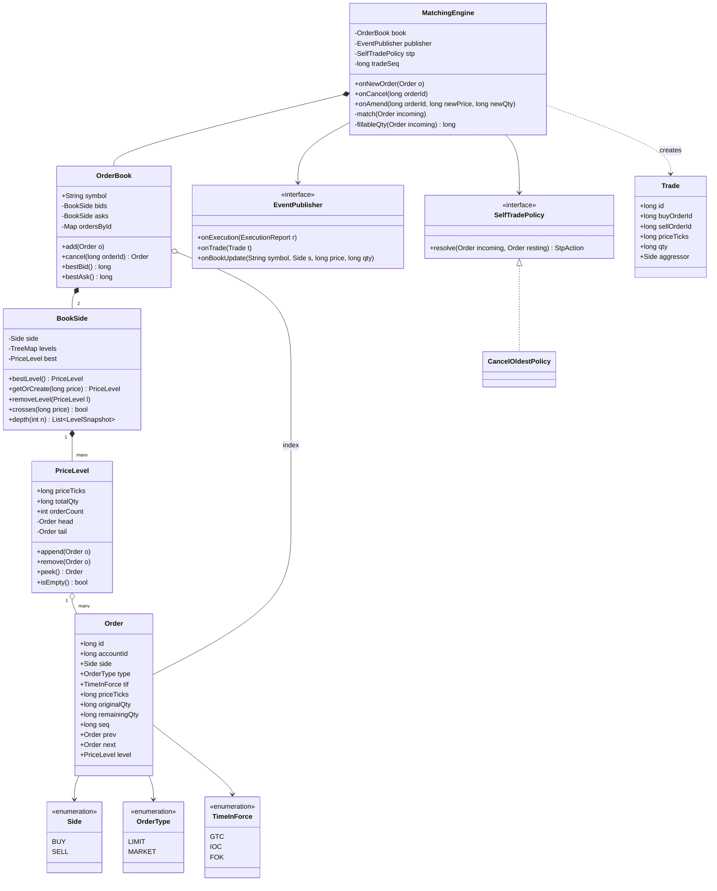
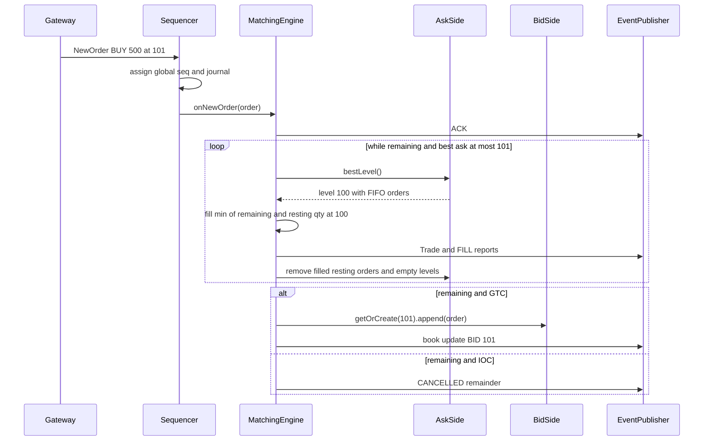
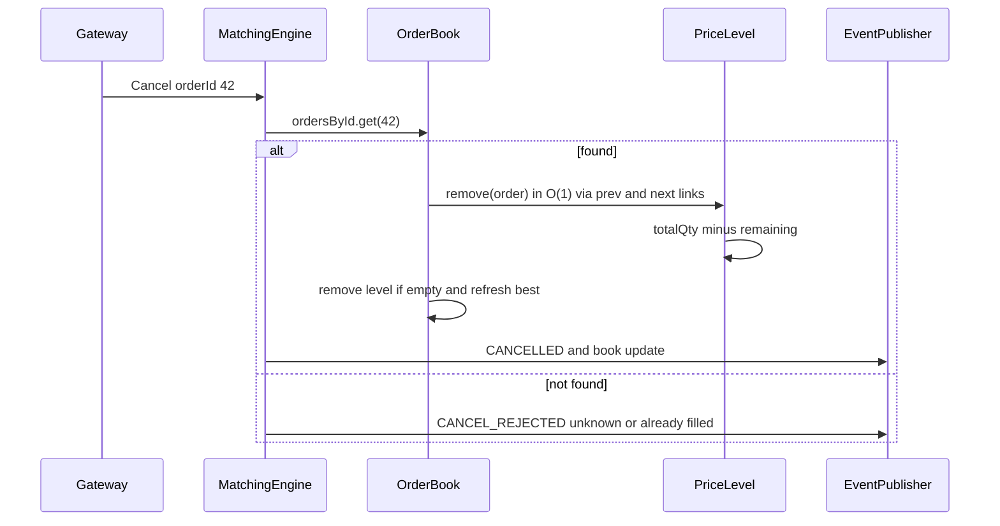

# Stock Exchange Order Book

**Category:** Low-Level Design
**Difficulty:** 🔴 Hard
**Seniority:** staff
**Companies:** Jane Street, Citadel, Two Sigma, Goldman Sachs, Bloomberg, Coinbase, Robinhood
**Tags:** oop, matching-engine, price-time-priority, data-structures, low-latency, event-sourcing
**Time:** 60 min

---

## Problem Statement

Design the order book and matching engine for a single exchange venue. Traders submit limit and market orders (and cancels/amends) for instruments; the engine matches buy and sell orders using price-time priority, produces trades (executions), maintains the resting book, and publishes market data (top of book and depth).

At staff level the interviewer expects precise data structures with complexity guarantees (O(1) cancel, O(log P) or O(1) best price), correct matching semantics (partial fills, IOC/FOK, self-trade prevention), a deterministic single-threaded engine per instrument, and a discussion of how determinism enables event-sourced recovery, replication and low latency.

## Clarifying Questions

- Order types? *LIMIT and MARKET; time-in-force GTC, IOC, FOK; stop orders as a follow-up.*
- Matching rule? *Price-time priority (FIFO within a price level); pro-rata is a follow-up.*
- Instruments and volume? *~10K symbols; hot symbols see 100K+ messages/s; latency target p99 < 50 µs inside the engine.*
- Prices? *Integer ticks (no floating point); each instrument has a tick size and lot size.*
- Amend semantics? *Reducing quantity keeps priority; price change or quantity increase loses priority (cancel/replace).*
- Self-trade prevention? *Yes, cancel the resting order (cancel-oldest) when the same account would trade with itself.*
- Market data? *L1 (best bid/ask) and L2 (aggregated depth by price) updates after each event.*
- Recovery? *Must rebuild exact state after a crash.*

## Requirements

### Functional

- Submit LIMIT/MARKET orders with side, quantity, price (limit), TIF, account.
- Match incoming orders against the opposite side at the best prices, FIFO within a level; trades execute at the resting order's price.
- Support partial fills; the remainder of a GTC limit order rests in the book.
- IOC: fill what is possible, cancel the rest. FOK: fill entirely or cancel without trading.
- Cancel and amend by order ID.
- Emit execution reports (ACK, FILL, PARTIAL_FILL, CANCELLED, REJECTED) and market data.
- Query best bid/ask, depth snapshot.

### Non-Functional

- Deterministic: same input sequence produces the same outputs.
- O(1) cancel, O(1) best-price access, O(log P) new price level insertion (P = number of levels).
- Microsecond latency, no GC/allocation on the hot path where possible.
- Exact recovery via replay of a sequenced input log.

### Out of Scope

- Risk checks/margin (pre-trade gateway), clearing and settlement, auctions (opening/closing cross), FIX protocol parsing.

## Core Entities

- **Order** → id, account, instrument, side, type, TIF, price (ticks), original/remaining qty, timestamp/sequence; intrusive prev/next pointers in its level.
- **PriceLevel** → price, FIFO doubly linked list of orders, total quantity.
- **BookSide** → sorted map of price to PriceLevel (bids descending, asks ascending) with cached best level.
- **OrderBook** → one instrument: bid side, ask side, order index `Map<orderId, Order>`.
- **MatchingEngine** → applies commands to the book, runs matching, emits events; one per instrument shard.
- **Trade** → trade id, buy/sell order ids, price, qty, aggressor side.
- **Command** → NewOrder, Cancel, Amend, sequenced by the sequencer.
- **EventPublisher** → execution reports and market data (L1/L2) to downstream consumers.
- **SelfTradePolicy / MatchingPolicy** → pluggable rules (cancel-oldest, price-time vs pro-rata).

## Class Diagram



## Design Patterns

| Pattern | Where | Why |
|---|---|---|
| Command | `NewOrder`, `Cancel`, `Amend` input messages | Sequenced, serializable inputs enable journaling and deterministic replay. |
| Event Sourcing | Input journal + snapshots | State = fold over commands; exact recovery and hot-standby replication. |
| Strategy | `SelfTradePolicy`, matching algorithm (FIFO vs pro-rata) | Venue/instrument-specific rules without touching the core loop. |
| Observer | `EventPublisher` for executions and market data | Decouple downstream (drop copy, market data, risk) from matching. |
| Object Pool / Flyweight | Preallocated `Order` and `PriceLevel` objects | Avoid allocation and GC pauses on the hot path. |
| Single Writer | One engine thread per instrument shard | No locks in matching; determinism and cache locality. |

## Key Workflows

### Aggressive limit buy that partially fills then rests



### Cancel



## Implementation

```text
CLASS PriceLevel                              // intrusive FIFO list
    FUNCTION append(o)
        SET o.prev ← tail; SET o.next ← NULL; SET o.level ← this
        IF tail IS NOT NULL THEN SET tail.next ← o ELSE SET head ← o
        SET tail ← o
        SET totalQty ← totalQty + o.remainingQty
        SET orderCount ← orderCount + 1

    FUNCTION remove(o)                         // O(1)
        IF o.prev IS NOT NULL THEN SET o.prev.next ← o.next ELSE SET head ← o.next
        IF o.next IS NOT NULL THEN SET o.next.prev ← o.prev ELSE SET tail ← o.prev
        SET totalQty ← totalQty - o.remainingQty
        SET orderCount ← orderCount - 1
        SET o.prev ← NULL; SET o.next ← NULL; SET o.level ← NULL

CLASS BookSide
    FIELDS side, levels : TreeMap<price, PriceLevel>   // or array indexed by tick offset
           best : PriceLevel (cached)

    FUNCTION better(a, b)                      // is price a better than b for this side
        RETURN a > b IF side == BUY ELSE a < b

    FUNCTION crosses(incomingPrice)            // called on the opposite side
        IF best IS NULL THEN RETURN false
        RETURN best.priceTicks <= incomingPrice IF side == SELL
               ELSE best.priceTicks >= incomingPrice

    FUNCTION getOrCreate(price)
        SET lvl ← levels.get(price)
        IF lvl IS NULL THEN
            SET lvl ← pool.acquireLevel(price)
            levels.put(price, lvl)              // O(log P)
            IF best IS NULL OR better(price, best.priceTicks) THEN SET best ← lvl
        RETURN lvl

    FUNCTION removeLevel(lvl)
        levels.remove(lvl.priceTicks)
        IF best == lvl THEN
            SET best ← levels.firstEntry() IF side == SELL ELSE levels.lastEntry()
        pool.release(lvl)

CLASS MatchingEngine                           // single-threaded per instrument
    FUNCTION onNewOrder(o)
        IF NOT validate(o) THEN publish REJECTED; RETURN        // tick/lot size, qty > 0
        IF o.type == MARKET THEN SET o.priceTicks ← +INF IF o.side == BUY ELSE -INF
        publish ACK(o)
        IF o.tif == FOK AND fillableQty(o) < o.remainingQty THEN
            publish CANCELLED(o, reason="FOK not fillable"); RETURN
        match(o)
        IF o.remainingQty > 0 THEN
            IF o.type == LIMIT AND o.tif == GTC THEN
                book.sideOf(o.side).getOrCreate(o.priceTicks).append(o)
                SET book.ordersById[o.id] ← o
                publishLevel(o.side, o.priceTicks)
            ELSE
                publish CANCELLED(o, remaining=o.remainingQty)   // IOC / market leftover

    FUNCTION match(incoming)
        SET opp ← book.oppositeOf(incoming.side)
        WHILE incoming.remainingQty > 0 AND opp.crosses(incoming.priceTicks)
            SET lvl ← opp.best
            WHILE incoming.remainingQty > 0 AND NOT lvl.isEmpty()
                SET resting ← lvl.peek()
                IF resting.accountId == incoming.accountId THEN
                    IF stp.resolve(incoming, resting) == CANCEL_RESTING THEN
                        lvl.remove(resting); REMOVE book.ordersById[resting.id]
                        publish CANCELLED(resting, reason="self-trade")
                        CONTINUE
                    ELSE
                        SET incoming.remainingQty ← 0           // cancel incoming
                        publish CANCELLED(incoming, reason="self-trade"); RETURN
                SET q ← min(incoming.remainingQty, resting.remainingQty)
                SET px ← resting.priceTicks                     // trade at resting price
                SET incoming.remainingQty ← incoming.remainingQty - q
                SET resting.remainingQty ← resting.remainingQty - q
                SET lvl.totalQty ← lvl.totalQty - q
                SET tradeSeq ← tradeSeq + 1
                publish Trade(tradeSeq, buyId, sellId, px, q, aggressor=incoming.side)
                publish FILL or PARTIAL_FILL for both orders
                IF resting.remainingQty == 0 THEN
                    lvl.remove(resting); REMOVE book.ordersById[resting.id]
                    pool.release(resting)
            publishLevel(opp.side, lvl.priceTicks)
            IF lvl.isEmpty() THEN opp.removeLevel(lvl)

    FUNCTION fillableQty(o)                    // FOK pre-check, stops early
        SET need ← o.remainingQty; SET got ← 0
        FOR lvl IN opposite levels from best WHILE lvl crosses o.priceTicks
            SET got ← got + lvl.totalQty         // excluding own-account orders if STP applies
            IF got >= need THEN RETURN got
        RETURN got

    FUNCTION onCancel(orderId)
        SET o ← book.ordersById.remove(orderId)
        IF o IS NULL THEN publish CANCEL_REJECTED; RETURN
        SET lvl ← o.level
        lvl.remove(o)
        IF lvl.isEmpty() THEN book.sideOf(o.side).removeLevel(lvl)
        publish CANCELLED(o); publishLevel(o.side, o.priceTicks)

    FUNCTION onAmend(orderId, newPrice, newQty)
        SET o ← book.ordersById[orderId]
        IF o IS NULL THEN publish AMEND_REJECTED; RETURN
        SET filled ← o.originalQty - o.remainingQty
        IF newQty <= filled THEN onCancel(orderId); RETURN
        IF newPrice == o.priceTicks AND newQty < o.originalQty THEN
            SET delta ← o.originalQty - newQty                  // reduce in place, keep priority
            SET o.remainingQty ← o.remainingQty - delta
            SET o.originalQty ← newQty
            SET o.level.totalQty ← o.level.totalQty - delta
            publish AMENDED(o)
        ELSE
            onCancel(orderId)                                   // loses time priority
            onNewOrder(copyOf(o, price=newPrice, qty=newQty - filled))
```

## Concurrency & Extensibility

- **Single-writer per instrument:** each order book is owned by exactly one engine thread (shard symbols across cores). Matching needs no locks; determinism follows from processing a totally ordered input sequence. This is the LMAX architecture.
- **Sequencer + journal:** gateways send commands to a sequencer that assigns monotonic sequence numbers and journals them (and replicates to a hot standby) before the engine processes them. Recovery = load latest snapshot + replay journal from its sequence; the standby replays the same stream and can take over.
- **Inter-thread hand-off:** lock-free single-producer/single-consumer ring buffers (Disruptor) between gateway, sequencer, engine and publishers; busy-spin waiting and CPU pinning for microsecond latency.
- **Memory:** preallocated pools for orders and levels, primitive long-keyed maps (no boxing), and for instruments with bounded price ranges an array of levels indexed by `(price - minPrice) / tick` for O(1) level access, with a best-price pointer that scans to the next non-empty level.
- **Market data:** publish incremental L2 deltas with sequence numbers; consumers detect gaps and request snapshots.
- **Open/Closed:** new TIFs/order types (stop, iceberg with hidden quantity replenished at the level tail, post-only) are added as pre-/post-match hooks; pro-rata matching is a different `MatchingPolicy` for the level loop; STP modes are strategies.

## Trade-offs

| Decision | Option A | Option B | Choice & Why |
|---|---|---|---|
| Engine threading | Multi-threaded with locks per book | Single thread per instrument | Single writer — no lock contention, deterministic, better cache behavior; scale by sharding symbols. |
| Price level index | Balanced tree (O(log P)) | Array by tick offset (O(1)) | Tree for wide/unknown ranges; array for liquid instruments with bounded ranges. |
| Orders within level | ArrayDeque | Intrusive doubly linked list | Intrusive list — O(1) cancel from the middle without searching. |
| Price representation | double | long ticks | Long ticks — exact comparisons and arithmetic. |
| Durability | Write state to DB per event | Journal inputs + snapshots | Journal inputs — sequential append is fast; deterministic replay rebuilds state. |
| Amend | Always cancel/replace | In-place quantity reduction | In-place reduce keeps priority (industry norm); price/qty increase loses priority. |

## Follow-up Questions

1. **How would you implement stop orders?** Keep stop orders in separate price-sorted structures keyed by trigger price; after each trade, check last price and inject triggered orders as new market/limit commands in deterministic order.
2. **How do you implement iceberg orders?** Show only a display quantity at the level; when it is filled, replenish from hidden quantity and move the order to the tail of the level (losing priority for the new slice).
3. **How do you scale to thousands of symbols?** Partition symbols across engine threads/hosts by symbol hash or by load; each partition has its own sequencer stream; no cross-symbol state is needed for matching.
4. **How do you handle failover without losing or duplicating trades?** Replicate the sequenced input journal to the standby synchronously before acknowledging; the standby replays deterministically and resumes from the last sequence; outputs carry sequence numbers so downstream dedupes.
5. **How would you add an opening auction?** Collect orders without matching, then compute the single clearing price that maximizes executed volume (tie-break by minimum imbalance and reference price), execute at that price, and switch to continuous matching.

## Common Mistakes

- Executing at the incoming order's price instead of the resting order's price.
- Using floating-point prices and getting inconsistent comparisons.
- Cancel implemented as a linear scan through a level or the whole book.
- Letting FOK partially fill, or IOC rest in the book.
- Using locks around a shared book from multiple threads, destroying determinism and latency.
- Forgetting to remove empty price levels and update the cached best price.

## Key Takeaways

- Book = two sorted sides of price levels, each level a FIFO intrusive list, plus an order-id index for O(1) cancel.
- Matching loop: while the incoming order crosses the best opposite level, fill FIFO at the resting price; then rest, cancel or reject per TIF.
- A single-threaded engine per instrument fed by a sequenced journal gives determinism, replay recovery and hot standby.
- Low latency comes from no locks, no allocation, integer prices and cache-friendly structures.
